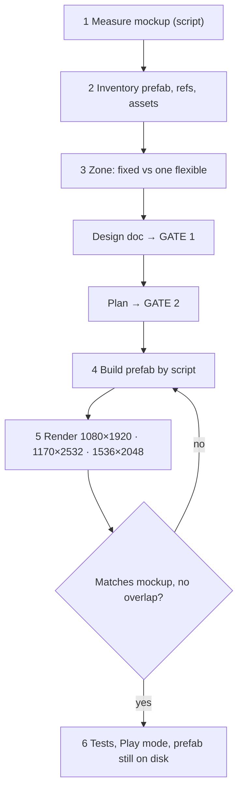

# Unity Responsive UI (BlockDrag)

Build uGUI screens that match a mockup at the reference size and stay correct on every aspect ratio. Measure the mockup, split the screen into fixed and flexible zones, build the prefab by script, and prove it with renders.

**This skill works inside the project gates** (`.agents/rules/task_planning.md`): its measurements and zoning go into the design doc (Gate 1), its build and verification steps go into the plan (Gate 2). It never replaces them.

Worked example: `Assets/_Game/Resources/UI/HomeCanvas.prefab`, design `Docs/designs/2026-11-01-home-canvas-mockup-layout-design.md`. Ready-to-run scripts: [render-snippets.md](render-snippets.md).

## Project facts

| Fact | Value |
|---|---|
| Canvas scaler | `UIManager.prefab`: Scale With Screen Size, **1080×1920**, match **0.5** |
| Mockups | `Assets/_Game/_BlockDrag/Resource/ComboBlock_UI_assets/UI Preview/*.png`, 360×640 → **mockup px × 3 = canvas units** |
| UI sprites | `ComboBlock_UI_assets/{buttons,icons,tiles}` — check here before generating anything |
| Styled text | `Fredoka-Bold Title SDF` + `Fredoka-Bold Title Material` (face color from vertex color) |
| Safe area | `Quang.UI.SafeAreaFitter` (package `com.quang.ui` ≥ 0.9.0, `Runtime/Core`) drives anchors from `Screen.safeArea` — available in every project using Quang UI |
| Canvases | `Assets/_Game/Resources/UI/*.prefab`, loaded by `UIManager`; keep `UISCanvas` refs + `UIScaleAnim` |

Canvas size each device actually gets (match 0.5):

| Screen | Canvas | Consequence |
|---|---|---|
| 1080×1920 (16:9) | 1080 × 1920 | = mockup ×3 |
| 1170×2532 (tall phone) | ~979 × 2118 | narrower **and** taller |
| 1536×2048 (iPad 3:4) | ~1247 × 1663 | **shorter** — vertical space is the constraint |

## Workflow



1. **Measure, don't eyeball.** Load the mockup PNG in `execute_code`, sample colors and per-row content extents (snippet 1). Write every element as mockup px → canvas units (×3) in the design.
2. **Inventory.** Dump the prefab hierarchy with components, TMP settings and margins (snippet 2). List which `[SerializeField]` refs the canvas script uses — they must survive the rebuild. List the sprites you need and which are missing.
3. **Zone the screen** (rules below) and draw the hierarchy as Mermaid in the design.
4. **Build** with one `LoadPrefabContents` script (template below). Keep it in `execute_code` history so it can be replayed.
5. **Render** the prefab at the three resolutions (snippet 4) and read the PNGs next to the mockup. Iterate.
6. **Verify** (checklist below).

## Layout rules

- **Background outside, content inside.** `Bg` (solid color) and decorative tiles stay stretched on the root; everything interactive goes under a stretched `SafeArea` with `SafeAreaFitter`.
- **Fixed zones for what is tapped or read** — top bar, buttons, panels, banner slot: mockup size ×3, anchored to the edge they belong to (top-stretch, bottom-stretch, corner).
- **Exactly one flexible zone** absorbs the aspect difference — usually the logo/art. Stretch it between the fixed zones with offsets, put the image inside with `AspectRatioFitter` **Fit In Parent** at the sprite's ratio.
- **No centre-relative magic numbers** (e.g. `y: +489` from centre). They break on tall phones and tablets.
- **Group the bottom cluster** (labels + panel + main button) in one fixed-size `BottomGroup` anchored bottom-centre, so its internal spacing never changes.
- **Banner slot**: reserve height inside `SafeArea`; let its color band extend below (child stretched with `offsetMin.y = -400`) so it reaches the screen edge.
- **9-slice** every sprite drawn at a ratio other than its native one (set `spriteBorder` + Full Rect on the importer, `Image.Type = Sliced`).
- **Icon + text rows**: `HorizontalLayoutGroup` (middle-centre, control width on, force expand off) + `LayoutElement` on the icon. Do not position text by hand.
- **TMP**: Title font/material, `fontStyle` Normal, auto-size off, `margin = 0`, alignment **`CenterGeoAligned`**, word wrap off. Disable `FontMaterialProp` on texts that use the Title material.
- **Tiled patterns** (grid): one tile = mockup pitch ×3 pixels, PPU 100, `Image.Type = Tiled`.

## Prefab-edit template

```csharp
const string path = "Assets/_Game/Resources/UI/<Canvas>.prefab";
var root = PrefabUtility.LoadPrefabContents(path);
try
{
    // find existing nodes by path, reparent with SetParent(parent, false),
    // create new ones with new GameObject(name, typeof(RectTransform)),
    // set anchors/pivot/anchoredPosition/sizeDelta explicitly
    PrefabUtility.SaveAsPrefabAsset(root, path);
}
finally { PrefabUtility.UnloadPrefabContents(root); }
AssetDatabase.SaveAssets();
return System.IO.File.ReadAllText(path).Contains("m_Name: <NewNode>"); // proves it is on disk
```

- Reuse existing nodes that carry serialized refs or `UIScaleAnim` (move them, don't recreate).
- In `execute_code` (CodeDom, C# 6): write `UnityEngine.Object`, not `Object`; get types by name with `System.Type.GetType("Quang.UI.SafeAreaFitter, Quang.UI")` (game types: `"UI.HomeCanvas, BlockDrag.UI"`).

## Verification checklist

- [ ] Console has no errors after script changes.
- [ ] Renders at 1080×1920 match the mockup (positions/sizes within a few %), 1170×2532 and 1536×2048 have no overlap, logo shrinks on tablet.
- [ ] Canvas script refs still point to the right objects (`SerializedObject` check in snippet 4).
- [ ] EditMode tests run; new logic (e.g. pure helpers) has tests.
- [ ] **Re-check the prefab on disk after running tests.**
- [ ] Play mode from `LoadStart`: screen opens, values display, buttons work (snippet 5).
- [ ] Notch: Device Simulator with a notched iPhone (cannot be checked by script).
- [ ] Commit only intended files; leave TMP font-asset atlas diffs out.

## Pitfalls seen

| Symptom | Cause | Fix |
|---|---|---|
| Prefab reverted to old version after tests | An open Prefab Mode stage with the old content was saved when the test runner started | Close Prefab Mode before scripting; re-check the file on disk after tests and re-apply if needed |
| Text sits low in its box | `TextCommon` prefab has `margin.w = -52` | Set `margin = Vector4.zero` |
| Text not centred vertically next to an icon | Font metrics, `Center` alignment | Use `CenterGeoAligned` |
| Outline color/width wrong at runtime | `FontMaterialProp` overrides the material in `Start` | Disable it on Title-material texts |
| Button corners stretched | Sprite drawn off its native ratio without borders | 9-slice on the importer |
| `Fredoka-Bold SDF.asset` / `Title SDF.asset` modified | Dynamic atlas filled while rendering | Don't commit these diffs |
| `GameOverCheckTests` fail in SetUp | Existing issue (`BlockGrid.GenerateGrid` instantiates a null prefab), not UI | Report, don't chase |
