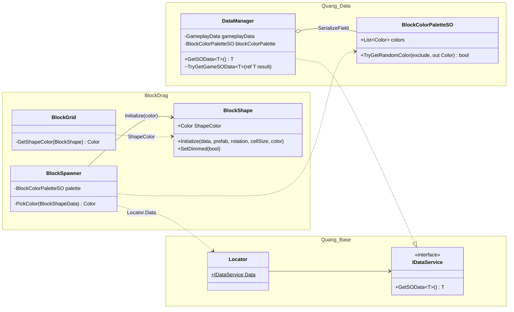
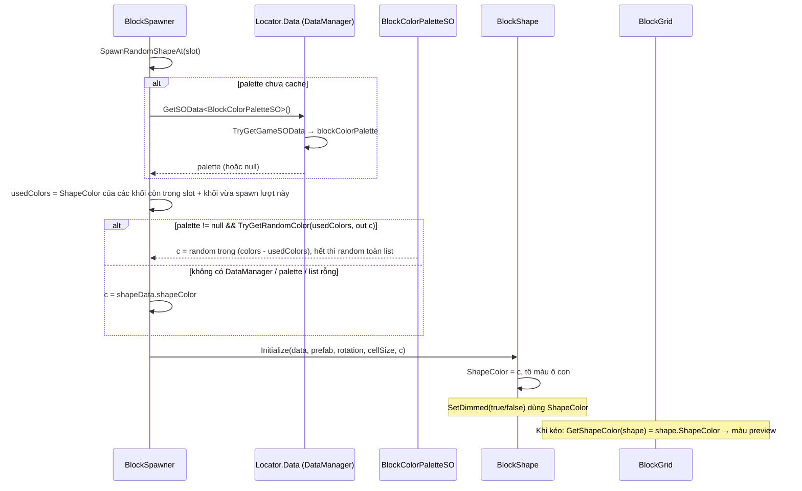

# Thiết Kế Kỹ Thuật: Bộ Màu Random Cho Block Khi Spawn

> **Ngày tạo:** 2026-10-12  
> **Tài liệu tham chiếu:** [`.agents/rules/architecture.md`](../../.agents/rules/architecture.md)  
> **Files liên quan:**  
> - `Assets/_Game/_BlockDrag/Data/BlockColorPaletteSO.cs` *(mới, assembly `Quang.Data` qua asmref)*  
> - `Assets/_Game/_BlockDrag/Data/DataManager.BlockDrag.cs` *(mới, partial của `DataManager`)*  
> - [`Assets/_Game/_BlockDrag/BlockSpawner.cs`](../../Assets/_Game/_BlockDrag/BlockSpawner.cs)  
> - [`Assets/_Game/_BlockDrag/BlockShape.cs`](../../Assets/_Game/_BlockDrag/BlockShape.cs)  
> - [`Assets/_Game/_BlockDrag/BlockGrid.cs`](../../Assets/_Game/_BlockDrag/BlockGrid.cs)  
> - [`Assets/_Game/_Data/DataManager.prefab`](../../Assets/_Game/_Data/DataManager.prefab)  

---

## 1. Bối Cảnh & Yêu Cầu

### 1.1. Hiện trạng
- Màu của một khối lấy cố định từ `BlockShapeData.shapeColor`: cùng một hình luôn cùng một màu.
- Màu này được đọc ở 3 chỗ:
  - `BlockShape.Initialize` tô màu các ô con.
  - `BlockShape.SetDimmed` khôi phục màu gốc / làm tối.
  - `BlockGrid.GetShapeColor`: màu của preview phá hàng (glow) khi kéo khối.
- `DataManager` (package `com.quang.data`) là `partial class` và có sẵn hook `TryGetGameSOData<T>` cho game đăng ký SO riêng. Game **chưa** có phần partial nào của `DataManager`.

### 1.2. Mục tiêu
1. Có một ScriptableObject `BlockColorPaletteSO` chứa `List<Color>`, tạo được qua menu `Create`.
2. `DataManager` có `[SerializeField]` để kéo asset palette vào (trên `DataManager.prefab`).
3. Mỗi khối khi spawn lấy một màu ngẫu nhiên từ palette qua `Locator.Data.GetSOData<BlockColorPaletteSO>()`.
4. Màu random dùng nhất quán cho ô con, trạng thái dimmed và preview phá hàng.
5. Ba khối trong cùng một lượt **không trùng màu** (khi palette đủ màu).
6. Sửa lỗi sẵn có: `GetSOData<GameplayData>()` trả về `GameplayData.asset` thay vì `null`.
7. Fallback an toàn: không có `DataManager`, chưa gán palette, hoặc list rỗng → dùng `BlockShapeData.shapeColor` như hiện tại.

### 1.3. Ngoài phạm vi
- Không đổi màu của ô đã đặt trên grid sau khi đặt (giữ nguyên màu khối lúc đặt).
- Không xoá trường `BlockShapeData.shapeColor`: nó vẫn là màu fallback.

---

## 2. Thiết Kế

### 2.1. Ràng buộc kiến trúc: SO phải nằm ở đâu?

`DataManager` thuộc assembly `Quang.Data`. Một `[SerializeField]` trong `DataManager` chỉ có thể dùng kiểu mà `Quang.Data` nhìn thấy. `BlockDrag` phụ thuộc `Quang.Data`, chiều ngược lại bị cấm. Vì vậy:

- `BlockColorPaletteSO` **phải** nằm trong thư mục `Assets/_Game/_BlockDrag/Data/` (asmref → `Quang.Data`), giống `GameplayData.BlockDrag.cs`.
- Phần partial `DataManager.BlockDrag.cs` cũng nằm ở đó, khai báo field và implement `TryGetGameSOData<T>`.
- Namespace giữ `Gameplay.BlockDrag` (như `ENUM.ITEM.cs` trong cùng thư mục), nên code gameplay dùng không cần thêm `using`.
- `BlockSpawner` (assembly `BlockDrag`) đọc palette qua `Locator.Data` (contract `IDataService`), không gọi trực tiếp `DataManager`.

Hướng phụ thuộc không đổi. Mục "Extending Package Assemblies" trong `architecture.md` sẽ được bổ sung: `_BlockDrag/Data` giờ chứa thêm palette SO và partial `DataManager`.

> Lưu ý: `partial void TryGetGameSOData<T>` chỉ cho phép **một** implementation. Implementation này trở thành điểm đăng ký chung cho mọi SO riêng của game sau này.

### 2.2. Thành phần

| Thành phần | Assembly | Trách nhiệm |
| :--- | :--- | :--- |
| `BlockColorPaletteSO` | `Quang.Data` (asmref) | `[CreateAssetMenu]`, `List<Color> colors`. `bool TryGetRandomColor(IReadOnlyList<Color> exclude, out Color)`: ưu tiên màu chưa có trong `exclude`; nếu đã dùng hết thì random toàn bộ list; trả `false` nếu list rỗng. |
| `DataManager` (partial, game) | `Quang.Data` (asmref) | `[SerializeField] GameplayData gameplayData` và `[SerializeField] BlockColorPaletteSO blockColorPalette`; `TryGetGameSOData<T>` trả đúng SO theo `typeof(T)`. |
| `BlockSpawner` | `BlockDrag` | Lấy palette một lần (cache, có lấy lại nếu null), chọn màu cho từng khối, truyền vào `BlockShape.Initialize`. |
| `BlockShape` | `BlockDrag` | Thêm `Color ShapeColor { get; private set; }`. `Initialize(..., Color? color = null)` lưu màu (mặc định `data.shapeColor`). `SetDimmed` dùng `ShapeColor`. |
| `BlockGrid` | `BlockDrag` | `GetShapeColor` đọc `shape.ShapeColor` thay vì `shapeData.shapeColor`. |
| `BlockColorPalette.asset` | `Assets/_Game/_Data/DataSO/` | Asset do người dùng tạo và điền màu, kéo vào `DataManager.prefab`. |

### 2.3. Sơ đồ lớp

### 2.4. Luồng spawn

### 2.5. Chi tiết hành vi
- **Random không trùng:** `SpawnNewHand` gom `ShapeColor` của các khối đang nằm trong slot, cộng thêm màu vừa chọn cho từng khối mới trong lượt. Palette chọn ngẫu nhiên trong các màu chưa dùng. Nếu palette ít hơn 3 màu (đã dùng hết) thì cho phép lặp, random trên toàn list. So sánh màu bằng `==` của `Color`.
- **Alpha:** giữ nguyên RGB của màu trong palette. Phần tử mới thêm vào `List<Color>` trong Inspector có thể là `(0,0,0,0)`, khiến khối trong suốt, nên `TryGetRandomColor` ép `a = 1`. `SetDimmed(false)` vẫn ép alpha = 1 như hiện tại.
- **Cache palette:** `BlockSpawner` cache palette ở lần spawn đầu. Nếu kết quả null thì lần sau thử lại (vì `DataManager` có thể đăng ký `Locator.Data` muộn hơn), không log mỗi lần, chỉ warning một lần.
- **Không đổi chữ ký công khai cũ:** tham số `color` của `Initialize` là optional, nên các chỗ gọi khác (nếu có) vẫn chạy.

---

## 3. Kiểm Thử
- EditMode `BlockColorPaletteTests`:
  - `TryGetRandomColor_WhenEmpty_ReturnsFalse`
  - `TryGetRandomColor_WhenHasColors_ReturnsColorFromList`
  - `TryGetRandomColor_WhenColorHasZeroAlpha_ReturnsOpaqueColor`
  - `TryGetRandomColor_WithExclude_ReturnsUnusedColor`
  - `TryGetRandomColor_WhenAllExcluded_ReturnsColorFromList`
- EditMode test cho `BlockShape`: `Initialize_WithColor_SetsShapeColorAndRenderers`, `Initialize_WithoutColor_UsesShapeDataColor` (nếu fixture hiện có cho phép tạo prefab tạm).
- Kiểm tra thủ công trong Editor: tạo palette 5–6 màu, gán vào `DataManager.prefab`, chạy `GameScene` → các khối có màu khác nhau trong bộ màu; khối bị dimmed vẫn tối đúng màu; preview phá hàng glow theo màu khối đang kéo; xoá palette khỏi prefab → khối quay về màu của `BlockShapeData`.

### 2.6. Sửa `GetSOData<GameplayData>()`
- Hiện game chưa implement `TryGetGameSOData`, nên các UI (`LoseCanvas`, `HomeCanvas`, `RevivePopup`, `WinCanvas`, `BuyBoosterPopup`, `ShowItemsPopup`) nhận `null`.
- `DataManager.prefab` **vẫn còn** dữ liệu serialize `gameplayData: {guid: a5a284ac…}` (= `Assets/_Game/_Data/DataSO/GameplayData.asset`) từ trước khi tách package. Khai báo lại field cùng tên `gameplayData` trong partial thì Unity tự gán lại tham chiếu, không cần sửa prefab cho field này.

## 4. Quyết định (đã chốt với người dùng 2026-10-12)
1. Ba khối trong cùng lượt **không trùng màu**.
2. Tạo sẵn `Assets/_Game/_Data/DataSO/BlockColorPalette.asset` với 6 màu mẫu và gán vào `DataManager.prefab`.
3. Sửa luôn `GetSOData<GameplayData>()` trong cùng task.
