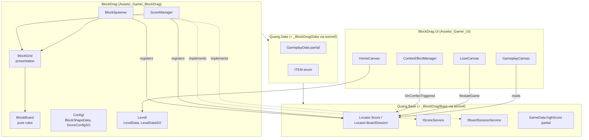
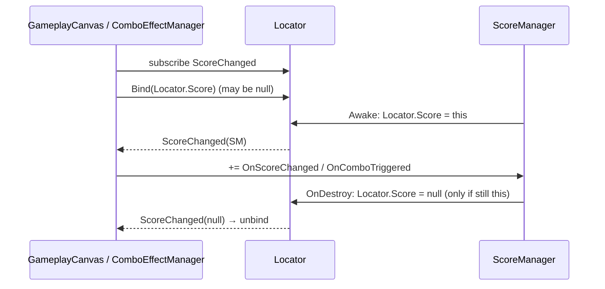
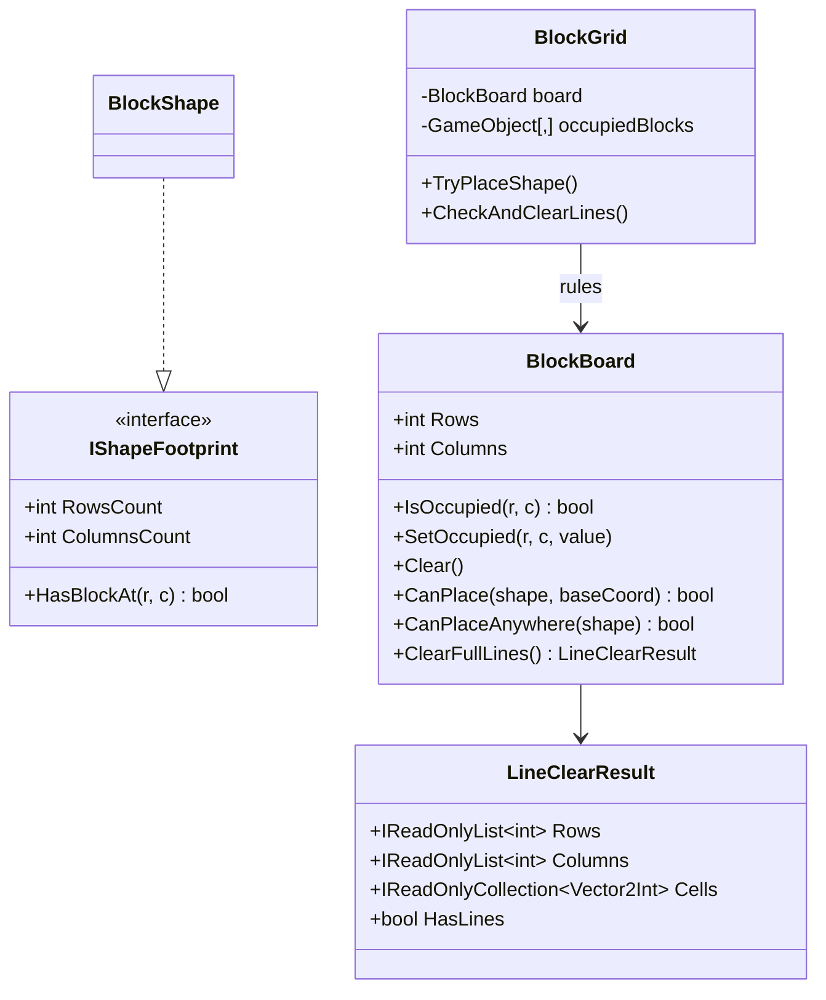

# Layer Alignment Refactor — Design

## 1. Context

An architecture audit of `Assets/_Game` (2026-10-12) found that assembly dependency direction is correct
(`BlockDrag.UI → BlockDrag → Quang.*`), but code placement inside the layers drifted:

| # | Finding | Impact |
|---|---------|--------|
| 1 | `.agents/rules/architecture.md` still describes `Hung.*` assemblies and feature folders that moved to `com.quang.*` packages | Agents and humans follow a wrong map |
| 2 | Empty, unused `_Game.Data.GameplayData` MonoBehaviour; `ComboEffectManager` only subscribes if `ScoreManager.Ins` already exists | Name clash noise; combo text can silently never show |
| 3 | Every file under `_BlockDrag/Data/` is compiled into the **package** assembly `Quang.Data` via `.asmref`, although only the `GameplayData` partial needs to be there; six gameplay types live in the global namespace | Game code leaks into a shared package assembly |
| 4 | UI reaches gameplay through concrete singletons (`ScoreManager.Ins`, `BlockSpawner.Ins`) instead of `Locator` contracts | Violates the "cross-feature via Locator interfaces" rule; hard to test |
| 5 | `BlockGrid` (897 lines) mixes board rules (occupancy, placement, line detection) with presentation | Rules cannot be unit-tested without GameObjects |

## 2. Goals / Non-goals

**Goals**
- Documentation matches the real module layout.
- `Quang.Data` / `Quang.Base` only receive files that *must* extend package partial classes or define Locator contracts.
- UI depends on gameplay only through `Locator` interfaces.
- Board rules live in a pure C# class covered by EditMode tests.
- No gameplay behavior change; serialized assets keep working (all `.meta` GUIDs preserved).

**Non-goals**
- Removing the legacy `LevelData` / `LevelDataSO` schema (still read by `HomeCanvas`); it is only relocated.
- Editing `com.quang.*` packages.
- Reworking `CountdownManager` beyond tightening its singleton setter.

## 3. Target Module Layout



Rule: arrows only point down. `BlockDrag.UI` no longer names `ScoreManager` or `BlockSpawner`.

## 4. Component Design

### 4.1 Locator contracts (`_BlockDrag/Base`, compiled into `Quang.Base`)

```csharp
public interface IScoreService
{
    int CurrentScore { get; }
    int HighScore { get; }
    event Action<int> OnScoreChanged;
    event Action<int> OnHighScoreChanged;
    event Action<int, Vector3> OnComboTriggered;
}

public interface IBoardSessionService
{
    bool IsGameOver { get; }
    event Action OnGameOver;
    event Action OnGameRestarted;
    void RestartGame();
}

public static partial class Locator
{
    public static IScoreService Score { get; set; }               // setter raises ScoreChanged
    public static event Action<IScoreService> ScoreChanged;
    public static IBoardSessionService BoardSession { get; set; } // setter raises BoardSessionChanged
    public static event Action<IBoardSessionService> BoardSessionChanged;
}
```

Event names mirror the existing `ScoreManager` / `BlockSpawner` events so the implementations satisfy the
interfaces without renaming. The `*Changed` events replace the per-class `OnInstanceReady` statics and solve
late registration: consumers bind to the current value, then rebind whenever it changes.

### 4.2 Registration lifecycle



### 4.3 `BlockBoard` (pure C#, `_BlockDrag/Board`)



`BlockGrid` keeps `occupiedBlocks` as the **view** map (which GameObject sits in a cell) and delegates every
rule question to `BlockBoard`. Both are written in the same places (place, clear, reset), so they stay in sync.
Public `BlockGrid` API and events are unchanged.

### 4.4 Assembly relocation

| File | From (assembly) | To (assembly / folder) |
|------|-----------------|------------------------|
| `GameplayData.BlockDrag.cs`, `ENUM.ITEM.cs` | Quang.Data | unchanged (must extend package partial) |
| `BlockShapeData.cs`, `ScoreConfigSO.cs`, `ScoreConfig.asset` | Quang.Data | BlockDrag / `_BlockDrag/Config` |
| `LevelData.cs`, `LevelDataSO.cs` | Quang.Data | BlockDrag / `_BlockDrag/Level` |
| `GameplayData.cs` (empty MonoBehaviour) | Quang.Data | deleted |

`BlockDrag.asmdef` gains a `Quang.DesignPattern` reference (needed by `LevelData` → `PoolType`).
`BlockGrid`, `BlockShape`, `BlockSpawner`, `BlockDragHandler`, `BlockShapeData`, `BlockRotation`, `LevelDataSO`
move into `namespace Gameplay.BlockDrag`.

## 5. Risks

- **Script GUIDs** — moved with `git mv` including `.meta`, so prefabs/scenes/assets keep their references.
- **Namespace change** — Unity serializes `MonoBehaviour`/`ScriptableObject` by script GUID, so it is safe.
  No `[SerializeReference]` or Odin type-name data references these types (`LevelDataSO` has no asset).
- **Locator static state across tests** — tests restore the previous value in `TearDown`.
