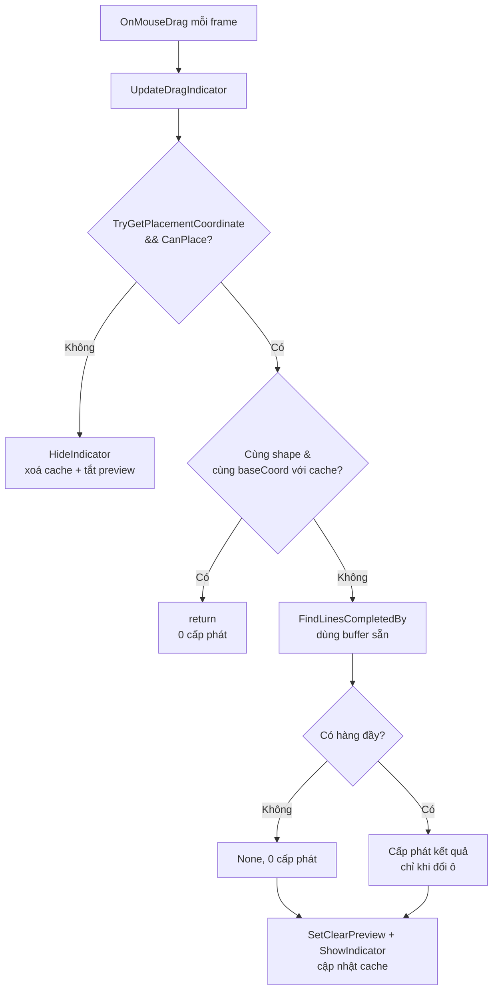

# Thiết Kế Kỹ Thuật: Loại Bỏ Rác GC Khi Kéo Khối (Line Clear Preview)

> **Ngày tạo:** 2026-10-12
> **Tài liệu tham chiếu:** `.agents/rules/architecture.md`, `Docs/designs/2026-10-12-line-clear-preview-glow-design.md`
> **Files liên quan:**
> - `Assets/_Game/_BlockDrag/BlockGrid.cs` *(sửa — cache vị trí đặt)*
> - `Assets/_Game/_BlockDrag/Board/BlockBoard.cs` *(sửa — dùng lại buffer)*
> - `Assets/_Game/_BlockDrag/Effects/LineClearPreviewEffect.cs` *(sửa — thoát sớm trong Update)*
> - `Assets/Tests/EditMode/BlockBoardTests.cs` *(sửa — test buffer không rò trạng thái)*

---

## 1. Vấn Đề

`BlockDragHandler.OnMouseDrag` gọi `BlockGrid.UpdateDragIndicator` **mỗi frame**. Từ khi thêm preview, mỗi lần gọi chạy `BlockBoard.FindLinesCompletedBy`, hàm này `new` 1 `HashSet`, 2 `SortedSet`, 2 `List` (+1 `HashSet` khi có hàng đầy) → ước tính vài trăm byte – ~1KB/frame ⇒ vài chục KB/giây khi đang kéo, dễ kích GC gây giật trên mobile.

Trong khi đó vị trí đặt (`baseCoord`) chỉ đổi khi khối đi sang ô khác → phần lớn các frame tính lại y hệt kết quả cũ.

| Nguồn | Tần suất | Cấp phát |
|---|---|---|
| `FindLinesCompletedBy` | mỗi frame kéo | ~5–6 collection |
| `ShowIndicator` | mỗi frame kéo hợp lệ | 0 (chỉ set vị trí/màu) nhưng thừa |
| `LineClearPreviewEffect.Update` | mỗi frame, kể cả khi tắt | 0, nhưng chạy vòng lặp thừa |

## 2. Giải Pháp

### 2.1. `BlockGrid` — chỉ tính lại khi vị trí đặt đổi
- Thêm cache `previewShape` (`BlockShape`) + `previewBaseCoord` (`Vector2Int`) + cờ `hasPreviewCache`.
- `UpdateDragIndicator` nhánh hợp lệ: nếu `hasPreviewCache && shape == previewShape && baseCoord == previewBaseCoord` → `return` (ghost và preview đang đúng, không cần làm gì).
- Ngược lại: tính preview + `ShowIndicator` như cũ, rồi cập nhật cache.
- **Xoá cache** trong `HideIndicatorCells()` — được gọi khi: vị trí không hợp lệ, thả khối (`TryPlaceShape`), `ResetBoard`, `ClearGrid`. Vì bàn cờ chỉ thay đổi qua các đường này, cache không bao giờ trả kết quả cũ sai.

### 2.2. `BlockBoard` — dùng lại buffer
- Thay `HashSet` footprint bằng `bool[,] footprintScratch` (kích thước Rows×Columns, cấp 1 lần trong constructor); đánh dấu các ô footprint, dùng xong **xoá đúng các ô vừa đánh dấu**.
- Thay 2 `SortedSet` bằng `bool[] rowScratch` / `bool[] colScratch`; duyệt theo chỉ số tăng dần nên thứ tự kết quả vẫn tăng dần như cũ.
- Danh sách ô footprint tạm: `List<Vector2Int> footprintCells` dùng lại (Clear trước mỗi lần).
- Chỉ cấp phát `List<int>` rows/cols + `HashSet` cells **khi thật sự có hàng đầy** (bắt buộc, vì `LineClearResult` được `BlockGrid` giữ lại làm `ClearPreview`). Không có hàng đầy → trả `LineClearResult.None` (0 byte).
- `BlockBoard` không thread-safe — chấp nhận, toàn bộ gameplay chạy trên main thread.

### 2.3. `LineClearPreviewEffect.Update` — thoát sớm
- Khi `!isPreviewing && fade <= 0` và viền đã tắt → `return` ngay, không duyệt pool.

### 2.4. Luồng sau khi sửa

## 3. Rủi Ro & Quyết Định

| Vấn đề | Quyết định |
|---|---|
| Cache trả kết quả cũ khi bàn đổi | Bàn chỉ đổi khi đặt khối / reset — đều đi qua `HideIndicatorCells()` xoá cache |
| Buffer rò trạng thái giữa các lần gọi | Xoá đúng các ô đã đánh dấu sau mỗi lần; thêm test gọi liên tiếp nhiều vị trí |
| `CanPlace` vẫn chạy mỗi frame | Không cấp phát, chi phí ≤ 25 ô → giữ nguyên |
| Gọi `UpdateDragIndicator` từ code khác với cùng toạ độ sau khi tự gọi `ShowIndicator` | Hiện chỉ `BlockDragHandler` gọi; ghi chú trong XML doc |

## 4. Tiêu Chí Chấp Nhận
1. Giữ khối đứng yên hoặc kéo trong cùng một ô: **0 B GC Alloc/frame** từ `BlockGrid`/`BlockBoard`/effect (kiểm bằng Profiler — Deep Profile hoặc GC Alloc column).
2. Hành vi preview không đổi: đổi màu, viền, ghost, tắt khi rời ô/thả/reset.
3. Toàn bộ test `BlockBoardTests` + `LineClearPreviewEffectTests` pass, thêm test gọi liên tiếp không rò trạng thái.
