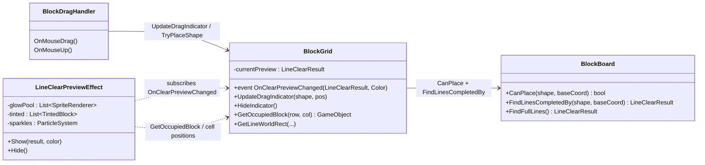
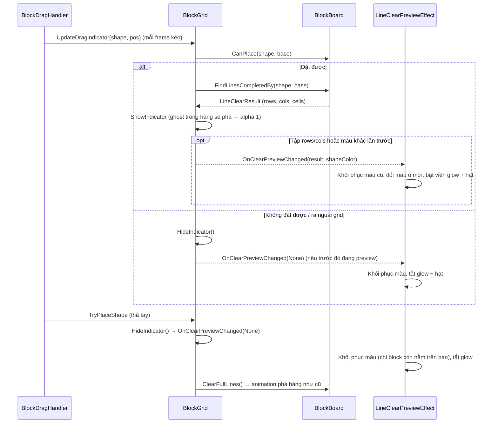
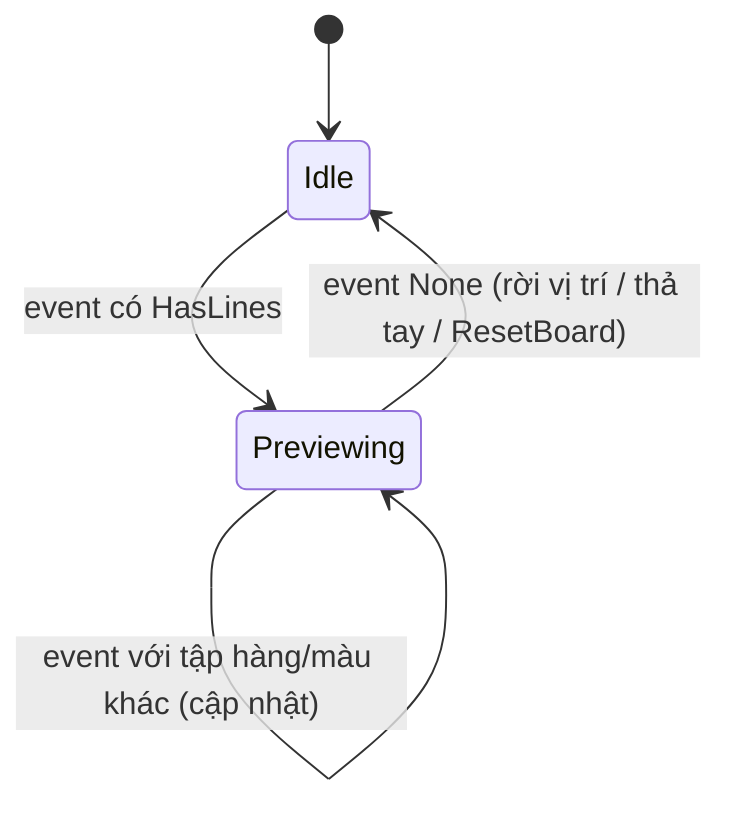

# Thiết Kế Kỹ Thuật: Viền Sáng Báo Trước Hàng Sẽ Bị Phá (Line Clear Preview Glow)

> **Ngày tạo:** 2026-10-12
> **Tài liệu tham chiếu:** `.agents/rules/architecture.md`, `.agents/rules/task_planning.md`
> **Video tham chiếu:** `Assets/_Game/_BlockDrag/Resource/1791791448367_2226600900546722489_9065635962486239376.mp4`
> **Files liên quan:**
> - `Assets/_Game/_BlockDrag/Board/BlockBoard.cs` *(sửa — thêm hàm dự đoán hàng/cột sẽ đầy)*
> - `Assets/_Game/_BlockDrag/BlockGrid.cs` *(sửa — tính preview khi kéo, phát event, ghost đậm trong hàng sẽ phá)*
> - `Assets/_Game/_BlockDrag/Effects/LineClearPreviewEffect.cs` *(mới — đổi màu hàng, viền glow, hạt lấp lánh)*
> - `Assets/Tests/EditMode/BlockBoardTests.cs` *(sửa — test hàm dự đoán)*
> - `Assets/Tests/EditMode/LineClearPreviewEffectTests.cs` *(mới)*
> - `Assets/_Game/_Scenes/Game/GameScene.unity` *(sửa — gắn component)*

---

## 1. Yêu Cầu & Phân Tích Video

### 1.1. Mục tiêu
Khi người chơi **đang kéo** một `BlockShape` tới vị trí mà nếu thả xuống sẽ lấp đầy một (hoặc nhiều) hàng/cột, các hàng/cột đó được làm nổi bật với **viền sáng tỏa ra xung quanh** để báo trước. Rời khỏi vị trí đó hoặc thả khối thì hiệu ứng tắt.

### 1.2. Phân tích khung hình (video 4.65s, 720×1600)

| Thời điểm | Quan sát |
|---|---|
| 0.00s – 0.50s | Kéo khối chữ L đỏ (3 ô) xuống góc trái dưới. Ghost mờ hiện bên dưới, **chưa có** hiệu ứng |
| ≈ 0.60s | Khối vào vị trí làm hàng dưới cùng đầy. Khối **vẫn đang được giữ** (lệch nhẹ so với lưới) nhưng hàng đã sáng |
| 0.60s – 2.20s | Giữ nguyên trạng thái preview: <br>• **Toàn bộ ô trong hàng đổi sang màu của khối đang kéo** (ô vàng/cam chuyển đỏ) <br>• **Viền glow hồng/magenta** bo góc bao quanh cả hàng, tỏa mềm ra ngoài khoảng ⅓ ô <br>• **Hạt lấp lánh** trắng/hồng nhỏ trôi lơ lửng dọc mép trên và mép dưới của hàng |
| ≈ 2.25s | Thả tay → hàng vỡ ngay (không có delay sau khi thả), dải sáng quét ngang, mảnh vụn bay |
| 2.50s | Điểm cộng, hàng trống |

**Kết luận:** đây là hiệu ứng **preview lúc kéo**, không phải hiệu ứng sau khi đặt. Phần vỡ hàng sau khi thả **ngoài phạm vi** task này (đã có animation clear hiện tại).

### 1.3. Phạm vi
- ✅ Đổi màu ô đã đặt trong hàng/cột sẽ phá sang màu khối đang kéo; khôi phục khi preview tắt.
- ✅ Ghost của khối đang kéo nằm trong hàng sẽ phá hiển thị đậm (alpha 1) để hàng trông liền màu.
- ✅ Viền glow (bo góc, mềm, nhấp nháy nhẹ) quanh mỗi hàng/cột sẽ phá. Nhiều hàng + cột → mỗi đường một viền.
- ✅ Hạt lấp lánh dọc viền khi preview đang bật.
- ❌ Không đổi animation phá hàng sau khi thả, không đổi điểm số.

---

## 2. Kiến Trúc & Thiết Kế Thành Phần

### 2.1. Phân lớp
Tất cả nằm trong assembly `BlockDrag` (namespace `Gameplay.BlockDrag`). Không thêm phụ thuộc giữa assembly, không đụng `BlockDrag.UI` hay package `Quang.*`.

- **`BlockBoard`** (luật thuần C#): biết dự đoán "nếu đặt shape ở đây thì hàng/cột nào đầy" — không thay đổi trạng thái bàn.
- **`BlockGrid`** (trình bày bàn cờ): khi kéo, hỏi `BlockBoard`, chỉ **phát event** khi tập hàng/cột preview thay đổi. Không biết gì về VFX (giống cách `BlockPlaceEffect` nghe `OnShapePlacedCells`).
- **`LineClearPreviewEffect`** (VFX mới, cùng thư mục `Effects/`): nghe event, đổi màu block, vẽ viền glow, phát hạt.

### 2.2. Sơ đồ thành phần



### 2.3. Luồng hoạt động



### 2.4. Trạng thái preview



### 2.5. `BlockBoard.FindLinesCompletedBy(IShapeFootprint shape, Vector2Int baseCoord)`
- Trả `LineClearResult.None` nếu `!CanPlace(shape, baseCoord)`.
- Xét các hàng/cột mà shape chạm vào (chỉ những hàng/cột này mới có thể vừa đầy): một ô đếm là "đầy" nếu `occupied` **hoặc** thuộc footprint của shape.
- **Không sửa** `occupied`. Kết quả dùng chung struct `LineClearResult` (rows, cols, cells không trùng).
- Bất biến cần test: kết quả bằng đúng `FindFullLines()` sau khi đặt shape thật → preview luôn khớp với hàng thực sự bị phá.

### 2.6. Thay đổi trong `BlockGrid`
```csharp
// (result, shapeColor) result.HasLines == false nghĩa là tắt preview
public event System.Action<LineClearResult, Color> OnClearPreviewChanged;

public GameObject GetOccupiedBlock(int row, int col);
```
- `UpdateDragIndicator`: khi hợp lệ → tính preview; khi không hợp lệ → `SetClearPreview(None)`.
- `HideIndicator()` (đã được gọi bởi `TryPlaceShape`, `ResetBoard`) → cũng tắt preview.
- `SetClearPreview` so sánh rows/cols/màu với lần trước; **chỉ phát event khi khác** → không rebuild VFX mỗi frame kéo.
- `ShowIndicator`: ghost cell thuộc `preview.Cells` dùng alpha `clearPreviewGhostAlpha` (mặc định 1), còn lại giữ `indicatorAlpha`.

### 2.7. `LineClearPreviewEffect` (MonoBehaviour mới)
Theo khuôn của `BlockPlaceEffect`: tự tìm `BlockGrid`, đăng ký event trong `OnEnable`/`OnDisable`, root VFX riêng (không làm con `BlockGrid` vì `ClearGrid()` destroy mọi child).

**a. Đổi màu ô**
- Với mỗi cell trong `result.Cells`: lấy `GetOccupiedBlock`; nếu có → lưu `(SpriteRenderer, màu gốc, cell)` rồi gán `shapeColor` (giữ alpha gốc).
- Khôi phục: chỉ đặt lại màu khi `GetOccupiedBlock(cell)` **vẫn là block đó**. Block đã bị phá (đang tween fade/scale) bị bỏ qua → không phá animation fade, và hàng vỡ ra với màu khối đang kéo đúng như video.

**b. Viền glow**
- Mỗi hàng/cột một `SpriteRenderer` (pool, không Instantiate liên tục), `drawMode = Sliced`.
- Sprite glow: dùng `glowSprite` gán trong Inspector nếu có; nếu trống → **tự sinh** texture 64×64 lúc Awake: viền bo góc sáng, mép ngoài mờ dần, giữa trong suốt (chỉ là viền, không phủ lên block), 9-slice border để kéo dài không méo.
- Kích thước = khung bao hàng/cột (`gridWidth × cellSize` hoặc ngược lại) + `glowPadding × cellSize` mỗi bên.
- Màu mặc định hồng magenta `#FF3DC8`, nhấp nháy alpha `0.75 ↔ 1` bằng DOTween (`SetLoops(-1, Yoyo)`, `SetTarget(this)`), fade-in nhanh 0.1s khi bật.
- Sorting order 6: trên block đã đặt (2) và ghost (5), dưới khối đang kéo (12).

**c. Hạt lấp lánh**
- Một `ParticleSystem` tự sinh bằng code (giống `BlockPlaceEffect`, material `Sprites/Default`), `Emission` tắt, phát thủ công trong `Update` khi đang preview với tốc độ `sparklesPerSecondPerLine`.
- Vị trí: ngẫu nhiên dọc 2 mép dài của mỗi viền; vận tốc nhỏ hướng ra ngoài + trôi lên; size 4–8% ô; màu trắng / hồng nhạt; lifetime 0.4–0.8s, fade + nhỏ dần.
- Khi tắt preview: dừng phát, hạt còn lại tự tàn (không xoá đột ngột).

### 2.8. Tham số Inspector

| Tham số | Mặc định | Ý nghĩa |
|---|---|---|
| `BlockGrid.clearPreviewGhostAlpha` | 1 | Alpha ghost nằm trong hàng sẽ phá |
| `glowSprite` | *(trống → tự sinh)* | Sprite viền 9-slice |
| `glowColor` | `#FF3DC8` | Màu viền |
| `glowPadding` | 0.3 | Viền tràn ra ngoài (× cellSize) |
| `pulseAlphaRange` | 0.75 – 1 | Nhấp nháy |
| `pulseDuration` | 0.45s | Chu kỳ nửa nhịp |
| `tintBlocks` | true | Đổi màu ô sang màu khối đang kéo |
| `sparklesPerSecondPerLine` | 14 | Mật độ hạt |
| `sortingOrder` | 6 | Thứ tự vẽ viền + hạt |

---

## 3. Rủi Ro & Quyết Định

| Vấn đề | Quyết định |
|---|---|
| Tính preview mỗi frame kéo | `FindLinesCompletedBy` chỉ duyệt hàng/cột shape chạm vào (≤ 5+5 đường × 8 ô) → rẻ; event chỉ phát khi thay đổi |
| Khôi phục màu block đang bị phá | Kiểm tra block vẫn còn trong `occupiedBlocks` trước khi khôi phục |
| `ResetBoard` / Replay lúc đang preview | `ResetBoard` gọi `HideIndicator` → tắt preview |
| Nhiều hàng và cột cùng lúc | Mỗi đường một viền; chỗ giao nhau sáng hơn — chấp nhận, giống Block Blast |
| Màu glow cố định hay theo khối | Video dùng hồng cố định dù khối đỏ → mặc định cố định, chỉnh được ở Inspector |
| Không có sprite glow trong project | Sinh texture lúc chạy; vẫn cho gán sprite riêng nếu designer muốn |

## 4. Tiêu Chí Chấp Nhận
1. Kéo khối tới vị trí làm đầy hàng/cột → hàng/cột đổi màu theo khối, có viền hồng sáng nhấp nháy và hạt lấp lánh.
2. Kéo đi chỗ khác / ra ngoài grid → mọi ô trở về màu cũ, viền tắt.
3. Thả khối → hàng phá như cũ; các ô không bị phá giữ đúng màu gốc.
4. Hàng/cột preview luôn trùng khớp với hàng/cột bị phá thật (có test EditMode).
5. Không có lỗi/cảnh báo Console, không GC đáng kể mỗi frame kéo.
