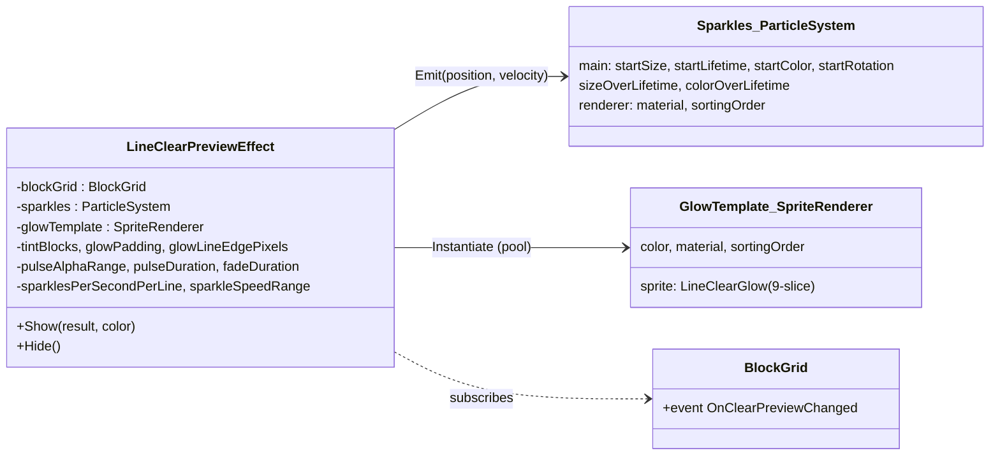
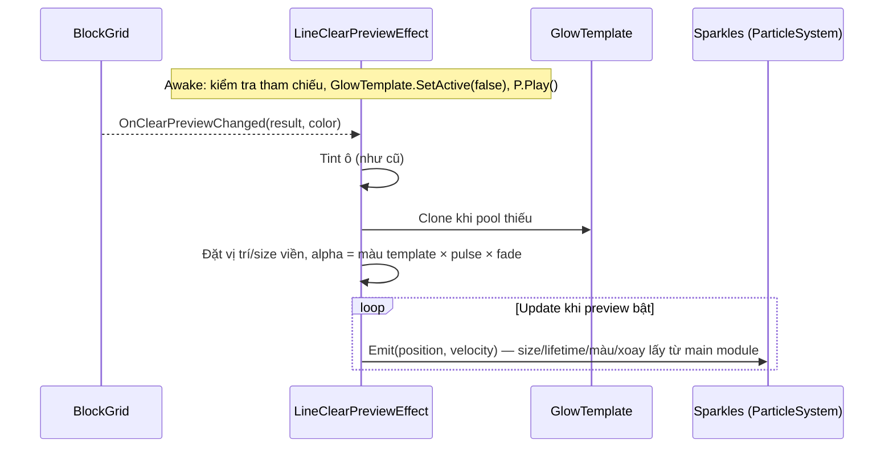

# Thiết Kế Kỹ Thuật: Chuyển LineClearPreviewEffect Sang Prefab

> **Ngày tạo:** 2026-10-12
> **Tài liệu tham chiếu:** `.agents/rules/architecture.md`, `Docs/designs/2026-10-12-line-clear-preview-glow-design.md`, `Docs/designs/2026-10-12-line-clear-preview-gc-fix-design.md`
> **Files liên quan:**
> - `Assets/_Game/_BlockDrag/Effects/LineClearPreviewEffect.cs` *(sửa — dùng tham chiếu prefab thay vì tự dựng bằng code)*
> - `Assets/_Game/_BlockDrag/Prefabs/LineClearPreviewEffect.prefab` *(mới)*
> - `Assets/_Game/_BlockDrag/Effects/Textures/LineClearGlow.png` *(mới — sprite viền 9-slice, bake từ texture đang sinh bằng code)*
> - `Assets/Tests/EditMode/LineClearPreviewEffectTests.cs` *(sửa)*
> - `Assets/_Game/_Scenes/Game/GameScene.unity` *(sửa — thay component bằng prefab instance)*

---

## 1. Yêu Cầu

Hiện `LineClearPreviewEffect` tự dựng toàn bộ VFX bằng code trong `Awake` (ParticleSystem, texture viền, material). Designer chỉ chỉnh được qua vài tham số trên component, **không** chỉnh trực tiếp ParticleSystem / sprite / material, và không xem trước ở Edit mode.

**Mục tiêu:** đưa effect thành prefab có sẵn các phần hình ảnh dưới dạng asset để chỉnh trực tiếp trong Inspector (ParticleSystem đầy đủ module, SpriteRenderer viền, sprite, material), code chỉ còn lo **logic** (khi nào bật/tắt, đặt viền ở đâu, phát hạt ở đâu).

**Ngoài phạm vi:** `BlockPlaceEffect` giữ nguyên (có thể làm tương tự ở task khác).

## 2. Cấu Trúc Prefab

```text
LineClearPreviewEffect.prefab          ← LineClearPreviewEffect (logic + tham số timing)
├── Sparkles                           ← ParticleSystem + Renderer (designer chỉnh trực tiếp)
└── GlowTemplate (inactive)            ← SpriteRenderer Sliced, sprite LineClearGlow, màu hồng, sortingOrder 6
```

- **Root** chứa component. Lúc chạy root được đặt theo vị trí/xoay/scale của `BlockGrid` (như `vfxRoot` hiện tại) — prefab instance nằm ở gốc scene, **không** làm con `BlockGrid` (vì `ClearGrid()` destroy mọi child).
- **GlowTemplate**: khuôn để clone ra các viền (pool). Designer đổi sprite, màu, material (vd. additive), sorting order ngay trên object này. Template luôn tắt, chỉ bản clone được bật.
- **Sparkles**: ParticleSystem dựng sẵn với đúng thông số hiện tại (world space, emission tắt, size/color over lifetime…). Designer chỉnh mọi module.

### 2.1. Sơ đồ





## 3. Thay Đổi Code `LineClearPreviewEffect`

### 3.1. Field

| Giữ trên component | Bỏ khỏi component → chuyển vào prefab |
|---|---|
| `blockGrid` | `glowSprite` → sprite của GlowTemplate |
| `tintBlocks` | `materialOverride` → material của Sparkles renderer |
| `glowPadding` | `glowColor` → màu của GlowTemplate |
| `pulseAlphaRange`, `pulseDuration`, `fadeDuration` | `sparkleSizeRange` → `main.startSize` |
| `sparklesPerSecondPerLine` | `sparkleLifetimeRange` → `main.startLifetime` |
| `sparkleSpeedRange` (tốc độ theo cellSize, phải tính bằng code) | `sparklePalette` → `main.startColor` (Random Color / Gradient) |
| **mới** `sparkles : ParticleSystem`, `glowTemplate : SpriteRenderer` | `sortingOrder` → sorting order trên từng renderer |
| **mới** `glowLineEdgePixels` (mặc định 16): khoảng cách từ mép sprite tới mép hàng, để căn viền đúng khi đổi sprite | |

### 3.2. Hành vi
- `Awake`: nếu thiếu `sparkles` hoặc `glowTemplate` → `Debug.LogError` + `enabled = false` (không tự dựng bằng code nữa → một nguồn sự thật duy nhất là prefab). Tắt template, `sparkles.Play()`.
- Không còn `new GameObject` root riêng: root của prefab chính là `transform` của component. `OnDestroy` chỉ hủy các viền clone (cũng là con của root nên tự hủy theo) → không còn material/texture/sprite runtime cần dọn.
- `Emit`: chỉ set `position`, `velocity`; các giá trị size/lifetime/màu/xoay **để ParticleSystem tự lấy** từ main module. Kích thước hạt hiện tính theo cellSize → trong prefab đặt bằng world unit tương ứng cellSize hiện tại (cellSize trong game ≈ đo lúc chạy, ghi vào plan).
- Màu viền = `glowTemplate.color` (lưu lúc Awake) × pulse × fade.
- Hành vi preview, tint, cache, 0 B GC khi kéo — **không đổi**.

### 3.3. Sprite viền
- Bake texture đang sinh bằng `CreateGlowTexture` ra `LineClearGlow.png` một lần (qua Unity editor), import: Sprite, `pixelsPerUnit 64`, border 24 mọi cạnh, mesh Full Rect, không mipmap, Clamp.
- Sau khi bake, **xoá** `CreateGlowTexture` và các hằng `GlowTexture*` khỏi runtime code (không còn dùng); test tương ứng chuyển thành test kiểm tra asset (alpha giữa = 0, vạch sáng = 1, border = 24).

## 4. Scene
- `GameScene`: xoá component `LineClearPreviewEffect` khỏi `VFXPut`, thêm instance `LineClearPreviewEffect.prefab` ở gốc scene, override `blockGrid` → `BlockGrid` trong scene (prefab asset không tham chiếu được object trong scene; nếu để trống vẫn tự `FindObjectOfType`).

## 5. Rủi Ro & Quyết Định

| Vấn đề | Quyết định |
|---|---|
| Kích thước hạt trước đây tỉ lệ theo cellSize, giờ là world unit cố định | Grid cố định 8×8 theo bề ngang camera → cellSize gần như không đổi; ghi giá trị tương đương vào prefab. Nếu cần tỉ lệ lại sau, thêm `scalingMode`/size multiplier. |
| Thiếu tham chiếu trong prefab | LogError + tắt component, không crash |
| Bỏ fallback dựng bằng code | Giữ một nguồn sự thật (prefab); tránh hai đường code song song |
| Designer muốn xem trước | Có thể bật tạm GlowTemplate / Play ParticleSystem trong Prefab Mode |

## 6. Tiêu Chí Chấp Nhận
1. Mở prefab thấy và chỉnh được Sparkles (mọi module) và GlowTemplate (sprite, màu, material, sorting).
2. Đổi màu/sprite/size trong prefab → thay đổi thấy ngay khi chơi, không cần sửa code.
3. Hình ảnh mặc định giống bản hiện tại; preview bật/tắt/tint như cũ; 0 B GC khi giữ khối cùng ô.
4. Console sạch, test pass.
