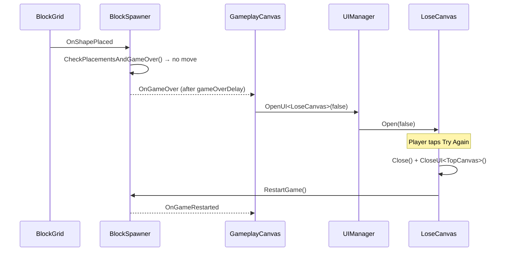

# Design: Game Over opens LoseCanvas (remove GameOverUI)

## Requirements
- When the player has no valid move, open `LoseCanvas` instead of the runtime-built `GameOverUI` popup.
- `GameOverUI` is no longer used and is removed.
- Pressing **Try Again** on `LoseCanvas` behaves exactly like the old `GameOverUI` replay button: hide the popup and call `BlockSpawner.RestartGame()`.

## Architecture
- `BlockDrag` (gameplay assembly) must not reference `BlockDrag.UI`; `BlockDrag.UI` already references `BlockDrag`.
- So `BlockSpawner` keeps raising `OnGameOver` and the UI layer reacts:
  - `GameplayCanvas` (open during play) subscribes to `BlockSpawner.OnGameOver` and opens `LoseCanvas` with `param = false` (lose).
  - `LoseCanvas.OnTryAgain` closes itself and `TopCanvas`, then calls `BlockSpawner.RestartGame()`.
- `ScoreManager` keeps its own `OnGameOver` / `OnGameRestarted` subscriptions (unchanged).

## Removed
- `Assets/_Game/_BlockDrag/GameOverUI.cs` (+ `.meta`) and its auto-creation in `BlockSpawner.Start`. No scene/prefab references it.
