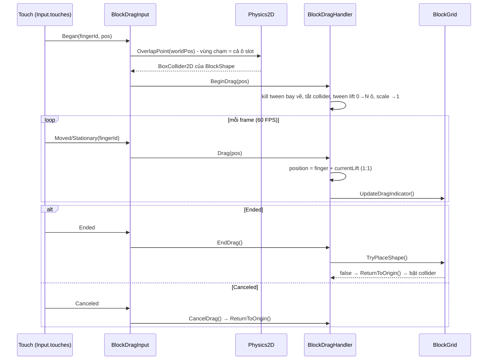
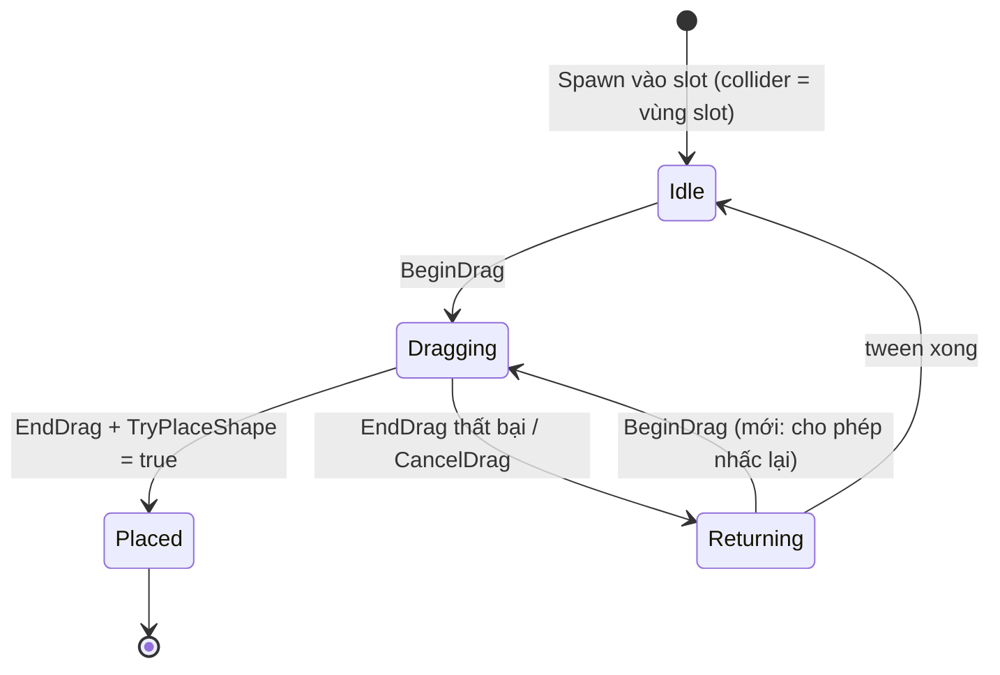
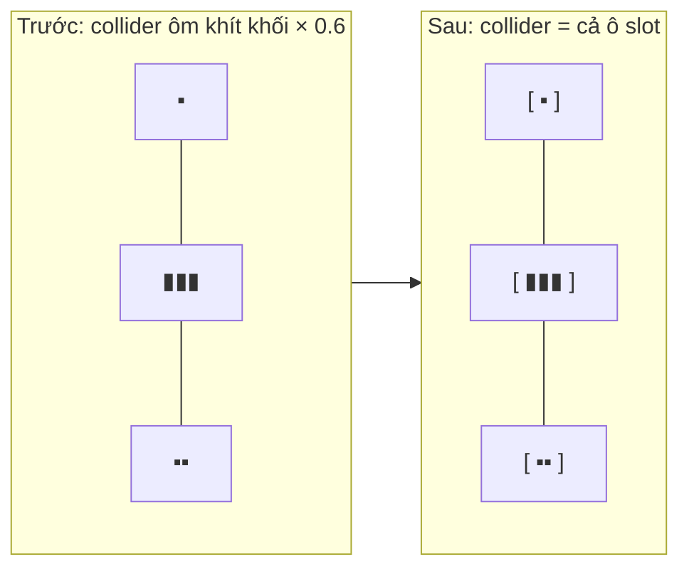

# Thiết Kế Kỹ Thuật: Cải Thiện Độ Nhạy Chạm & Độ Mượt Khi Kéo Khối

> **Ngày tạo:** 2026-10-13  
> **Tài liệu tham chiếu:** [`.agents/rules/architecture.md`](../../.agents/rules/architecture.md)  
> **Files liên quan:**  
> - [`Assets/_Game/_BlockDrag/BlockDragHandler.cs`](../../Assets/_Game/_BlockDrag/BlockDragHandler.cs)  
> - [`Assets/_Game/_BlockDrag/BlockShape.cs`](../../Assets/_Game/_BlockDrag/BlockShape.cs)  
> - [`Assets/_Game/_BlockDrag/BlockSpawner.cs`](../../Assets/_Game/_BlockDrag/BlockSpawner.cs)  

---

## 1. Bối Cảnh & Vấn Đề

Trên thiết bị thật, người chơi gặp 2 vấn đề:
1. **Chạm vào khối ở slot rất khó**, cảm giác không nhận ngay.
2. **Khi kéo, khối di chuyển không mượt.**

### 1.1. Nguyên nhân tìm được trong code

| # | Nguyên nhân | Vị trí | Ảnh hưởng |
|---|---|---|---|
| A1 | **Vùng chạm quá nhỏ.** `BoxCollider2D` của shape ôm vừa khít các ô, rồi container bị scale `spawnScaleRatio = 0.6`. Khối `Single` tại slot chỉ còn 0.6 ô (~6–7% chiều rộng màn hình), khối I/L mảnh thì vùng chạm theo một chiều cũng rất hẹp. Chạm lệch một chút ra ngoài viền là trượt. | `BlockShape.UpdateColliderBounds`, `BlockSpawner.SpawnRandomShapeAt` | Vấn đề 1 (chính) |
| A2 | **Không cho nhấc lại khi khối đang bay về slot.** `OnMouseDown` return sớm khi `isReturning` (0.2s). Người chơi thả hụt rồi chạm lại ngay thì bị bỏ qua. | `BlockDragHandler.OnMouseDown` | Vấn đề 1 |
| A3 | **Dùng `OnMouseDown/Drag/Up`** (SendMouseEvents mô phỏng chuột từ touch): chỉ đọc `Input.mousePosition` (khi có 2 ngón, vị trí nhảy giữa các ngón), không có pha `Canceled` (có cuộc gọi/notification kéo xuống thì khối kẹt ở trạng thái drag), và phải raycast vật lý cho mọi collider mỗi frame. | `BlockDragHandler` | Vấn đề 1 & 2 |
| B1 | **Không set `Application.targetFrameRate`.** Không có chỗ nào trong project set giá trị này → Unity trên iOS/Android mặc định **30 FPS**. Khối bám ngón tay ở 30 FPS sẽ thấy giật/trễ rõ rệt, đây là nguyên nhân chính của vấn đề 2 (Editor chạy không giới hạn nên không thấy). | Toàn project | Vấn đề 2 (chính) |
| B2 | **Nhấc khối bị "giật" ở frame đầu.** Ngay frame chạm, khối dịch tức thời `dragOffset = (0, 1.5)` lên trên ngón tay, đồng thời scale `OutBack` (có overshoot) từ 0.6 → 1. Cú nhảy vị trí tức thời + overshoot tạo cảm giác giật. | `BlockDragHandler.OnMouseDown` | Vấn đề 2 |
| B3 | `dragOffset` tính bằng world unit cố định (1.5), không theo `cellSize` → trên mỗi màn hình khoảng nâng khác nhau. | `BlockDragHandler` | Phụ |

`UpdateDragIndicator` đã có cache theo `baseCoord` nên chi phí mỗi frame thấp, không phải nguyên nhân.

### 1.2. Mục tiêu
1. Chạm vào bất kỳ đâu trong "ô slot" của khối là nhấc được, kể cả khối nhỏ.
2. Nhấc được ngay cả khi khối đang bay về slot.
3. Chạy 60 FPS trên mobile; khối bám ngón tay 1:1, không độ trễ.
4. Nhấc khối mượt: khoảng nâng lên trên ngón tay chuyển dần, không nhảy tức thời.
5. Xử lý đúng multi-touch (chỉ theo ngón đã nhấc khối) và touch bị huỷ.

### 1.3. Ngoài phạm vi
- Không thêm hệ số khuếch đại kéo (kéo 1 cm khối đi 1.3 cm như một số game) — có thể làm sau nếu cần.
- Không chuyển sang Input System package mới.
- Không thay đổi logic đặt khối của `BlockGrid`.

---

## 2. Thiết Kế

### 2.1. Vùng chạm theo slot (A1)
- `BlockSpawner` biết khoảng cách giữa 3 slot → tính **kích thước vùng chạm world** cho mỗi slot: rộng = khoảng cách giữa 2 slot liền kề (không chồng lên nhau), cao = cấu hình `touchAreaHeightPercent` (theo % chiều cao màn hình).
- Thêm vào `BlockShape`: `SetTouchArea(Vector2 worldSize)` → đặt `boxCollider.size = max(kích thước shape, worldSize / lossyScale)`, `offset = 0` (tâm slot).
- Collider **chỉ dùng để chọn khối** (Grid đặt khối theo vị trí, không dùng collider) nên phóng to không ảnh hưởng gameplay.
- Khi bắt đầu kéo: tắt collider (không cần raycast nữa, tránh Physics2D phải cập nhật collider di chuyển mỗi frame). Khi trở về slot: bật lại.

### 2.2. Bộ đọc input tập trung `BlockDragInput` (A2, A3)
Component mới trong assembly `BlockDrag`, một instance trong scene (đặt chung GameObject với `BlockSpawner`):
- Mỗi `Update`: đọc `Input.touches` (mobile) hoặc chuột (Editor/Standalone, fallback khi `touchCount == 0`).
- `Began` (khi chưa giữ khối nào) → `Physics2D.OverlapPoint(worldPos)` → lấy `BlockDragHandler` → `handler.BeginDrag(screenPos)`; ghi nhớ `fingerId`.
- `Moved/Stationary` của đúng `fingerId` → `handler.Drag(screenPos)`.
- `Ended` → `handler.EndDrag()`; `Canceled` → `handler.CancelDrag()` (bay về slot, không đặt).
- Các ngón khác bị bỏ qua.

`BlockDragHandler` bỏ `OnMouseDown/Drag/Up`, thay bằng 4 method public trên. `BeginDrag` **không còn chặn khi `isReturning`**: kill tween bay về và nhấc lên từ vị trí hiện tại.

### 2.3. Frame rate (B1)
- Set `Application.targetFrameRate = 60` (cấu hình được) lúc khởi động game. Vị trí đặt sẽ chốt ở plan (ưu tiên bootstrap sẵn có trong `Quang.Base` nếu có; nếu không thì trong `BlockDragInput.Awake`).

### 2.4. Nhấc khối mượt (B2, B3)
- Khối luôn bám ngón tay 1:1 tại mỗi frame (**không** dùng Lerp/SmoothDamp vì sẽ gây trễ).
- Khoảng nâng được tween: `currentLift` từ 0 → `dragLiftCells * cellSize` trong `pickUpDuration` (Ease.OutQuad). Vị trí = `fingerWorld + currentLift`.
- Scale nhấc lên đổi `OutBack` → `OutQuad` (bỏ overshoot).
- `dragOffset` (world unit) thay bằng `dragLiftCells` (đơn vị ô, mặc định ~2 ô) để đồng nhất trên mọi màn hình. Giữ property `DragOffset` trả về giá trị world đã tính để không vỡ code đang dùng.

---

## 3. Sơ Đồ

### 3.1. Luồng input

### 3.2. Trạng thái khối

### 3.3. Vùng chạm trước / sau

---

## 4. Ranh Giới Kiến Trúc
- Mọi thay đổi nằm trong assembly `BlockDrag`; không thêm phụ thuộc mới vào `BlockDrag.UI` hay sửa package `Quang.*` (trừ khi plan chốt đặt frame rate ở bootstrap sẵn có).
- Sự kiện `OnBeginDragEvent / OnDraggingEvent / OnEndDragEvent` giữ nguyên chữ ký.

## 5. Rủi Ro
| Rủi ro | Giảm thiểu |
|---|---|
| Vùng chạm phóng to chồng lên grid / UI | Chiều cao vùng chạm giới hạn theo % màn hình, chỉ phủ khu vực slot dưới grid; kiểm tra trên iPhone & iPad. |
| Scene đang dựa vào `OnMouse*` (ví dụ test) | Tìm và cập nhật trong plan. |
| 60 FPS tốn pin hơn | Chấp nhận được cho game kéo thả; giá trị cấu hình được. |
