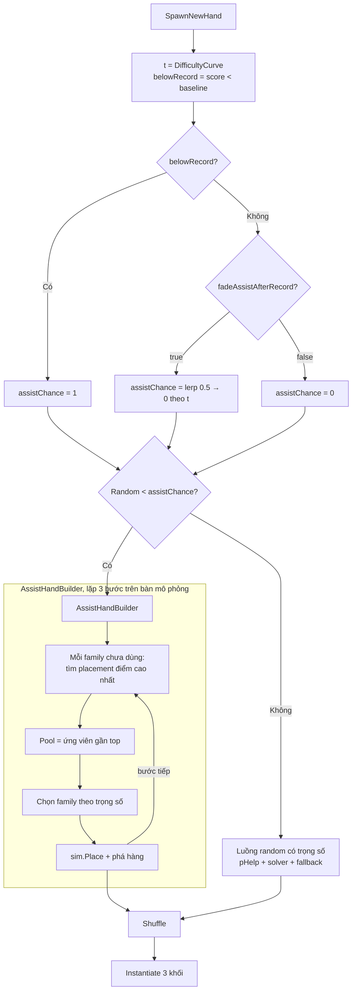
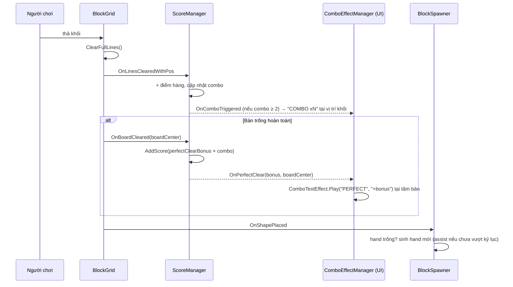

# Thiết Kế Kỹ Thuật: Hỗ Trợ Đầu Game (Assist Hand) & Thưởng Dọn Sạch Bàn (Perfect Clear)

> **Ngày tạo:** 2026-10-13  
> **Tiếp nối:** [`2026-10-13-spawn-difficulty-design.md`](2026-10-13-spawn-difficulty-design.md)  
> **Tài liệu tham chiếu:** [`.agents/rules/architecture.md`](../../.agents/rules/architecture.md)  
> **Files liên quan:**  
> - [`Assets/_Game/_BlockDrag/Spawn/HandGenerator.cs`](../../Assets/_Game/_BlockDrag/Spawn/HandGenerator.cs), [`SpawnSettings.cs`](../../Assets/_Game/_BlockDrag/Spawn/SpawnSettings.cs)  
> - [`Assets/_Game/_BlockDrag/BlockSpawner.cs`](../../Assets/_Game/_BlockDrag/BlockSpawner.cs)  
> - [`Assets/_Game/_BlockDrag/BlockGrid.cs`](../../Assets/_Game/_BlockDrag/BlockGrid.cs)  
> - [`Assets/_Game/_BlockDrag/ScoreManager.cs`](../../Assets/_Game/_BlockDrag/ScoreManager.cs), [`Config/ScoreConfigSO.cs`](../../Assets/_Game/_BlockDrag/Config/ScoreConfigSO.cs)  
> - [`Assets/_Game/_BlockDrag/Base/IScoreService.cs`](../../Assets/_Game/_BlockDrag/Base/IScoreService.cs)  
> - [`Assets/_Game/_UI/Scripts/ComboEffectManager.cs`](../../Assets/_Game/_UI/Scripts/ComboEffectManager.cs), [`ComboTextEffect.cs`](../../Assets/_Game/_UI/Scripts/ComboTextEffect.cs)  

---

## 1. Bối Cảnh & Yêu Cầu

### 1.1. Hiện trạng (sau task spawn-difficulty)
- Hand luôn đặt hết được và không trùng loại.
- Khối phá hàng chỉ được **ép theo xác suất** `pHelp`: bàn trống thì khoảng 15–20%, bàn nửa đầy khoảng 40%. Nên đầu game thường **không có** khối khớp chỗ cần phá, người chơi ít ăn combo, điểm lên chậm.
- Ngay cả khi có khối hỗ trợ, nó chỉ phá được hàng trên bàn **hiện tại**. Hai khối còn lại random, không nối tiếp nhau thành chuỗi phá hàng.
- Không có thưởng khi dọn sạch bàn.
- Combo trong `ScoreManager` tính theo thời gian: phá hàng mở cửa sổ 5 giây, mỗi lần phá tiếp được cộng thêm 3 giây. Vì vậy hand giúp phá hàng **liên tiếp** sẽ tự sinh combo.

### 1.2. Mục tiêu (giống Block Blast)
1. **Assist mode khi chưa vượt HighScore:** mỗi hand được **dựng có chủ đích** để các khối **khớp chỗ cần phá**. Đặt đúng chỗ thì khối 1 phá hàng, khối 2 phá tiếp, khối 3 phá tiếp, tạo combo dồn dập và điểm lên nhanh.
2. **Ưu tiên dọn sạch bàn:** nếu có cách đặt khối làm bàn trống hoàn toàn, assist ưu tiên tạo cơ hội đó.
3. **Sau khi vượt kỷ lục:** có công tắc `fadeAssistAfterRecord` để chơi thử và cảm nhận:
   - `true`: assist giảm dần từ 50% về 0 theo độ khó.
   - `false`: tắt assist ngay khi vượt kỷ lục.
4. **Thưởng Perfect Clear:** khi một lần phá hàng làm bàn **trống hoàn toàn**, cộng `perfectClearBonus × combo hiện tại` (chỉnh được trong `ScoreConfigSO`) và hiện chữ nổi "PERFECT +N" giống combo text.
5. Giữ nguyên các đảm bảo cũ: không trùng loại, hand luôn đặt hết được, logic C# thuần có test.

### 1.3. Ngoài phạm vi
- Không đổi công thức combo theo thời gian (5 giây / +3 giây).
- Không gợi ý vị trí đặt cho người chơi (không highlight chỗ đặt). Người chơi vẫn phải tự nhận ra.
- Không thay đổi luật đặt khối hay phá hàng.
- Không dùng `PerfectCanvas` của template cũ.

---

## 2. Thiết Kế

### 2.1. Chọn chế độ sinh hand

```text
t            = DifficultyCurve.Evaluate(score, baseline)      // như cũ
belowRecord  = score < max(baseline, minBaseline)

assistChance =
    belowRecord                                   → 1.0   (luôn assist)
    đã vượt kỷ lục, fadeAssistAfterRecord = true  → lerp(assistChanceAtRecord, 0, u)
                                                     u = (t - belowRecordMaxT) / (1 - belowRecordMaxT)
    đã vượt kỷ lục, fadeAssistAfterRecord = false → 0     (tắt assist ngay)

Random < assistChance  → AssistHandBuilder (mới)
ngược lại              → luồng random có trọng số hiện tại (pHelp, solver, fallback)
```

- `assistChanceAtRecord` mặc định là 0.5. Vừa vượt kỷ lục thì vẫn còn 50% hand "ngon", sau đó giảm dần về 0 khi đạt độ khó tối đa.
- Người chơi mới (kỷ lục dưới `minBaseline` = 1000) được assist hoàn toàn cho tới 1000 điểm.
- **Vị trí công tắc `fadeAssistAfterRecord`:** đặt trong **`SpawnConfigSO`** (cạnh các tham số assist khác), **không** đặt trong `ScoreConfigSO`.
  - Lý do: `BlockSpawner` đã giữ `SpawnConfigSO`, còn `ScoreConfigSO` thuộc `ScoreManager`. Đặt sang đó sẽ bắt spawner đọc config điểm, trộn hai trách nhiệm.
  - Bạn vẫn bật/tắt được trong Inspector của `SpawnConfig.asset`.

### 2.2. AssistHandBuilder: dựng hand theo chuỗi phá hàng

Ý tưởng: **mô phỏng trước** một chuỗi 3 lần đặt đẹp trên bản sao bàn cờ. Hand chính là 3 khối của chuỗi đó, sau đó được xáo thứ tự.

```text
BuildAssistHand(board, count, difficulty, excludedFamilies):
  sim  = copy(board)
  hand = []
  lặp step = 1..count:
      // Với mỗi family chưa dùng: tìm placement tốt nhất của nó trên sim
      cands = []
      for family ∉ excluded ∪ hand:
          best = argmax over (variant, position hợp lệ) của PlacementScore(sim, variant, position)
          cands.add(family, best)

      if cands rỗng: break
      topScore = max(cands.score)
      pool = cands có score ≥ topScore - |topScore| * assistTolerance     // nhóm ứng viên gần top
      chọn 1 family trong pool theo trọng số family (early/late theo t)
      sim.Place(variant, position); sim.ClearFullLinesInPlace()
      hand.add(variant)

  nếu hand.Count < count: bù bằng luồng random (vẫn kiểm tra solvable)
  Shuffle(hand); return hand
```

**PlacementScore** (càng cao càng "đẹp"):

| Thành phần | Điểm | Ý nghĩa |
| :--- | :--- | :--- |
| Dọn sạch bàn sau khi đặt | +`perfectClearScore` (10000) | Ưu tiên tuyệt đối cơ hội Perfect Clear |
| Mỗi hàng/cột phá được | +`clearLineScore` (100) | Khối khớp chỗ cần phá |
| Setup | Σ (số ô đã lấp / kích thước hàng)² trên các hàng/cột khối chạm vào, sau khi đặt | Khi chưa phá được gì: ưu tiên chỗ làm hàng/cột gần đầy, chuẩn bị combo cho bước sau |
| Lấp lỗ | + số cạnh tiếp xúc với ô đã chiếm hoặc mép bàn × `contactScore` (0.5) | Khối "vừa khít", tránh tạo lỗ khó lấp |

**Vì sao cách này tạo cảm giác "khối luôn khớp":**
- Bước 1 chọn khối phá được hàng đang chờ.
- Bước 2 chạy trên bàn **sau khi** hàng đó đã bị phá, nên khối 2 khớp chỗ cần phá tiếp theo. Bước 3 tương tự.
- Hand được dựng từ một chuỗi đặt hợp lệ, nên **luôn giải được** mà không cần chạy solver.
- Bàn trống đầu ván chưa có gì để phá. Điểm setup sẽ ưu tiên những khối dễ tạo hàng (I_4, I_5, Rec…), để các hand sau có cái phá.

**Giữ sự đa dạng:** không luôn chọn placement đứng đầu, mà chọn trong nhóm gần top (`assistTolerance` = 0.15) theo trọng số family. Nhờ vậy hand không lặp đi lặp lại.

**Chi phí:** mỗi bước duyệt 16 family × tối đa 4 góc xoay × 64 vị trí, khoảng 4.000 lần `CanPlace` cộng tính điểm, nhân 3 bước. Ước lượng dưới 1 ms. Sẽ đo lại.

### 2.3. Perfect Clear

**Phát hiện** (trong `BlockGrid.CheckAndClearLines`): sau `Board.ClearFullLines()` có phá hàng và `Board.OccupiedCount == 0`, thì bắn `OnBoardCleared(Vector3 boardCenter)`. `boardCenter` là tâm bàn cờ trong world space.

**Thứ tự sự kiện** (đồng bộ trong một frame):

```text
PlaceShape → CheckAndClearLines
              ├─ OnLinesCleared / OnLinesClearedWithPos  → ScoreManager cộng điểm hàng + cập nhật combo
              └─ OnBoardCleared(boardCenter)             → ScoreManager cộng thưởng Perfect Clear
           → OnShapePlaced → BlockSpawner (có thể sinh hand mới)
```

**Điểm thưởng** (thêm vào `ScoreConfigSO`, chỉnh trong Inspector):

| Biến | Mặc định | Ý nghĩa |
| :--- | :--- | :--- |
| `perfectClearBonus` | 300 | Điểm thưởng gốc khi dọn sạch bàn |
| `perfectClearMultiplyByCombo` | true | Nhân thưởng với combo hiện tại |

```text
combo = currentCombo sau khi tính lần phá hàng này (≥ 1)
bonus = perfectClearBonus × (perfectClearMultiplyByCombo ? combo : 1)
```

Ví dụ: đang combo 4 mà dọn sạch bàn thì được 300 × 4 = **+1200**.

**Contract:** `IScoreService` thêm `event Action<int, Vector3> OnPerfectClear` (bonus, vị trí). File này nằm trong `Quang.Base` qua asmref, là contract của game, nên đúng chỗ.

**Hiệu ứng (UI): chữ nổi giống combo text**
- `ComboTextEffect` thêm overload `Play(string label, string value, Vector3 pos, …)`. `Play(int comboCount, …)` cũ gọi lại overload này với `"COMBO"`, `"x{n}"`, nên animation và giới hạn mép màn hình giữ nguyên.
- `ComboEffectManager` bind thêm `OnPerfectClear`, rồi lấy một effect từ pool và `Play("PERFECT", "+{bonus}", boardCenter)`.
- Chữ PERFECT hiện ở **tâm bàn**, chữ COMBO hiện ở vị trí khối vừa đặt, nên hai chữ bật cùng lúc không đè lên nhau.

### 2.4. Thành phần

| Thành phần | Assembly | Thay đổi |
| :--- | :--- | :--- |
| `Spawn/AssistHandBuilder` *(mới)* | `BlockDrag` | C# thuần. `List<ShapeVariant> Build(BlockBoard, int count, float difficulty, ISet<string> excludedFamilies)` + `static float PlacementScore(...)`. Dùng chung danh sách family với `HandGenerator`. |
| `Spawn/HandGenerator` | `BlockDrag` | `Generate(board, count, difficulty, inHand, bool belowRecord)`: tính `assistChance`, gọi `AssistHandBuilder` hoặc luồng random cũ. |
| `Spawn/SpawnSettings` | `BlockDrag` | Thêm `fadeAssistAfterRecord` (true), `assistChanceAtRecord` (0.5), `assistTolerance` (0.15), hệ số điểm placement (`clearLineScore` 100, `perfectClearScore` 10000, `contactScore` 0.5). |
| `BlockSpawner` | `BlockDrag` | Truyền thêm `belowRecord`. |
| `BlockGrid` | `BlockDrag` | Event `OnBoardCleared(Vector3 boardCenter)` bắn trong `CheckAndClearLines`. |
| `ScoreConfigSO` | `BlockDrag` | `perfectClearBonus` (300), `perfectClearMultiplyByCombo` (true). |
| `ScoreManager` | `BlockDrag` | Subscribe `OnBoardCleared`, cộng `bonus × combo`, bắn `OnPerfectClear`. |
| `IScoreService` | `Quang.Base` (asmref) | Thêm `event Action<int, Vector3> OnPerfectClear`. |
| `ComboTextEffect` | `BlockDrag.UI` | Overload `Play(string label, string value, Vector3 pos, …)`. |
| `ComboEffectManager` | `BlockDrag.UI` | Bind `OnPerfectClear`, phát chữ "PERFECT +N". |

Hướng phụ thuộc không đổi: UI → `Locator.Score` (contract) ← `BlockDrag`. Không cần sửa ranh giới trong `architecture.md`.

---

## 3. Sơ Đồ

### 3.1. Luồng sinh hand



### 3.2. Perfect Clear



---

## 4. Rủi Ro & Cách Xử Lý

| Rủi ro | Xử lý |
| :--- | :--- |
| Đầu game **quá dễ**, không có áp lực | Đây là chủ đích (giống Block Blast). Áp lực đến sau khi vượt kỷ lục. `fadeAssistAfterRecord`, `assistChanceAtRecord`, `assistTolerance` và đường cong độ khó đều chỉnh được trong SO. |
| Người chơi đặt sai thứ tự hoặc vị trí, bàn lộn xộn | Hand sau dựng lại từ bàn **thực tế**, nên assist tự thích nghi. |
| Assist luôn chọn khối nhỏ dễ phá | Trọng số family vẫn áp dụng trong pool. Điểm setup thưởng khối tạo hàng dài. Sẽ chỉnh sau khi chơi thử. |
| Thưởng nhân combo quá lớn, lạm phát điểm | `perfectClearBonus` và `perfectClearMultiplyByCombo` chỉnh được trong `ScoreConfigSO`. |
| Chữ PERFECT và COMBO bật cùng lúc đè nhau | PERFECT ở tâm bàn, COMBO ở vị trí khối. |
| Thêm event vào `IScoreService` làm vỡ mock trong test | Rà soát mọi implementation của `IScoreService` (bao gồm test) và thêm event. |

## 5. Quyết Định Đã Chốt
1. **Perfect Clear:** thưởng = `perfectClearBonus × combo`. Cả điểm gốc và cờ nhân combo nằm trong `ScoreConfigSO`.
2. **Assist sau khi vượt kỷ lục:** công tắc `fadeAssistAfterRecord` (true = giảm dần, false = tắt ngay). Đặt trong `SpawnConfigSO`, lý do ở mục 2.1.
3. **Hiệu ứng:** chữ nổi "PERFECT +N" dùng chung `ComboTextEffect`. Không dùng `PerfectCanvas`.
