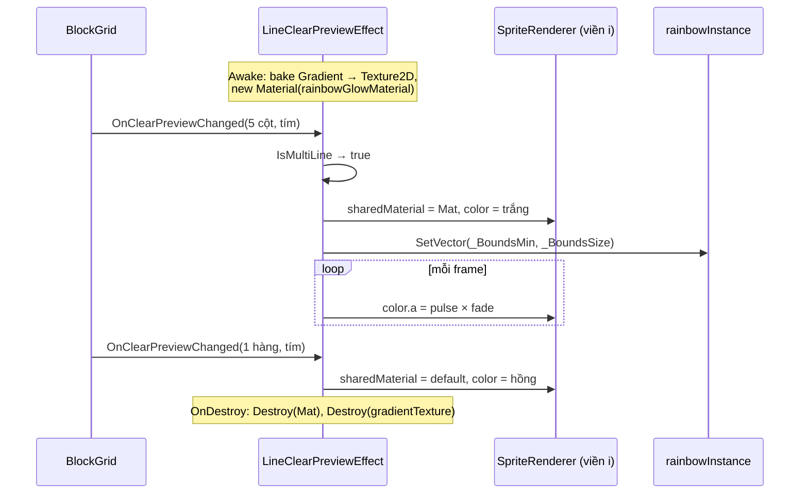

# Thiết Kế Kỹ Thuật: Viền Cầu Vồng Khi Phá Từ 2 Hàng/Cột (Multi-Line Rainbow Glow)

> **Ngày tạo:** 2026-10-13
> **Tài liệu tham chiếu:** `.agents/rules/architecture.md`, `.agents/rules/task_planning.md`, `Docs/designs/2026-10-12-line-clear-preview-glow-design.md`
> **Video tham chiếu:** `Assets/_Game/_BlockDrag/Resource/Screen Recording 2026-10-13 at 01.04.45.mov`
> **Files liên quan:**
> - `Assets/_Game/_BlockDrag/Effects/LineClearPreviewEffect.cs` *(sửa — chọn chế độ màu theo số đường)*
> - `Assets/_Game/_BlockDrag/Effects/Shaders/LineClearRainbowGlow.shader` *(mới — tô gradient theo vị trí thế giới)*
> - `Assets/_Game/_BlockDrag/Effects/Materials/LineClearRainbowGlow.mat` *(mới)*
> - `Assets/_Game/_BlockDrag/Prefabs/LineClearPreviewEffect.prefab` *(sửa — gán material + gradient)*
> - `Assets/Tests/EditMode/LineClearPreviewEffectTests.cs` *(sửa — thêm test)*

---

## 1. Yêu Cầu & Phân Tích Video

### 1.1. Mục tiêu
Khi khối đang kéo sẽ phá **từ 2 đường trở lên cùng lúc** (2+ hàng, 2+ cột, hoặc hàng + cột), viền glow không còn màu hồng đơn sắc mà chuyển sang **dải màu cầu vồng / ánh kim** như video. Nếu chỉ phá 1 đường thì giữ nguyên viền hồng hiện tại.

### 1.2. Phân tích khung hình (video 6.8s, 330×550)

| Thời điểm | Quan sát |
|---|---|
| 0.0s – 1.0s | Kéo khối I-5 ngang quanh bàn 8×8 (gần đầy, toàn ô tím). Chưa vào vị trí phá → không có viền |
| ≈ 1.2s | Đặt khối I-5 vào hàng trên cùng, cột 2–6 → **5 cột** sẽ đầy cùng lúc. Viền bật |
| 1.2s – 2.0s | Trạng thái preview nhiều đường: <br>• Mỗi cột có viền riêng, các viền **chạy sát nhau** thành từng vạch sáng giữa các cột <br>• Màu **thay đổi dọc chiều dài cột**: hai đầu (trên/dưới) **hồng → cam/trắng**, giữa cột **xanh cyan → xanh dương** <br>• Màu **thay đổi theo chiều ngang**: cột trái thiên cyan/xanh dương, mép phải thiên **xanh lá → vàng** <br>• Gradient gần như **đứng yên** giữa các khung (không cuộn nhanh), alpha vẫn nhấp nháy nhẹ <br>• Ô trong cột vẫn tô màu khối (tím), hạt lấp lánh vẫn có ở mép trên/dưới |
| ≈ 2.2s | Kéo ra khỏi vị trí → viền tắt, các ô giữ màu cũ |
| 2.6s – 6.8s | Thả ở chỗ khác, không có phá hàng |

**Kết luận:** chỉ khác bản 1 đường ở **màu viền**: thay màu phẳng bằng gradient nhiều màu phụ thuộc **vị trí trên bàn** (cả trục dọc lẫn ngang). Sprite viền, padding, nhấp nháy, fade, tint ô và hạt giữ nguyên.

### 1.3. Phạm vi
- ✅ `Rows.Count + Columns.Count >= multiLineThreshold` (mặc định **2**) → viền dùng material cầu vồng.
- ✅ Gradient cấu hình trong Inspector (`Gradient`), hướng gradient và tốc độ cuộn (mặc định 0 = đứng yên như video) chỉnh được.
- ✅ Chuyển qua lại 1 đường ↔ nhiều đường khi đang kéo phải đổi ngay, không leak material.
- ⚪ Tuỳ chọn (bật/tắt trong Inspector): hạt lấp lánh cũng lấy màu từ gradient khi ở chế độ nhiều đường. Mặc định **tắt**, vì trong video hạt vẫn trắng/hồng.
- ❌ Không đổi animation phá hàng sau khi thả, không đổi điểm/combo, không đổi `BlockGrid`/`BlockBoard`.

### 1.4. Giả định cần xác nhận
1. "Từ 2 hàng hoặc cột" tính **tổng số đường** → 1 hàng + 1 cột cũng tính là 2 và cũng ra cầu vồng.
2. Ô trong hàng vẫn tô theo **màu khối đang kéo** (như bây giờ), không tô cầu vồng lên ô.

---

## 2. Kiến Trúc & Thiết Kế Thành Phần

### 2.1. Phân lớp
Thay đổi chỉ nằm trong `LineClearPreviewEffect` (assembly `BlockDrag`, namespace `Gameplay.BlockDrag`) cùng asset shader/material mới. Event `OnClearPreviewChanged(LineClearResult, Color)` đã đủ thông tin (số hàng + số cột) nên **không sửa** `BlockGrid`, `BlockBoard` hay `LineClearResult`. Không thêm phụ thuộc giữa assembly.

### 2.2. Vì sao dùng shader thay vì sprite cầu vồng vẽ sẵn
| Cách | Nhược điểm |
|---|---|
| Đổi `SpriteRenderer.color` | Một renderer chỉ có 1 màu → không có gradient dọc chiều dài |
| Sprite 9-slice có gradient vẽ sẵn | Hàng và cột cần hướng gradient khác nhau (2 sprite hoặc xoay renderer), màu không liền mạch giữa các viền cạnh nhau, đổi màu phải vẽ lại ảnh |
| **Shader tô theo vị trí thế giới** ✅ | Dùng chung sprite viền hiện tại (alpha), màu lấy từ texture gradient tạo từ `Gradient` trong Inspector → các viền sát nhau liền màu như video, hàng/cột dùng chung 1 material |

### 2.3. Shader `BlockDrag/LineClearRainbowGlow`
- Shader sprite unlit, trong suốt, blend `SrcAlpha OneMinusSrcAlpha`, tôn trọng `vertex color` (để alpha nhấp nháy/fade hiện tại vẫn chạy qua `SpriteRenderer.color`).
- Vertex: chuyển `positionOS` → world, truyền `worldPos.xy` xuống fragment. Dùng world space vì SpriteRenderer có thể bị dynamic batching (object space không tin được).
- Fragment:
  ```
  uv01 = (worldPos.xy - _BoundsMin.xy) / _BoundsSize.xy      // 0..1 trên khung bàn (đã gồm padding)
  t    = frac(dot(uv01 - 0.5, _GradientDir.xy) + 0.5 + _Time.y * _ScrollSpeed)
  rgb  = tex2D(_GradientTex, float2(t, 0.5)).rgb
  a    = tex2D(_MainTex, uv).a * vertexColor.a
  out  = float4(rgb * vertexColor.rgb, a)
  ```
- Thuộc tính: `_MainTex`, `_GradientTex` (1D, wrap Clamp/Repeat), `_BoundsMin`, `_BoundsSize`, `_GradientDir`, `_ScrollSpeed`.
- Pass không gắn `LightMode` → URP (Forward lẫn 2D Renderer) vẽ qua `SRPDefaultUnlit`.

**Gradient mặc định** (theo video, hướng `_GradientDir ≈ (0.6, 1.0)` → đổi màu chủ yếu theo chiều dọc, lệch nhẹ theo chiều ngang):

`hồng #FF3DC8 → cam/trắng #FFD9A8 → cyan #3DF2FF → xanh dương #3D7BFF → xanh lá #5CFF8A → vàng #FFE45C → hồng #FF3DC8`

### 2.4. Thay đổi trong `LineClearPreviewEffect`
**Field mới (Inspector, header `Multi-Line`):**
- `int multiLineThreshold = 2`
- `Material rainbowGlowMaterial` — material mẫu (asset); runtime tạo **1 bản instance** dùng chung cho mọi viền, huỷ trong `OnDestroy`.
- `Gradient rainbowGradient` → bake vào `Texture2D` 256×1 (`TextureWrapMode.Repeat`, `FilterMode.Bilinear`) ở `Awake`, bake lại trong `OnValidate` khi chạy Editor.
- `Vector2 gradientDirection = (0.6, 1)`, `float gradientScrollSpeed = 0`
- `bool tintSparklesWithGradient = false`

**State mới:** `bool isMultiLine`, `Material defaultGlowMaterial` (lấy từ `glowTemplate.sharedMaterial`), `Material rainbowInstance`, `Texture2D gradientTexture`.

**Luồng:**
1. `Show(result, color)` → `isMultiLine = IsMultiLine(result, multiLineThreshold)`.
2. `LayoutGlows` → với mỗi viền đang bật: `sharedMaterial = isMultiLine ? rainbowInstance : defaultGlowMaterial`. Khi multi: cập nhật `_BoundsMin/_BoundsSize` của `rainbowInstance` bằng hộp bao (world) của tất cả `activeLineRects`.
3. `ApplyGlowAlpha` → màu nền = `isMultiLine ? Color.white : baseGlowColor`, rồi nhân alpha nhấp nháy × fade như hiện tại.
4. Thiếu `rainbowGlowMaterial` → tự rơi về viền hồng (log warning 1 lần, không tắt component).

**Hàm tĩnh để test:** `public static bool IsMultiLine(LineClearResult result, int threshold) => result.Rows.Count + result.Columns.Count >= threshold;`

### 2.5. Sơ đồ luồng

```mermaid
flowchart TD
    A[BlockGrid.OnClearPreviewChanged<br/>result, shapeColor] --> B{result.HasLines?}
    B -- Không --> H[Hide: trả màu ô,<br/>viền fade out]
    B -- Có --> C[ApplyTint ô = shapeColor]
    C --> D{"Rows + Columns<br/>≥ multiLineThreshold (2)?"}
    D -- "Không (1 đường)" --> E[glow.sharedMaterial = defaultGlowMaterial<br/>màu nền = baseGlowColor hồng]
    D -- "Có (≥ 2 đường)" --> F[glow.sharedMaterial = rainbowInstance<br/>màu nền = trắng]
    F --> G[Cập nhật _BoundsMin/_BoundsSize<br/>= hộp bao tất cả viền]
    E --> P[Update: alpha = pulse × fade<br/>ghi vào SpriteRenderer.color]
    G --> P
    P --> S[Shader: rgb = Gradient&#40;vị trí world&#41; × vertexColor<br/>alpha = sprite.a × vertexColor.a]
```





---

## 3. Rủi Ro & Lưu Ý
- **Hiệu năng:** 1 material instance dùng chung → các viền vẫn batch được; texture 256×1 rất nhẹ. Không phát sinh GC mỗi frame (giữ nguyên hướng của `2026-10-12-line-clear-preview-gc-fix`).
- **Leak:** material/texture tạo runtime phải `Destroy` trong `OnDestroy`; `OnValidate` chỉ bake lại khi đang Play.
- **Sorting/Render:** material mới phải giữ `sortingLayer/order` từ `glowTemplate` (sorting nằm trên renderer, không nằm trên material → đổi material không ảnh hưởng).
- **Màu sắc:** gradient trong video là ước lượng từ bản ghi 330×550; sẽ cần chỉnh lại trong Inspector sau khi xem trên máy.
