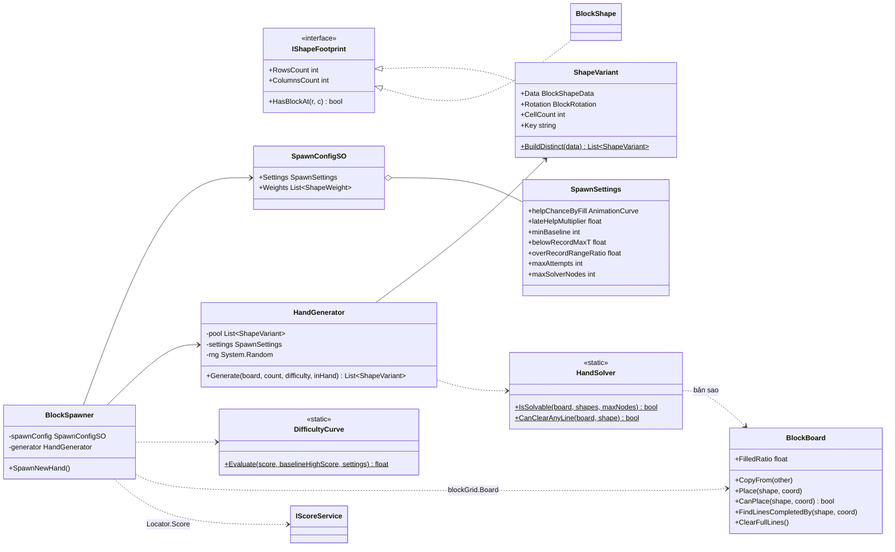
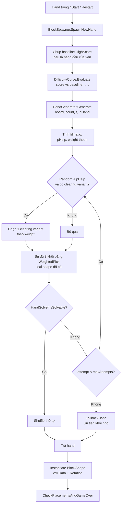

# Thiết Kế Kỹ Thuật: Cân Bằng Độ Khó Khi Sinh Khối (Smart Hand Generator)

> **Ngày tạo:** 2026-10-13  
> **Tài liệu tham chiếu:** [`.agents/rules/architecture.md`](../../.agents/rules/architecture.md)  
> **Files liên quan:**  
> - [`Assets/_Game/_BlockDrag/BlockSpawner.cs`](../../Assets/_Game/_BlockDrag/BlockSpawner.cs)  
> - [`Assets/_Game/_BlockDrag/Board/BlockBoard.cs`](../../Assets/_Game/_BlockDrag/Board/BlockBoard.cs)  
> - [`Assets/_Game/_BlockDrag/Config/BlockShapeData.cs`](../../Assets/_Game/_BlockDrag/Config/BlockShapeData.cs)  
> - `Assets/_Game/_BlockDrag/Spawn/*` *(mới)*  
> - `Assets/_Game/_BlockDrag/Config/SpawnConfigSO.cs` + `SpawnConfig.asset` *(mới)*  

---

## 1. Bối Cảnh & Yêu Cầu

### 1.1. Hiện trạng
- `BlockSpawner.SpawnRandomShapeAt` chọn **đều ngẫu nhiên** 1 trong 17 `BlockShapeData` và **đều ngẫu nhiên** 1 trong 4 góc xoay.
- Không nhìn bàn cờ, nên có thể sinh ra một hand 3 khối mà không khối nào đặt được, dẫn tới Game Over ngay, rất vô lý.
- Không chống trùng: hand có thể có 2–3 khối giống hệt nhau.
- Phân bố bị lệch: hình đối xứng (Square, Single) có 4 góc xoay giống nhau. Hình I có 2 cặp góc trùng. Nếu sau này dedupe theo hình dạng thì phải tính lại xác suất cho đúng.
- Hand chỉ được làm mới khi cả 3 slot trống (`HandleShapePlaced`), cộng thêm lúc `Start`/`RestartGame`. Nên mỗi lần sinh luôn là **3 khối mới cùng lúc**.

### 1.2. Mục tiêu
1. **Tỷ lệ spawn:** mỗi hình có trọng số (weight) chỉnh được trong một ScriptableObject.
2. **Hand luôn giải được:** luôn tồn tại ít nhất một thứ tự đặt hết 3 khối lên bàn hiện tại (có tính phá hàng sau mỗi lần đặt).
3. **Hỗ trợ phá hàng theo xác suất:** bàn càng đầy thì xác suất hand có ít nhất 1 khối hoàn thành hàng/cột càng cao. Người chơi vẫn phải tự nhận ra khối nào, đặt vào đâu.
4. **Không trùng:** 3 khối trong một hand khác `BlockShapeData` với nhau, **kể cả khi xoay khác hướng** (không có 2 khối L trong cùng một hand). So sánh theo **family**: key chuẩn hoá của 4 góc xoay. Vì vậy 2 asset khác nhau nhưng là cùng hình xoay (như `Block_L_2` / `Block_L_2_1`) cũng được coi là trùng.
5. **Độ khó bám theo HighScore:** trước khi chạm kỷ lục, độ khó chỉ tăng nhẹ. Khi người chơi **vượt HighScore** thì độ khó tăng dần lên tối đa (khối to ra nhiều hơn, hỗ trợ ít hơn), tạo cảm giác "phá kỷ lục là phải chiến".
6. Logic sinh hand là C# thuần, test được bằng EditMode, có seed để tái hiện.
7. Fallback an toàn: thiếu `SpawnConfigSO` thì chạy với weight = 1, không hỗ trợ, nhưng vẫn đảm bảo giải được và không trùng.

### 1.3. Ngoài phạm vi
- Không đổi luật đặt khối, luật phá hàng hay cách tính điểm.
- Không thêm UI chỉnh độ khó. Không thêm chế độ level.
- Không đổi hệ màu (`PickColor` giữ nguyên).

---

## 2. Thiết Kế

### 2.1. Khái niệm chính

| Khái niệm | Ý nghĩa |
| :--- | :--- |
| **ShapeVariant** | Một cặp (`BlockShapeData`, `BlockRotation`) đã chuẩn hoá thành footprint `bool[,]`. Implement `IShapeFootprint`. Các góc xoay cho ra cùng footprint được gộp làm một. |
| **Variant pool** | Danh sách toàn bộ variant khác nhau, build **một lần** khi khởi tạo. Weight của một shape chia đều cho các variant của nó, nên Square (1 variant) và L (4 variant) có cùng tổng xác suất ra hình. |
| **Fill ratio** | Số ô đã chiếm / tổng số ô, trong khoảng 0..1. |
| **Baseline HighScore** | HighScore **chụp lại lúc bắt đầu ván** (`Start` / `RestartGame`). Bắt buộc phải chụp vì `ScoreManager.HighScore` cập nhật trực tiếp: một khi đã vượt kỷ lục thì nó luôn bằng điểm hiện tại. Nếu kỷ lục nhỏ hơn `minBaseline` (người chơi mới) thì dùng `minBaseline`. |
| **Difficulty t** | Trong khoảng 0..1, tính bởi `DifficultyCurve` (xem 2.2). |
| **Clearing variant** | Variant có ít nhất một vị trí hợp lệ trên bàn hiện tại mà khi đặt vào sẽ hoàn thành ≥1 hàng/cột (dùng `BlockBoard.FindLinesCompletedBy`). |
| **Solvable hand** | Tồn tại một hoán vị (tối đa 3! = 6) và một dãy vị trí đặt được cả 3 khối, có áp dụng `ClearFullLines` sau mỗi lần đặt. |

### 2.2. Thuật toán

**Độ khó theo HighScore (`DifficultyCurve.Evaluate`):**

```text
B = max(baselineHighScore, minBaseline)

nếu score < B:   t = belowRecordMaxT * (score / B)                       // tăng nhẹ: 0 → belowRecordMaxT
ngược lại:       range = max(minOverRange, B * overRecordRangeRatio)
                 t = belowRecordMaxT + (1 - belowRecordMaxT) * clamp01((score - B) / range)
```

Ví dụ với mặc định (`belowRecordMaxT = 0.3`, `overRecordRangeRatio = 0.5`): kỷ lục 4000 điểm. Ở 2000 điểm thì t = 0.15. Ở 4000 thì t = 0.3. Ở 6000 trở lên thì t = 1 (khó tối đa).

**Sinh hand:**

```text
GenerateHand(board, count = 3, t, inHand):
  fill     = board.FilledRatio
  pHelp    = helpChanceByFill.Evaluate(fill) * lerp(1, lateHelpMultiplier, t)
  weights  = lerp(earlyWeight, lateWeight, t) cho mỗi shape

  wantHelp = Random < pHelp                    // tung 1 lần cho cả hand, không tung lại khi retry
  clearing = các variant phá được ≥1 hàng/cột trên bàn hiện tại

  lặp attempt = 1..maxAttempts:
      hand = []
      nếu wantHelp và clearing không rỗng:
          hand.add(WeightedPick(clearing))
      while hand.Count < count:
          hand.add(WeightedPick(pool loại các shape đã có trong hand))
      nếu IsSolvable(board, hand): Shuffle(hand); return hand

  return FallbackHand(board, count)
```

- **WeightedPick:** chọn shape theo weight, rồi chọn đều 1 variant của shape đó.
- **Shuffle:** khối hỗ trợ không phải lúc nào cũng nằm ở slot đầu, để người chơi không đoán được.
- **IsSolvable:** DFS trên bản sao bàn cờ (`BlockBoard.CopyFrom`). Thử từng khối chưa đặt, từng vị trí hợp lệ; đặt xong thì `ClearFullLines` rồi đệ quy; gặp nhánh thành công đầu tiên là dừng. Bàn trống thì gần như thành công ngay. Bàn đầy thì có ít vị trí hợp lệ nên vẫn nhanh. Có trần `maxSolverNodes` để chặn trường hợp xấu nhất; vượt trần thì coi như *không giải được* và thử hand khác.
- **FallbackHand:** sắp xếp variant theo số ô tăng dần. Tham lam chọn khối nhỏ nhất (khác shape) mà vẫn giữ hand giải được. Nếu ngay cả hand toàn khối nhỏ cũng không giải được thì trả hand có nhiều khối đặt được nhất. Thực tế chỉ xảy ra khi bàn gần kín; khi đó Game Over là hợp lý.
- Bộ sinh dùng `System.Random` truyền vào, test cố định được seed.

### 2.3. Thành phần

| Thành phần | Assembly | Trách nhiệm |
| :--- | :--- | :--- |
| `Spawn/ShapeVariant` *(mới)* | `BlockDrag` | Footprint đã xoay và chuẩn hoá, implement `IShapeFootprint`. Giữ `Data`, `Rotation`, `CellCount`, `Key` (chuỗi footprint để dedupe góc xoay). `static List<ShapeVariant> BuildDistinct(BlockShapeData)`. |
| `Spawn/HandGenerator` *(mới)* | `BlockDrag` | C# thuần. Constructor nhận `IReadOnlyList<BlockShapeData>`, `SpawnConfigSO` (có thể null), `System.Random`. `List<ShapeVariant> Generate(BlockBoard board, int count, float difficulty, IReadOnlyList<BlockShapeData> inHand)`. |
| `Spawn/DifficultyCurve` *(mới)* | `BlockDrag` | C# thuần, static. `float Evaluate(int score, int baselineHighScore, SpawnSettings s)` theo công thức ở 2.2. |
| `Spawn/HandSolver` *(mới)* | `BlockDrag` | C# thuần, static. `bool IsSolvable(BlockBoard, IReadOnlyList<IShapeFootprint>, int maxNodes)`. `bool CanClearAnyLine(BlockBoard, IShapeFootprint)`. |
| `Spawn/SpawnSettings` *(mới)* | `BlockDrag` | POCO `[Serializable]`, chứa tham số tuning (xem 2.4). Tách khỏi SO để test tạo trực tiếp được. |
| `Config/SpawnConfigSO` *(mới)* | `BlockDrag` | `[CreateAssetMenu]`. Chứa `SpawnSettings` và `List<ShapeWeight { BlockShapeData shape; float earlyWeight; float lateWeight; }>`. Giống mô hình `ScoreConfigSO`, gán vào `BlockSpawner` bằng `[SerializeField]`. |
| `BlockBoard` *(sửa)* | `BlockDrag` | Thêm `int OccupiedCount`, `float FilledRatio`, `void CopyFrom(BlockBoard other)`. Thêm `void Place(IShapeFootprint, Vector2Int)` để solver đặt khối mà không cần GameObject. |
| `BlockSpawner` *(sửa)* | `BlockDrag` | Bỏ random trực tiếp. Giữ `runBaselineHighScore`: reset về "chưa chụp" ở `Start`/`RestartGame`, chụp `Locator.Score.HighScore` ở lần sinh hand đầu tiên của ván (lúc đó `ScoreManager` chắc chắn đã đăng ký và load kỷ lục). `SpawnNewHand` tính `t = DifficultyCurve.Evaluate(Locator.Score?.CurrentScore ?? 0, runBaselineHighScore, settings)`, gọi `HandGenerator.Generate(blockGrid.Board, emptySlotCount, t, inHand)`, rồi instantiate từng variant bằng `shapeComp.Initialize(variant.Data, …, rotation: variant.Rotation, …)`. Thiếu config thì tạo `SpawnSettings` mặc định. |

> **Lưu ý về dedupe khi còn khối trên tay:** `SpawnNewHand` hiện chỉ chạy khi hand trống, nhưng vẫn được viết để lấp các slot trống. Generator nhận thêm danh sách khối đang còn trên tay để (a) loại shape trùng và (b) đưa chúng vào kiểm tra solvable. Như vậy hành vi đúng kể cả khi sau này đổi sang refill từng slot.

### 2.4. Tham số tuning (`SpawnSettings`) – giá trị khởi điểm

| Tham số | Mặc định | Ý nghĩa |
| :--- | :--- | :--- |
| `helpChanceByFill` (`AnimationCurve`) | (0 → 0.15), (0.4 → 0.3), (0.7 → 0.8), (1 → 0.9) | Xác suất hand có khối phá hàng, theo fill ratio |
| `lateHelpMultiplier` | 0.5 | Ở độ khó tối đa, xác suất hỗ trợ còn một nửa |
| `minBaseline` | 1000 | Mốc tối thiểu khi người chơi chưa có kỷ lục, để ván đầu không bị khó tối đa ngay |
| `belowRecordMaxT` | 0.3 | Độ khó tối đa khi chưa vượt kỷ lục |
| `overRecordRangeRatio` | 0.5 | Vượt kỷ lục thêm 50% thì đạt độ khó tối đa |
| `minOverRange` | 500 | Khoảng tăng độ khó tối thiểu sau khi vượt kỷ lục |
| `maxAttempts` | 30 | Số lần thử sinh hand trước khi dùng fallback |
| `maxSolverNodes` | 20000 | Trần số node DFS cho mỗi lần kiểm tra |
| Weight mặc định | Khối 1–3 ô: early 3 / late 2. Khối 4 ô: 2 / 2. Khối 5 ô: 1.5 / 2. Square 3x3, I_5: 0.5 / 1.5 | Gợi ý ban đầu, chỉnh trong Inspector |

### 2.5. Kiến trúc & phụ thuộc
- Toàn bộ code mới nằm trong assembly `BlockDrag`, namespace `Gameplay.BlockDrag`. Không đụng `Quang.*`, không phụ thuộc `BlockDrag.UI`.
- Điểm số đọc qua contract `Locator.Score` (`IScoreService.CurrentScore`), đúng quy tắc Locator.
- Không đổi ranh giới module, nên **không cần** cập nhật `architecture.md`. Chỉ bổ sung một dòng `Spawn/` vào mục *Gameplay Structure* cho đầy đủ.

---

## 3. Sơ Đồ

### 3.1. Class diagram



### 3.2. Luồng sinh hand



---

## 4. Rủi Ro & Cách Xử Lý

| Rủi ro | Xử lý |
| :--- | :--- |
| Solver chậm trên mobile | Bàn 8x8, tối đa 6 hoán vị, cắt nhánh sớm, có trần `maxSolverNodes`. Đo bằng Profiler. Mục tiêu dưới 2 ms mỗi lần sinh hand. |
| Game quá dễ | Mọi tham số tuning nằm trong SO. Đảm bảo "giải được" không có nghĩa là dễ, vì người chơi vẫn có thể đặt sai thứ tự. |
| Cấu hình weight thiếu shape | Shape có trong `availableShapes` nhưng không có trong `Weights` thì nhận weight mặc định là 1. |
| Thứ tự hoán vị phá hàng làm thay đổi kết quả | Solver áp dụng `ClearFullLines` sau mỗi lần đặt, khớp với luật thật trong `BlockGrid`. |

## 5. Quyết Định Đã Chốt
1. "Không giống nhau" = **khác `BlockShapeData`**: một hand không có 2 khối cùng loại, kể cả khi xoay khác hướng.
2. Độ khó bám theo **HighScore của người chơi** (chụp lúc bắt đầu ván): trước kỷ lục tăng nhẹ, vượt kỷ lục thì khó dần tới tối đa.
