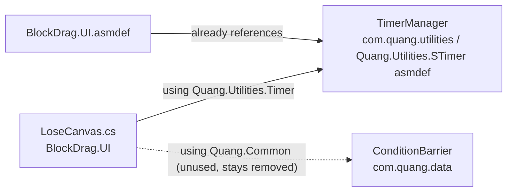

# Fix LoseCanvas compile error — Design

## Problem

Unity console:

```
Assets/_Game/_UI/Scripts/LoseCanvas.cs(153,13): error CS0103: The name 'TimerManager' does not exist in the current context
```

The uncommitted change to `LoseCanvas.cs` removed two `using` directives:

| Removed using | Still needed? | Reason |
|---|---|---|
| `Quang.Common` | No | Its only type is `ConditionBarrier` (in `com.quang.data`), which LoseCanvas does not use. |
| `Quang.Utilities.Timer` | **Yes** | `TimerManager` lives in `com.quang.utilities/Runtime/STimer/TimerManager.cs` under `namespace Quang.Utilities.Timer`, and `OnNextLevel` calls `TimerManager.Ins.WaitForTime(...)`. |

The `BlockDrag.UI.asmdef` already references `Quang.Utilities.STimer`, so this is only a missing `using`, not an assembly problem.

## Proposed fix

1. Add `using Quang.Utilities.Timer;` back.
2. Tidy up the blank lines the removal left behind (one has trailing whitespace).
3. Keep `Quang.Common` removed, since nothing uses it.

No changes to assemblies, dependency direction, prefabs, or scenes.



## Out of scope: runtime risks spotted, not fixed here

- `OnNextLevel` calls `topCanvas.FlyGoldReward(...)`, but `topCanvas = UIManager.Ins.OpenUI<TopCanvas>()` is commented out in `Open`, so `topCanvas` is always `null`. Pressing **Next Level** will throw a `NullReferenceException`.
- `BASE_GOLD` is always `0` because its assignment in `Open` is commented out.
- `using System.Data;` looks unused.

If you want these handled too, tell me and I'll add them to the scope.
