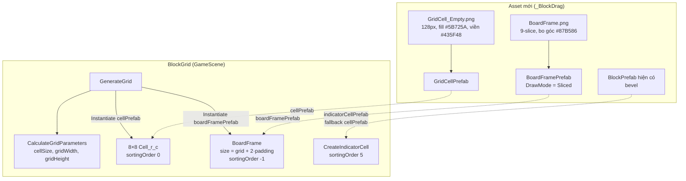

# Thiết Kế Kỹ Thuật: Asset Ô Lưới & Khung Board Theo Video Tham Chiếu

> **Ngày tạo:** 2026-10-14  
> **Tài liệu tham chiếu:** [`.agents/rules/architecture.md`](../../.agents/rules/architecture.md)  
> **Video tham chiếu:** `Assets/_Game/_BlockDrag/Resource/1791219122143_2226600900546722489_9065635962486239376.mp4` (2.5s, 720×1600)  
> **Files liên quan:**  
> - [`Assets/_Game/_BlockDrag/BlockGrid.cs`](../../Assets/_Game/_BlockDrag/BlockGrid.cs)  
> - [`Assets/_Game/_BlockDrag/Prefabs/BlockPrefab.prefab`](../../Assets/_Game/_BlockDrag/Prefabs/BlockPrefab.prefab)  
> - [`Assets/_Game/_Scenes/Game/GameScene.unity`](../../Assets/_Game/_Scenes/Game/GameScene.unity) (object `BlockGrid`)

---

## 1. Bối Cảnh & Yêu Cầu

### 1.1. Phân tích video
Board trong video là lưới **8×8** gồm hai lớp:

| Thành phần | Mô tả | Màu đo từ frame |
|---|---|---|
| Ô trống | Vuông phẳng, không bevel | fill `#5B725A` |
| Đường lưới | Vạch tối mảnh ≈ 3px trên ô ≈ 80px (~4% cạnh ô) giữa mọi ô và quanh mép | `#435F48` |
| Khung board | Viền bo góc dày ≈ 10px bao quanh lưới, đậm hơn màu nền | `#87B586` (mép ngoài sáng `#A6C9A8`) |
| Nền màn hình | Không thuộc task này | `#9BBEA3` |

Ghost khi kéo khối trong video vẫn là **khối bevel** mờ, không phải ô phẳng.

### 1.2. Hiện trạng
- `BlockGrid.cellPrefab` = `BlockPrefab` (sprite `Block_Bevel_White`, tint vàng alpha 0.29) — dùng cho **cả** ô nền **và** ghost indicator (`CreateIndicatorCell`).
- `spacing = 0` trong scene; không có khung board.

### 1.3. Mục tiêu
1. Tạo asset ô trống mới (sprite + prefab) giống video: ô phẳng, đường lưới nằm sẵn trong sprite.
2. Tạo khung board bo góc (sprite 9-slice + prefab) tự co giãn theo kích thước grid.
3. Gán vào `BlockGrid` trong `GameScene` để grid hiển thị giống video.
4. Ghost indicator giữ nguyên kiểu bevel hiện tại.

### 1.4. Ngoài phạm vi
- Màu nền màn hình, UI điểm/crown/settings, khối màu, khu spawn.
- Không đổi luật board (`BlockBoard`), kích thước 8×8, margin, vị trí.

---

## 2. Thiết Kế

### 2.1. Asset mới

| Asset | Đường dẫn | Chi tiết |
|---|---|---|
| `GridCell_Empty.png` | `Assets/_Game/_BlockDrag/Resource/` | 128×128, fill `#5B725A`, viền trong 2px `#435F48` mỗi cạnh → hai ô kề nhau tạo vạch ~4px (≈3px ở 80px như video). PPU = 128 để `sprite.bounds` = 1 unit. Filter Bilinear, không mipmap. |
| `BoardFrame.png` | `Assets/_Game/_BlockDrag/Resource/` | 64×64 bo góc bán kính ~16px, fill `#87B586`, viền ngoài 1–2px `#A6C9A8`. Sprite **border 9-slice** = 20px mỗi cạnh, Mesh Type = Full Rect. |
| `GridCellPrefab.prefab` | `Assets/_Game/_BlockDrag/Prefabs/` | 1 `SpriteRenderer` (sprite `GridCell_Empty`, color trắng, sortingOrder 0). |
| `BoardFramePrefab.prefab` | `Assets/_Game/_BlockDrag/Prefabs/` | 1 `SpriteRenderer` (sprite `BoardFrame`, Draw Mode **Sliced**, sortingOrder −1). |

Sprite được tạo bằng script một lần (ảnh PNG commit vào repo), **không** sinh texture lúc runtime. Màu nằm trong sprite nên ô không cần tint.

### 2.2. Thay đổi `BlockGrid` (assembly `BlockDrag`)
Thêm 3 field Inspector, giữ tương thích ngược khi để trống:

```csharp
[Tooltip("Prefab ghost khi kéo khối. Để trống => dùng cellPrefab")]
[SerializeField] protected GameObject indicatorCellPrefab;
[Tooltip("Prefab khung board (SpriteRenderer Sliced). Để trống => không vẽ khung")]
[SerializeField] protected GameObject boardFramePrefab;
[Tooltip("Độ dày viền khung tính theo tỉ lệ cellSize")]
[SerializeField] protected float framePaddingRatio = 0.12f;
```

- `CreateIndicatorCell()` dùng `indicatorCellPrefab ?? cellPrefab` → gán `BlockPrefab` để ghost giữ bevel.
- `GenerateGrid()` sau khi tạo ô: tạo (hoặc dùng lại) 1 instance `BoardFrame` con của grid, `localPosition = 0`, `size = (gridWidth, gridHeight) + 2·cellSize·framePaddingRatio`. `ClearGrid()` xoá khung cùng các ô.
- Padding tính theo `cellSize` nên khung co giãn đúng trên điện thoại và tablet.

Không thêm dependency mới; `BlockDrag` vẫn chỉ tham chiếu những gì đang có. Không đổi kiến trúc → không cần cập nhật `architecture.md`.

### 2.3. Wiring trong `GameScene`
| Field `BlockGrid` | Trước | Sau |
|---|---|---|
| `cellPrefab` | `BlockPrefab` | `GridCellPrefab` |
| `indicatorCellPrefab` | — | `BlockPrefab` |
| `boardFramePrefab` | — | `BoardFramePrefab` |
| `spacing` | 0 | 0 (vạch lưới nằm trong sprite) |

### 2.4. Sorting
```
-1  BoardFrame   (khung)
 0  GridCell     (ô trống)
 2  Khối đã đặt  (hiện có)
 5  Indicator    (hiện có)
```

---

## 3. Sơ Đồ



---

## 4. Rủi Ro & Cách Xử Lý
| Rủi ro | Xử lý |
|---|---|
| Ghost indicator thành ô phẳng nếu chỉ đổi `cellPrefab` | Field `indicatorCellPrefab` riêng, gán `BlockPrefab`. |
| Vạch lưới bị mờ/răng cưa ở cellSize nhỏ | Sprite 128px + Bilinear, không mipmap; kiểm tra trên Game view 1080×1920 và iPad. |
| Khung không khớp khi đổi margin/tablet | Kích thước khung tính từ `gridWidth/gridHeight/cellSize` trong cùng `GenerateGrid`. |
| Hiệu ứng clear/preview đọc `gridCells` | Không đổi cấu trúc `gridCells`; khung là object riêng, không nằm trong mảng. |

## 5. Kiểm Tra
- EditMode test hiện có vẫn pass.
- Play `GameScene`: lưới 8×8 phẳng có vạch tối, khung bo góc bao quanh, so sánh cạnh frame video; ghost vẫn bevel; clear hàng hoạt động bình thường; thử resolution iPad.
