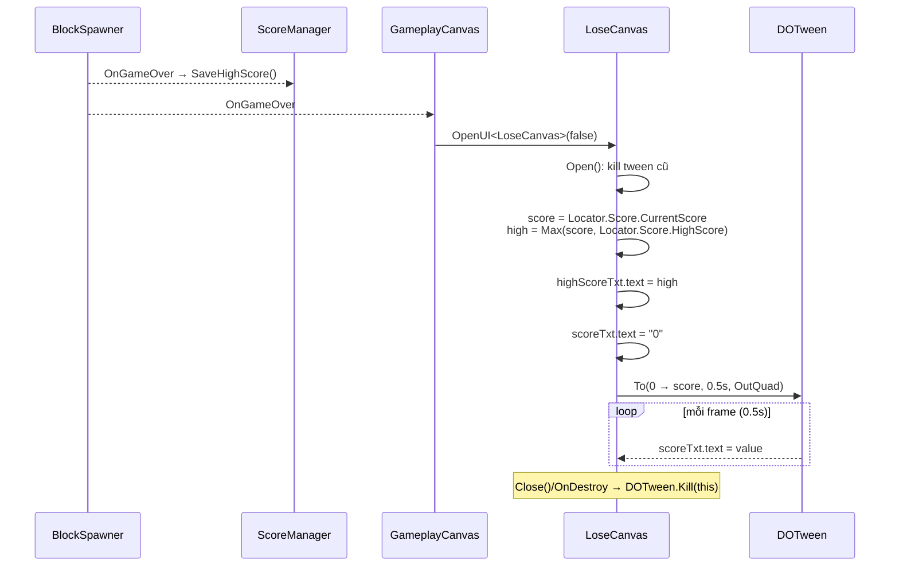

# Design: LoseCanvas hiển thị Score (count-up) và HighScore

## Requirements
- `LoseCanvas.scoreTxt` hiển thị điểm của ván vừa thua, chạy animation đếm tăng dần từ `0` → điểm cuối trong **0.5s**.
- `LoseCanvas.highScoreTxt` hiển thị điểm kỷ lục (hiện ngay, không animation).
- Không thay đổi hành vi các nút Try Again / Home / Next Level.

## Data source
- Dùng `Locator.Score` (`IScoreService`, assembly `BlockDrag`) — đúng hướng phụ thuộc `BlockDrag.UI → BlockDrag`, giống `GameplayCanvas`.
  - `CurrentScore`: điểm ván hiện tại (chưa bị reset khi Game Over; chỉ reset ở `OnGameRestarted`).
  - `HighScore`: kỷ lục. Khi Game Over, `ScoreManager.HandleGameOver → SaveHighScore()` cập nhật `HighScore`. Vì thứ tự subscribe giữa `ScoreManager` và `GameplayCanvas` vào `OnGameOver` không đảm bảo, hiển thị `Mathf.Max(CurrentScore, HighScore)` để luôn đúng.
- Nếu `Locator.Score == null` (ví dụ mở canvas ngoài gameplay): hiển thị `0`, không animation.

## Animation
- Dùng DOTween (đã được `BlockDrag.UI` tham chiếu): `DOTween.To(getter, setter, finalScore, 0.5f)` trên một biến `int`, mỗi update gán `scoreTxt.text`.
- Ease: `Ease.OutQuad` (nhanh lúc đầu, chậm dần về cuối — cảm giác "đếm điểm" tự nhiên).
- `SetUpdate(true)` để chạy cả khi `Time.timeScale = 0`.
- `SetTarget(this)`; kill tween cũ khi `Open` lại, khi `Close`, và trong `OnDestroy` để tránh tween ghi vào text của canvas đã đóng/huỷ.
- Duration để `[SerializeField] float scoreCountDuration = 0.5f` để chỉnh trong Inspector.

## Out of scope
- Không thêm hiệu ứng "New Best!" hay scale/punch cho text.
- Không đổi prefab (2 field `scoreTxt`, `highScoreTxt` đã có sẵn — chỉ cần kiểm tra đã được gán trong prefab).
