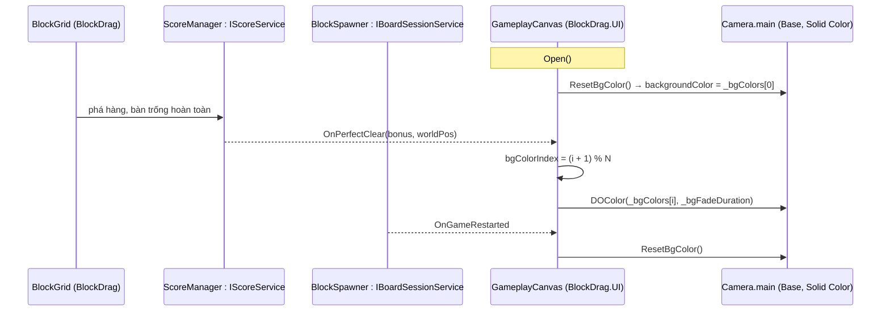
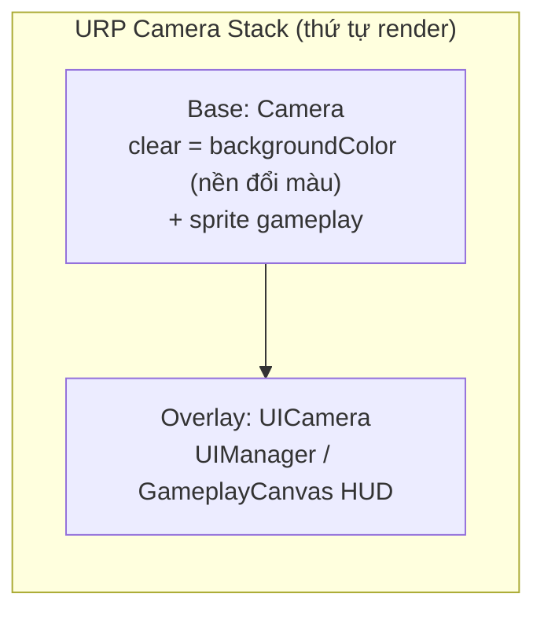

# Thiết Kế Kỹ Thuật: Đổi Màu Background Khi Dọn Sạch Bàn (Perfect Clear)

> **Ngày tạo:** 2026-10-14  
> **Tài liệu tham chiếu:** [`.agents/rules/architecture.md`](../../.agents/rules/architecture.md)  
> **Files liên quan:**  
> - [`Assets/_Game/_UI/Scripts/GameplayCanvas.cs`](../../Assets/_Game/_UI/Scripts/GameplayCanvas.cs)  
> - [`Assets/_Game/Resources/UI/GameplayCanvas.prefab`](../../Assets/_Game/Resources/UI/GameplayCanvas.prefab)  
> - [`Assets/_Game/_BlockDrag/Base/IScoreService.cs`](../../Assets/_Game/_BlockDrag/Base/IScoreService.cs), [`IBoardSessionService.cs`](../../Assets/_Game/_BlockDrag/Base/IBoardSessionService.cs)  
> - `Assets/_Game/_Scenes/Game/GameScene.unity` (chỉ đọc: cấu hình camera)

---

## 1. Bối Cảnh & Yêu Cầu

### 1.1. Hiện trạng
- `GameplayCanvas.prefab` có object `BG` (Image màu trơn, full màn hình). Khi bật, BG **che mất board gameplay**.
- Cấu hình camera trong `GameScene` dùng **URP camera stack**:
  - `Camera` (tag `MainCamera`) là **Base** camera, Clear Flags = Solid Color, dùng để render sprite gameplay.
  - `UICamera` là **Overlay** camera nằm trong stack của Base camera và render canvas `UIManager` (Screen Space - Camera).
- Overlay camera luôn render **sau** Base camera, nên mọi Image trong UI đều vẽ đè lên gameplay. Sorting Layer/Order **không** đẩy được BG ra phía sau, vì nó chỉ có tác dụng trong cùng một camera.
- `IScoreService.OnPerfectClear(int bonus, Vector3 worldPos)` đã được bắn ra mỗi khi người chơi dọn sạch bàn.

### 1.2. Mục tiêu
1. Nền màn chơi hiển thị **phía sau** board.
2. Mỗi lần Perfect Clear, nền **chuyển mượt** sang màu kế tiếp trong một bảng màu cấu hình được trong Inspector.
3. Khi bắt đầu ván mới (mở canvas hoặc `RestartGame`), nền quay về màu đầu tiên.

### 1.3. Ngoài phạm vi
- Nền dạng sprite/ảnh. Nếu cần sau này: tạo một canvas BG riêng trong scene, render bằng Base camera.
- Lưu màu nền giữa các phiên chơi.

---

## 2. Thiết Kế

### 2.1. Dùng màu nền của Base camera làm background
- Base camera đã clear bằng màu trơn, nên đổi `Camera.main.backgroundColor` là đổi màu nền. Nền này luôn nằm sau mọi sprite gameplay và mọi UI.
- Object `BG` trong prefab được **tắt** (`m_IsActive: 0`) và không còn được dùng.
- Không thay đổi scene hay cấu hình camera stack.

### 2.2. Logic đổi màu (trong `GameplayCanvas`, assembly `BlockDrag.UI`)
- Thêm field serialize: `_bgColors[]` và `_bgFadeDuration`.
- Lấy camera qua `Camera.main` mỗi lần cần dùng. Prefab nằm trong `Resources` nên không serialize được tham chiếu tới camera của scene, và camera có thể đổi khi load lại scene.
- Trong `BindScore` / `UnbindScore`: đăng ký và gỡ `OnPerfectClear`.
- Trong `BindSession` / `UnbindSession`: đăng ký và gỡ `OnGameRestarted`, dùng để reset màu.
- `Start()` reset màu lúc vào game, vì `GameplayCanvas` được đặt sẵn trong `GameScene` nên `Open()` không chạy ở lần đầu.
- `Open()` cũng reset màu, phòng trường hợp ván mới được bắt đầu bằng cách mở lại canvas.
- Màu được đổi bằng `Camera.DOColor` (DOTween). Tween cũ bị kill trước khi chạy tween mới và bị kill trong `OnDestroy`.

### 2.3. Phụ thuộc
Không thêm phụ thuộc mới. UI chỉ nghe interface của gameplay (`IScoreService`, `IBoardSessionService`) qua `Locator`, đúng chiều `BlockDrag.UI → BlockDrag`.

---

## 3. Rủi Ro
- **Chỉ hỗ trợ màu trơn:** muốn nền là ảnh thì phải chuyển sang canvas BG trong scene (xem 1.3).
- **Màu ban đầu của camera:** `_bgColors[0]` sẽ thay cho màu nền đang đặt trên camera trong scene (xanh dương). Mặc định `_bgColors[0]` là màu nâu cũ của BG, có thể chỉnh trong Inspector.
