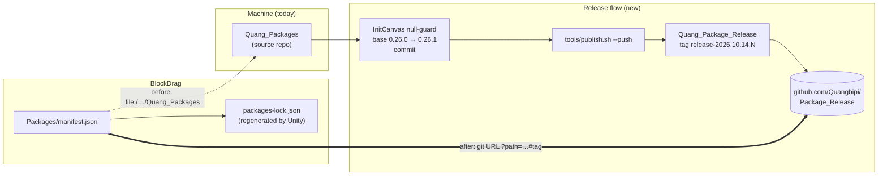

# Switch `com.quang.*` packages from local `file:` to the git release — Design

## Context

`Packages/manifest.json` references six packages through absolute local paths:

```
com.quang.designpattern  com.quang.utilities  com.quang.persistence
com.quang.base           com.quang.data       com.quang.ui
→ file:/Users/minhquang/Documents/PackUnity/Quang_Packages/Packages/<id>
```

This only works on this one machine. Releases are already published to
`https://github.com/Quangbipi/Package_Release.git` (latest tag `release-2026.10.11.1`).

## Gap between the source repo and the published release

`Quang_Packages` has uncommitted changes:

| Change | Impact |
|---|---|
| ~198 `.meta` files: Unity added the `MonoImporter` block, **GUIDs unchanged** | None, cosmetic only |
| `com.quang.base/Runtime/Init/InitCanvas.cs`: `clearDataButton` listener add/remove **commented out** | **Required by BlockDrag** |

`Assets/_Game/_Base/Canvas_Debug.prefab` (used in `CryptoLoader.unity`) does **not** assign
`clearDataButton`. With the current release tag, `InitCanvas.Start()` and `InitCanvas.OnDestroy()`
would throw `NullReferenceException`, and `Start` would abort before anything after it runs.

## Decision

1. **Fix `InitCanvas` properly in the source repo** instead of keeping the commented-out lines:
   guard the optional button with `if (clearDataButton != null)` in `Start` and `OnDestroy`.
   Games that wire the button keep the Clear Data feature, and games that do not (BlockDrag)
   no longer crash.
2. Bump `com.quang.base` `0.26.0 → 0.26.1` (patch, no API change) and add a CHANGELOG entry.
   Dependents keep declaring `"com.quang.base": "0.26.0"`. This is valid because Unity takes
   the manifest's direct git reference.
3. Commit the source repo (fix + `.meta` normalisation), then run `tools/publish.sh --push`.
   This creates a new tag `release-2026.10.14.N`.
4. Point the six manifest entries at
   `https://github.com/Quangbipi/Package_Release.git?path=Packages/<id>#<new tag>`.
   Unity regenerates `packages-lock.json`.

Architecture boundaries are unchanged: only the package source changes, not the dependency
direction.



## Workflow afterwards

- Edit packages in `Quang_Packages`, bump the version and CHANGELOG, commit, then run `publish.sh --push`. After that, change `#tag` in BlockDrag's manifest.
- For live debugging, temporarily switch one entry back to `file:`. Do not commit that change.

## Risks

- **Outward-facing:** pushing a commit and tag to GitHub. A pushed tag should be treated as immutable.
- The release repo has an untracked `HUONG_DAN_PACKAGES.md`, and `publish.sh` refuses to run on a dirty release repo. This file must be committed, moved or ignored first. The plan will decide which.
- First resolve needs git access to the repo from every machine/CI that opens the project.
