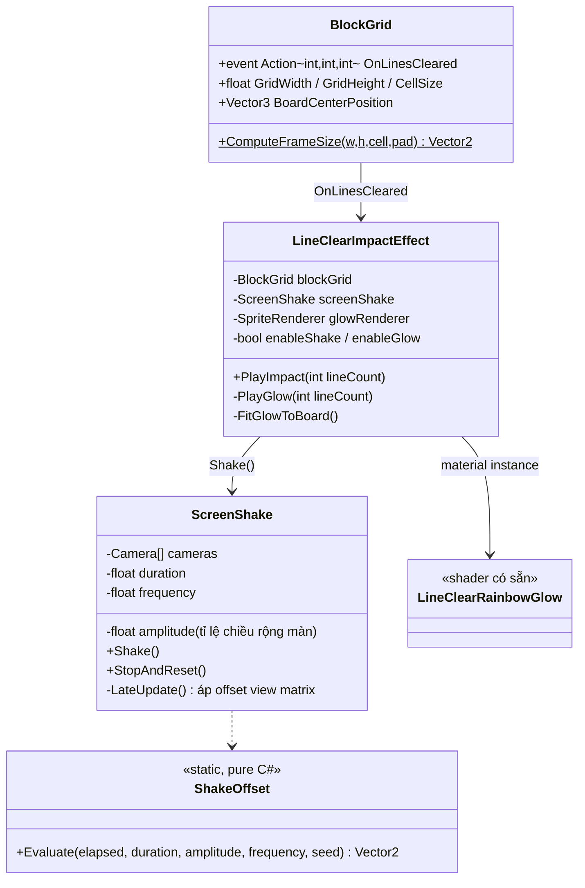
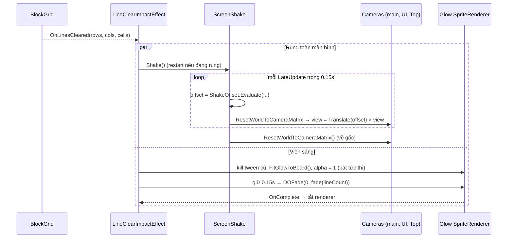
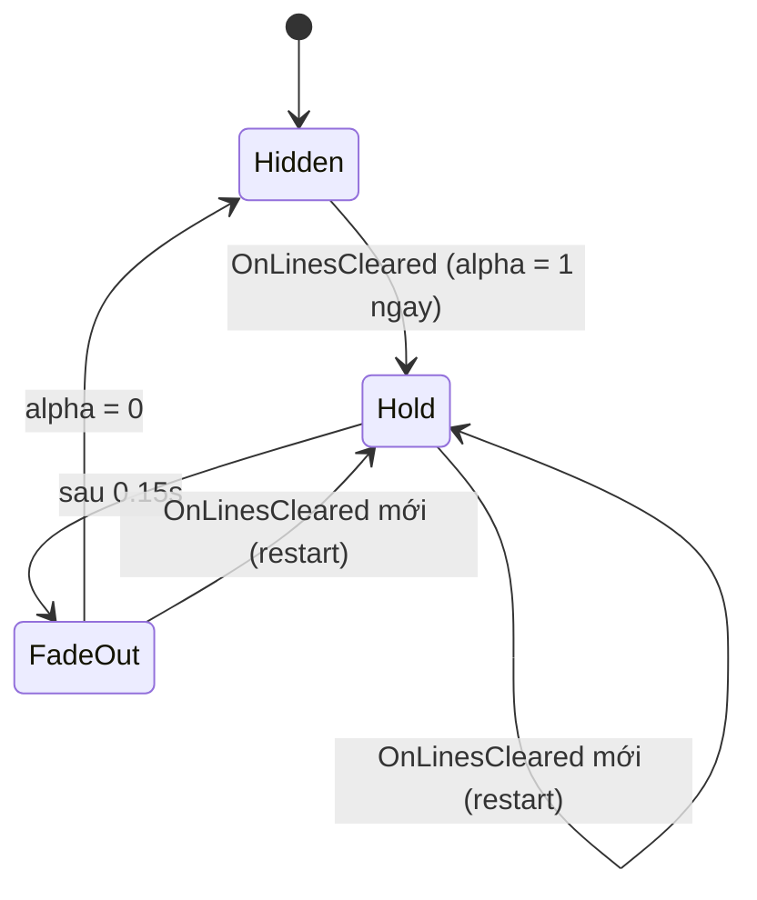

# Thiết Kế Kỹ Thuật: Game Feel Khi Phá Hàng — Rung Toàn Màn Hình & Viền Sáng Quanh Grid (Line Clear Impact Feedback)

> **Ngày tạo:** 2026-10-15 · **Sửa lần 1:** 2026-10-15 (đo lại video bằng pixel: rung là **toàn màn hình**, biên độ **không** tăng theo số đường) · **Sửa lần 2:** 2026-10-15 (đổi từ dịch projection sang dịch **view matrix** — đã được duyệt, xem 2.2)
> **Tài liệu tham chiếu:** `.agents/rules/architecture.md`, `.agents/rules/task_planning.md`, `Docs/designs/2026-10-13-multi-line-rainbow-glow-design.md`
> **Video tham chiếu:** `Assets/_Game/_BlockDrag/Resource/1792060311704_2226600900546722489_9065635962486239376.mp4` (26.5s, 720×1600, ~24fps)
> **Files dự kiến:**
> - `Assets/_Game/_BlockDrag/Effects/ScreenShake.cs` *(mới — rung toàn màn hình bằng offset view matrix của các camera)*
> - `Assets/_Game/_BlockDrag/Effects/ShakeOffset.cs` *(mới — hàm thuần tính offset theo thời gian, unit-test được)*
> - `Assets/_Game/_BlockDrag/Effects/LineClearImpactEffect.cs` *(mới — nghe `BlockGrid.OnLinesCleared`, gọi rung + viền)*
> - `Assets/_Game/_BlockDrag/Effects/Materials/BoardImpactGlow.mat` *(mới — dùng lại shader `BlockDrag/LineClearRainbowGlow`)*
> - Sprite viền: tái dùng `Effects/Textures/LineClearGlow.png` (9-slice), nếu quầng sáng không đủ mềm thì thêm `BoardImpactGlow.png`
> - `Assets/_Game/_BlockDrag/Prefabs/LineClearImpactEffect.prefab` *(mới)* + `GameScene.unity` *(thêm instance, gán camera)*
> - `Assets/Tests/EditMode/ShakeOffsetTests.cs`, `LineClearImpactEffectTests.cs` *(mới)*

---

## 1. Yêu Cầu & Phân Tích Video

### 1.1. Mục tiêu
Mỗi khi phá hàng/cột, người chơi cảm nhận được "lực va chạm": **toàn bộ màn hình rung nhẹ** và **một viền sáng nhiều màu loé lên quanh grid** rồi tắt dần.

### 1.2. Đo đạc khung hình
Trích từng frame (~42ms) quanh 2 lần phá: **1 đường** (t≈0.96s) và **5 đường** (t≈22.75s). Với mỗi frame, đo số pixel đen lộ ra ở 4 mép video tại 3 độ cao khác nhau: **HUD điểm (trên cùng)**, **giữa bàn chơi**, **banner quảng cáo (dưới cùng)**. Màn hình bị dịch bao nhiêu thì mép đối diện lộ ra bấy nhiêu pixel đen.

**Lần phá 1 đường**

| t | Mép trên | Mép trái (HUD / giữa / banner) | Mép phải (HUD / giữa / banner) | Ý nghĩa |
|---|---|---|---|---|
| 0.93s | 0 | 0 / 0 / 0 | 0 / 0 / 0 | Chưa rung |
| 0.98s | 5 | 0 / 0 / 0 | 1 / 1 / 1 | Dịch **xuống** 5px |
| 1.02s | 2 | **8 / 8 / 8** | 0 / 0 / 0 | Dịch **phải** 8px |
| 1.06s | 0 | 0 / 0 / 0 | 0 / 0 / 0 | Về giữa (hoặc lệch hướng lên/trái) |
| 1.10s | 6 | 0 / 0 / 0 | 1 / 1 / 1 | Dịch **xuống** 6px |
| 1.14s | 0 | 0 / 0 / 0 | 0 / 0 / 0 | Hết rung |

**Lần phá 5 đường**

| t | Mép trên | Mép dưới | Mép trái (HUD / giữa / banner) | Ý nghĩa |
|---|---|---|---|---|
| 22.65s – 22.78s | 0 | 0 | 0 / 0 / 0 | Chưa rung |
| 22.82s | 0 | 4 | **4 / 4 / 4** | Dịch lên + phải 4px |
| 22.86s | 3 | 0 | 0 / 0 / 0 | Dịch xuống 3px |
| 22.90s – 22.94s | 0 | 4 | 0 / 0 / 0 | Dịch lên 4px |
| 22.98s | 0 | 0 | 0 / 0 / 0 | Hết rung |

**Kết luận**
1. **Rung toàn màn hình** — HUD, bàn chơi và cả banner quảng cáo lệch **cùng một lượng** ở cùng frame ⇒ cả khung hình dịch chuyển như một khối, không phải chỉ bàn chơi.
2. **Biên độ**: 3–8px trên màn rộng 720px ⇒ khoảng **0.5%–1.1% chiều rộng màn hình**.
3. **Thời lượng**: khoảng **0.15s** (4 frame), mỗi frame đổi sang một hướng ngẫu nhiên, hết rung thì về đúng vị trí cũ.
4. **Không mạnh hơn khi phá nhiều đường**: 5 đường (4px, ~0.15s) không mạnh hơn 1 đường (5–8px, ~0.15s). (Bản trước mình nói rung 5 đường mạnh hơn là đoán bằng mắt, đo pixel thì không đúng.)
5. **Viền sáng** bật **tức thì** đúng frame phá, gradient **cyan (dưới/trái) → tím/hồng (trên/phải)** ôm khung board, quầng mềm tràn ra ~0.3 ô; giữ ~0.15s rồi mờ dần. Riêng viền thì **lâu hơn khi phá nhiều đường**: 1 đường ≈ 0.4s, 5 đường ≈ 0.55s.
6. Viền vàng lấp lánh ở t≈23.4s đi kèm text Combo, **ngoài phạm vi**.

### 1.3. Phạm vi
- ✅ Rung toàn màn hình (thế giới game + UI render qua camera) mỗi lần `OnLinesCleared`, biên độ/thời lượng **cố định** theo video.
- ✅ Viền sáng quanh khung board mỗi lần phá; thời gian giữ/mờ dài hơn khi phá nhiều đường.
- ✅ Phá liên tiếp nhanh: hiệu ứng **khởi động lại**, màn hình luôn trả về đúng vị trí gốc.
- ✅ Mọi thông số chỉnh trong Inspector; bật/tắt riêng rung và viền.
- ❌ Không đổi animation ô bị phá, điểm, combo text, perfect-clear background.
- ❌ Không rung haptic (điện thoại); **không rung được banner quảng cáo native** (banner do SDK vẽ ngoài Unity) — trong video banner rung có lẽ vì video là bản quay quảng cáo dựng lại, game thật không cần.

### 1.4. Thông số mặc định (đã chốt từ đo video)

| Thông số | Mặc định | Ghi chú |
|---|---|---|
| Biên độ rung | **0.9% chiều rộng màn hình** | ≈ 6.5px trên màn 720px; tính theo tỉ lệ màn nên mọi thiết bị trông như nhau |
| Thời gian rung | **0.15s** | |
| Tần số đổi hướng | **~24 lần/giây** (mỗi ~42ms) | Hướng ngẫu nhiên, biên độ giảm dần về 0 |
| Viền — alpha đỉnh | 1.0 | |
| Viền — giữ sáng | 0.15s | |
| Viền — thời gian mờ | 0.25s (1 đường) → 0.40s (≥3 đường) | Tổng 0.4s → 0.55s như video |

---

## 2. Kiến Trúc & Thiết Kế Thành Phần

### 2.1. Hiện trạng camera/canvas (đã kiểm tra trong `GameScene`)
- Scene có **3 camera orthographic**: `Camera` (main, vẽ bàn chơi), `UICamera`, `Top`.
- `UIManager` (package `com.quang.ui`) có `SetCameraScreenSpace(cam)` để chuyển canvas sang *Screen Space – Camera*; các canvas con trong `Resources/UI/*.prefab` gắn dưới canvas đó.
- Chưa có code nào làm rung/di chuyển camera; code khác chỉ **đọc** `cam.transform.position.z` (`BlockDragInput`, `BlockDragHandler`, `BlockGrid`).

### 2.2. Vì sao rung bằng offset view matrix thay vì di chuyển camera

| Cách | Vấn đề |
|---|---|
| Di chuyển `transform` của camera main | Canvas *Screen Space – Camera* luôn bám theo camera ⇒ **UI đứng yên**, chỉ bàn rung. Không giống video |
| Di chuyển camera + di chuyển thêm root UI | Phải đồng bộ 2 nơi; `BlockDrag` không được phụ thuộc `BlockDrag.UI` |
| Dịch ma trận projection của mọi camera | **Đã thử, loại**: canvas *Screen Space – Camera* của `UICamera` **biến mất** khi projection bị ghi đè (kiểm tra trong Play mode) |
| **Dịch view matrix (`worldToCameraMatrix`) của mọi camera trong danh sách** ✅ | Mọi thứ camera vẽ (bàn, khối, particle, HUD qua UICamera) cùng dịch một lượng như một khối ⇒ đúng "rung cả screen" (đã kiểm tra trong Play mode: HUD vẫn hiện và lệch cùng bàn). Transform camera **không đổi** ⇒ vị trí world của grid và luật đặt khối không bị ảnh hưởng |

Cách làm: mỗi frame trong lúc rung, với mỗi camera `cam.ResetWorldToCameraMatrix()` rồi `cam.worldToCameraMatrix = Matrix4x4.Translate(offset × viewWidth) * cam.worldToCameraMatrix` (`viewWidth = 2 × orthographicSize × aspect`). Hết rung thì `ResetWorldToCameraMatrix()` để view lại bám theo transform camera như bình thường.

> Canvas *Screen Space – Overlay* (nếu có) không đi qua camera nên sẽ không rung. Bước plan sẽ kiểm tra lúc chạy xem canvas gameplay/HUD đang ở chế độ nào và render bằng camera nào, rồi chốt danh sách camera cần gán.

### 2.3. Thành phần

- **`ScreenShake`** — component tái sử dụng, không biết gì về grid. Có thể gọi từ chỗ khác sau này (ví dụ perfect clear, game over).
- **`ShakeOffset`** — hàm thuần: chia thời gian thành từng bước theo `frequency`, mỗi bước chọn một hướng ngẫu nhiên (theo seed), nhân biên độ giảm dần tuyến tính về 0 ở cuối `duration`. Dễ test: `elapsed >= duration` ⇒ `Vector2.zero`.
- **`LineClearImpactEffect`** — subscribe `OnLinesCleared` trong `OnEnable`, unsubscribe trong `OnDisable`. Gọi `screenShake.Shake()` và chạy viền.
- **Viền** — một `SpriteRenderer` 9-slice con, đặt ở `BoardCenterPosition`, size = `ComputeFrameSize(...)` + padding; dùng lại shader `BlockDrag/LineClearRainbowGlow` với gradient cyan → xanh dương → tím → hồng. Thứ tự vẽ: trên khung board, dưới block (giá trị cụ thể chốt trong plan).

### 2.4. Luồng chạy

### 2.5. Trạng thái viền

### 2.6. Ranh giới module
Toàn bộ nằm trong assembly **`BlockDrag`** (`Effects/`, namespace `Gameplay.BlockDrag`), chỉ dùng `BlockGrid` (event và kích thước có sẵn), `UnityEngine.Camera`, DOTween. Không sửa `BlockGrid`, `BlockBoard`, `ScoreManager`, package hay UI ⇒ không đổi ranh giới, không cần cập nhật `architecture.md`.

---

## 3. Kiểm Thử (định hướng)
- **EditMode `ShakeOffsetTests`**: `elapsed = 0` có biên độ ≤ amplitude; `elapsed >= duration` ⇒ `Vector2.zero`; biên độ giảm dần; cùng seed ⇒ cùng kết quả.
- **EditMode `LineClearImpactEffectTests`**: sau khi rung xong hoặc bị dừng giữa chừng, view matrix của camera trở về đúng ma trận mặc định, projection không bị đụng; thời gian mờ viền tăng theo số đường và có giới hạn trên.
- **Thủ công (GameScene)**: phá 1 và 5 đường, so với video — HUD và bàn cùng rung, rung trong khoảng 0.15s, không thấy lệch khi kéo khối ngay sau khi phá; viền ôm khít khung board trên cả màn điện thoại và tablet.

## 4. Rủi Ro
| Rủi ro | Giảm thiểu |
|---|---|
| Có canvas Overlay ⇒ phần UI đó không rung | Plan kiểm tra render mode lúc chạy; nếu cần thì thêm một offset nhỏ cho root canvas đó ở phía UI (task riêng nếu phải sửa package) |
| Rung gây khó chịu | Biên độ nhỏ (0.9% màn hình), chỉ 0.15s, có toggle tắt |
| View matrix không được reset khi object bị tắt/huỷ giữa lúc rung | `OnDisable`/`OnDestroy` luôn gọi `ResetWorldToCameraMatrix()` cho mọi camera |
