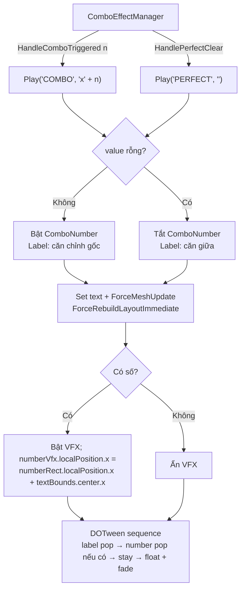

# ComboTextEffect: ẩn điểm cộng khi PERFECT & căn VFX giữa số combo — Design

## 1. Yêu cầu

1. Khi hiện **PERFECT**, không hiện số điểm cộng phía sau (hiện tại là `PERFECT +900`).
2. VFX `Flash_star_ellow_green` (con của prefab `ComboTextEffect`) phải **luôn nằm giữa text số combo** (`x2`, `x10`, `x125`...). Hiện tại VFX bị lệch khi combo ≥ 10.

## 2. Hiện trạng & nguyên nhân

Cấu trúc prefab [ComboTextEffect.prefab](../../Assets/_Game/Resources/Prefabs/ComboTextEffect.prefab):

```
ComboTextEffect (RectTransform, HorizontalLayoutGroup, ContentSizeFitter, CanvasGroup, ComboTextEffect)
├── Flash_star_ellow_green   (Transform thường, localPos x=110, y=-19, scale 30)  ← layout group bỏ qua
├── ComboLabel   (TMP, rect 418 x 89, pivot (1, 0.5), căn phải)
└── ComboNumber  (TMP, rect 399.6 x 138, pivot (0, 0.5), căn TRÁI)
```

- Text số dùng **rect cố định rộng ~400** và **căn trái**. Khi text dài ra (`x2` → `x10`), chữ mọc thêm về bên phải, nên **tâm nhìn thấy của chữ dịch sang phải**.
- VFX đặt cứng ở `x = 110` (đo bằng mắt khi text là `x2`) nên không chạy theo → lệch.
- PERFECT: [ComboEffectManager.cs:258](../../Assets/_Game/_UI/Scripts/ComboEffectManager.cs#L258) gọi `effect.Play("PERFECT", $"+{bonus}", ...)` nên số luôn hiện.

## 3. Thiết kế

### 3.1 Ẩn điểm cộng khi PERFECT

- `ComboEffectManager.HandlePerfectClear` gọi `Play("PERFECT", string.Empty, spawnPosition)` (giữ nguyên chữ ký event `OnPerfectClear(int bonus, Vector3)` — chỉ không hiển thị `bonus`).
- `ComboTextEffect.Play(label, value, ...)`: nếu `value` rỗng → **tắt GameObject `ComboNumber`** (`SetActive(false)`), ngược lại bật lại. Vì đối tượng được pool tái sử dụng, phải bật lại mỗi lần chơi combo.
  - `HorizontalLayoutGroup` bỏ qua child inactive → `ContentSizeFitter` co root lại chỉ còn label → chữ PERFECT nằm giữa điểm spawn.
  - Animation bỏ qua bước "số nảy" khi số bị ẩn.
- Label đang căn phải trong rect 418; khi ẩn số, chữ PERFECT sẽ bị lệch phải một chút. Khi không có số → tạm đổi label sang căn giữa; khi có số → trả lại căn chỉnh gốc (cache lúc `EnsureReferences`).

### 3.2 VFX luôn ở giữa text số

Dùng code thay vì chỉnh tay vị trí trong prefab:

- Thêm field `[SerializeField] private Transform numberVfx;` vào `ComboTextEffect`, gán `Flash_star_ellow_green` trong prefab.
- Sau khi set text trong `Play`, gọi `AlignVfxToNumber()`:
  1. `comboNumberText.ForceMeshUpdate()` để có `textBounds` mới đúng với text hiện tại.
  2. `LayoutRebuilder.ForceRebuildLayoutImmediate(rectTransform)` để vị trí `ComboNumber` trong layout đã cập nhật.
  3. Tính tâm chữ trong không gian local của root: `numberRect.localPosition.x + textBounds.center.x` (tính bằng localPosition chứ **không** dùng `TransformPoint`, vì lúc này `numberContainer.localScale = 0` để chuẩn bị animation).
  4. Gán `numberVfx.localPosition = (centerX, numberVfx.localPosition.y, z)` → **chỉ chỉnh X**, giữ nguyên Y (-19) & scale bạn đã set tay.
- Khi PERFECT (số bị ẩn): **ẩn VFX** (`numberVfx.gameObject.SetActive(false)`); khi có số thì bật lại VFX (đã chốt với bạn).



## 4. Ranh giới kiến trúc

- Chỉ chạm `BlockDrag.UI` (`ComboTextEffect.cs`, `ComboEffectManager.cs`) + prefab `ComboTextEffect` + EditMode test. Không đổi phụ thuộc giữa các assembly.
- `ComboEffectPrefabCreator` (editor tool tạo prefab) không cần đổi; field `numberVfx` để null thì `AlignVfxToNumber` bỏ qua.

## 5. Kiểm thử

- EditMode (`ComboEffectTests`):
  - `Play_WithEmptyValue_HidesNumber` — PERFECT: `ComboNumber` inactive.
  - `Play_WithEmptyValue_HidesVfx` — PERFECT: VFX inactive.
  - `Play_ComboAfterPerfect_ShowsNumberAndVfxAgain` — pool tái sử dụng bật lại số và VFX.
  - Cập nhật test `PlayWithLabelAndValue` hiện đang assert `"+900"` cho PERFECT.
- Thủ công trong Editor: combo x2, x9, x10, x25, x100 → sao nằm giữa số; Perfect clear → chỉ hiện `PERFECT`.

## 6. Quyết định

1. Khi **PERFECT** (không có số): **ẩn VFX** — đã chốt.
2. Lưu ý: prefab `ComboTextEffect` đang có thay đổi chưa commit của bạn (thêm VFX) — mình sẽ sửa trên đó, không revert.
