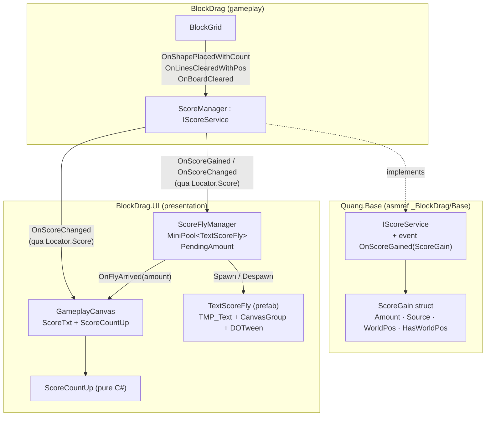
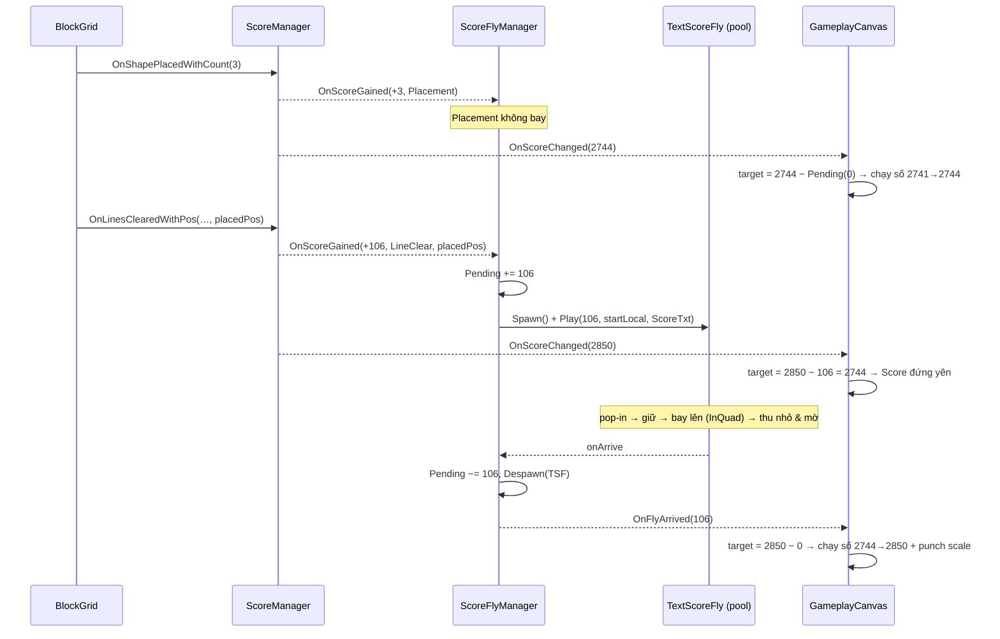
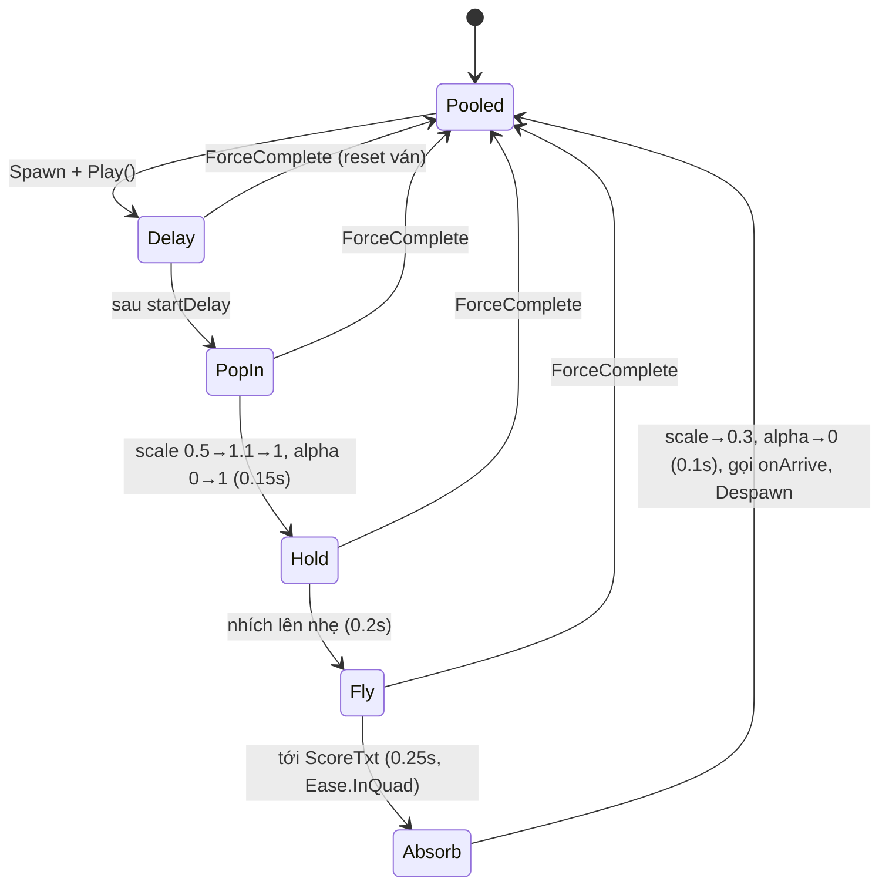

# Thiết Kế Kỹ Thuật: Chữ Điểm Bay Lên Score & Đếm Điểm Tăng Dần (Score Fly Text + Count-Up)

> **Ngày tạo:** 2026-10-16 · **Sửa lần 1:** 2026-10-16 (thời gian chạy số là `[SerializeField] countUpDuration`, mặc định 1s; điểm đặt khối không bay)
> **Tài liệu tham chiếu:** `.agents/rules/architecture.md`, `.agents/rules/task_planning.md`, `Docs/designs/2026-10-04-block-blast-score-and-combo-system-design.md`, `Docs/designs/2026-10-04-combo-text-effect-animation-design.md`
> **Video tham chiếu:** `Assets/_Game/_BlockDrag/Resource/1791791448367_2226600900546722489_9065635962486239376.mp4` (4.65s, 720×1600)
> **Files dự kiến:**
> - `Assets/_Game/_BlockDrag/Base/ScoreGain.cs` *(mới — struct `ScoreGain` + enum `ScoreSource`, biên dịch vào `Quang.Base` qua asmref)*
> - `Assets/_Game/_BlockDrag/Base/IScoreService.cs` *(sửa — thêm event `OnScoreGained`)*
> - `Assets/_Game/_BlockDrag/ScoreManager.cs` *(sửa — phát `OnScoreGained` kèm nguồn + toạ độ)*
> - `Assets/_Game/_UI/Scripts/ScoreFly/ScoreCountUp.cs` *(mới — logic đếm số thuần C#, unit-test được)*
> - `Assets/_Game/_UI/Scripts/ScoreFly/TextScoreFly.cs` *(mới — component chữ "+N" bay)*
> - `Assets/_Game/_UI/Scripts/ScoreFly/ScoreFlyManager.cs` *(mới — pool `MiniPool<TextScoreFly>`, spawn & theo dõi điểm đang bay)*
> - `Assets/_Game/_UI/Scripts/GameplayCanvas.cs` *(sửa — ScoreTxt chạy số thay vì nhảy số)*
> - `Assets/_Game/Resources/Prefabs/TextScoreFly.prefab` *(mới)*
> - `Assets/_Game/Resources/UI/GameplayCanvas.prefab` *(sửa — thêm `ScoreFlyManager`, gán ScoreTxt làm đích bay)*
> - `Assets/Tests/EditMode/ScoreCountUpTests.cs`, `ScoreFlyTests.cs` *(mới)*

---

## 1. Yêu Cầu & Phân Tích Video

### 1.1. Mục tiêu
1. Khi ăn điểm, xuất hiện chữ **"+N"** tại chỗ vừa phá hàng, sau đó **bay lên chữ Score** trên `GameplayCanvas`.
2. Chữ "+N" là một **prefab `TextScoreFly`**, quản lý bằng **pool** vì người chơi có thể ăn điểm liên tiếp (nhiều chữ bay cùng lúc).
3. Khi chữ bay tới nơi, **Score không nhảy số** mà **chạy tăng dần** tới số điểm cuối.

### 1.2. Timeline đo từ video (trích frame mỗi 50ms)

| t | Điều xảy ra trên màn hình |
|---|---|
| 2.40s | Đặt khối → phá 1 hàng. Điểm đặt khối **+3** cộng **ngay** vào Score (2741 → 2744), viên kim cương sau Score loé sáng. **Không có chữ bay** cho điểm đặt khối. |
| 2.70s | Chữ **"Combo 3"** bật lên tại vị trí khối vừa đặt. |
| 3.00s | **"+106"** hiện ra **nhỏ, mờ** ngay **phía trên** chữ Combo (pop-in). |
| 3.05s – 3.25s | "+106" phóng về kích thước đầy đủ, **đứng yên** (~0.2s); chữ Combo mờ dần rồi biến mất. |
| 3.25s → 3.45s | "+106" **bay thẳng lên** Score (~0.2s), **tăng tốc dần** (đoạn đầu chậm, đoạn cuối nhanh), trượt dần về giữa theo trục X. Không có vệt/particle. |
| 3.45s → 3.55s | Tới Score: **thu nhỏ + mờ dần** đè lên chữ Score rồi biến mất. |
| 3.55s → 3.75s | Score vẫn đứng 2744 (khoảng chờ ~0.3s). |
| 3.90s → 4.50s | Score chạy **2747 → 2752 → 2757 → 2763 → 2767**: tăng **tuyến tính ~35 điểm/giây**, video kết thúc khi chưa chạy hết tới 2850. |

### 1.3. Kết luận áp dụng
- **Chỉ điểm phá hàng/combo và Perfect Clear** mới có chữ bay. Điểm đặt khối cộng thẳng vào Score (chạy số ngắn), giống video và tránh spam chữ mỗi lần đặt khối.
- Số hiển thị trên Score **chỉ tăng khi chữ bay tới nơi**, nên trong lúc chữ đang bay thì Score hiển thị `điểm thật − tổng điểm đang bay`.
- **Đã chốt:** thời gian chạy số là một `[SerializeField] countUpDuration` trên `GameplayCanvas`, **mặc định 1s**, chỉnh trong Inspector. Mỗi lần có điểm mới tới, Score chạy từ số đang hiển thị lên số cuối trong `countUpDuration` giây.

---

## 2. Kiến Trúc

### 2.1. Sơ đồ thành phần



Chiều phụ thuộc giữ nguyên: `BlockDrag.UI → BlockDrag/Quang.Base`, gameplay **không** biết gì về UI. UI chỉ đọc `Locator.Score` (interface `IScoreService`), không tham chiếu `ScoreManager` cụ thể.

### 2.2. Thay đổi hợp đồng `IScoreService`

```csharp
// _BlockDrag/Base/ScoreGain.cs  (namespace Quang.Base)
public enum ScoreSource { Placement, LineClear, PerfectClear }

public readonly struct ScoreGain
{
    public readonly int Amount;
    public readonly ScoreSource Source;
    public readonly Vector3 WorldPos;   // vị trí khối vừa đặt / tâm bàn
    public readonly bool HasWorldPos;   // false khi gọi từ test/API không có toạ độ
}

// IScoreService
event Action<ScoreGain> OnScoreGained; // phát TRƯỚC OnScoreChanged
```

`ScoreManager` thay đổi:
- `AddScore(int amount)` giữ nguyên (tương thích test cũ) → nguồn mặc định `Placement`, không toạ độ.
- Thêm overload nội bộ `AddScore(int amount, ScoreSource source, Vector3? worldPos)`.
- `HandleShapePlacedWithCount` → `Placement`.
- `HandleLinesClearedWithPos` truyền `placedPos` xuống `HandleLinesCleared` → `LineClear` (gộp điểm cơ bản + thưởng combo thành **một** lần cộng như hiện tại → **một** chữ "+106").
- `HandlePerfectClear(boardCenter)` → `PerfectClear` kèm `boardCenter`.

### 2.3. Luồng xử lý một lần phá hàng



### 2.4. Trạng thái của một `TextScoreFly`



---

## 3. Chi Tiết Thành Phần

### 3.1. `TextScoreFly` (prefab `Resources/Prefabs/TextScoreFly.prefab`)
- Cấu trúc: `RectTransform` gốc + `CanvasGroup` + con `TMP_Text` (font/màu kem-vàng có viền giống "+106" trong video, cùng font với ScoreTxt).
- API:
  - `Play(int amount, Vector2 startAnchoredPos, RectTransform target, float startDelay, Action<TextScoreFly> onArrive)`
  - `ForceComplete()` — kill tween, **không** gọi onArrive (dùng khi reset ván).
- Animation dựng bằng một `DOTween.Sequence` (SetLink tới GameObject), các thời lượng/ease để `[SerializeField]` cho designer chỉnh.
- Đích bay là **toạ độ của ScoreTxt quy đổi về không gian local của pool container** (tính lúc bắt đầu bay, nên vẫn đúng nếu layout thay đổi).

### 3.2. `ScoreFlyManager` (component trên `GameplayCanvas`)
- Pool: `MiniPool<TextScoreFly>` của `Quang.DesignPattern` (theo quy tắc kiến trúc "reuse pool sẵn có"), preload `initialPoolSize = 4`, container `ScoreFlyPool` là con cuối của canvas để vẽ đè lên board và chữ Combo.
- Bind `Locator.Score` theo mẫu `BindScore/UnbindScore` + `Locator.ScoreChanged` như `GameplayCanvas`/`ComboEffectManager`.
- `HandleScoreGained(ScoreGain gain)`:
  - Nếu `Source` không nằm trong `flySources` (mặc định: LineClear, PerfectClear) hoặc `!HasWorldPos` hoặc thiếu đích → **không bay**, điểm vào Score ngay.
  - Ngược lại: `PendingAmount += gain.Amount`, quy đổi `WorldPos → screen → local` (cùng cách `ComboTextEffect` đang làm), cộng `spawnOffset` (đẩy lên trên chữ Combo, mặc định `(0, +90)`), chọn `startDelay`:
    - LineClear: `lineClearDelay` (mặc định 0.3s — chờ chữ Combo bật lên như video).
    - PerfectClear: `lineClearDelay + perfectClearExtraDelay` (bay sau chữ của lần phá cùng lượt, không chồng lên nhau).
  - Kẹp vị trí bắt đầu trong biên màn hình (giống `ComboTextEffect.ClampToCanvas`).
- `HandleArrive(fly)`: `PendingAmount -= amount`, despawn, phát `event Action<int> OnFlyArrived`.
- `CancelAll()`: `ForceComplete` mọi chữ đang bay, `Collect()` pool, `PendingAmount = 0`.
- Public: `int PendingAmount`, `event Action<int> OnFlyArrived`, `RectTransform FlyTarget`.

### 3.3. `ScoreCountUp` (pure C#, không phụ thuộc Unity object)
- Trạng thái: `Displayed` (int), `Target` (int), thời gian đã chạy, thời lượng.
- `Duration` (float): thời gian chạy số, lấy từ `GameplayCanvas.countUpDuration` (mặc định 1s). `Duration <= 0` → nhảy số ngay.
- `SetTarget(int target)`: nếu `target > Displayed` → bắt đầu chạy lại **từ số đang hiển thị** (không quay lại số cũ khi có điểm mới chen vào giữa) trong `Duration` giây.
- `Snap(int value)`: gán ngay (dùng cho bind lần đầu, reset ván, điểm giảm).
- `Tick(float dt) → bool changed`: nội suy `Mathf.Lerp` theo ease `OutQuad` rồi `RoundToInt`; luôn kết thúc **đúng bằng** `Target`.
- Không bao giờ hiển thị số lớn hơn `Target` hay giảm số trong lúc chạy lên.

### 3.4. `GameplayCanvas` (sửa)
- Thêm `[SerializeField] ScoreFlyManager scoreFlyManager`, `[SerializeField] float countUpDuration = 1f` (Tooltip: thời gian Score chạy từ số cũ lên số cuối) và `ScoreCountUp scoreCounter`.
- `UpdateScoreText(score)` đổi thành `RefreshScoreTarget()`:
  `target = boundScore.CurrentScore − scoreFlyManager.PendingAmount` → `scoreCounter.SetTarget(target)`.
- `Update()`: `if (scoreCounter.Tick(Time.unscaledDeltaTime)) ScoreTxt.text = scoreCounter.Displayed.ToString();` — chỉ gán text khi số đổi, `ToString` dùng cache số gần nhất để tránh GC mỗi frame (theo hướng của design `line-clear-preview-gc-fix`).
- `OnFlyArrived` → `RefreshScoreTarget()` + **punch scale** ScoreTxt (giữ hiệu ứng punch hiện có, nhưng chạy khi chữ chạm Score, không chạy mỗi lần số đổi).
- Bind lần đầu / điểm giảm (ván mới, `ResetScoreAndCombo`) / `OnGameRestarted` → `scoreFlyManager.CancelAll()` rồi `scoreCounter.Snap(CurrentScore)`.

### 3.5. Các tình huống biên

| Tình huống | Xử lý |
|---|---|
| Ăn liên tiếp, nhiều chữ đang bay | Mỗi lần ăn spawn một instance từ pool; `PendingAmount` cộng dồn; mỗi chữ tới nơi Score chạy tiếp từ số đang hiển thị. Pool tự nở nếu thiếu. |
| Line clear + Perfect Clear cùng lượt | 2 chữ riêng ("+106", "+300"), chữ Perfect bay trễ hơn `perfectClearExtraDelay`. |
| Game over khi chữ còn đang bay | Chữ vẫn bay hết & Score chạy hết (LoseCanvas đọc điểm từ `IScoreService`, không đọc text). |
| Restart / ván mới | `CancelAll()` + `Snap(0)`: không còn chữ treo, không cộng nhầm điểm ván cũ. |
| `ScoreManager` đổi instance (reload scene) | Bind lại theo `Locator.ScoreChanged`, `CancelAll()` + `Snap`. |
| Thiếu prefab / thiếu ScoreTxt | Không bay, Score vẫn chạy số đúng (an toàn ngược). |
| HighScore | Không đổi: vẫn cập nhật ngay theo `OnHighScoreChanged` (ngoài phạm vi). |

---

## 4. Ranh Giới Kiến Trúc
- `ScoreGain`/`ScoreSource` đặt trong `_BlockDrag/Base` vì `IScoreService` (Quang.Base) cần thấy chúng — đúng mục đích của asmref này ("game contracts exposed on Locator").
- Không thêm phụ thuộc mới giữa assembly: `BlockDrag.UI` đã tham chiếu `Quang.DesignPattern`, `DOTween`, `TMPro`.
- **Không đụng** `ComboEffectManager.cs` / `ComboTextEffect.cs` / `ComboTextEffect.prefab` (đang có thay đổi chưa commit của task `combo-text-perfect-and-vfx-center`), tránh xung đột.
- Cập nhật `.agents/rules/architecture.md` mục `IScoreService` (thêm `OnScoreGained`) và module map `BlockDrag.UI` (thêm Score fly).

## 5. Kiểm Thử
- **EditMode – `ScoreCountUpTests`**: chạy tới đúng Target sau đúng `Duration`; không vượt Target; SetTarget giữa chừng chạy tiếp từ số đang hiển thị; `Duration <= 0` nhảy ngay; Snap gán ngay.
- **EditMode – `ScoreFlyTests`** (mở rộng `ScoreManager` tests): `OnScoreGained` phát đúng `Source`/`Amount`/toạ độ cho đặt khối, phá hàng (một sự kiện gộp base + combo), perfect clear; phát trước `OnScoreChanged`; tổng `Amount` = chênh lệch `CurrentScore`.
- **Thủ công trong Editor (GameScene)**: phá 1 hàng, combo, nhiều hàng liên tiếp nhanh, perfect clear, restart giữa lúc chữ đang bay; đối chiếu với video.

## 6. Thông Số Mặc Định (chỉnh được trong Inspector)

| Thông số | Mặc định | Theo video |
|---|---|---|
| `lineClearDelay` | 0.3s | ~0.3s sau khi phá |
| `popInDuration` / `holdDuration` | 0.15s / 0.2s | ~0.1s / ~0.2s |
| `flyDuration` + ease | 0.25s, `InQuad` | ~0.2s, tăng tốc |
| `absorbDuration` | 0.1s | ~0.1s |
| `spawnOffset` | (0, 90) | ngay trên chữ Combo |
| `perfectClearExtraDelay` | 0.25s | — |
| `countUpDuration` (GameplayCanvas) | **1s** | ~3s cho +106 (~35 điểm/giây) |
| Count-up ease | `OutQuad` | tuyến tính |
| Chờ trước khi chạy số | 0s | ~0.3s |
| `initialPoolSize` | 4 | — |

## 7. Quyết Định Đã Chốt
1. **Tốc độ chạy số**: `[SerializeField] countUpDuration` trên `GameplayCanvas`, mặc định **1s**, bạn tự chỉnh trong Inspector.
2. **Điểm đặt khối**: chọn **(A)** — giống video, không có chữ bay; Score chạy số ngay (trong `countUpDuration`). `flySources` mặc định chỉ gồm `LineClear`, `PerfectClear`.
