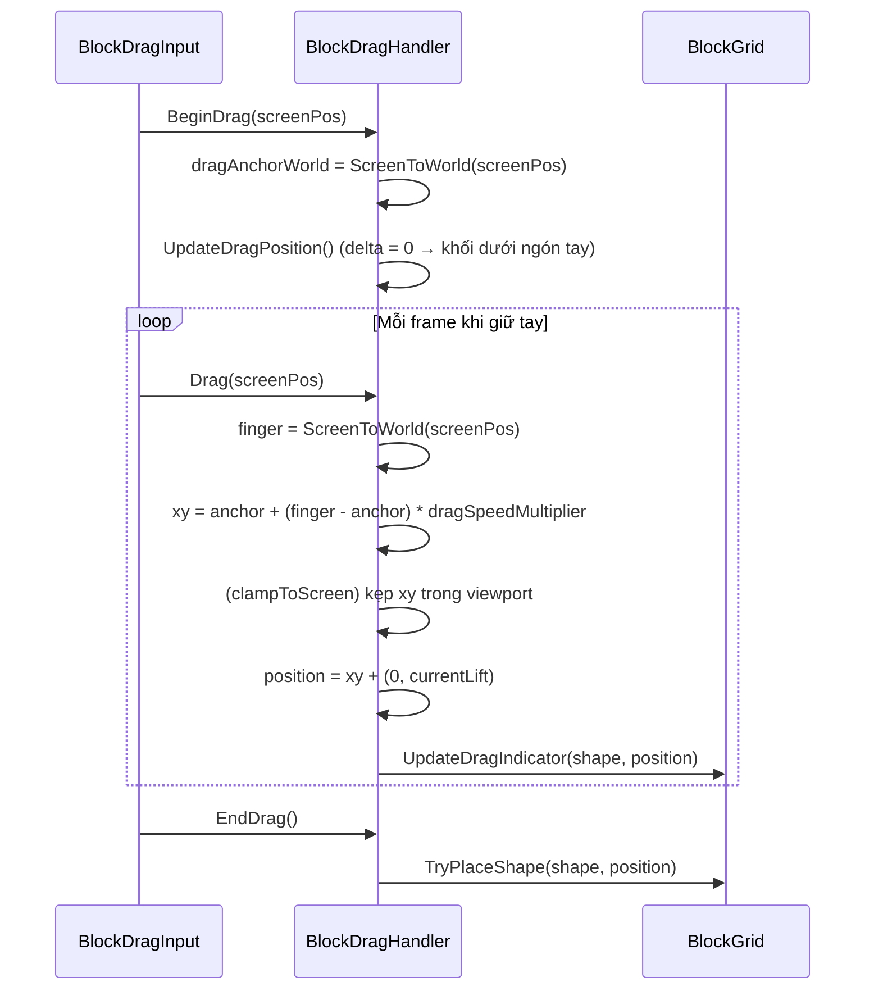
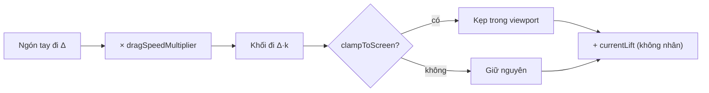

# Tăng tốc độ kéo khối (drag speed multiplier) — Design

## 1. Yêu cầu

Trên device, khi kéo khối người chơi thấy khối di chuyển "chậm", chưa đủ nhanh/mượt. Cần thêm biến cấu hình trong `BlockDragHandler` để khối di chuyển **nhanh hơn ngón tay** (ngón tay đi 1 đơn vị → khối đi `k` đơn vị), giống các game Block Blast / Block Puzzle.

## 2. Hiện trạng

| Thành phần | Vai trò hiện tại |
|------------|------------------|
| `BlockDragInput` | Đọc touch/mouse, gọi `BeginDrag(screenPos)` → `Drag(screenPos)` mỗi frame → `EndDrag()`. Đã set `Application.targetFrameRate = 60` |
| `BlockDragHandler.UpdateDragPosition()` | Bám **1:1**: `position = fingerWorld + (0, currentLift)` |
| `BlockGrid.UpdateDragIndicator / TryPlaceShape` | Dùng `transform.position` của khối → không cần sửa, tự hưởng vị trí mới |

Vì bám 1:1 nên muốn đưa khối từ slot (dưới cùng) lên đỉnh board, ngón tay phải đi đúng cả quãng đường đó → cảm giác chậm, mỏi tay. Frame rate đã là 60 nên nguyên nhân chính là tỉ lệ 1:1, không phải độ trễ.

## 3. Giải pháp đề xuất

Chuyển từ bám tuyệt đối sang **bám theo delta có hệ số nhân**, neo tại điểm bắt đầu kéo:

```
fingerWorld   = ScreenToWorld(lastScreenPos)
blockXY       = dragAnchorWorld + (fingerWorld - dragAnchorWorld) * dragSpeedMultiplier
position      = (blockXY.x, blockXY.y + currentLift, originalPosition.z)
```

- `dragAnchorWorld`: vị trí ngón tay (world) lúc `BeginDrag`. Tại frame đầu delta = 0 → khối vẫn nhảy về đúng dưới ngón tay như hiện tại (không đổi cảm giác lúc nhấc).
- `currentLift` **không** nhân hệ số (vẫn nâng đúng `dragLiftCells` ô).
- Với `dragSpeedMultiplier = 1` → hành vi y hệt hiện tại (an toàn để rollback trên Inspector).

### Biến mới (Inspector, header `Drag Speed`)

| Field | Kiểu | Mặc định | Ý nghĩa |
|-------|------|----------|---------|
| `dragSpeedMultiplier` | `float` `[Range(1f, 2.5f)]` | `1.3` | Hệ số nhân quãng đường khối đi so với ngón tay |
| `clampToScreen` | `bool` | `true` | Giữ tâm khối trong vùng camera nhìn thấy (vì `k > 1` khối có thể chạy ra ngoài màn hình trước ngón tay) |

### Tách logic thuần để test

Hàm static `ComputeDragPosition(Vector2 anchor, Vector2 finger, float multiplier)` trả về `anchor + (finger - anchor) * multiplier` → test EditMode được, không cần camera.

## 4. Sơ đồ





## 5. Kiến trúc & phạm vi

- Chỉ sửa `Assets/_Game/_BlockDrag/BlockDragHandler.cs` (assembly `BlockDrag`). Không thêm phụ thuộc assembly, không đổi API public, không đổi `BlockDragInput` / `BlockGrid`.
- Thêm test EditMode cho `ComputeDragPosition` trong `Assets/Tests/EditMode`.
- Prefab block: field mới có giá trị mặc định nên không cần migrate; chỉnh giá trị trên prefab khi tinh chỉnh cảm giác.

## 6. Rủi ro / cân nhắc

- `k` quá lớn (> 1.6) khó căn chính xác ô nhỏ → mặc định 1.3, tinh chỉnh trên device.
- Khi bắt đầu kéo từ slot sát cạnh màn hình, khối có thể bị kẹp ở mép — chấp nhận được, vì ngón tay kéo vào trong là khối đi ra ngay.
- Có thể sau này tách hệ số X/Y riêng (thường Y cần nhanh hơn X); hiện để một hệ số chung cho đơn giản.
