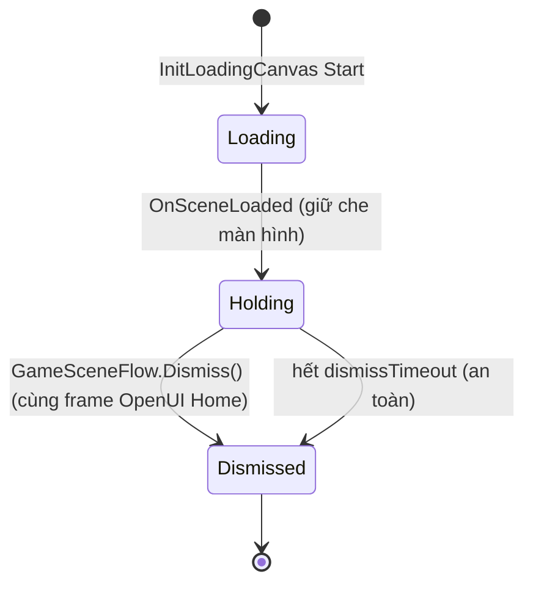

# Home Open Anim Timing — Design

Ngày: 2026-10-18

## 1. Vấn đề

Vào GameScene thì anim mở `HomeCanvas` (2 `UIScaleAnim` 0.25s / 0.5s, OutBack) và anim đếm HighScore (0.5s) **không nhìn thấy được**: lúc loading biến mất thì Home đã ở trạng thái cuối.

## 2. Nguyên nhân (đã khảo sát code)

| # | Sự kiện | Nguồn |
|---|---|---|
| 1 | GameScene activate → `GameSceneFlow.Start()` gọi `OpenUI<HomeCanvas>()` ngay frame đầu | `GameSceneFlow.cs` |
| 2 | `UICanvas.Open` → `SetActive(true)` → `OnActivated()` → `Show()` → tween SHOW **bắt đầu ngay** | `com.quang.base` `UICanvas.Open`, `com.quang.ui` `UISCanvas.Show` |
| 3 | `InitLoadingCanvas` (sorting **10000**) vẫn phủ trên Home (sorting **11**); chỉ bị `Destroy` khi coroutine `SceneGameManager` thấy `isDone` ở frame sau → `OnSceneLoaded` | `SceneGameManager.LoadSceneAsyncCoroutine`, `InitLoadingCanvas.OnGameSceneLoaded` |
| 4 | Frame activate scene + `Resources.Load`/`Instantiate` HomeCanvas bị hitch lớn. Tween `SetUpdate(true)` dùng unscaled delta **không bị cap** (`useSmoothDeltaTime: 0` nên `maxSmoothUnscaledTime` không có hiệu lực) → tween 0.25s/0.5s hoàn tất trong 1–2 frame | `DOTweenSettings.asset`, `UIScaleAnim.Play` |

→ Anim có chạy, nhưng chạy **sau lưng loading** và bị hitch "nuốt".

## 3. Thiết kế sửa — "handoff trong cùng 1 frame"

Nguyên tắc:
1. Loading **không tự huỷ** khi scene load xong nữa; nó giữ nguyên che màn hình cho tới khi GameScene **chủ động** gọi `Dismiss()`.
2. Trong lúc loading còn che: preload HomeCanvas (instantiate inactive) và chờ vài frame cho hitch qua đi — người chơi chỉ thấy loading 100%, không thấy gì lạ.
3. **Cùng 1 frame**: `OpenUI<HomeCanvas>()` rồi `loading.Dismiss()`. `HomeCanvas/Bg` là ảnh full màn hình **không có anim** → ngay frame loading tắt, Bg đã che GameScene → **0 frame lộ GameScene**. `Logo` (0.6→1) và nút Start (0→1) scale-in trên nền Bg như thiết kế.

| Thành phần | Assembly | Thay đổi |
|---|---|---|
| `InitLoadingCanvas` | `BlockDrag.UI` | Thêm `public static InitLoadingCanvas Current` (gán ở `Awake`, xoá ở `OnDestroy`). `OnGameSceneLoaded` **không `Destroy` ngay** nữa: bật bộ đếm an toàn `dismissTimeout` (mặc định 3s, unscaled) — hết giờ mà chưa ai gọi thì tự `Dismiss()` để không kẹt loading nếu scene không có `GameSceneFlow`. Thêm `public void Dismiss()` → `Destroy(gameObject)` (idempotent). |
| `GameSceneFlow` | `BlockDrag.UI` | `Start` chuyển thành coroutine: tắt input → `Locator.UI.GetUI<HomeCanvas>()` (preload) → `yield` `settleFrames` frame (mặc định 2, serialized) → `OpenUI<HomeCanvas>()` → `InitLoadingCanvas.Current?.Dismiss()` (cùng frame). Không có loading (chạy thẳng GameScene) vẫn chạy đúng luồng. |
| `HomeCanvas` | — | Không đổi. |
| Package `com.quang.*`, prefab, scene, DOTween settings | — | **Không đổi.** |

Vì sao không lộ frame: Unity render 1 lần ở cuối frame. Trong frame handoff, Home đã active (Bg hiển thị, Logo/nút ở StartSize) và loading bị `Destroy` (huỷ cuối frame, trước render) → khung hình kế tiếp chuyển thẳng từ "loading 100%" sang "Home Bg + Logo bắt đầu scale".

Tuỳ chọn (không bắt buộc, bạn chọn): thay vì tắt loading tức thì, fade `CanvasGroup` của loading 1→0 trong ~0.15s rồi mới huỷ → Home scale-in "lộ dần" sau lớp loading, chuyển cảnh mượt hơn. Mặc định đề xuất: **tắt tức thì**.

Phương án đã loại:
- Mở Home sau khi loading huỷ + chờ 1 frame (bản trước): lộ GameScene 1 frame.
- Bật `useSmoothDeltaTime` toàn cục: ảnh hưởng mọi tween, Home vẫn bị loading che.
- Nghe `SceneGameManager.OnSceneLoaded` trong `GameSceneFlow`: thời điểm vẫn trùng frame hitch.

### 3.1 Ranh giới kiến trúc

- Chỉ sửa trong `BlockDrag.UI`; `GameSceneFlow` → `InitLoadingCanvas` là phụ thuộc cùng assembly.
- Không thêm phụ thuộc mới vào `Quang.*`/`BlockDrag`; không đổi dependency direction → không cập nhật `architecture.md`.

### 3.2 Sơ đồ

```mermaid
sequenceDiagram
    autonumber
    participant SGM as SceneGameManager
    participant ILC as InitLoadingCanvas<br/>(sorting 10000)
    participant GSF as GameSceneFlow
    participant UIM as Locator.UI
    participant HC as HomeCanvas<br/>(sorting 11)

    ILC->>SGM: LoadingSceneAsync("GameScene")
    Note over GSF: GameScene activate (frame hitch, loading vẫn che)
    GSF->>GSF: input.enabled = false
    GSF->>UIM: GetUI<HomeCanvas>() — preload, inactive
    SGM->>ILC: OnSceneLoaded → KHÔNG huỷ, bật safety timeout
    GSF->>GSF: chờ settleFrames (2) — hitch qua đi
    rect rgba(120,180,255,0.15)
    Note over GSF,HC: Cùng 1 frame
    GSF->>UIM: OpenUI<HomeCanvas>()
    UIM->>HC: Open → Show → Bg hiện, Logo/nút bắt đầu scale + đếm HighScore
    GSF->>ILC: Dismiss() → Destroy (cuối frame, trước render)
    end
    Note over HC: Frame kế: thấy Home + anim chạy trọn
    HC-->>GSF: _OnClose (nhấn Start)
    GSF->>UIM: OpenUI<GameplayCanvas>(); input.enabled = true
```



## 4. Rủi ro

- Loading hiển thị 100% lâu thêm ~2 frame (~33ms) — không cảm nhận được.
- Nếu sau này đổi `HomeCanvas/Bg` thành có anim (fade/scale) thì sẽ lộ GameScene trong lúc anim Bg chạy → khi đó dùng phương án fade loading ở trên.
- `static Current`: gán/xoá theo vòng đời object nên không kẹt khi tắt Domain Reload.
