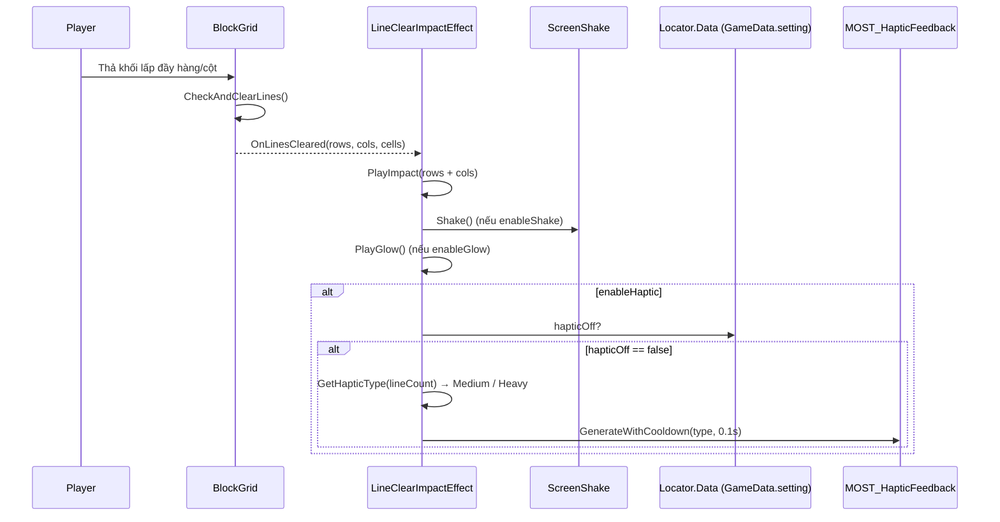
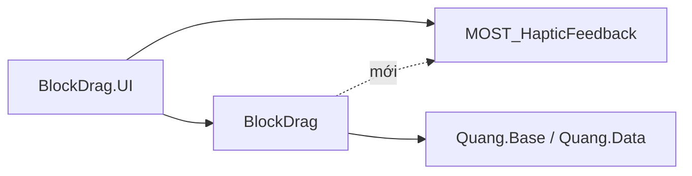

# Rung (haptic) khi phá hàng/cột — Design

## 1. Yêu cầu

Khi người chơi phá được hàng/cột, điện thoại rung nhẹ bằng `MOST_HapticFeedback` (`Assets/MOST_HapticFeedback`, namespace `Solo.MOST_IN_ONE`), giống cách UI đã dùng (`PerfectCanvas`, `UI_ANIM.Breaking`).

## 2. Hiện trạng

| Thành phần | Vai trò hiện tại |
|------------|------------------|
| `BlockGrid.CheckAndClearLines()` | Phá ô, bắn `OnLinesCleared(rows, cols, cells)` rồi `OnLinesClearedWithPos`, `OnBoardCleared` |
| `Effects/LineClearImpactEffect` | Nghe `OnLinesCleared` → `PlayImpact(lineCount)`: rung màn hình (`ScreenShake`) + loé viền board. Có toggle `enableShake`, `enableGlow` |
| `MOST_HapticFeedback` | Static API: `GenerateWithCooldown(HapticTypes, cooldown)`, tự kiểm tra `HapticsEnabled` (PlayerPrefs `"MOST Haptic Toggle"`); Editor/Standalone không rung |
| `BlockDrag.asmdef` | **Chưa** tham chiếu `MOST_HapticFeedback.asmdef` (chỉ `BlockDrag.UI` có) |
| `GameData.setting.hapticOff` | Nút Haptic trong `SettingPopup` chỉ đảo cờ này; **không** đồng bộ sang `MOST_HapticFeedback.HapticsEnabled`, và các chỗ đang rung trong UI cũng không đọc cờ này |

## 3. Giải pháp đề xuất

Gắn haptic vào **`LineClearImpactEffect.PlayImpact`** — đây đã là nơi tập trung "phản hồi va chạm khi phá hàng" (rung màn hình + glow), nên haptic là kênh phản hồi thứ ba, cùng thời điểm, cùng toggle style. Không thêm event/listener mới, không đụng `BlockGrid`.

- Thêm `[SerializeField] bool enableHaptic = true` cạnh `enableShake`/`enableGlow`.
- Chọn cường độ theo số đường phá (cấu hình trên Inspector):
  - 1 đường → `MediumImpact`
  - ≥ `heavyHapticLineCount` (mặc định 2) đường → `HeavyImpact`
- Gọi `MOST_HapticFeedback.GenerateWithCooldown(type, hapticCooldown)` với `hapticCooldown = 0.1f` để không chồng rung.
- Tôn trọng cài đặt người chơi: bỏ qua rung nếu `Locator.Data.GetData<GameData>().setting.hapticOff == true` (đọc an toàn: `Locator.Data` null → coi như bật).
- Tách hàm chọn loại rung thành static thuần (`GetHapticType(lineCount, heavyLineCount)`) để test EditMode.

### Phụ thuộc assembly

`BlockDrag.asmdef` thêm reference `MOST_HapticFeedback` (GUID `609b4fad904294b92a3463bf72b4762d`). Đây là plugin bên thứ ba không phụ thuộc gì, nằm ở tầng Foundation → không vi phạm hướng phụ thuộc (`BlockDrag` vẫn không biết `BlockDrag.UI`). Ghi chú thêm vào `.agents/rules/architecture.md`.

## 4. Phạm vi không làm

- Không đồng bộ `hapticOff` ↔ `MOST_HapticFeedback.HapticsEnabled` toàn cục, và không sửa các chỗ rung sẵn có trong UI (`PerfectCanvas`, `UI_ANIM`) — là task riêng nếu bạn muốn.
- Không thêm rung riêng cho Perfect Clear (`PerfectCanvas` đã rung).
- Không sửa code vendor `MOST_HapticFeedback`.

## 5. Rủi ro / lưu ý

- Perfect Clear: `OnLinesCleared` rung ngay, `PerfectCanvas` rung sau ~0.3s → cooldown 0.1s không chặn nhau, cảm giác là 2 nhịp riêng — chấp nhận được.
- Chỉ kiểm chứng rung thật trên thiết bị Android/iOS; Editor chỉ kiểm tra được logic chọn loại rung và không lỗi.

## 6. Câu hỏi cần bạn chốt

1. Cường độ: 1 đường = `MediumImpact`, ≥2 đường = `HeavyImpact` — ok, hay muốn khác (ví dụ 1 đường `LightImpact`)?
2. Có muốn tôn trọng `setting.hapticOff` như đề xuất không?
