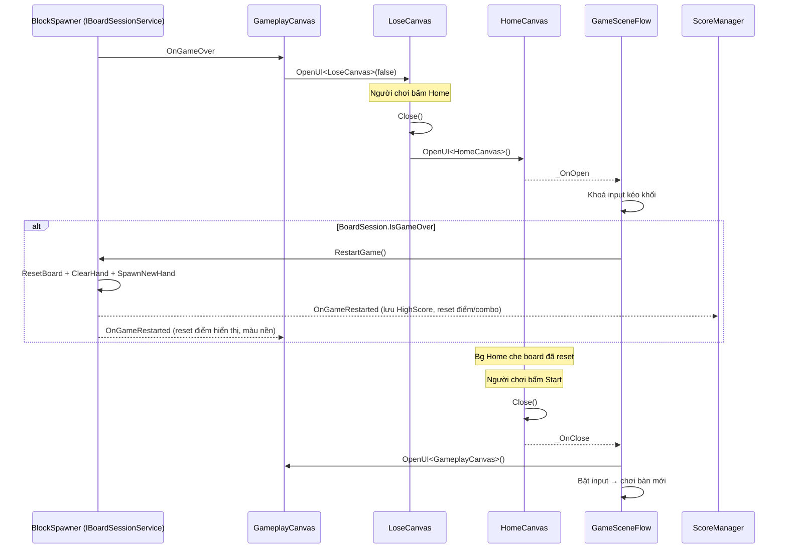

# Lose → Home → Start: tạo bàn mới — Design

## 1. Yêu cầu

Khi thua (LoseCanvas), người chơi bấm **Home** để về HomeCanvas. Khi bấm **Start** ở Home, ván chơi phải là **bàn mới**: board trống, khay 3 khối mới, điểm về 0, nền GameplayCanvas về màu mặc định.

## 2. Hiện trạng & nguyên nhân

| Bước | Code hiện tại | Vấn đề |
|------|---------------|--------|
| Game over | `BlockSpawner` → `OnGameOver` → `GameplayCanvas.HandleGameOver` mở `LoseCanvas` | — |
| Bấm Home | `LoseCanvas.OnGoHome`: `Close()` + `OpenUI<HomeCanvas>()` | Không reset ván, không khoá input |
| Bấm Start | `HomeCanvas.OnStartGame` → `Close()` → `GameSceneFlow.OnHomeClosed` mở `GameplayCanvas`, bật input | Board vẫn ở trạng thái game over (`IsGameOver = true`, board đầy, khay cũ) → không chơi tiếp được |

Ngoài ra `GameSceneFlow` chỉ khoá input lúc khởi động scene; khi Home được mở lại từ LoseCanvas thì input kéo khối vẫn bật.

## 3. Giải pháp đề xuất

`GameSceneFlow` (BlockDrag.UI) trở thành nơi duy nhất điều phối "Home mở / Home đóng" cho mọi lần mở Home, không chỉ lần đầu:

- Đăng ký thêm `HomeCanvas._OnOpen` (đã có sẵn trong `UISCanvas`) → `OnHomeOpened`:
  - Khoá input kéo khối.
  - Nếu `Locator.BoardSession.IsGameOver` → gọi `Locator.BoardSession.RestartGame()`.
    Việc reset diễn ra **khi Home vừa mở**, Bg full màn của Home che board nên người chơi không thấy board bị dọn; lúc bấm Start là đã có bàn mới.
- `OnHomeClosed` giữ nguyên: mở `GameplayCanvas`, bật input.
- `LoseCanvas.OnGoHome` giữ nguyên (Close + Open Home) — không cần biết tới logic reset.

`RestartGame()` đã có sẵn và đã làm đủ việc qua `OnGameRestarted`: `ScoreManager` lưu HighScore + reset điểm/combo, `GameplayCanvas` reset điểm hiển thị và màu nền. Không thêm API mới, không đổi `IBoardSessionService`.

### Vì sao reset lúc Home mở, không phải lúc bấm Start?

- Reset lúc Start: anim đóng Home sẽ lộ board cũ rồi bị dọn → giật mắt.
- Reset lúc Home mở: bị che hoàn toàn, Start là vào thẳng bàn mới.
- Chỉ reset khi `IsGameOver` → nếu sau này có nút Home trong lúc đang chơi (pause), ván đang dở vẫn được giữ.

## 4. Sơ đồ

## 5. Phạm vi & kiến trúc

- Chỉ sửa `Assets/_Game/_UI/Scripts/GameSceneFlow.cs` (assembly `BlockDrag.UI`).
- Gọi gameplay qua `Locator.BoardSession` (contract trong `Quang.Base`) → đúng chiều phụ thuộc, không chạm `BlockDrag` hay package.
- Đăng ký/huỷ `_OnOpen` cặp đôi với `_OnClose` trong `OnDestroy`.
- Lần mở Home đầu tiên (khởi động scene): `GameSceneFlow` đăng ký sau khi Home đã mở, và board lúc đó là bàn mới (`IsGameOver = false`) → hành vi khởi động không đổi.

## 6. Rủi ro / lưu ý

- `RestartGame()` gọi `SaveHighScore()` → Home hiển thị HighScore đúng (đã lưu cả ở `HandleGameOver`).
- Nếu `Locator.BoardSession` null (chạy thẳng scene thiếu spawner) → bỏ qua reset, không lỗi.
- Nút **Try Again** của LoseCanvas không bị ảnh hưởng (vẫn gọi `RestartGame()` trực tiếp).
