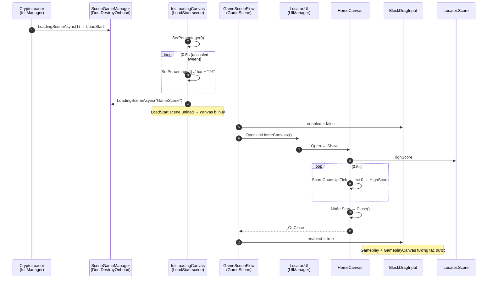
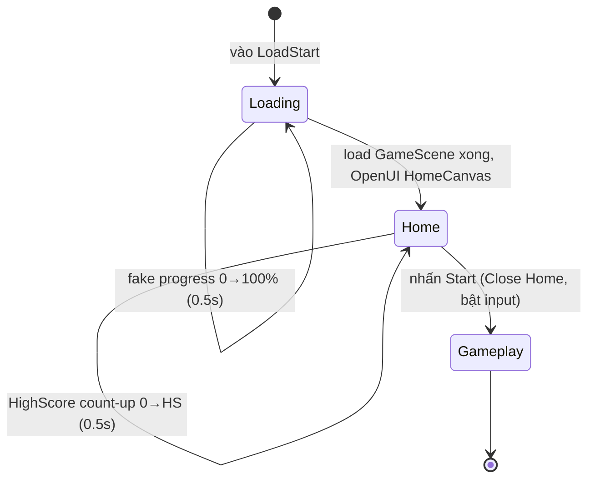

# UI Startup Flow — Design

Ngày: 2026-10-18

## 1. Yêu cầu

1. **LoadStart scene**: `InitLoadingCanvas` hiển thị `loadingBar` + text `%`. Chưa có data thật nên **fake tiến độ 0 → 100% trong 0.5s**, xong thì load `GameScene`.
2. **GameScene**: vào scene thì **mở `HomeCanvas` đầu tiên**.
3. **HomeCanvas**: text HighScore **chạy tăng dần từ 0 lên HighScore trong 0.5s** mỗi lần Home hiện ra.
4. Nhấn **Start** → **ẩn HomeCanvas**, vào Gameplay (bàn chơi + `GameplayCanvas`), lúc này mới được kéo khối.

## 2. Hiện trạng (đã khảo sát)

| Thành phần | Hiện trạng | Vấn đề |
|---|---|---|
| `LoadStart.unity` | Có `UIManager`, `DataManager`, `GameEventManager`, `SceneGameManager` (DontDestroyOnLoad), instance `InitLoadingCanvas`, và component `Quang.Base.Init.LoadStart` | `LoadStart` (package) gọi `LoadingSceneAsync("GameScene")` ngay trong `Start` → không có loading bar. Không sửa package được. |
| `InitLoadingCanvas.cs` | Chỉ có `SetPercentage(float)` | Không ai gọi. |
| Build Settings | `CryptoLoader` (0), `GameScene` (1) | `LoadStart` **không có trong build**; `InitManager` (CryptoLoader) load index 1 = thẳng GameScene → bỏ qua loading. |
| `GameScene.unity` | `GameplayCanvas` đặt sẵn, active. `HomeCanvas`, `InitLoadingCanvas`, `UIManager`, `DataManager` là instance **inactive** (để edit) | Không ai mở `HomeCanvas`. |
| `HomeCanvas.cs` | `OnStartGame → Close()`, HighScore text bị comment | Chưa hiển thị HighScore. |
| `BlockDragInput` | Đọc `Input` thô + Physics2D, **không bị UI chặn** | Khi Home đang mở vẫn kéo được khối phía sau. |
| `ScoreCountUp` (`_UI/Scripts/ScoreFly`) | Logic đếm số OutQuad, C# thuần, `GameplayCanvas` đang dùng | Tái sử dụng cho HighScore của Home. |
| `Locator.Score.HighScore` | `ScoreManager` đăng ký trong `Awake` | Nguồn HighScore cho Home. |

## 3. Thiết kế

### 3.1 Thành phần mới / thay đổi

| Thành phần | Assembly | Vai trò |
|---|---|---|
| `InitLoadingCanvas` (sửa) | `BlockDrag.UI` | Tự chạy fake loading: trong `Start`, nếu `autoLoadOnStart` (mặc định `true`) thì tween `SetPercentage` 0→1 trong `fakeLoadDuration` (0.5s, unscaled), xong gọi `SceneGameManager.Ins.LoadingSceneAsync(gameSceneName)`. Có cờ chống load 2 lần. Component `Quang.Base.Init.LoadStart` của package bị gỡ khỏi `LoadStart.unity` (nó load scene ngay lập tức). |
| **`GameSceneFlow`** (mới, MonoBehaviour) | `BlockDrag.UI` | Đặt trong `GameScene.unity`. `Start`: tắt `BlockDragInput`, `Locator.UI.OpenUI<HomeCanvas>()`, nghe `home._OnClose` → bật lại `BlockDragInput`. Unsubscribe trong `OnDestroy`. |
| `HomeCanvas` (sửa) | `BlockDrag.UI` | Mỗi lần mở/hiện: `ScoreCountUp.Snap(0)` → `SetTarget(Locator.Score?.HighScore ?? 0)` với `Duration = highScoreCountDuration` (0.5s); `Update` tick bằng `Time.unscaledDeltaTime`. Start → `Close()` (giữ nguyên). Bỏ `throw` ở nút Setting (thay bằng log/no-op). |
| Build Settings | — | Thêm `LoadStart.unity` vào **index 1**: `CryptoLoader (0) → LoadStart (1) → GameScene (2)`. `InitManager` load index 1 = LoadStart, `LoadStart` load GameScene **theo tên** nên không lệch index. |

### 3.2 Ranh giới kiến trúc

- Toàn bộ code mới/sửa nằm trong `BlockDrag.UI` → được phép phụ thuộc `Quang.*` và `BlockDrag`.
- `BlockDrag` **không** biết gì về Home/flow; `GameSceneFlow` chỉ giữ `[SerializeField] BlockDragInput` (wiring scene, không phải singleton) để bật/tắt `enabled`.
- `HomeCanvas` không biết `GameSceneFlow`; flow nghe `_OnClose` có sẵn của `UISCanvas`.
- HighScore đọc qua contract `Locator.Score` (`IScoreService`), không chạm `ScoreManager` cụ thể.
- Không sửa package `com.quang.*`; chỉ bỏ component `LoadStart` khỏi scene.
- Không thay đổi dependency direction → không cần cập nhật `architecture.md` ngoài ghi chú flow (tuỳ chọn).

### 3.3 Sơ đồ luồng

### 3.4 Chi tiết hành vi

- **Fake loading**: `DOVirtual.Float(0, 1, fakeLoadDuration, SetPercentage).SetUpdate(true).SetEase(Ease.Linear)`; `OnComplete` → load scene. Tween `SetLink(gameObject)` để tự kill khi scene đổi. Nếu `fakeLoadDuration <= 0` → set 100% và load ngay.
- Sau này có load data thật: thay tween bằng tiến độ thật (vd. `max(fake, real)`) — chỉ sửa `InitLoadingCanvas`.
- `autoLoadOnStart`: instance `InitLoadingCanvas` (inactive) trong `GameScene` hoặc nếu sau này mở qua `UIManager` thì tắt cờ này để không tự load lại GameScene.
- **HighScore count-up**: dùng lại `ScoreCountUp` (OutQuad, đã có test). HighScore = 0 → hiện "0" ngay. Chạy lại mỗi lần Home được mở/hiện (hook `OnEnable` hoặc `Show` của `UISCanvas`).
- **Thứ tự render**: `HomeCanvas` mở qua `UIManager` phải nằm trên `GameplayCanvas` (đặt sẵn trong scene). Cần kiểm tra sorting order trong Editor; nếu bị đè thì chỉnh `sortingOrder` của prefab Home.
- **Chạy thẳng GameScene trong Editor** (không qua LoadStart): `Locator.UI` có thể null vì `UIManager` nằm ở LoadStart. `GameSceneFlow` log warning và bật input luôn để không kẹt — không cố tự tạo UIManager.

## 4. Ngoài phạm vi

- Load data thật, Setting popup, quay lại Home sau khi thua, animation chuyển cảnh Home ↔ Gameplay ngoài anim sẵn có của `UISCanvas`.

## 5. Câu hỏi cần bạn xác nhận

1. Thêm `LoadStart.unity` vào Build Settings ở index 1 (giữa `CryptoLoader` và `GameScene`) — đồng ý?
2. HighScore count-up chạy lại **mỗi lần** Home mở (không chỉ lần đầu) — đúng ý bạn?
3. Khoá kéo khối khi Home đang mở bằng cách tắt `BlockDragInput` — OK?

## 6. Cập nhật trong lúc implement (đã duyệt, đã làm)

Khi play thử phát hiện 2 điểm khác với khảo sát ban đầu:

1. **`GameplayCanvas` không thật sự active khi chơi**: trong `GameScene` nó nằm dưới `UIManager(inactive)/ParentCanvas/Parent/GameplayCanvas` — tức là chỉ để edit, giống `HomeCanvas`. UIManager thật đến từ LoadStart (DontDestroyOnLoad) nên `GameplayCanvas` không bao giờ hiện.
   → **Đề xuất**: `GameSceneFlow.OnHomeClosed` gọi thêm `Locator.UI.OpenUI<GameplayCanvas>()` (load từ `Resources/UI/GameplayCanvas.prefab`) rồi mới bật input. Đúng với yêu cầu "nhấn Start → mở vào Gameplay".
2. **Prefab `HomeCanvas` có `anims = [Missing]`** → `OpenUI` văng NRE trong `UISCanvas.StopAllAnims`. Đã sửa wiring: `anims = []` (prefab không có `UIAnim` nào) — nằm trong phạm vi "sửa wiring HomeCanvas.prefab" của plan.
3. **`InitLoadingCanvas` không bị huỷ khi đổi scene**: trong LoadStart nó là con của `UIManager/ParentCanvas/Parent` → đi theo `UIManager` (DontDestroyOnLoad) sang GameScene và vẫn hiện. Mục 3.3/3.4 ghi "canvas bị huỷ" là sai.
   → **Đề xuất**: trước khi load, `InitLoadingCanvas` đăng ký `SceneGameManager.Ins.OnSceneLoaded`; khi GameScene load xong thì huỷ đăng ký và `Destroy(gameObject)` (chỉ dùng 1 lần lúc vào game, không cần giữ lại). Đóng ngay khi scene load xong để không lộ khung hình trống giữa loading và Home.
