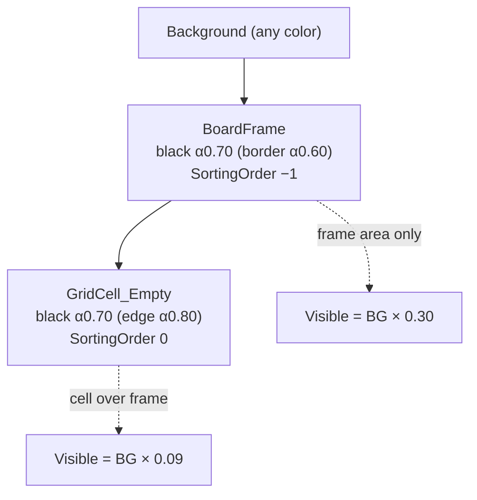
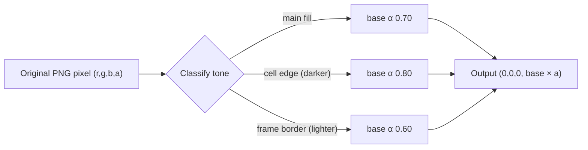

# Board sprites: black with alpha ~0.7 — Design

## Goal

Recolor `BoardFrame.png` and `GridCell_Empty.png` to semi-transparent black (alpha ≈ 0.7) so that the board picks up the background color: when the BG changes, the board and empty cells change tint with it. Where the cells overlap the frame, the alpha stacks, so the two areas end up with naturally different shades.

## Current state

| Sprite | Size | Main color (opaque) | Detail | Used by |
|---|---|---|---|---|
| `BoardFrame.png` | 64×64, 9-slice border 20 | `(152,192,152)` | Lighter border `(180,210,183)`, anti-aliased rounded corners (alpha < 255) | `BoardFramePrefab` (SortingOrder −1), created by `BlockGrid.CreateBoardFrame` |
| `GridCell_Empty.png` | 128×128 | `(109,132,109)` | Darker edge ~2px `(84,113,90)`, separates adjacent cells | `GridCellPrefab` + several cells in `GameScene.unity` |

Every `SpriteRenderer.color` is white, so the color comes entirely from the texture.

## Design

Rewrite the pixels of both PNGs in place (same file, same `.meta`/GUID, so prefabs and scenes don't change):

- RGB → `(0,0,0)` for every pixel.
- New alpha = `baseAlpha(tone) × originalAlpha/255`:
  - **Main fill** → **0.70**.
  - **Detail tone** keeps its contrast through alpha instead of color, so the cell grid lines and the frame edge don't disappear:
    - GridCell edge (darker than the fill) → **0.80** (darker grid line).
    - BoardFrame border (lighter than the fill) → **0.60**.
  - Multiplying by the original alpha keeps the anti-aliased frame corners smooth, and fully transparent pixels stay transparent.

> Option B (if you want it completely flat): every pixel at 0.70. Simpler, but the grid lines between cells and the frame edge disappear entirely.

Expected result on top of the BG (where α is the total coverage of black):

- Frame area outside the grid: α = 0.70 → BG at 30% brightness.
- Cell area (cell on top of frame): α = 1 − 0.3×0.3 = **0.91** → BG at 9% brightness, darker than the frame. This is the stacking effect you described.
- Grid line inside a cell: 1 − 0.3×0.2 = 0.94.

## Notes / risks

- **Very dark cells**: with the frame behind them, cells reach ~91% black. If you want cells to be exactly 0.7 over the BG, you would need a different approach (lower the cell alpha to ~0.57, or stop placing the frame behind the cells). The current design keeps the stacking because that is what you want.
- Import settings (`alphaIsTransparency`, sRGB, 9-slice border) stay as they are, so no `.meta` changes are needed.
- No code, prefab or scene changes; the originals can be restored from git.
- The exact alpha values (0.70 / 0.80 / 0.60) can be tuned before implementation.
