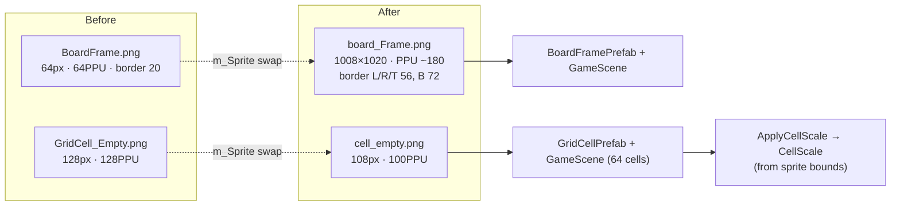
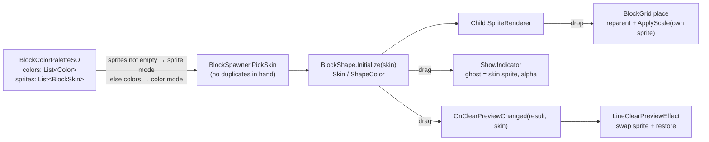
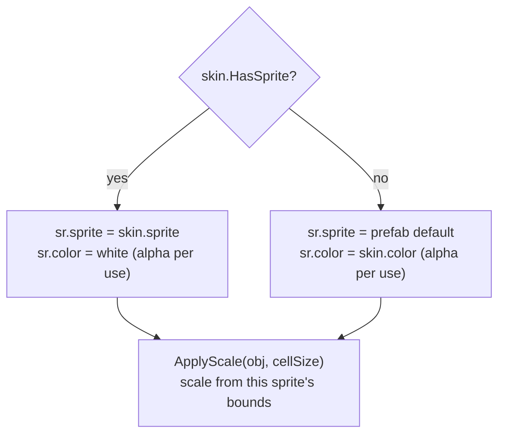
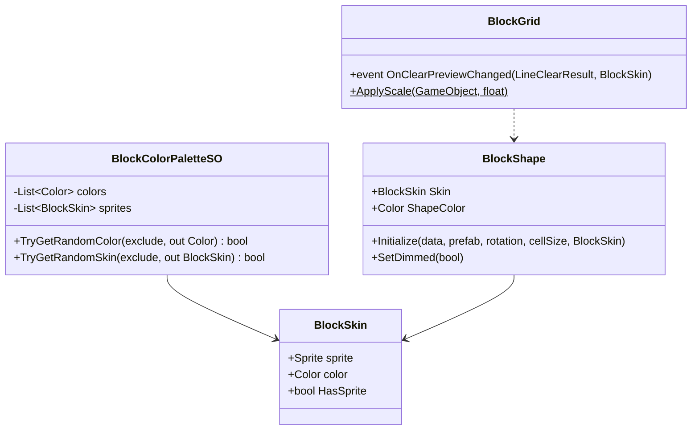

# Block sprite palette — Design

Branch: `feature/block-sprite-palette`

## Goal

Let blocks use **colored sprites** (`Resource/ComboBlock_UI_assets/tiles/tile_*.png`) instead of tinting one white sprite with a `Color`. Keep the current color mode working as a fallback.

Decisions (from the user):
0. Also replace the board frame and empty-cell sprites with `board_Frame.png` and `tiles/cell_empty.png` (section 8).
1. The drag ghost and the line-clear preview use the **block's sprite**, not just its color.
2. **Both modes stay.** Color mode is not removed.

## Current state

| Step | Where | What it does |
|---|---|---|
| Palette | `BlockColorPaletteSO` (`List<Color> colors`), asset `_Data/DataSO/BlockColorPalette.asset` (6 colors) | Returns a random color not already in `exclude` |
| Pick | `BlockSpawner.PickColor` + `usedColors` | Picks one color per spawned shape, no duplicates in hand. Falls back to `BlockShapeData.shapeColor` |
| Apply | `BlockShape.Initialize(..., Color? color)` → `spriteRenderer.color = ShapeColor` | Tints every child block |
| Dim | `BlockShape.SetDimmed` | `ShapeColor × 0.4`, alpha 0.45 |
| Place | `BlockGrid` (~L766) | Reparents the child GameObjects onto the grid, sets `localScale = CellScale` |
| Ghost | `BlockGrid.ShowIndicator` (~L567) | Indicator cells (sprite of `indicatorCellPrefab`/`cellPrefab`) tinted `ShapeColor`, alpha `indicatorAlpha`/`clearPreviewGhostAlpha` |
| Clear preview | `BlockGrid.OnClearPreviewChanged(result, Color)` → `LineClearPreviewEffect.ApplyTint/RestoreTint` | Tints the occupied cells in the lines about to clear with `ShapeColor`, then restores `sr.color` |

## Design

### 1. Data: a "block skin" = sprite + color

Introduce a small serializable struct in `Gameplay.BlockDrag` (same assembly as the palette SO):

```csharp
[Serializable]
public struct BlockSkin
{
    public Sprite sprite;   // null → color mode (tint the prefab's default sprite)
    public Color color;     // tint in color mode; representative color in sprite mode
    public bool HasSprite => sprite != null;
}
```

`BlockColorPaletteSO` gets a **second list** next to the existing one:

```csharp
[SerializeField] private List<Color> colors;          // unchanged, color mode
[SerializeField] private List<BlockSkin> sprites;     // new, sprite mode
public bool TryGetRandomSkin(IReadOnlyList<BlockSkin> exclude, out BlockSkin skin);
```

- Mode selection: if `sprites` has at least one entry with a sprite → **sprite mode**. Otherwise → **color mode**, using `colors` exactly as today (wrapped into `BlockSkin { sprite = null, color = c }`).
- No duplicates in hand: in sprite mode compare by `sprite` reference, in color mode compare RGB (current behavior).
- `TryGetRandomColor` stays for compatibility. The existing `colors` data in the asset is untouched, so switching back is just clearing `sprites`.
- `color` in sprite mode is the tile's dominant color. Nothing in sprite mode needs it today, but it keeps `ShapeColor` meaningful (e.g. future particles).

### 2. BlockShape

- New `public BlockSkin Skin { get; private set; }`. `ShapeColor` stays (= `Skin.color`), so callers that read it keep working.
- `Initialize(..., Color? color = null)` keeps its signature; a new overload `Initialize(..., BlockSkin skin)` is what the spawner calls. The `Color?` version forwards to it with `sprite = null`.
- When creating each child block:
  - Sprite mode: `sr.sprite = Skin.sprite; sr.color = Color.white`. The sprite is set **before** `ApplyBlockScale`, so the scale is computed from the new sprite's bounds.
  - Color mode: unchanged (`sr.color = ShapeColor`).
- `SetDimmed`: the base color is `Color.white` in sprite mode and `ShapeColor` in color mode; then the same ×0.4 / alpha 0.45 formula applies. (In sprite mode this darkens the sprite instead of re-tinting it.)

### 3. BlockSpawner

- `usedColors: List<Color>` → `usedSkins: List<BlockSkin>`.
- `PickColor` → `PickSkin` returning `BlockSkin`. The fallback is `BlockSkin { sprite = null, color = data.shapeColor }`.
- Collect skins from the blocks still in hand via `existing.Skin`.

### 4. Scale when placing on the board — important

The tile sprites are **108×108 px** while `GridCell_Empty` is **128×128 px** (both 100 PPU). Today a placed block gets `localScale = CellScale`, which is computed from the empty-cell sprite. With a 108 px sprite, the placed block would shrink to ~84% of the cell. The ghost indicator has the same problem.

Fix: wherever a block or indicator gets `CellScale`, use `BlockGrid.ApplyScale(obj, cellSize)` instead. That computes the scale from **that object's own sprite**. In color mode the sprite is still the prefab's, so the result is identical to today.

### 5. Drag ghost (sprite)

`ShowIndicator`:
- Sprite mode: `sr.sprite = shape.Skin.sprite`, `sr.color = (1,1,1, indicatorAlpha)` (or `clearPreviewGhostAlpha` inside a preview line), then apply the scale for that sprite.
- Color mode: restore the indicator prefab's original sprite (cached when the pool cell is created) and tint `ShapeColor` as today.
- Because indicators are pooled, the sprite must be reassigned every time (a cell can switch between shapes with different skins).

### 6. Line-clear preview (sprite)

- Event signature: `OnClearPreviewChanged(LineClearResult, Color)` → `OnClearPreviewChanged(LineClearResult, BlockSkin)`. `LineClearPreviewEffect` is the only subscriber.
- `SetClearPreview` deduplicates by comparing the skin (sprite reference + color) instead of just the color.
- `LineClearPreviewEffect.TintedBlock` additionally stores `OriginalSprite`:
  - `ApplyTint` sprite mode: `sr.sprite = skin.sprite`, color white with the original alpha. Color mode: as today.
  - `RestoreTint`: restore both `sprite` and `color`.
- Scale: preview cells are already on the board. If they were placed with a different sprite size (e.g. a mixed board after switching modes), swapping the sprite changes their visual size. Since all `tile_*` sprites are 108 px, just swapping the sprite is enough in practice. To be safe, `ApplyTint` / `RestoreTint` also store and restore `localScale` and call `ApplyScale` after swapping.

### 7. Asset setup

- `BlockColorPalette.asset`: fill `sprites` with the 7 tiles (`blue, cyan, green, orange, purple, red, yellow`), each with its representative color. Keep `colors` as is.
- Tile import settings: already `Sprite (2D and UI)`, Single, 100 PPU. No change needed, because the scale is computed from the sprite's bounds (section 4).
### 8. Board frame and empty cell: switch to the new sprites

Added after the first review: also replace the board sprites with the new art.

| | Old sprite (GUID) | New sprite | Referenced by |
|---|---|---|---|
| Frame | `Resource/BoardFrame.png`: 64×64, 64 PPU, 9-slice border 20 (`57a71908…`) | `ComboBlock_UI_assets/board_Frame.png`: 1008×1020, 100 PPU, **no border yet** | `BoardFramePrefab.prefab`, 1 object in `GameScene.unity` |
| Empty cell | `Resource/GridCell_Empty.png`: 128×128, 128 PPU (`553b9710…`) | `ComboBlock_UI_assets/tiles/cell_empty.png`: 108×108, 100 PPU | `GridCellPrefab.prefab`, 64 cells baked in `GameScene.unity` |

Approach: **point the references at the new sprites**, and don't overwrite the old PNGs (they stay for comparison or rollback, and the black-alpha work from 2026-10-26 is not lost).
- `GridCellPrefab` and `BoardFramePrefab`: replace `m_Sprite` with the new sprite.
- `GameScene.unity`: the grid is rebuilt at runtime (`ClearGrid` → create from `cellPrefab`/`boardFramePrefab`), so the baked cells and frame only matter in the Editor view. They are still updated for consistency (GUID swap on those `m_Sprite` lines only).
- **Cell scale**: cells already use `ApplyCellScale`, which computes the scale from the sprite's bounds. The 108 px sprite fits the cell automatically, and `CellScale` changes accordingly. Together with section 4 (placed blocks and ghost scaled by their own sprite), every size stays correct.
- **Frame 9-slice**: `CreateBoardFrame` draws the frame as `Sliced` with `sr.size` = grid + padding. `board_Frame.png` needs a sprite border in its `.meta`, otherwise the rounded corners stretch. From the image: corner radius ≈ 50 px, a thicker bottom edge (≈ 20 px shadow). Proposed border: **L/R/T = 56, B = 72 px**.
- **Frame PPU**: at 100 PPU a 56 px corner is 0.56 world units, larger than the current frame's 0.31 (20 px / 64 PPU) and larger than the padding `framePaddingRatio × cellSize`. The frame edge would then cover the outer cells. Proposed: raise the PPU of `board_Frame.png` (start at **~180**, so the corner ≈ 0.31 u like today), then tune it in the Editor together with `framePaddingRatio`.

Visual note: the new frame is opaque grey with a dark border, unlike the black-alpha version that picks up the background color. That is the intended art change.



## Diagrams

### Data flow



### Applying a skin to one renderer



### Types



## Architecture check

Everything stays inside the `BlockDrag` assembly (`Gameplay.BlockDrag`). `BlockColorPaletteSO` is already pulled into `Quang.Data` through an asmref so that `DataManager` can serialize it; `BlockSkin` lives next to it, in the same compilation unit, so no new assembly reference is needed. No `Quang.*` → `BlockDrag` or `BlockDrag` → `BlockDrag.UI` dependency is added.

## Risks / open points

- **Visual size**: 108 px tiles versus 128 px cells. Handled by section 4; must be verified in the Editor (hand, ghost, placed, line-clear).
- **Frame border/PPU** (section 8) are estimates from the image and need tuning in the Editor.
- **Look of the dimmed state** with a sprite (darken ×0.4 + alpha 0.45). It may need tuning after viewing it.
- **`BlockPlaceEffect`** particles keep their own hard-coded palette (unchanged).
- Saved games: the board does not store colors/sprites, so nothing to migrate.

## Out of scope

- Removing color mode.
- `buttons/`, `icons/`, `launcher/` in `ComboBlock_UI_assets`.
- Deleting the old `BoardFrame.png` / `GridCell_Empty.png`.
- Choosing skins per level/theme.
