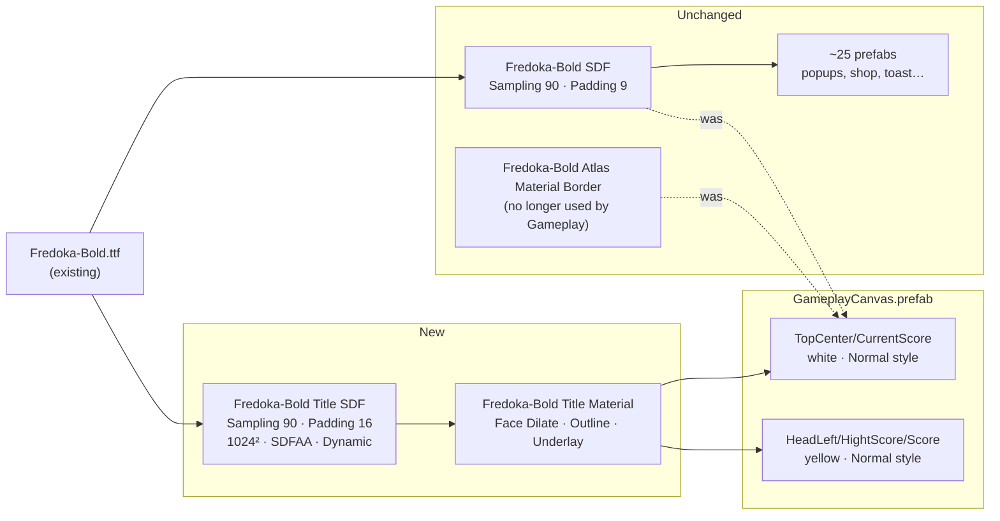

# Gameplay score text style — Design

Branch: `feature/block-sprite-palette`

## Goal

Make the score texts in `GameplayCanvas` look like the mockup `Resource/ComboBlock_UI_assets/UI Preview/Gameplay@1x.png`:

- `TopCenter/CurrentScore` ("1,240"): white, very heavy, tight letters, dark outline, solid dark drop shadow under the glyphs.
- `HeadLeft/HightScore/Score` ("94,157"): same style, yellow face, small.

Only these two texts change. No code changes.

## Current state (measured in the Editor)

Side-by-side render of the prefab vs the mockup at 720×1280:

| | Mockup | Unity now |
|---|---|---|
| "1,240" glyph height | ~70 px | ~130 px (`fontSize` 188) |
| Letter spacing | glyphs almost touch | wide (`characterSpacing` 0) |
| Weight | very fat, small counters | thinner face, thick outline |
| Drop shadow | solid dark, offset down | none (`UNDERLAY_ON` not enabled) |
| "94,157" | small, tight | large (`fontSize` 65.4), spacing -0.7 |

Root causes:

1. **Faux bold** — both texts have `fontStyle = Bold` on a font that is already Bold. TMP adds `_WeightBold 0.75` on top.
2. **Not enough SDF padding** — `Fredoka-Bold SDF` has Sampling 90 / Padding 9 (~10 %). `Fredoka-Bold Atlas Material Border` asks for Outline 0.403 + bold 0.75. That is more than the SDF range allows, so TMP clamps it (`_ScaleRatioA 0.9`). A fatter face plus an underlay does not fit at all.
3. **No underlay** — the mockup's 3D shadow is missing.
4. **Size / spacing** — both texts are about twice as big and wider than the mockup.

### Why not just regenerate `Fredoka-Bold SDF`

`Fredoka-Bold SDF` is used by ~25 prefabs (popups, shop, Win/Lose, Toast, TextScoreFly, ComboTextEffect…). Changing its padding changes the SDF gradient scale, so every outline and effect material on that atlas would render differently. That is a project-wide visual change outside this task.

## Design

Add a **dedicated title font asset + material** for the big styled numbers. Leave the shared font untouched.

### 1. New font asset `Fredoka-Bold Title SDF`

Path: `Assets/_Game/_UI/UIResources/UI/Font/Fredoka-Bold Title SDF.asset`

| Setting | Value | Why |
|---|---|---|
| Source | `Fredoka-Bold.ttf` | same face as the mockup |
| Sampling point size | 90 | same quality as today |
| Padding | 16 (~18 %) | room for dilate + outline + underlay without clipping |
| Atlas | 1024 × 1024, SDFAA | same as the existing asset |
| Population | Dynamic | digits and `,` are added on demand |

### 2. New material `Fredoka-Bold Title Material`

Made from the new font asset's default material (so `_MainTex` is the new atlas). Starting values, tuned by eye against the mockup during implementation:

| Property | Value |
|---|---|
| Face color | white (vertex color gives yellow for the best score) |
| Face Dilate | ~0.2 |
| Outline color | dark navy, sampled from the mockup outline |
| Outline width | ~0.2 |
| Underlay | **on**, same dark color, alpha 1 |
| Underlay offset | X 0, Y ~-0.8 |
| Underlay dilate / softness | ~0.3 / 0 |

One material for both texts: the face color comes from each text's vertex color, so the white and yellow texts share it.

### 3. Prefab overrides in `GameplayCanvas.prefab`

| Text | Font / material | Style | Size | Char spacing | Color |
|---|---|---|---|---|---|
| `CurrentScore` | Title SDF / Title Material | Normal (faux bold off) | ~100 (from 188) | ~-6 | white |
| `HightScore/Score` | Title SDF / Title Material | Normal | ~36 (from 65.4) | ~-6 | yellow (kept) |

Exact sizes are tuned so glyph height and placement match the mockup at the same resolution. Anchors and positions are adjusted only if needed after the size change.

## Out of scope (reported, not changed)

- The `BG` Image in the prefab uses the mockup `Gameplay@1x.png` as its sprite. It shows as a misaligned ghost behind the score. It looks like a temporary reference overlay. Remove or disable it before shipping.
- `BtnSetting` renders a second, smaller gear icon at its bottom-right corner.
- `Fredoka-Bold Atlas Material Border.mat` (untracked) becomes unused. It is kept, not deleted, unless you say otherwise.
- `Fredoka_Expanded-Bold` (untracked) is not needed for this look.

## Architecture

Asset- and prefab-only change inside `BlockDrag.UI` content. No code, no assembly references, and no change to the dependency direction.

## Risks

- **Dynamic atlas in builds** — keep "Clear Dynamic Data On Build" consistent with the other font assets. The source TTF is already included through the existing font asset.
- **Large digits strings** — e.g. a 7-digit score with negative spacing may overflow the `CurrentScore` rect. Check with a long value during verification.

## Verification

1. Render the prefab off-screen at 720×1280 (preview scene, nothing saved) and compare it side by side with the mockup: size, spacing, outline thickness and shadow offset.
2. Zoom in on the glyph edges: no clipped outline or underlay, and no square artifacts around the glyphs.
3. Play Mode: the score updates (new digits get added to the dynamic atlas) and long scores still fit.
4. Spot-check one other screen that uses `Fredoka-Bold SDF` (e.g. `LoseCanvas`) to confirm it has not changed.
