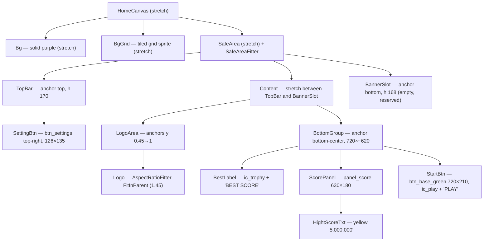
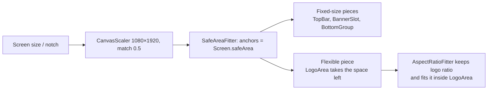

# HomeCanvas mockup layout — Design

Branch: `feature/block-sprite-palette`

## Goal

Rebuild the `HomeCanvas` layout so it matches the mockup `Assets/_Game/_BlockDrag/Resource/ComboBlock_UI_assets/UI Preview/Home@1x.png` (360×640) and stays correct on tall phones (19.5:9, notch) and tablets (3:4).

Mockup, top to bottom:

1. Purple background with a faint grid.
2. Settings button, top-right (white rounded square, gear).
3. "Combo Block" logo, large, centered.
4. Trophy icon + "BEST SCORE" label (white, dark outline).
5. Dark rounded panel with the best score in yellow, with thousands separators ("5,000,000").
6. Big green "▶ PLAY" button.
7. Bottom band reserved for a 320×50 ad banner.

## Current state

`Assets/_Game/Resources/UI/HomeCanvas.prefab`, scaled by `UIManager` (`CanvasScaler` Scale With Screen Size, 1080×1920, match 0.5). The mockup ×3 = 1080×1920, so mockup px × 3 = canvas units.

| Element | Now | Problem |
|---|---|---|
| `Bg` | `Background_09_Purple1` (4×4 solid) | no grid, color not checked against the mockup |
| `Logo` | `Combo_Block.png`, center-anchored, 911×555 at y +489 | fixed size and position: on 3:4 tablets it overlaps the score; on tall phones it floats in the middle |
| `HightScore` / `HightScoreTxt` | `TextCommon` texts, "Hight Score" + plain number | no trophy, no panel, no separators, wrong style |
| `StartBtn` | `BasicButton`, 350×150, "Start" | old sprite, wrong size and label |
| `SettingBtn` | `BasicButton` 96×92, top-right, label "Start" | old sprite, not inside the safe area |
| Ad banner area | none | play button can sit under the banner |
| Safe area | none in the project | settings button can sit under the notch |

## Assets

All from `Assets/_Game/_BlockDrag/Resource/ComboBlock_UI_assets/` unless noted:

| Use | Asset |
|---|---|
| Play button | `buttons/btn_base_green.png` (720×204 = mockup 240×68 ×3) |
| Play icon | `icons/ic_play_white.png` |
| Settings button | `buttons/btn_settings.png` (132×141) |
| Trophy | `icons/ic_trophy.png` |
| Logo | `Assets/_Game/_BlockDrag/Resource/Combo_Block.png` (already used, 3700×2550) |
| Texts | `Fredoka-Bold Title SDF` + `Fredoka-Bold Title Material` (same style as the Gameplay score) |

**Missing from the asset pack** — two small sprites I will generate and save next to the pack, unless you prefer to supply them:

- `bg_grid_tile.png` — one grid cell (transparent with a light 2 px line), drawn with `Image.Type = Tiled` over a solid purple `Bg`.
- `panel_score.png` — dark-purple rounded rectangle with a darker border, 9-sliced.

## Design

### Hierarchy and anchors

Sizes in canvas units (mockup px × 3):

| Element | Mockup (px) | Canvas |
|---|---|---|
| Settings button | 42×44, 39 from right, 38 from top (center) | 126×132, offset (−117, −114) |
| Logo | ~300 wide | up to 900 wide, shrinks with its area |
| BEST SCORE label | text ~20 high | font ~60, trophy 75 |
| Score panel | 210×60 | 630×180, text ~105 |
| Play button | 240×70 | 720×210, "PLAY" ~100 |
| Banner band | 55 high | 168 |

### How it stays responsive

- **Tall phones (9:19.5)**: the canvas gets taller. The top bar, bottom group and banner keep their size; `LogoArea` grows and the logo stays width-limited (900), centered in its area — matches the mockup's look with more breathing room.
- **Tablets (3:4)**: the canvas gets shorter (~1250×1660). `LogoArea` shrinks and the logo scales down with its aspect ratio, so it never overlaps the score. The bottom group keeps its size (it fits: 170 + ~620 + 168 < 1660).
- **Notch / home indicator**: `SafeAreaFitter` sets the `SafeArea` anchors from `Screen.safeArea`, so the settings button and the banner slot stay inside the visible area. `Bg` and `BgGrid` stay outside the safe area so the background still fills the whole screen.

### Code changes (`BlockDrag.UI`)

1. **New `SafeAreaFitter`** (`Assets/_Game/_UI/Scripts/SafeAreaFitter.cs`): a small `MonoBehaviour` on a `RectTransform`. It converts `Screen.safeArea` to anchor min/max and reapplies them when the safe area or the screen size changes. No other dependency. It can be reused later by Gameplay/Lose canvases (out of scope here).
2. **`HomeCanvas.cs`**: show the best score with thousands separators — `Displayed.ToString("N0", CultureInfo.InvariantCulture)` → "5,000,000". No change to its fields; the existing `startButton`, `settingButton`, `highScoreTxt` references are rewired in the prefab.

No changes to packages, gameplay, or assembly references.

### Prefab changes (`HomeCanvas.prefab`)

- `Bg`: solid color sampled from the mockup; add `BgGrid` above it.
- Add `SafeArea` → `TopBar`, `Content` (`LogoArea`, `BottomGroup`), `BannerSlot`.
- Move `Logo` into `LogoArea` and add `AspectRatioFitter` (Fit In Parent, ratio 3700/2550).
- Replace `HightScore` with `BestLabel` (trophy + "BEST SCORE") and `ScorePanel` containing `HightScoreTxt`.
- `StartBtn`: green sprite, play icon, label "PLAY", size 720×210.
- `SettingBtn`: `btn_settings` sprite, label hidden, inside `TopBar`.
- Keep the existing open/close transition components on the root and buttons.

## Assumptions (please confirm or correct)

- **Ad banner**: the "AD BANNER 320×50" box in the mockup is a placeholder. I reserve an empty `BannerSlot` (with the slightly darker band from the mockup) but do not draw the dashed box or text. No ads code is added.
- **Grid and score panel**: generated as described in *Assets* because the pack has no sprites for them.
- **Best score format**: "5,000,000" (comma separators) as in the mockup. Gameplay score formatting is not changed here.

## Out of scope

- Settings popup (the button still has the existing `TODO`).
- Safe area for other canvases.
- Real banner ad integration.

## Architecture

Changes stay inside `BlockDrag.UI` (one new component, one small edit) and its prefab. Dependency direction is unchanged.

## Risks

- `AspectRatioFitter` drives the logo's `RectTransform`; any existing open animation that changes the logo's size (not scale) would conflict. I will check the logo has no such animation.
- `Screen.safeArea` in the Editor is the full screen unless the Device Simulator is used — verify notch behavior in the Device Simulator.
