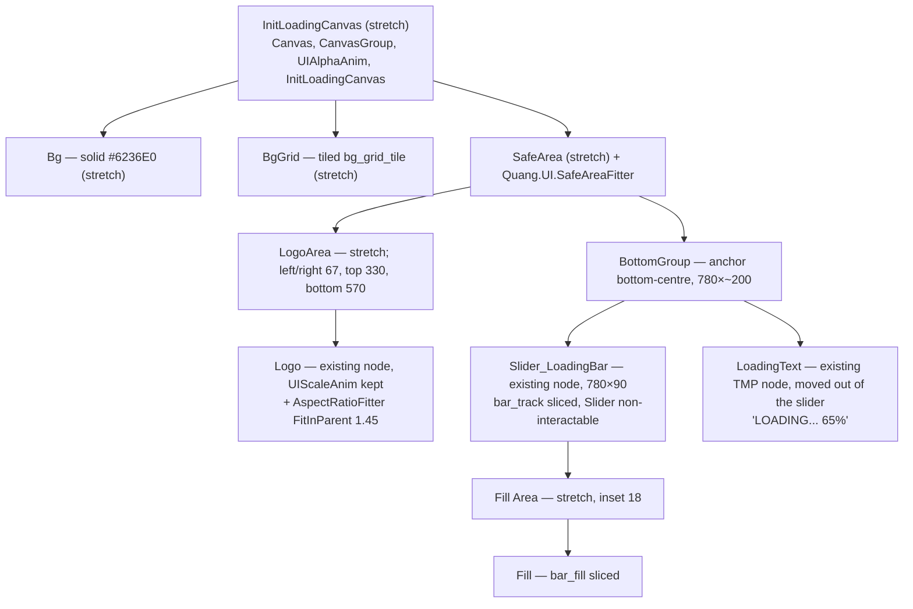
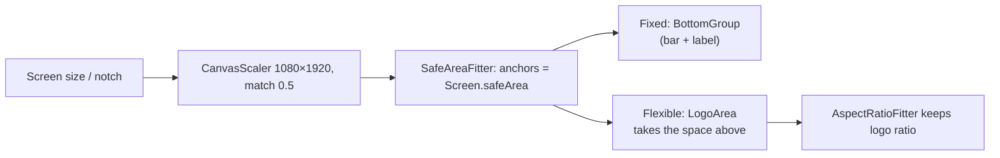

# InitLoadingCanvas mockup layout — Design

Branch: `feature/block-sprite-palette`

## Goal

Rebuild the `InitLoadingCanvas` layout so it matches the mockup `Assets/_Game/_BlockDrag/Resource/ComboBlock_UI_assets/UI Preview/Loading@1x.png` (360×640) and stays correct on tall phones (19.5:9, notch) and tablets (3:4). Follows the `unity-responsive-ui` skill and the HomeCanvas rebuild (`2026-11-01-home-canvas-mockup-layout-design.md`).

Mockup, top to bottom:

1. Purple background with a faint grid (same as Home).
2. "Combo Block" logo, large, slightly above the centre.
3. Dark rounded progress bar with a yellow fill.
4. "LOADING... 65%" label (white, dark outline), under the bar.

## Measurements (script, mockup px → canvas units ×3)

| Element | Mockup | Canvas |
|---|---|---|
| Background | `#6236E0`, grid line `#6B42E2`, pitch 24 px | same as Home: solid `Bg` + tiled `bg_grid_tile.png` |
| Logo (incl. particles) | x 22–337, y 171–386, centre y 278 | ~945×652, centre 834 from top |
| Bar track | x 50–309, y 468–497, colour `#1C1A3A`, fully rounded | 780×90, bottom edge 429 from bottom |
| Bar shadow | 3 px band `#432E8E` under the track | 9 units, part of the track sprite |
| Bar fill | inset 6 px from the track; top `#FFC83D` (13 px), lower band `#E0A100` (5 px), rounded | inset 18; height 54 |
| Label | x 103–255, y 513–530, centre y 521; white, `#1C1A3A` outline, soft dark shadow | ~456 wide, centre 357 from bottom, font ~66 (tuned by render) |

Check: at 65 % the fill spans x 56–216 of the 56–303 inner track → 160 / 248 = 0.645 ✓.

## Current state

`Assets/_Game/Resources/UI/InitLoadingCanvas.prefab`

| Node | Now | Problem |
|---|---|---|
| `Bg` | `Background_09_Purple1`, stretch | no grid |
| `Logo` | `Combo_Block.png`, centre-anchored 911×555 at y +489, `UIScaleAnim` | centre-relative magic number; wrong place on tall phones / tablets |
| `Slider_LoadingBar` | bottom-stretch, margin 50, h 76, y 282; old `progress_3` / `progress_green` sprites | wrong look and size |
| `Text (TMP)` (child of slider) | `Bungee-Regular2` 46, text `"0%"` | wrong font, style, place and wording |

Serialized refs on `InitLoadingCanvas` that must survive: `loadingText` → text, `loadingBar` → slider (`LoadingBar` is public). `loadingSpine` is already null and stays unused.

## Assets

| Use | Asset |
|---|---|
| Background | `Bg` colour `#6236E0` (same as Home's `Bg`) + `ComboBlock_UI_assets/bg_grid_tile.png` (made for Home) |
| Logo | `Assets/_Game/_BlockDrag/Resource/Combo_Block.png` (3700×2550, ratio 1.45) |
| Label | `Fredoka-Bold Title SDF` + `Fredoka-Bold Title Material` |

**Missing from the asset pack** — I will generate them next to the pack with the snippet-3 approach, 9-sliced:

- `bar_track.png` — `#1C1A3A` pill with a 9-unit `#432E8E` shadow band at the bottom.
- `bar_fill.png` — `#FFC83D` pill with a `#E0A100` lower band.

## Design

### Hierarchy and anchors

At 1080×1920: `LogoArea` is 946×1020 with its centre 840 from the top, so the logo fits at 946×652 centred at y≈840 — the mockup's 945×652 at 834. `BottomGroup` puts the bar's centre 468 and the label's centre 357 above the safe-area bottom.

### How it stays responsive

| Device | Canvas | Result |
|---|---|---|
| 1080×1920 | 1080×1920 | = mockup |
| 1170×2532 tall phone | ~979×2118 | `LogoArea` 845×1218 → logo width-limited 845×583, more space around it; bar unchanged |
| 1536×2048 iPad | ~1247×1663 | `LogoArea` 1113×763 → logo height-limited ~1106×763 (same share of the width as on phone); bar unchanged, no overlap |
| Notch / home indicator | — | `SafeArea` keeps the bar above the home indicator; `Bg` / `BgGrid` still fill the screen |

### Code change (`BlockDrag.UI`)

`InitLoadingCanvas.SetPercentage`: label text becomes `$"LOADING... {(int)(value * 100)}%"` (was `"{n}%"`). No other change; fields and public API stay the same.

### Prefab changes (`InitLoadingCanvas.prefab`)

- `Bg`: solid `#6236E0`; add `BgGrid` above it.
- Add `SafeArea` → `LogoArea`, `BottomGroup`.
- Move `Logo` into `LogoArea`, add `AspectRatioFitter`.
- Move `Slider_LoadingBar` into `BottomGroup`: new sprites, 780×90, `interactable` off, transition none, add `Fill Area` with 18 inset and reparent `Fill`.
- Move `Text (TMP)` out of the slider into `BottomGroup`, rename `LoadingText`, Title font/material, white, `margin = 0`, `CenterGeoAligned`, no wrap, auto-size off; disable `FontMaterialProp` if present.
- Root components (`UIAlphaAnim`, `CanvasGroup`, `InitLoadingCanvas`) are not touched.

## Assumptions (please confirm or correct)

- The label wording is "LOADING... NN%" (uppercase, three dots) as in the mockup.
- Logo particles/explosion are part of `Combo_Block.png` already (same sprite as Home); nothing extra is drawn.
- Bar sprites are generated, as the pack has none.

## Out of scope

- `LoadingCanvas.prefab` / `LoadingAdsCanvas.prefab` (other loading screens).
- Loading flow, timings, `GameSceneFlow` dismiss logic.

## Architecture

Changes stay inside `BlockDrag.UI` (one string format) and its prefab, plus two new sprites. `Quang.UI.SafeAreaFitter` is already used by Home. Dependency direction is unchanged.

## Risks

- **Fill near 0 %**: a 9-sliced fill narrower than its two end caps squashes. With `Slider` driving `anchorMax.x` the fill at 0–3 % is only a few units wide; acceptable for a fast fake load, but I will check the render at 0 % and 5 %.
- **Logo open animation**: `UIScaleAnim` (`com.quang.ui`) only tweens `localScale`, never `sizeDelta`, so it does not fight `AspectRatioFitter`.
- **TMP atlas diffs** (`Fredoka-Bold SDF.asset`, `Title SDF.asset`) appear while rendering; they are not committed.
