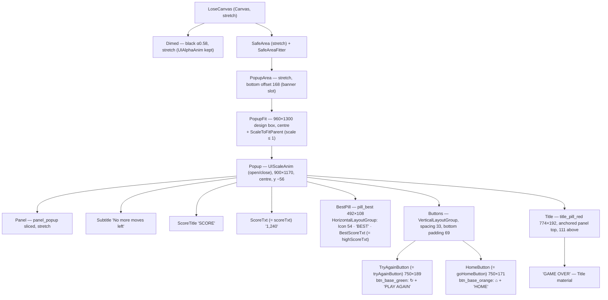
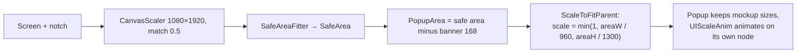

# LoseCanvas mockup layout — Design

Branch: `feature/block-sprite-palette`

## Goal

Restyle `LoseCanvas` so it matches `Assets/_Game/_BlockDrag/Resource/ComboBlock_UI_assets/UI Preview/Game Over (Lose)@1x.png` (360×640, mockup px × 3 = canvas units) and stays correct on 16:9 phones, tall/notched phones and 3:4 tablets. Same approach as the SettingPopup restyle (`2026-11-01-setting-popup-mockup-layout-design.md`).

Mockup, top to bottom:

1. Gameplay behind, dimmed (purple `#6236E0` → `#291960`, ≈ black 58 %).
2. Red pill title "GAME OVER" (white, dark outline) overlapping the top edge of a white panel.
3. Grey subtitle "No more moves left".
4. Dark label "SCORE", then the big white score "1,240" (dark outline).
5. Light pill: trophy icon + "BEST 94,157" (dark text).
6. Big green "↻ PLAY AGAIN" button.
7. Big orange "⌂ HOME" button.
8. Bottom band reserved for the 320×50 ad banner (outside the popup).

## Measurements (mockup px → canvas units)

Sampled by script from the PNG. "y" is measured from the panel's top edge.

| Element | Mockup | Canvas |
|---|---|---|
| Dim | `#291960` over `#6236E0` | black **α 0.58** (now 0.86) |
| Panel (white, `#1C1A3A` border 3, `#E3DEF5` inner bottom edge) | x 30–330, y 124–514 → 300×390 | **900×1170** — same art as `panel_popup` |
| Title pill (`#FF4D5E`, darker bottom `#D12A3C`, `#1C1A3A` border, pink highlight `#FFA6AF` top-left) | x 54–312, y 87–151 → 258×64; 37 above / 27 below panel top | **774×192**, top 111 above panel top |
| "GAME OVER" | cap ~20 | Title font ~**84** |
| Subtitle "No more moves left" (`#6B6690`) | centre y 61, cap ~9 | `Fredoka-Bold SDF` ~**42**, centre **183** |
| "SCORE" (`#1C1A3A`) | centre y 93, cap ~8 | `Fredoka-Bold SDF` ~**40**, centre **279** |
| Score number | y 118–159, ~41 high | Title font ~**150**, centre **414** |
| Best pill (`#F1EEFB`, `#1C1A3A` border 3, full radius) | x 98–262, y 176–212 → 164×36 | **492×108**, centre **582** |
| Best row: trophy · "BEST" · value | icon ~18, cap ~9 | icon **54**, `Fredoka-Bold SDF` `#1C1A3A` ~**42** |
| Play Again (green, ↻ icon) | x 55–305, y 236–299 → 250×63 | **750×189**, label ~**72** |
| Home (orange, ⌂ icon) | x 55–305, y 310–367 → 250×57 | **750×171**, label ~**66** |
| Gap Play → Home | 11 | **33** |
| Home → panel bottom | 23 | **69** |
| Side padding inside panel | 25 | **75** |
| Banner band | y 584–640 → 56 | **168** |

## Current state

`Assets/_Game/Resources/UI/LoseCanvas.prefab` + `Assets/_Game/_UI/Scripts/LoseCanvas.cs`.

- Old art: `Block` background tinted cyan, `btn_blue_large` title "Lose", `btn_green` / `btn_orange` buttons, `Bungee-Regular2` font everywhere.
- `Popup` (800×1058, `UIScaleAnim`) placed at `y +71` from centre — centre-relative magic number.
- `HomeButton` is inactive in the prefab (the script turns it on for the lose state).
- Leftovers: `Content/Text_Info` [off], `Content/Item` [off] (holds `blockGoldTxt`), `NextLevel` [off].
- **The win path is dead**: the only caller is `GameplayCanvas` → `OpenUI<LoseCanvas>(false)`. `nextLevelButton`, `blockGoldTxt`, `OnNextLevel`, `loadingTimes/loadingActions/loadingAction2s`, `isWin`, `isNextLevel`, `BASE_GOLD`, `topCanvas` exist only for it (there is a separate `WinCanvas`).
- Score counts up with `SetText("{0}", v)` → no thousands separator ("1240", mockup shows "1,240").

Serialized refs to keep: `tryAgainButton` = `TryAgainButton`, `goHomeButton` = `HomeButton`, `scoreTxt` = `ScoreTxt`, `highScoreTxt` = `BestScoreTxt`.

## Assets

From `ComboBlock_UI_assets/`:

| Use | Asset |
|---|---|
| Panel | `panel_popup.png` (generated for SettingPopup, already 9-sliced) |
| Play Again / Home | `buttons/btn_base_green` / `btn_base_orange` (already 9-sliced) |
| Button icons | `icons/ic_restart_white`, `icons/ic_home_white` |
| Best icon | `icons/ic_trophy` |
| Texts | Title / score / buttons: `Fredoka-Bold Title SDF` + Title Material. Subtitle, SCORE, BEST: `Fredoka-Bold SDF`, no outline |

**Missing from the pack** — generated with the same script as `title_pill.png`, saved next to it, 9-sliced:

- `title_pill_red.png` — `#FF4D5E` rounded rect, darker `#D12A3C` bottom band, `#1C1A3A` border, small `#FFA6AF` highlight bar top-left (like the buttons).
- `pill_best.png` — `#F1EEFB` fully rounded pill with `#1C1A3A` border.

## Design

### Hierarchy

Every child of `Popup` is anchored to the popup's **top** edge with the y values from the table (`Buttons` to its bottom edge), so positions are the mockup's and never relative to the screen centre. Button contents (icon + label) use `HorizontalLayoutGroup` + `LayoutElement` on the icon, as the skill requires.

### How it stays responsive

A modal popup has no flexible zone, so the whole popup is one fixed block that only **scales down** when the space is too small and stays centred otherwise. `Dimed` stays outside the safe area so it covers the whole screen.

| Screen | Canvas | Area above banner | Scale |
|---|---|---|---|
| 1080×1920 | 1080×1920 | 1080×1752 | 1.00 — same as mockup |
| 1170×2532 (notch) | ~979×2118 | ~979 × ~1830 | 1.00 (960 fits) |
| 1080×2400 (20:9) | ~966×2147 | ~966 × ~1900 | 1.00 |
| 1536×2048 (iPad) | ~1247×1663 | 1247×1495 | 1.00 (1300 tall box fits) |
| Very small / landscape-ish | — | < 960 or < 1300 | shrinks uniformly |

- Design box 960×1300 = panel 900 (+30 margin each side) × panel 1170 + title overhang 111 (+ ~19 margin). `Popup` sits 56 below the box centre so the title overhang is included.
- `ScaleToFitParent` on `PopupFit`, `UIScaleAnim` on the child `Popup` — two nodes, so the open animation and the fit scale never overwrite each other (same as SettingPopup).

### Code changes (`LoseCanvas.cs`, `BlockDrag.UI`)

1. **Thousands separator**: score count-up and high score show `1,240` / `94,157`. A small pure helper `ScoreFormat.Format(int)` (`N0`, invariant culture → always `,`) with EditMode tests; the tween writes `scoreTxt.text = ScoreFormat.Format(v)`.
2. **Remove the dead win path**: `nextLevelButton`, `blockGoldTxt`, `OnNextLevel`, the loading lists, `isWin`, `isNextLevel`, `BASE_GOLD`, `topCanvas`, unused `gameData/gameplayData` fields and usings. `Open` no longer casts `param`; the Home button is always on.
3. Behaviour of Play Again (`RestartGame`) and Home (`Close(); OpenUI<HomeCanvas>()`) unchanged.

### Prefab changes (`LoseCanvas.prefab`)

- `Dimed`: color black α 0.58 (keep `CanvasGroup`, `UIAlphaAnim`).
- Add `SafeArea` → `PopupArea` → `PopupFit`; move the existing `Popup` (keeps `UIScaleAnim`) under it.
- Rebuild children of `Popup` per the hierarchy, **reusing** `TryAgainButton`, `HomeButton`, `ScoreTxt`, `BestScoreTxt` (serialized refs survive), `TitleLevel` → `Title`, `ScoreTitle`.
- Texts: "GAME OVER", "No more moves left", "SCORE", "BEST", "PLAY AGAIN", "HOME"; TMP per the skill (margin 0, `CenterGeoAligned`, wrap off, auto-size off, `FontMaterialProp` off on Title-material texts).
- **Delete**: `Background` (old cyan block), `BestScore` label ("Hight Score"), `Content` (`Text_Info`, `Item`), `GroupButton/NextLevel`.

## Assumptions — please confirm

1. The **win path is removed** (never called; `WinCanvas` covers wins). If you want to keep it for later, the `NextLevel` button + `Item` would stay hidden instead.
2. Subtitle is the fixed text "No more moves left" (the only lose reason today).
3. Scores use `,` as thousands separator regardless of device language, like the mockup.
4. The ad-banner placeholder is not drawn; the popup only stays above the reserved 168-unit slot (same as SettingPopup).
5. No new animation beyond what exists (popup scale-in, dim fade, score count-up).

## Out of scope

- Real banner ads, revive flow (`RevivePopup`), sounds/analytics (still commented out).
- Restyling `WinCanvas` or other popups.

## Architecture

All changes stay in `BlockDrag.UI` (one script edit, one small helper, reuse of `ScaleToFitParent`) and its prefab/sprites. Uses `Locator.Score` / `Locator.BoardSession` as today. Dependency direction unchanged; no package changes.

## Risks

- Generated `title_pill_red` / `pill_best` only approximate the mockup art; they can be swapped for designer art later without prefab changes (same names/borders).
- Font sizes are estimates from cap heights; final values are tuned against the 1080×1920 render.
