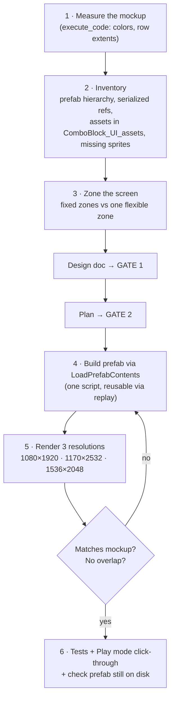

# Responsive UI skill — Design

Branch: `feature/block-sprite-palette`

## Goal

Turn the method used to rebuild `HomeCanvas` from `UI Preview/Home@1x.png` into a reusable project skill, so future screens (Gameplay, Settings/Pause, Loading, Lose, popups) are built the same way: measured from the mockup, responsive, verified by renders.

Docs only. No code, prefab, or package changes.

## Where it lives

- `.agents/skills/unity-responsive-ui/SKILL.md` (+ one helper reference file).
- `CLAUDE.md` says project skills are exposed to Claude Code through `.claude/skills/`, but **that folder does not exist** right now, so none of the `.agents/skills` are picked up automatically. Decision (approved): link **all** skills by making `.claude/skills` a directory symlink to `../.agents/skills`, so every current and future skill is exposed. `/.claude/skills/` is already in `.gitignore`, so the link is local to each machine; `CLAUDE.md` gets the one-line command to recreate it.

## When it triggers

Description (what decides auto-loading):

> Use when building or restyling a Unity uGUI screen, canvas, or popup in BlockDrag from a mockup image (e.g. `ComboBlock_UI_assets/UI Preview/*.png`), or when a UI must adapt to phones, tall phones, notch and tablets.

It works **inside** the existing gates: the skill tells what to put in the design and the plan, and how to implement and verify. It never skips Gate 1 / Gate 2.

## Skill content

### Sections of `SKILL.md`

1. **Project facts** — `CanvasScaler` 1080×1920 match 0.5 (from `UIManager.prefab`); mockup 360×640 → **×3** = canvas units; real canvas sizes per device (table); asset folder; Title font + material for styled numbers/labels; `SafeAreaFitter` in `BlockDrag.UI`.
2. **Measure, don't guess** — `execute_code` snippets: load the mockup PNG, sample colors, per-row non-background extents → sizes and positions ×3.
3. **Layout rules**
   - Background (`Bg` + tiled grid) outside `SafeArea`; everything interactive inside.
   - Fixed-size zones for anything tapped or read (top bar, buttons, panels, banner slot); **one** flexible zone that absorbs the aspect difference (usually the logo/art) with `AspectRatioFitter` Fit In Parent.
   - Anchor to the edge the element belongs to; no centre-relative magic numbers.
   - 9-slice any sprite that is stretched off its native ratio; set it on the importer.
   - `HorizontalLayoutGroup` for icon + text rows.
   - TMP: margins 0, `CenterGeoAligned`, Title material; disable `FontMaterialProp` when using the Title material.
   - Banner band extended below the safe area.
4. **Building the prefab** — the `LoadPrefabContents` → edit → `SaveAsPrefabAsset` → `UnloadPrefabContents` template; keep existing serialized refs and transition components (`UIScaleAnim`); avoid ambiguous `Object` in `execute_code` (use `UnityEngine.Object`).
5. **Verification** — preview-scene render script for the 3 resolutions (world-space canvas sized like `CanvasScaler` would); compare with the mockup side by side; Play mode from `LoadStart`, click via `ExecuteEvents`; `ScreenCapture`.
6. **Pitfalls seen** — prefab overwritten by an open Prefab Mode stage when tests run → re-check the file on disk after tests; `TextCommon` has margin bottom −52; dynamic TMP atlas diffs in font assets are noise, don't commit them; `GameOverCheckTests` failures are unrelated to UI.

### Reference file

`render-snippets.md` — the full, tested `execute_code` scripts (measure mockup, render 3 resolutions, play-mode click). Kept out of `SKILL.md` so the main file stays short.

## Out of scope

- Any change to existing UI.
- Subagent pressure-testing of the skill (the `writing-skills` method) — can be done later if you want.

## Architecture

Documentation only; no assembly or dependency change.
