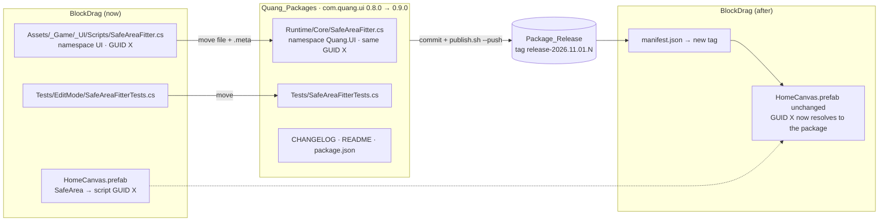

# Move `SafeAreaFitter` into `com.quang.ui` — Design

Branch: `feature/block-sprite-palette`

## Goal

`SafeAreaFitter` is generic (no BlockDrag dependency). Make it part of the shared UI base `com.quang.ui` so every project that uses the package — and the `unity-responsive-ui` skill — finds it in the same place.

## Current state

| Item | Where |
|---|---|
| Component | `Assets/_Game/_UI/Scripts/SafeAreaFitter.cs`, namespace `UI`, assembly `BlockDrag.UI` |
| Tests | `Assets/Tests/EditMode/SafeAreaFitterTests.cs` (3 tests) |
| Used by | `HomeCanvas.prefab` → node `SafeArea` (referenced by the script's **GUID**) |
| Package source | `/Users/minhquang/Documents/PackUnity/Quang_Packages/Packages/com.quang.ui` — `0.8.0`, clean, identical to release `release-2026.10.13.1` |
| Release | `tools/publish.sh --push` → `Quang_Package_Release` → `github.com/Quangbipi/Package_Release`, tag `release-YYYY.MM.DD.N` |
| BlockDrag manifest | all six `com.quang.*` at `#release-2026.10.13.1` |

`com.quang.ui/Runtime/Core/UIScreenUtils.cs` exists but has nothing for the safe area, so there is no overlap.

## Design

### 1. Package side (`com.quang.ui`)

- `Runtime/Core/SafeAreaFitter.cs` — same code, namespace **`Quang.UI`**, next to `UIScreenUtils`. The **`.meta` is moved with it, keeping GUID X**, so existing prefab references keep working without re-wiring.
- `Tests/SafeAreaFitterTests.cs` — the 3 existing tests, namespace adjusted, in `Quang.UI.Tests` (already references `Quang.UI`).
- `package.json` `0.8.0 → 0.9.0` (new public component = minor). CHANGELOG entry. README: add `SafeAreaFitter` to the Public API index with one line on usage (stretch a child `RectTransform` under the canvas, put interactive content inside, keep the background outside).
- Commit in `Quang_Packages`, then `tools/publish.sh --push` → new tag `release-2026.11.01.N`.

### 2. BlockDrag side

- Delete `Assets/_Game/_UI/Scripts/SafeAreaFitter.cs(.meta)` and `Assets/Tests/EditMode/SafeAreaFitterTests.cs(.meta)` **in the same step** as moving the manifest to the new tag. Two files with the same GUID must never exist at once (Unity would reassign one and break the prefab link).
- Manifest: move **all six** `com.quang.*` entries to the new tag, so the project keeps one consistent release (the other five have no content change).
- `HomeCanvas.prefab`: no edit; it keeps pointing at GUID X.
- Docs: `unity-responsive-ui` skill and `.agents/rules/architecture.md` say `Quang.UI.SafeAreaFitter` (package) instead of `BlockDrag.UI`.

### Why keep the GUID

Unity stores a component as `m_Script: {guid: X}`. Namespace/assembly changes do not matter as long as the class name and file name match and the GUID is the same. A new GUID would leave `HomeCanvas` with a "missing script" and need manual re-wiring in every project.

## Architecture

Moves code **down** a layer (`BlockDrag.UI` → `Quang.UI`). Dependency direction stays valid: `BlockDrag.UI` already references `Quang.UI`; `Quang.UI` gains no new reference (only `UnityEngine`). The architecture memory is updated as required by `AGENTS.md`.

## Risks

- **Outward-facing:** pushes a commit and a new tag to `github.com/Quangbipi/Package_Release`. Tags are treated as immutable. This happens only in the implementation step after Gate 2.
- The release includes every package in `public-roots.txt`; only `com.quang.ui` changes content.
- If the package resolve fails (network/auth), BlockDrag would have lost the project copy — mitigated by verifying the package in `Library/PackageCache` before deleting, and by keeping the delete + manifest change in one uncommitted step that can be reverted.
