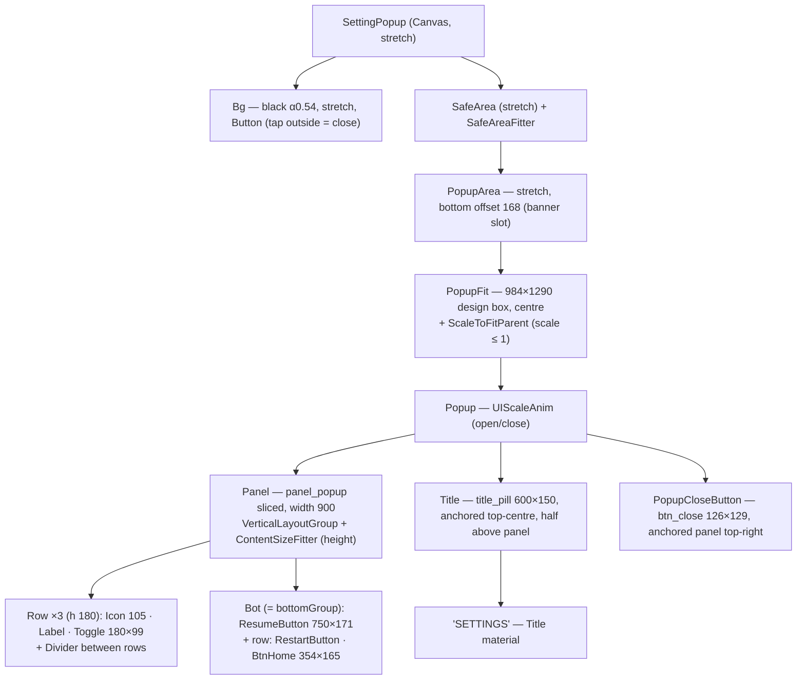
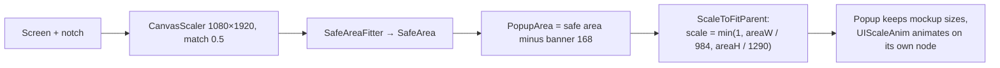
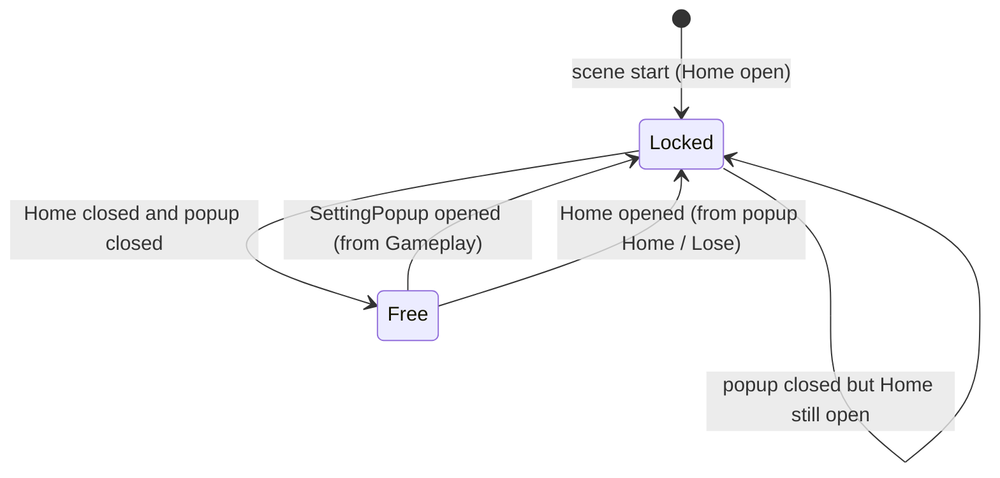

# SettingPopup mockup layout — Design

Branch: `feature/block-sprite-palette`

## Goal

Restyle `SettingPopup` so it matches `Assets/_Game/_BlockDrag/Resource/ComboBlock_UI_assets/UI Preview/Settings Pause@1x.png` (360×640, mockup px × 3 = canvas units) and stays correct on 16:9 phones, tall/notched phones and 3:4 tablets.

Mockup, top to bottom:

1. Screen behind is dimmed (purple `#6236E0` → `#2D1B68`, ≈ black 54 %).
2. Purple pill title "SETTINGS" (white, dark outline) overlapping the top edge of a white panel.
3. Red close button (×) at the panel's top-right corner, poking out of the panel.
4. Three rows — icon in a colored circle, dark label, toggle on the right — separated by light lines: **Sound**, **Music**, **Vibration**.
5. Big green "▶ RESUME" button.
6. Blue "↻ RESTART" and orange "⌂ HOME" buttons side by side.
7. Bottom band reserved for the 320×50 ad banner (outside the popup).

## Measurements (mockup px → canvas units)

Sampled by script from the PNG.

| Element | Mockup | Canvas |
|---|---|---|
| Panel (white, `#1C1A3A` border 3, drop shadow ~6 below) | x 30–330, y 113–515 → 300×402 | **900×1206** |
| Title pill (`#A855F7`, darker bottom `#7E2BD1`, dark border) | x 83–283, y 89–138 → 200×50, straddles the panel's top edge (24 above, 26 below) | **600×150**, top 72 above panel top |
| Close button | x 302–344, y 97–140 → 42×43 | **126×129** (`btn_close` 132×141), centre at panel corner −12/+18 |
| Row pitch (centres y 190 / 250 / 310) | 60 | **180** |
| First row centre below panel top | 77 | **231** |
| Row icon (circle) | ~35 | **105** (`ic_sound/music/vibration` 120×120) |
| Row label "Sound" | cap ~14, x from 107 | font **60**, left at icon + 36 |
| Toggle | x 245–305, 60×33 | **180×99** (`toggle_on/off` 180×102) |
| Divider (`#EEEAF8`) | 2 high, x 55–305 | **750×6** |
| Side padding inside panel | 25 | **75** |
| Resume button | x 55–305, y 361–418 → 250×57 | **750×171**, label font ~84 |
| Restart / Home | 118×55 each, gap 14 | **354×165** each, gap 42, label font ~60 |
| Resume → Restart gap | 17 | **51** |
| Last button → panel bottom | ~25 | **75** |
| Banner band | y 584–640 → 56 | **168** |

## Current state

`Assets/_Game/Resources/UI/SettingPopup.prefab` + `Assets/_Game/_UI/Scripts/SettingPopup.cs`.

- Old art from `UIResources/UI/Setting/*` (`frame_popup`, `frame_title`, `frame_toggle` + `btn_circle` handle), 720×800 board positioned at `y +81` from centre.
- Toggles move a handle by `ImageStateButtonComponent.Positions`; the pack instead has complete `toggle_on` / `toggle_off` sprites.
- Bottom row: `BtnHome` (round) + `ResumeButton`. **No restart button.**
- Many disabled leftovers: `BtnExit (1)`, Languages/Support buttons, `BtnPolicy`, `Scroll View` with 9 language buttons, `VersionTxt`, root `Image`.
- Labels say "Setting" / "Haptic".
- Nobody opens the popup: `HomeCanvas.OnSetting` is a `TODO`, `GameplayCanvas.OnSettingBtnClick` is commented out. Both buttons are wired in their prefabs.
- `OnGoHome` still goes through `ConfirmPopup` → Loading → `MainMenuCanvas` (the old flow). `LoseCanvas` already goes home with `Close(); Locator.UI.OpenUI<HomeCanvas>()`.

Serialized refs to keep: `closeButton` = `PopupCloseButton`, `backgroundCloseButton` = `Bg`, `resumeButton`, `homeButton`, `bottomGroup`, `functionButtons[0..2]` (Sound, Music, Vibration toggles).

## Assets

From `ComboBlock_UI_assets/`:

| Use | Asset |
|---|---|
| Close | `buttons/btn_close.png` |
| Toggles | `buttons/toggle_on.png`, `buttons/toggle_off.png` |
| Resume / Restart / Home | `buttons/btn_base_green` / `btn_base_blue` / `btn_base_orange` (720×204; set the same 70 px 9-slice border the green one already has) |
| Button icons | `icons/ic_play_white`, `ic_restart_white`, `ic_home_white` |
| Row icons | `icons/ic_sound`, `ic_music`, `ic_vibration` (circle already in the sprite) |
| Texts | Title / buttons: `Fredoka-Bold Title SDF` + Title Material. Row labels: `Fredoka-Bold SDF`, color `#1C1A3A`, no outline |

**Missing from the pack** — generated with the same script as `panel_score.png`, saved next to it, 9-sliced:

- `panel_popup.png` — white rounded rect, `#1C1A3A` 9 px border, radius ~42, light `#E3DEF5` inner bottom edge, dark drop shadow below.
- `title_pill.png` — `#A855F7` rounded rect with a darker `#7E2BD1` bottom band and `#1C1A3A` border.
- Divider: plain `Image` with color `#EEEAF8`, no sprite.

## Design

### Hierarchy

`Title` and `PopupCloseButton` are siblings of `Panel` (not layout children) but anchored to the panel's top edge, so they follow it when its height changes.

### How it stays responsive

A modal popup has no "flexible zone" to stretch, so the whole popup is one fixed block that **only scales down** when the space is too small, and stays centred otherwise.

| Screen | Canvas | Area above banner | Scale |
|---|---|---|---|
| 1080×1920 | 1080×1920 | 1080×1752 | 1.00 — same as mockup |
| 1170×2532 (notch) | ~979×2118 | ~979 × ~1830 (minus safe insets) | ~0.99 (width-limited: panel 900 + close button overhang) |
| 1080×2400 (20:9) | ~966×2147 | ~966 × ~1900 | ~0.98 |
| 1536×2048 (iPad) | ~1247×1663 | 1247×1495 | 1.00 (1290 tall box fits) |

- The design box (984×1290) is the panel plus the close button sticking out on the right (mirrored on the left to stay centred) and the title above.
- `ScaleToFitParent` sits on `PopupFit`, `UIScaleAnim` on the child `Popup` — two separate nodes, so the open/close animation and the fit scale never overwrite each other.
- In the Home state (`state 0`) the `Bot` group is hidden; because the panel height comes from its `ContentSizeFitter`, the panel shrinks to the three rows instead of leaving an empty white area.

### Code changes (`BlockDrag.UI`)

1. **New `ScaleToFitParent`** (`Assets/_Game/_UI/Scripts/ScaleToFitParent.cs`): sets `localScale` = `min(1, parentW / designW, parentH / designH)` on start and when the parent rect changes (`OnRectTransformDimensionsChange`). The math lives in a pure static method with EditMode tests.
2. **`SettingPopup.cs`**:
   - add `[SerializeField] UIButton restartButton` → `Close(); Locator.BoardSession?.RestartGame();` (same as `LoseCanvas.OnTryAgain`).
   - `OnHomeButtonClick` → `Close(); Locator.UI.OpenUI<HomeCanvas>();` (same as `LoseCanvas.OnGoHome`). The old `ConfirmPopup` / Loading / `MainMenuCanvas` path and its lists are removed.
   - `SetupState` unchanged in meaning (state 0 hides `bottomGroup`, state 1 shows it); `restartButton` lives inside `bottomGroup`.
3. **Open the popup**:
   - `HomeCanvas.OnSetting` → `Locator.UI.OpenUI<SettingPopup>(0)` (settings only).
   - `GameplayCanvas.OnSettingBtnClick` → `Locator.UI.OpenUI<SettingPopup>(1)` (pause: resume / restart / home).
4. **Block dragging under the popup** (`GameSceneFlow.cs`): it already disables `BlockDragInput` while `HomeCanvas` is open. Extend it to two flags — `homeOpen`, `settingOpen` — and set `blockDragInput.enabled = !homeOpen && !settingOpen`. It subscribes to `SettingPopup._OnOpen` / `_OnClose` (instance from `Locator.UI.GetUI<SettingPopup>()`, preloaded inactive together with Home). With two flags, closing the popup over Home does not re-enable input, and Home → popup → Home keeps input locked.

### Prefab changes (`SettingPopup.prefab`)

- `Bg`: black α 0.54 (keep `Button`, `CanvasGroup`, `UIAlphaAnim`).
- Add `SafeArea` → `PopupArea` → `PopupFit`; move the existing `Popup` (keeps `UIScaleAnim`) under it; remove its `AspectRatioFitter`.
- Rebuild `Broad` as `Panel` with the new sprites and layout, reusing `PopupCloseButton`, `Title`/`SettingText`, the three `SwitchToggle` rows (their `Toggle` objects are the `functionButtons`), `Bot`, `BtnHome`, `ResumeButton`. Add `RestartButton`.
- Toggles: one `Image` with `toggle_on` / `toggle_off`, `ImageStateButtonComponent` sprites per state (`OPENING` = muted = off, `SELECTING` = on, as `BoolToState` already maps); delete the `Handle` children and the position data.
- Texts: "SETTINGS", "Sound", "Music", "Vibration", "RESUME", "RESTART", "HOME"; TMP settings per the skill (margin 0, `CenterGeoAligned` for button/title, `FontMaterialProp` off on Title-material texts).
- **Delete the disabled leftovers** listed in *Current state* (none are referenced by the script).

## Assumptions — confirmed 2026-11-01 (loading screen and ads to be added later)

1. **Restart** = restart the current board in place (`RestartGame`), no loading screen or interstitial ad.
2. **Home** goes straight to `HomeCanvas` like `LoseCanvas` does, **without** the `ConfirmPopup` and without an interstitial. The board is kept, so pressing Play continues the same game (`GameSceneFlow` only resets a finished board).
3. Opening from Home shows only the three toggles (no Resume/Restart/Home); opening from Gameplay shows the full mockup.
4. Tapping the dim background closes the popup (current behaviour kept).
5. The ad-banner placeholder is not drawn; the popup only stays above the reserved 168-unit slot.
6. The leftover language/support/policy/version nodes are deleted.

## Out of scope

- Real pause of timers/countdown while the popup is open (see Risks).
- Banner ads, language selection, version text.
- Other popups (`ConfirmPopup` etc.) are not restyled.

## Architecture

All changes stay in `BlockDrag.UI` (one new component, edits to three canvas scripts) and its prefabs/sprites. It uses `Locator.BoardSession` (shared contract) as `LoseCanvas` already does. Dependency direction unchanged; no package changes.

## Risks

- **Input behind the popup**: handled by the `GameSceneFlow` lock above (approved). `BlockDragInput.OnDisable` already cleans up an active drag.
- `ContentSizeFitter` + nested layout groups need a layout rebuild on state change; `SetupState` will force one if the render shows a stale size.
- Generated `panel_popup` / `title_pill` sprites only approximate the mockup art; they can be swapped for designer art later without prefab changes (same names/borders).
