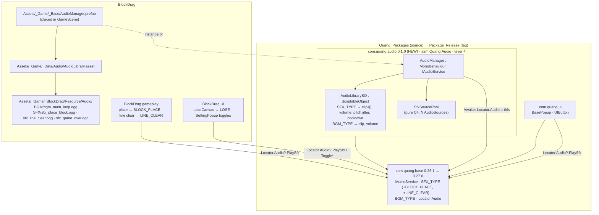
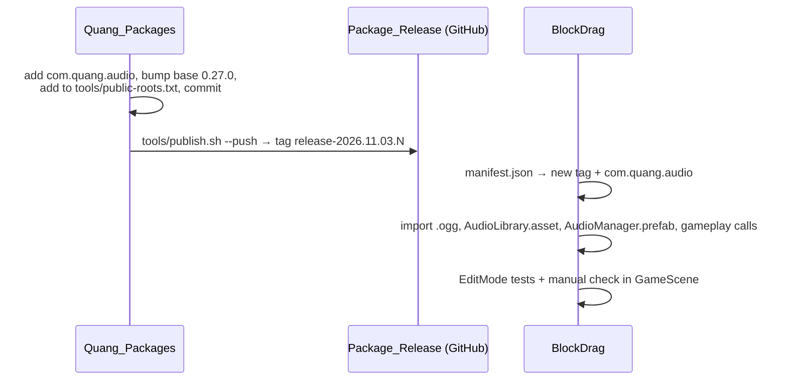
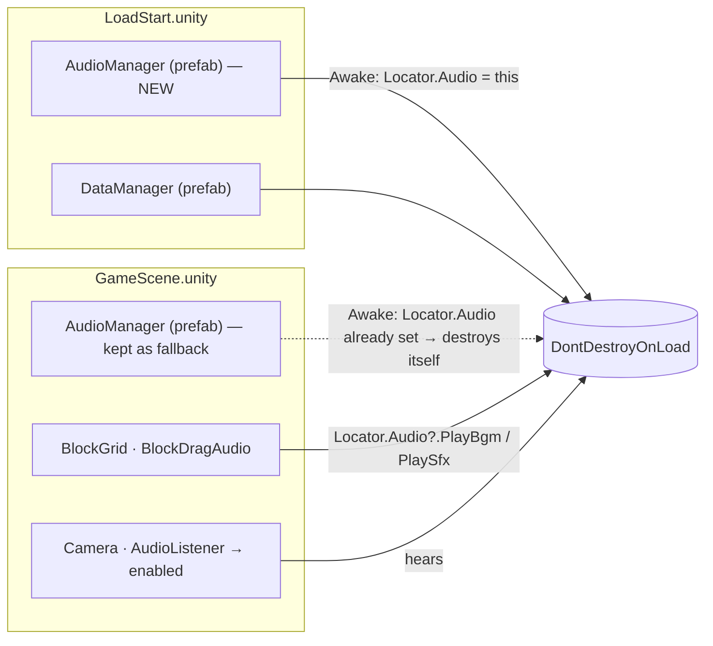

# New package `com.quang.audio` (implements `IAudioService`) — Design

Branch: `feature/block-sprite-palette` (recommend a new branch `feature/audio-package` for the BlockDrag side)

## Goal

`com.quang.base` already declares the audio contract (`IAudioService`, `SFX_TYPE`, `BGM_TYPE`, `Locator.Audio`), but **no package implements it**. `Locator.Audio` is therefore always `null` in BlockDrag. Several callers use `Locator.Audio.PlaySfx(...)` without `?.` (`PerfectCanvas`, `WinCanvas`, `ShowItemsPopup`, `UI_ANIM`), so those paths would throw a `NullReferenceException` today.

This task adds a reusable package, **`com.quang.audio`**, released the same way as `com.quang.ui`. It provides a ready `AudioManager : IAudioService`. BlockDrag then uses it to play the SFX/BGM from `~/Downloads/combo_block_audio`.

## Current state

| Item | Where / value |
|---|---|
| Contract | `com.quang.base` `Runtime/Services/Contracts/Audio/` — `IAudioService`, `ENUM.AUDIO.cs` (`SFX_TYPE`, `BGM_TYPE`), `Locator.Audio` |
| Existing callers | `Quang.UI`: `BasePopup` (POPUP_SHOW/HIDE), `UIButton` (CLICK). BlockDrag UI: `SettingPopup` (`ToggleSfxVolume`/`ToggleBgmVolume`), `PerfectCanvas`, `WinCanvas`, `ShowItemsPopup`, `UI_ANIM`, `LoseCanvas` (commented out) |
| Mute state | `GameData.setting.isBgmMute / isSfxMute` (Quang.Base), read through `Locator.Data.GetData<GameData>()` |
| Package source | `/Users/minhquang/Documents/PackUnity/Quang_Packages` (clean, HEAD `12a2032`) |
| Release | `tools/publish.sh --push` → `Quang_Package_Release` → `github.com/Quangbipi/Package_Release`, tag `release-YYYY.MM.DD.N`. The packages it copies are listed in `tools/public-roots.txt` |
| BlockDrag manifest | six `com.quang.*` entries at `#release-2026.10.31.1` |
| Audio assets | `bgm_main_loop`, `sfx_place_block`, `sfx_line_clear`, `sfx_game_over`, each as both `.wav` and `.ogg` |

## Architecture



The only dependency is `com.quang.audio → com.quang.base`. Nobody references `Quang.Audio` directly; every consumer goes through `Locator.Audio`. This follows the pattern used by `Quang.Analytics` and `Quang.Ads`, and the layer rule in `.agents/rules/architecture.md` (feature service at layer 4, above contracts). The package never references `BlockDrag`.

## 1. Package `com.quang.audio`

Layout follows `com.quang.ui` / `com.quang.services.analytics`:

```
Packages/com.quang.audio/
  package.json            name com.quang.audio · 0.1.0 · "layer:4" · deps { com.quang.base: 0.27.0 }
  README.md  CHANGELOG.md
  Runtime/Quang.Audio.asmdef      refs: Quang.Base  (no DOTween/Odin, so other projects need nothing extra)
  Runtime/AudioManager.cs
  Runtime/AudioLibrarySO.cs
  Runtime/SfxSourcePool.cs
  Tests/Quang.Audio.Tests.asmdef  (EditMode)
  Tests/AudioLibrarySOTests.cs · SfxSourcePoolTests.cs · AudioManagerTests.cs
```

### `AudioLibrarySO` (data)

```csharp
[CreateAssetMenu(menuName = "Quang/Audio/Audio Library")]
public class AudioLibrarySO : ScriptableObject
{
    [Serializable] public class SfxEntry { public SFX_TYPE type; public AudioClip[] clips; [Range(0,1)] public float volume = 1; public float pitchJitter; public float cooldown = 0.03f; }
    [Serializable] public class BgmEntry { public BGM_TYPE type; public AudioClip clip; [Range(0,1)] public float volume = 0.6f; }
    [SerializeField] List<SfxEntry> sfx; [SerializeField] List<BgmEntry> bgm;
    public bool TryGetSfx(SFX_TYPE t, out SfxEntry e);   // dictionary built lazily; duplicate type → first wins + warning
    public bool TryGetBgm(BGM_TYPE t, out BgmEntry e);
}
```

- `clips[]` with more than one item → a random clip is picked, so repeated sounds (like placing blocks) vary.
- `cooldown` stops the same SFX stacking within a few ms of itself, for example when one move clears several lines.

### `AudioManager : MonoBehaviour, IAudioService`

| Member | Behaviour |
|---|---|
| `[SerializeField] AudioLibrarySO library; int sfxPoolSize = 8; bool dontDestroyOnLoad = true` | Inspector config |
| `Awake` | If another manager is already registered, destroy this one (singleton guard). Otherwise `Locator.Audio = this`, create 2 BGM sources (for crossfade), a pool of SFX sources, then apply `DontDestroyOnLoad` |
| `Start` | — (implementation note: `Locator.Data` lives in `com.quang.data`, so to keep the package base-only the saved mute state is applied by the game — BlockDrag's `BlockDragAudio.Start`) |
| `OnDestroy` | `if (ReferenceEquals(Locator.Audio, this)) Locator.Audio = null` (same rule as `UIManager`) |
| `PlaySfx(type)` | Look up the entry, check cooldown, take a free source from the pool (if none is free, take the oldest), `PlayOneShot` with volume and pitch jitter. Does nothing when SFX is muted or the type has no entry (warning once per type in the Editor) |
| `PlayRandomSfx(list)` | Picks one type at random → `PlaySfx` |
| `PlayLoopSfx(type, fadeIn)` / `StopLoopSfx(src, fadeOut)` | A dedicated looping source with a coroutine fade; returns that `AudioSource` |
| `StopSfx(type)` | `NONE` → stop all SFX; otherwise stop the sources playing that type |
| `PlayBgm(type, fadeOut)` | Same clip already playing → do nothing. Otherwise crossfade between the two BGM sources over `fadeOut` seconds |
| `PauseBgm / UnPauseBgm / StopBgm` | Act on the active BGM source |
| `ToggleBgmVolume(isMute) / ToggleSfxVolume(isMute)` | Set the mute flag and adjust volume immediately. **Does not save anything**: saving stays with the caller (`SettingPopup` already writes `GameData.setting`) |

Fades use a coroutine with `Time.unscaledDeltaTime`, so music keeps fading while `PauseService` sets `timeScale = 0`.

`SfxSourcePool` is pure C# (rent/return/oldest-steal logic) so it can be unit-tested without Play Mode.

## 2. Change in `com.quang.base` (enum)

`SFX_TYPE` holds values from earlier games (RICE_*, KNIFE_*), and nothing matches "place block" or "line clear". A C# enum cannot be extended through an asmref, so the change must be made in the package:

- `SFX_TYPE.BLOCK_PLACE = 112`, `SFX_TYPE.LINE_CLEAR = 113` (generic names any puzzle game can reuse; values follow the current highest, 111).
- `com.quang.base` `0.26.1 → 0.27.0` (new public enum members = minor). CHANGELOG entry.

Mapping for BlockDrag:

| File | Enum |
|---|---|
| `sfx_place_block` | `SFX_TYPE.BLOCK_PLACE` (new) |
| `sfx_line_clear` | `SFX_TYPE.LINE_CLEAR` (new) |
| `sfx_game_over` | `SFX_TYPE.LOSE` (already exists) |
| `bgm_main_loop` | `BGM_TYPE.BACK_GROUND_1` (already exists) |

## 3. BlockDrag integration

- **Assets:** copy only the `.ogg` files into `Assets/_Game/_BlockDrag/Resource/Audio/{BGM,SFX}/`. Import settings: SFX `Decompress On Load` + Vorbis; BGM `Streaming` + Vorbis q≈70.
- **Data:** `Assets/_Game/_Data/Audio/AudioLibrary.asset` (an `AudioLibrarySO`) with the 4 entries above.
- **Prefab:** `Assets/_Game/_Base/AudioManager.prefab` (next to `DebugManager.prefab`), placed in `GameScene`.
- **Calls** (all `Locator.Audio?.` so a missing manager is never fatal):
  - Successful block placement (`BlockSpawner` / `BlockDragHandler`, exact spot chosen in the plan) → `BLOCK_PLACE`.
  - Line clear (`BlockGrid` clear animation / `Effects/LineClearImpactEffect`) → `LINE_CLEAR`, once per move.
  - `LoseCanvas`: uncomment `PlaySfx(SFX_TYPE.LOSE)`.
  - Game start → `PlayBgm(BGM_TYPE.BACK_GROUND_1)`.
- Change the existing `Locator.Audio.PlaySfx` calls (without `?.`) to `?.`.
- Manifest: add `com.quang.audio` and move **all** `com.quang.*` entries to the new tag.
- Update `.agents/rules/architecture.md`: add the `Quang.Audio` row to the Module Map and to the feature-services layer.

## Release flow



## Risks / notes

- **Outward-facing:** pushes a commit and a new tag to `github.com/Quangbipi/Package_Release`. Only done in the implementation step, after Gate 2.
- `com.quang.audio` must be added to `tools/public-roots.txt`, or the release will not include it.
- Other projects that use `SFX_TYPE` are unaffected (values are only added, never renumbered).
- `IAudioService` method signatures stay the same, so the fake services in the existing tests (`LocatorTests`, `UIButtonPolicyTests`) still compile.
- `UIButton`/`BasePopup` will start playing CLICK / POPUP_SHOW / POPUP_HIDE as soon as they have entries in the library. BlockDrag has no clips for them yet, so they stay silent (Editor warning once). Clips can be added later.

## Open questions for you

1. Is adding `BLOCK_PLACE` / `LINE_CLEAR` to `com.quang.base` OK? (Alternative: reuse existing values such as `POP` / `PERFECT`, which needs no base bump but gives misleading names.)
2. Should the BlockDrag integration (step 3) be part of this task, or should this task stop once the package is released?

## Addendum (2026-11-04) — no sound when playing from `LoadStart`

### Findings

| Item | State |
|---|---|
| `GameScene` → `Camera` → `AudioListener` | **disabled** (`m_Enabled: 0`). After `LoadStart` hands over to `GameScene`, the scene has no enabled listener → Unity logs *"There are no audio listeners in the scene"* and nothing is audible. (Earlier verification counted the component with `FindObjectsOfType`, which also returns disabled components, so this was missed.) |
| `LoadStart` → `Camera` | has an enabled `AudioListener`, but the scene is unloaded when `GameScene` loads (single mode) |
| `DataManager` | prefab instance in `LoadStart`, `DontDestroyOnLoad` → lives for the whole session |
| `AudioManager` | only in `GameScene` (it also uses `DontDestroyOnLoad`) |

### Change



1. **Enable the `AudioListener` on `GameScene/Camera`.** This alone fixes the silence, whichever scene is played first.
2. **Add an `AudioManager.prefab` instance to `LoadStart`**, next to `DataManager`, so audio exists from the first scene and stays loaded (`DontDestroyOnLoad`).
3. **Keep the `GameScene` instance** as a fallback for playing `GameScene` directly in the Editor. When coming from `LoadStart`, the existing singleton guard in `AudioManager.Initialize` destroys the second instance, so there is never more than one.

No code or package change. Only `LoadStart.unity` and `GameScene.unity` are edited.

### Verification

- Play from `LoadStart`: no "no audio listeners" log; exactly one `AudioManager` (in DontDestroyOnLoad); BGM `isPlaying` with volume 0.5; place/clear/lose SFX audible.
- Play `GameScene` directly: same result.
- Check: only one **enabled** `AudioListener` in each scene (`FindObjectsOfType<AudioListener>().Count(l => l.enabled)`).
