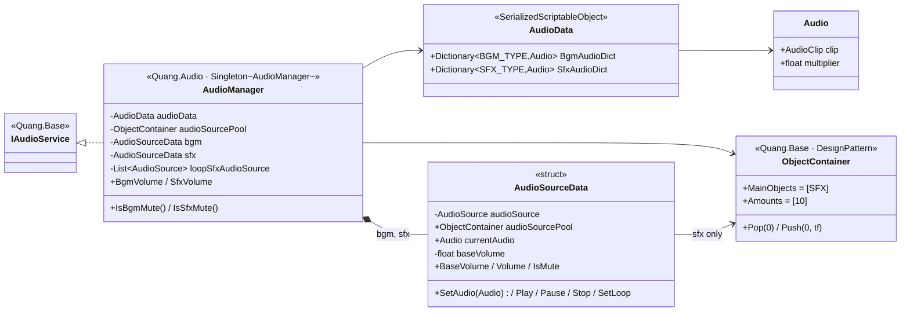

# `com.quang.audio` 0.2.0 — match PetVsMonster `_Audio` — Design

Branch: `feature/audio-package`
Reference: `/Users/minhquang/ITC Unity Projects/PetVsMonster/Assets/_Game/_Audio`

## Goal

Rebuild `com.quang.audio` so that its `AudioManager`, its data asset and its prefab work the same way as PetVsMonster's `_Audio`. In particular, the `AudioSource`s become **child GameObjects** (`BGM`, `SFX` + pooled copies) instead of a stack of components on the manager.

## Reference (PetVsMonster `_Audio`)

| Piece | What it is |
|---|---|
| `AudioManager : Singleton<AudioManager>, IAudioService` | `Awake`: `DontDestroyOnLoad`, `audioSourcePool.OnInit()`, reads `GameData.Setting.isBgmMute/isSfxMute` through `Locator.Data` → `BaseVolume` 0/1, `Locator.Audio = this` |
| `AudioSourceData` (serializable struct) | wraps one `AudioSource` + `currentAudio` + `baseVolume`. `Volume = baseVolume * audio.multiplier`. `SetAudio`: if the source is busy and a pool is set, push it back and pop another one from the pool |
| `bgm` / `sfx` fields | two `AudioSourceData`; `sfx` gets the pool, `bgm` does not |
| `ObjectContainer audioSourcePool` | component on the manager. `MainObjects = [SFX]`, `Amounts = [10]` → `OnInit` clones `SFX` 9 times under the same parent |
| `AudioData : SerializedScriptableObject` (Odin) | `Dictionary<BGM_TYPE, Audio>`, `Dictionary<SFX_TYPE, Audio>` |
| `Audio` (serializable class) | `clip`, `multiplier` (0–1) |
| `PlayBgm` | same audio → do nothing. Otherwise DOTween-fade the current BGM to 0 over `fadeOut`, then switch clip and play (fade-out then switch, **no crossfade**) |
| `PlaySfx` | `sfx.SetAudio` + `Play` (pool provides a free source when the current one is busy) |
| `PlayLoopSfx` / `StopLoopSfx` | pop a pooled source, loop, DOTween fade in / fade out, then push back |
| `Toggle*Volume` | `BaseVolume = isMute ? 0 : 1` (does not save) |
| Prefab | `AudioManager` (AudioManager + ObjectContainer) → children `BGM` (AudioSource) and `SFX` (AudioSource), `playOnAwake` off |

## Design



Prefab hierarchy (same as the reference):

```
AudioManager            AudioManager · ObjectContainer (MainObjects=[SFX], Amounts=[10])
├── BGM                 AudioSource (loop, playOnAwake off)   ← bgm.audioSource
└── SFX                 AudioSource (playOnAwake off)          ← sfx.audioSource, pool template
    (runtime: SFX(Clone) ×9 created by ObjectContainer.OnInit)
```

### Package `com.quang.audio` 0.1.0 → **0.2.0** (breaking)

| File | Change |
|---|---|
| `Runtime/AudioManager.cs` | rewritten after the reference (`AudioSourceData` struct + `AudioManager`), namespace `Quang.Audio` |
| `Runtime/AudioData.cs` (new) | `AudioData : SerializedScriptableObject` + `Audio` class; menu `ScriptableObjects/System/AudioData` |
| `Runtime/AudioLibrarySO.cs`, `Runtime/SfxSourcePool.cs` | **deleted** (replaced by `AudioData` / `ObjectContainer`) |
| `Runtime/Quang.Audio.asmdef` | refs `Quang.Base`, `Quang.Data`, `Quang.DesignPattern` (DOTween and Odin are precompiled DLLs, auto-referenced like in `Quang.UI`/`Quang.Data`) |
| `package.json` | `0.2.0`; deps `com.quang.base 0.27.0`, `com.quang.data`, `com.quang.designpattern` (versions from the current release) |
| `Tests/` | old tests replaced: `AudioSourceData` volume/mute math, `AudioManager` registration, `PlaySfx` taking a free pooled source when `sfx` is busy, `Toggle*Volume` |
| `README.md`, `CHANGELOG.md` | describe the new structure and the breaking change |

Dependency direction is still valid: `Quang.Audio` (layer 4) → `Quang.Data`, `Quang.DesignPattern`, `Quang.Base` (all lower). Nothing references `Quang.Audio`.

### Small fixes compared with the reference (needs your OK)

The reference has a few spots that break in BlockDrag's flows. I propose to keep the structure identical and only add guards:

| # | Reference behaviour | Problem here | Fix |
|---|---|---|---|
| 1 | `Locator.Data.GetData<GameData>()` in `Awake` | NRE when `GameScene` is played directly (no `DataManager`) | `Locator.Data?` → default to unmuted |
| 2 | No guard against a second instance | BlockDrag has the prefab in `LoadStart` **and** `GameScene` (fallback); the second would steal `Locator.Audio` and play BGM twice | if `Locator.Audio` is already another manager → `Destroy(gameObject)` |
| 3 | `PlayBgm` fades `bgm.currentAudio.multiplier` even when nothing is playing | first BGM waits `fadeOut` for nothing | fade only if `bgm` is playing, otherwise switch at once |
| 4 | `ObjectContainer.Pop` throws when all 10 SFX sources are busy | many SFX at once (combo) → `ArgumentOutOfRangeException` | if no free source, reuse the current `sfx` source |

The reference's `Setting` property is `setting` (field) in `com.quang.base`; this is only a name change.

### What is lost from 0.1.0

Per-SFX cooldown, pitch jitter, several random clips per SFX, BGM crossfade. These are not in the reference. `PlayRandomSfx` still covers "random among several sounds".

### BlockDrag side

| Item | Change |
|---|---|
| `Assets/_Game/_Data/Audio/AudioLibrary.asset` | replaced by `AudioData.asset` (same 4 mappings: BLOCK_PLACE, LINE_CLEAR, LOSE, BACK_GROUND_1; multiplier 1 / BGM 0.5) |
| `Assets/_Game/_Base/AudioManager.prefab` | rebuilt with the hierarchy above. **The prefab's GUID stays the same**, so `LoadStart` and `GameScene` keep their instances without edits |
| `BlockDragAudio.cs` | remove the code that applies mute (the manager now reads `GameData` itself); keep the place/clear SFX and BGM |
| `architecture.md` | update the `Quang.Audio` row (`AudioData`, `ObjectContainer`, deps on `Quang.Data`/`Quang.DesignPattern`) |
| manifest | all `com.quang.*` → new tag `release-2026.11.04.N` (outward-facing push, as before) |

## Open questions

1. **Package or in-project folder?** The reference is an in-project folder (`Assets/_Game/_Audio` with `Hung.Audio.asmdef` and asmrefs). This design keeps it as the `com.quang.audio` package (same code, released like `_UI`). Say so if you want `Assets/_Game/_Audio` instead.
2. Are fixes 1–4 OK, or should I copy the reference exactly, bugs included?
