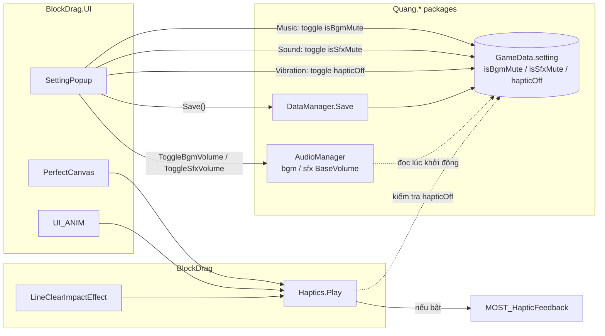
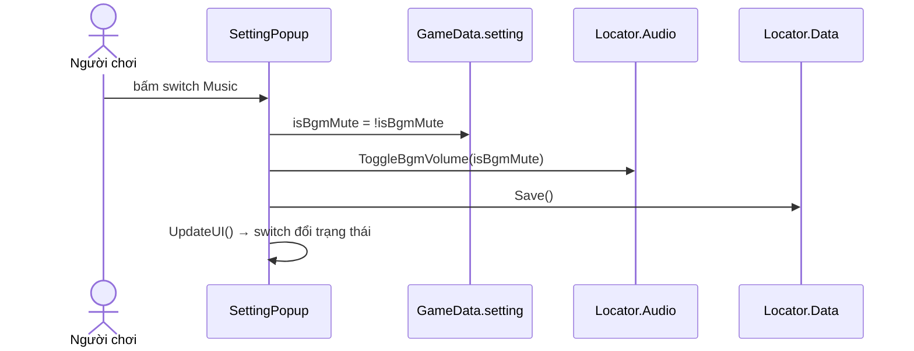

# Nối Setting: Music / Sound / Vibration — Design

Ngày: 2026-11-04 · Branch: `feature/audio-package`

## 1. Yêu cầu

| Toggle trong `SettingPopup` | Tác dụng |
|---|---|
| **Music** | Bật/tắt nhạc nền (BGM) |
| **Sound** | Bật/tắt hiệu ứng âm thanh (SFX) |
| **Vibration** | Bật/tắt rung (haptic) |

Trạng thái phải được lưu lại và áp dụng đúng khi mở lại game.

## 2. Hiện trạng (đã khảo sát)

| Phần | Trạng thái | Ghi chú |
|---|---|---|
| Prefab `Resources/UI/SettingPopup.prefab` | ✅ | `functionButtons` = `[RowSound(idx 0), RowMusic(idx 1), RowVibration(idx 2)]`, khớp với `switch` trong code |
| `SettingPopup.OnFunctionButtonClick` | ⚠️ một phần | Đổi cờ `GameData.setting` + gọi `Locator.Audio.ToggleSfxVolume/ToggleBgmVolume`. **Không lưu** xuống đĩa |
| Hiển thị switch (`UpdateUI`) | ✅ | Tắt → `OPENING` (núm trái, xám); bật → `SELECTING` (núm phải, sprite bật) |
| `AudioManager` (com.quang.audio) | ✅ | Đọc `isBgmMute`/`isSfxMute` lúc khởi động; `Toggle*Volume` đặt `BaseVolume` 0/1. BGM vẫn chạy ở volume 0 nên bật lại sẽ nghe ngay |
| Lưu `GameData` | ❌ | Chỉ được lưu gián tiếp khi `ScoreManager` lưu HighScore (pause/quit). Tắt nhạc ở Home rồi kill app → mất setting |
| Haptic `LineClearImpactEffect` | ✅ | Đã kiểm tra `setting.hapticOff` |
| Haptic `PerfectCanvas` (4 chỗ) | ❌ | Gọi thẳng `MOST_HapticFeedback`, bỏ qua `hapticOff` |
| Haptic `Anim/UI_ANIM` (1 chỗ) | ❌ | Như trên |

→ Việc còn thiếu: **(a) lưu setting**, **(b) mọi lệnh rung phải tôn trọng `hapticOff`**.

## 3. Thiết kế

### 3.1 Cổng rung tập trung `Haptics`

Thêm một static helper nhỏ trong assembly **`BlockDrag`** (namespace `Gameplay.BlockDrag`, file `Effects/Haptics.cs`):

```csharp
public static class Haptics
{
    public static bool IsOff { get; }   // đọc Locator.Data → GameData.setting.hapticOff (null-safe)
    public static void Play(MOST_HapticFeedback.HapticTypes type, float cooldown);
}
```

- `Play` trả về sớm khi `IsOff`, ngược lại gọi `MOST_HapticFeedback.GenerateWithCooldown`.
- `LineClearImpactEffect` thay `IsHapticOff()` riêng bằng `Haptics.Play`.
- `PerfectCanvas`, `UI_ANIM` (`BlockDrag.UI`) gọi `Haptics.Play` thay vì gọi thẳng vendor.
- Hướng phụ thuộc giữ nguyên: `BlockDrag.UI → BlockDrag → MOST_HapticFeedback / Quang.Base`. Không đụng package.

> Phương án bị loại: đặt helper trong `com.quang.*` — package không được tham chiếu vendor `MOST_HapticFeedback`, và đây là logic riêng của game.

### 3.2 Lưu setting

Trong `SettingPopup.OnFunctionButtonClick`, sau khi đổi cờ → gọi `Locator.Data?.Save()` (cùng API mà `GameDataHighScoreStore` đang dùng). Ghi file chỉ xảy ra khi người chơi bấm, không ảnh hưởng hiệu năng.

### 3.3 Hành vi chi tiết

- **Music off**: `ToggleBgmVolume(true)` → BGM về volume 0 ngay; chuyển scene/`PlayBgm` mới vẫn câm vì `BaseVolume = 0`.
- **Sound off**: `ToggleSfxVolume(true)` → mọi SFX (kể cả tiếng click `UIButton`) câm. Tiếng click của chính nút Sound lúc tắt có thể vẫn kêu vì phát trước khi đổi cờ — chấp nhận được.
- **Vibration on**: rung nhẹ một nhát (`LightImpact`) làm phản hồi khi vừa bật. *(Tuỳ chọn — bạn có thể bỏ.)*

## 4. Sơ đồ





## 5. Phạm vi / ngoài phạm vi

- Trong phạm vi: `SettingPopup.cs`, helper `Haptics` mới, 3 chỗ gọi haptic, test EditMode cho `Haptics.IsOff`.
- Ngoài phạm vi: thay đổi prefab/layout, package `com.quang.audio`, slider âm lượng.
- Không đổi ranh giới kiến trúc; chỉ cập nhật dòng mô tả haptic trong `.agents/rules/architecture.md` cho đúng (`Effects/Haptics`).

## 6. Kiểm chứng (sẽ chi tiết ở plan)

- EditMode test: `Haptics.IsOff` theo `hapticOff`, null-safe khi không có `Locator.Data`.
- Editor: bật/tắt từng switch → BGM/SFX tắt bật đúng; thoát Play Mode, vào lại → switch giữ trạng thái và audio áp dụng đúng.
- Thiết bị: tắt Vibration → phá hàng / Perfect không rung.
