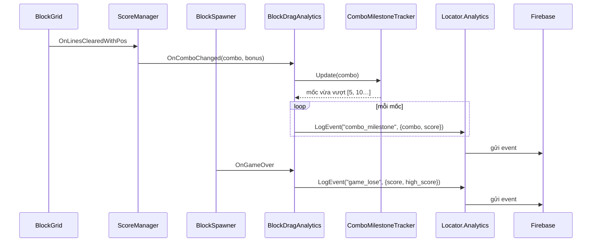
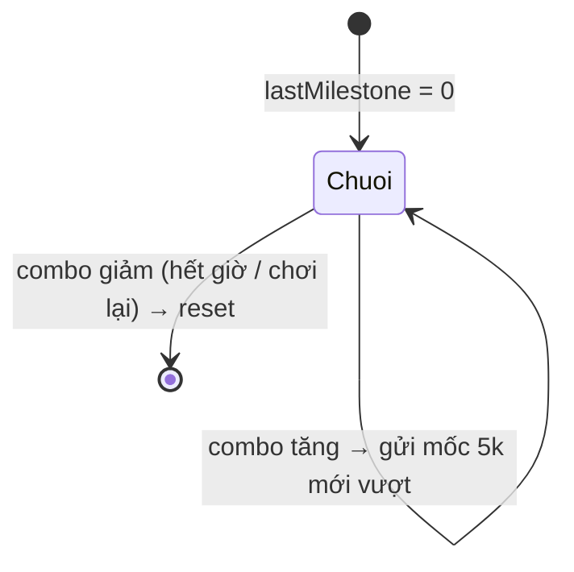

# Event Firebase: thua ván và mốc combo — Design

**Ngày:** 2026-11-07
**Trạng thái:** Đã duyệt, chọn phương án A (`combo_milestone` + tham số `combo`)

## 1. Yêu cầu

Gửi 2 event gameplay lên Firebase qua `Locator.Analytics` (package `com.quang.services.analytics`, backend Firebase đã bật):

1. **Thua ván**: khi người chơi hết nước đi (game over).
2. **Mốc combo**: khi combo đạt các số chia hết cho 5 (5, 10, 15, 20, …).

## 2. Hiện trạng

| Hạng mục | Vị trí | Ghi chú |
|---|---|---|
| Thua ván | `BlockSpawner.OnGameOver` | Bắn **1 lần mỗi ván** (cờ `isGameOver` chặn lặp), sau `gameOverDelay`. Không có hồi sinh trong luồng hiện tại: `GameplayCanvas` mở thẳng `LoseCanvas`. |
| Combo | `ScoreManager.OnComboChanged(combo, bonus)` | Bắn mỗi lần combo đổi, kể cả khi reset về 1 (hết giờ combo, chơi lại). |
| Gửi event | `Locator.Analytics.LogEvent(name, category, params)` | Có thể `null` → luôn gọi `?.`. |

**Điểm cần lưu ý: combo có thể "nhảy cóc" qua mốc.** Combo tăng theo **số hàng/cột phá cùng lúc** (`currentCombo += linesCleared`), nên có thể đi 4 → 6 mà không bao giờ bằng 5. Nếu chỉ kiểm tra `combo % 5 == 0` thì sẽ **mất event**. Thiết kế dưới đây gửi mọi mốc bị vượt qua.

## 3. Thiết kế

### 3.1 Thành phần mới (assembly `BlockDrag`, thư mục `_BlockDrag/Analytics/`)

| Type | Loại | Vai trò |
|---|---|---|
| `ComboMilestoneTracker` | C# thuần, unit-test được | Nhận combo mới, trả về danh sách mốc chia hết cho 5 vừa vượt qua trong chuỗi combo hiện tại. |
| `BlockDragAnalytics` | `MonoBehaviour` | Theo mẫu `BlockDragAudio`: tự tìm `ScoreManager` và `BlockSpawner`, đăng ký event trong `OnEnable`/`OnDisable`, gọi `Locator.Analytics?.LogEvent`. Đặt cùng GameObject với `BlockDragAudio` trong `GameScene`. |

Không sửa `ScoreManager` hay `BlockSpawner`, không đổi ranh giới kiến trúc (`BlockDrag` → `Quang.Base`, đã có sẵn).

### 3.2 Luật mốc combo

- Tracker nhớ `lastCombo` và `lastMilestone` (mốc lớn nhất đã gửi trong chuỗi).
- Combo mới **nhỏ hơn** combo trước → chuỗi mới (hết giờ, chơi lại) → `lastMilestone = 0`.
- Gửi mọi mốc `m = 5k` với `lastMilestone < m ≤ combo`, rồi cập nhật `lastMilestone`.

| Diễn biến combo | Event gửi |
|---|---|
| 1 → 2 → 3 → 4 → 5 | `5` |
| 4 → 6 | `5` |
| 8 → 11 | `10` |
| 3 → 11 (phá nhiều hàng) | `5`, `10` |
| 7 → hết giờ (1) → 6 | `5` lần thứ 2 (chuỗi mới) |
| Chuỗi 5 → 6 → 7 | chỉ `5` một lần |

### 3.3 Event đề xuất

| Event | Category | Tham số | Khi nào |
|---|---|---|---|
| `game_lose` | `Design` | `score` (int): điểm ván vừa thua `high_score` (int): kỷ lục sau ván | `BlockSpawner.OnGameOver` |
| `combo_milestone` | `Design` | `combo` (int): mốc đạt được (5, 10, …) `score` (int): điểm hiện tại | Mỗi mốc tracker trả về |

`high_score` lấy `max(HighScore, CurrentScore)` để không phụ thuộc thứ tự subscriber với `ScoreManager.HandleGameOver` (nơi cập nhật kỷ lục).

> **Lựa chọn tên event cho combo** — bạn chọn giúp mình:
> - **A (đề xuất): `combo_milestone` + tham số `combo`.** Một event, gọn, không giới hạn mốc. Muốn xem số lượng theo từng mốc trên dashboard Firebase thì cần đăng ký `combo` làm *custom dimension* (hoặc xem qua BigQuery/DebugView).
> - **B: tên theo mốc `combo_5`, `combo_10`, …** (giống kiểu `level_{n}_fail` của package). Thấy ngay trên dashboard, không cần custom dimension, nhưng mỗi mốc là một event riêng (Firebase giới hạn 500 tên event).

### 3.4 Sơ đồ

## 4. Kiểm thử

- **EditMode** `ComboMilestoneTrackerTests`: các trường hợp trong bảng 3.2.
- **Editor**: chơi `GameScene`, đặt log tạm/xem Console khi `Locator.Analytics` ghi; kiểm tra `game_lose` gửi đúng 1 lần mỗi ván thua.
- **Thiết bị**: Firebase DebugView thấy 2 event và tham số.

## 5. Ngoài phạm vi

- Event bắt đầu ván, thời gian chơi, combo cao nhất mỗi ván (có thể thêm sau nếu cần).
- Hồi sinh: luồng hiện tại không có; nếu thêm sau, `game_lose` cần xem lại thời điểm gửi.
