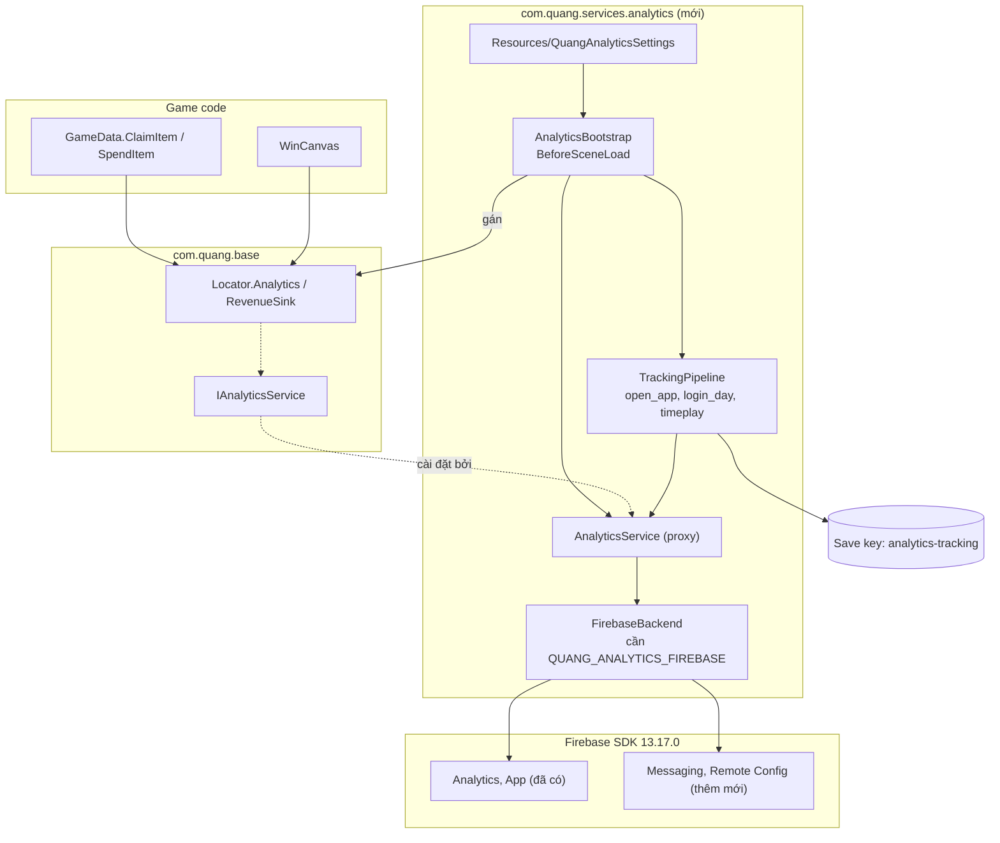
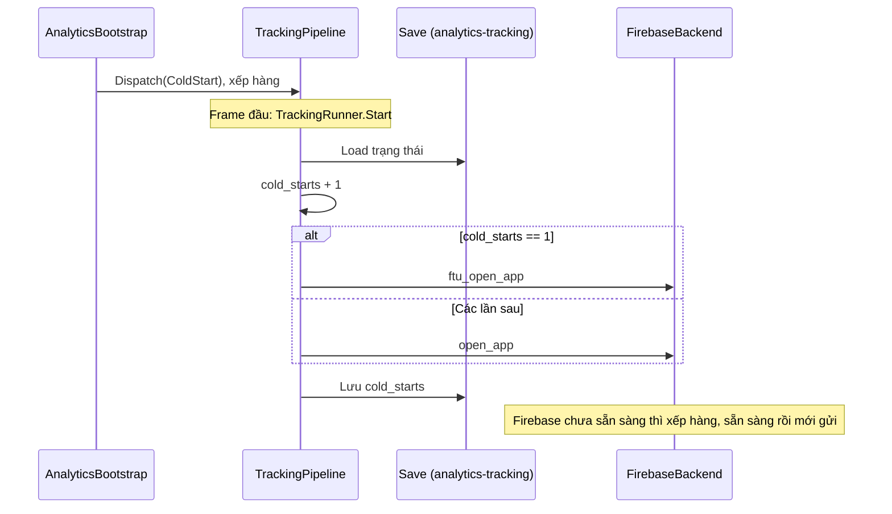

# Import package Analytics (`com.quang.services.analytics`) — Design

**Ngày:** 2026-11-07
**Trạng thái:** Đã duyệt phương án B, chấp nhận hộp thoại xin quyền thông báo. Mục 10 được thêm sau đó theo yêu cầu của bạn và được duyệt cùng plan.

## 1. Yêu cầu

Import package analytics từ repo release `Quangbipi/Package_Release` vào BlockDrag.

- **Package:** `com.quang.services.analytics` 0.5.1, có trong tag `release-2026.11.03.2`. Đây cũng là tag mà mọi `com.quang.*` trong `Packages/manifest.json` đang dùng.
- **Assembly chính:** `Quang.Analytics`. `.agents/rules/architecture.md` đã dự trù assembly này ở tầng Feature services, nên không đổi ranh giới kiến trúc.

## 2. Hiện trạng

| Hạng mục | Tình trạng |
|---|---|
| Contract `IAnalyticsService`, `Locator.Analytics`, `Locator.RevenueSink` | Đã có trong `com.quang.base` 0.27.0 |
| Bản cài đặt của contract | Chưa có, nên `Locator.Analytics` đang là `null` |
| Firebase App và Firebase Analytics 13.17.0 | Đã có (`GooglePackages/*.tgz`) |
| `google-services.json`, package name | Đã có, khớp `com.bipibupu.ComboBlockInfiniteGrid` |
| Firebase Messaging, Firebase Remote Config | **Chưa có** |
| Define `QUANG_ANALYTICS_*` | Chưa có |

## 3. Vướng mắc chính

Chỉ thêm package thì **chưa có event nào được gửi đi**. `FirebaseBackend` nằm trong assembly `Quang.Analytics.Integration.Firebase`, và assembly này chỉ biên dịch khi có define `QUANG_ANALYTICS_FIREBASE`. Không có define thì proxy chạy với 0 backend, tức là no-op.

Bật define lại cần thêm 2 SDK mà project chưa có:

- `FirebaseBackend.cs` dùng `Firebase.Messaging`.
- `FirebaseRemoteConfigCache.cs` dùng `Firebase.RemoteConfig`.

**Cửa sổ Settings không chặn được lỗi này.** `Quang/Analytics/Settings` chỉ kiểm tra type `Firebase.Analytics.FirebaseAnalytics`, nên vẫn cho bấm Apply. Nếu bật define khi thiếu 2 SDK trên, project sẽ lỗi biên dịch.

## 4. Các phương án

| | A. Chỉ import package | B. Import và bật Firebase **(đề xuất)** |
|---|---|---|
| Sửa `manifest.json` | Thêm 1 package | Thêm 1 package và 2 SDK Firebase |
| Event lên Firebase | Không | Có |
| Define | Không | `QUANG_ANALYTICS_FIREBASE` |
| Settings asset | Không bắt buộc (chỉ có 1 warning log lúc khởi động) | `Assets/Resources/QuangAnalyticsSettings.asset` |
| Thay đổi trải nghiệm người chơi | Không | **Android hiện hộp thoại xin quyền thông báo** |

**Đề xuất B**, vì project đã cài Firebase và mục đích của package là gửi được dữ liệu. Phương án A hợp nếu bạn chỉ muốn có sẵn package để bật sau.

Không dùng cách sửa hoặc fork package để bỏ Messaging và Remote Config: package đến từ git nên mọi chỉnh sửa cục bộ đều không bền, và việc đó vượt phạm vi yêu cầu.

## 5. Kiến trúc sau khi import (phương án B)

Khởi động không cần prefab hay chỉnh scene:

1. Ở `AfterAssembliesLoaded`, `FirebaseBackend` tự đăng ký vào `AnalyticsBackends`.
2. Ở `BeforeSceneLoad`, `AnalyticsBootstrap` đọc settings, khởi tạo backend rồi gán `Locator.Analytics`.
3. Event gửi trước khi Firebase sẵn sàng được xếp hàng (tối đa 100 event).

## 6. Tác động cần lưu ý

**Xảy ra ở cả hai phương án**

- `Locator.Analytics` không còn `null`, nên các lời gọi `?.` hiện có sẽ bắt đầu chạy:
  - `GameData.ClaimItem` và `SpendItem` sẽ log currency.
  - `WinCanvas.Open` sẽ chạy cả `gameData.level.MarkPassed(...)`, vốn đang nằm trong đối số của lời gọi `?.` nên hiện bị bỏ qua. Trong code C# không có chỗ nào khác nhắc tới `WinCanvas`, nên rủi ro có vẻ thấp, nhưng mình chưa kiểm tra prefab và scene.
- Tracking mặc định bật (`enabled` và `useStandardRules` đều là `true`), và tự chạy các rule `open_app`, `login_day`, `timeplay`.
- Save có thêm key `analytics-tracking`. Dữ liệu save hiện tại không bị đổi.

**Chỉ xảy ra ở phương án B**

- **Hộp thoại xin quyền:** `FirebaseBackend.Initialize` xin `POST_NOTIFICATIONS` ngay khi khởi động, trước scene đầu tiên. Không có tùy chọn để tắt. Đây là điểm mình mong bạn cân nhắc nhất.
- **Android dependencies:** cần chạy lại External Dependency Manager, nên `mainTemplate.gradle` và các file resolver có thể đổi.
- **`ProjectSettings.asset`:** Apply define sẽ ghi vào file này, trong khi file đang có thay đổi chưa commit của bạn. Mình sẽ giữ nguyên các thay đổi đó, nhưng khi commit cần tách riêng phần define.
- **Dung lượng:** repo thêm 2 file `.tgz` trong `GooglePackages/`, và bản build lớn hơn.

## 7. Phạm vi

**Có làm**

- Thêm package vào manifest, ghim đúng tag `release-2026.11.03.2`.
- Với phương án B: thêm 2 SDK cùng phiên bản 13.17.0, tạo settings asset, bật define Firebase.
- Cập nhật `.agents/rules/architecture.md` để ghi nhận package đã được cài.

**Không làm**

- Gắn event gameplay mới (`AnalyticsTracking.Facts.*`, ví dụ bắt đầu hoặc kết thúc ván). Việc này nên là task riêng vì cần chốt danh sách event. Event mở game lần đầu nằm trong phạm vi và được package gửi sẵn (mục 10).
- Thêm AppsFlyer, AppMetrica, GameAnalytics.
- Sửa `WinCanvas` hay bất kỳ code nào của package.

## 8. Cách kiểm chứng

| Kiểm tra | Cách làm | Phương án |
|---|---|---|
| Package được resolve, không lỗi biên dịch | Unity Console, `packages-lock.json` | A, B |
| `Locator.Analytics` khác `null` khi Play | Chạy `LoadStart` trong Editor | A, B |
| EditMode tests hiện có vẫn pass | Unity Test Runner | A, B |
| Backend Firebase hoạt động, event `open_app` lên dashboard | Build Android và xem Firebase DebugView **trên thiết bị** | B |

Mục cuối cần thiết bị thật và quyền truy cập Firebase Console, nên có thể bạn sẽ phải tự xác nhận.

## 9. Quyết định đã chốt

1. Chọn **phương án B**.
2. Chấp nhận **hộp thoại xin quyền thông báo lúc mở game**.

## 10. Event mở game lần đầu

**Dùng event có sẵn `ftu_open_app`, không viết code mới.** Rule `OpenAppRule` trong package đã làm đúng việc này, và test của package (`SessionRulesTests`) có kiểm tra tên event. Viết thêm một event riêng sẽ gửi trùng cùng một thông tin.

| Thuộc tính | Giá trị |
|---|---|
| Tên event | `ftu_open_app` |
| Category | `Design`, Firebase nhận vì mặc định nhận tất cả category |
| Thời điểm | Frame đầu tiên của lần chạy đầu |
| Tham số | Không có |

Rule này cũng gửi `open_app` ở các lần mở sau, và set user property `ftu`.

**Những trường hợp event không phản ánh đúng "cài mới":**

- **Người chơi cũ cập nhật lên bản này:** save của họ chưa có key `analytics-tracking`, nên họ cũng gửi `ftu_open_app` một lần. Vì vậy số đầu tiên sau khi phát hành sẽ cao hơn số lượt cài mới nếu game đã có người chơi.
- **Gỡ rồi cài lại, hoặc xóa dữ liệu app:** gửi lại, vì trạng thái nằm trong save của máy.
- **Không đọc được save:** package coi như đã qua lần đầu và gửi `open_app`, để không đếm trùng người chơi cũ.

Firebase cũng tự thu thập event `first_open`. Đây là số nên đối chiếu nếu cần đếm lượt cài mới.
