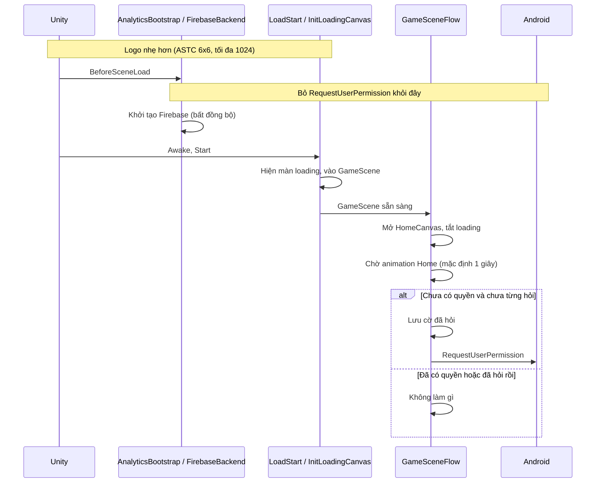

# Giảm khoảng chờ trước màn loading — Design

**Ngày:** 2026-11-07
**Trạng thái:** **Tạm dừng** theo yêu cầu của bạn. Việc đổi ảnh logo (mục 3.3) đã triển khai, chưa commit và chưa kiểm tra bằng mắt. Còn 2 việc để làm sau, xem [mục 8](#8-việc-còn-lại-để-làm-sau).

## 1. Yêu cầu

Trên bản build, sau splash mặc định của Unity phải chờ một lúc mới thấy màn loading. Task này làm 2 việc:

1. Không xin quyền thông báo trong lúc khởi động.
2. Làm nhẹ ảnh logo của màn loading.

**Ngoài phạm vi:**
- Đo bằng Profiler, chỉ làm nếu 2 việc trên chưa đủ.
- `Resources.LoadAll<UICanvas>`, vì nó không chạy trước màn loading.
- Thanh loading giả 1,5 giây (`fakeLoadDuration`).
- Xin quyền trên iOS.

## 2. Hiện trạng đã đo

Số liệu lấy từ logcat của 5 lần mở app trên M2101K7BG (Android 13), bản release.

| Đoạn | Thời gian |
|---|---|
| Bấm mở app → xin quyền thông báo | 6,5–7,8 giây |
| Lần đặt orientation cuối → xin quyền thông báo | 3,5–3,8 giây |
| Hộp thoại xin quyền mở rồi tự đóng (đo ở lần gần nhất) | khoảng 1,4 giây |
| `onPause` của Activity khi hộp thoại hiện | 1,3–1,6 giây |

Bản release không có log của Unity, nên chưa đo được thời điểm chính xác màn loading hiện. Việc coi lần đặt orientation cuối là lúc hết splash cũng chỉ là suy đoán.

### Xin quyền thông báo

`FirebaseBackend.Initialize` gọi `Permission.RequestUserPermission` ngay trong `AnalyticsBootstrap.Boot`, tức ở `BeforeSceneLoad`, trước `Awake` và `Start` của `LoadStart`. Máy test đã từ chối vĩnh viễn (`USER_FIXED`) nên hộp thoại tự đóng, nhưng app vẫn xin lại và bị pause ở mọi lần mở.

### Ảnh logo

`Combo_Block.png` được `InitLoadingCanvas` và `HomeCanvas` dùng trực tiếp, không qua atlas.

| Thuộc tính | Giá trị |
|---|---|
| Kích thước gốc | 3700×2550 |
| Kích thước sau import | 2048×1411 |
| Định dạng Android tự chọn | `ETC2_RGBA8` |
| Định dạng thực tế khi kiểm tra trong Editor | `RGBA32` (không nén) |
| Dung lượng trong Build Report | **11,1 MB** |

Con số 11,1 MB khớp với 2048×1411×4 byte, nên ảnh trong build nhiều khả năng cũng không được nén. Nguyên nhân có thể là chiều cao 1411 không chia hết cho 4 nên ETC2 không nén được; bước kiểm chứng sẽ xác nhận định dạng sau khi đổi.

Logo được hiển thị rộng khoảng 950 đơn vị trên canvas tham chiếu 1080×1920, nên 2048 pixel là thừa.

## 3. Thiết kế

### 3.1. Package `com.quang.services.analytics`

- Bỏ khối xin quyền và `using UnityEngine.Android` khỏi `FirebaseBackend`.
- Firebase, Messaging và Remote Config vẫn khởi tạo như cũ.
- Nâng lên **0.6.0** và ghi `CHANGELOG`: game dùng package giờ phải tự xin quyền.

Code package nằm trong repo `Quang_Packages` và đến game qua tag của `Package_Release`, nên cần phát hành tag mới rồi cập nhật `Packages/manifest.json`.

### 3.2. Game (`BlockDrag.UI`)

- **`NotificationPermissionPrompt`** (mới) chứa quy tắc thuần `ShouldRequest(hasPermission, alreadyAsked)` để test được, cùng phần gọi API Android nằm trong `#if UNITY_ANDROID`.
- **`GameData.BlockDrag.cs`** thêm cờ `notificationPermissionAsked`. Trạng thái người chơi thuộc về `GameData` theo rule kiến trúc.
- **`GameSceneFlow`** gọi prompt sau khi đã mở `HomeCanvas`, có `[SerializeField]` cho thời gian chờ (mặc định 1 giây).

Cờ được lưu **trước** khi gọi hộp thoại, nên mỗi lần cài chỉ hỏi tối đa một lần, kể cả khi app bị tắt giữa chừng.

Hướng phụ thuộc vẫn đúng rule: game gọi API của Unity, package không biết gì về game.

### 3.3. Import ảnh `Combo_Block.png`

- Thêm override cho Android và iOS: định dạng **ASTC 6x6**, kích thước tối đa **1024**.
- Atlas của project đã dùng ASTC 6x6, và định dạng này không bị ràng buộc chia hết cho 4.
- Không đổi file PNG, GUID hay prefab, nên `HomeCanvas` cũng được lợi theo.

Ước tính dung lượng còn **khoảng 0,3 MB** (1024×706, so với 11,1 MB).

## 4. Các phương án đã cân nhắc

| Quyết định | Chọn | Không chọn vì |
|---|---|---|
| Ai xin quyền | Game tự xin | Thêm tuỳ chọn trong settings của package giữ được hành vi cũ, nhưng thêm API mà hiện chỉ có một game dùng |
| Thời điểm xin | Sau khi Home đã mở | Trong màn loading vẫn làm gián đoạn lúc vào game; khi bấm Start thì cắt ngang lúc bắt đầu chơi |
| Làm nhẹ ảnh | Chỉ đổi import settings | Tách ảnh riêng cho loading phải sửa prefab và thêm asset mà không lợi thêm bao nhiêu |

## 5. Rủi ro

| Rủi ro | Cách xử lý |
|---|---|
| Logo hơi mờ trên màn hình rất nét (rộng 1440 pixel trở lên) | Xem trên máy thật; nếu cần thì nâng lên 1536 hoặc 2048 mà vẫn ASTC |
| Tag package mới kéo theo thay đổi không liên quan | Chỉ đổi URL của `com.quang.services.analytics` nếu dependency cho phép; kiểm tra diff so với `release-2026.11.03.2` trước khi phát hành |
| Hiệu quả chưa chắc đủ | Bỏ được khoảng 1,4 giây xin quyền là khá chắc, nhưng chưa biết ảnh chiếm bao nhiêu trong 3,5–3,8 giây còn lại. Nếu vẫn chậm thì làm tiếp bước Profiler |
| Người đã từ chối vĩnh viễn được hỏi thêm một lần sau khi cập nhật | Chấp nhận được: hộp thoại tự đóng, sau đó cờ chặn các lần sau |

## 6. Tiêu chí hoàn thành

**Việc 2:**
- Build Report: `Combo_Block.png` dưới 1 MB, định dạng ASTC 6x6.
- Logcat trên máy thật: so thời gian từ lúc bấm mở app đến `REQUEST_PERMISSIONS` với mốc cũ. Vì việc 1 đang dừng, lệnh xin quyền vẫn chạy ở `BeforeSceneLoad`, nên đây là mốc đo được ảnh hưởng riêng của việc đổi ảnh.
- Kiểm tra bằng mắt: logo ở màn loading và Home không vỡ, không mờ rõ rệt.

**Việc 1 (khi làm lại):**
- EditMode test cho `ShouldRequest` pass (đủ 4 tổ hợp).
- Logcat: không còn `REQUEST_PERMISSIONS` trước khi vào game; lần đầu sau khi cài có đúng một lần xin quyền, các lần mở sau không còn.

## 7. Tài liệu cần cập nhật

Việc 2 không đổi kiến trúc nên không cần sửa `.agents/rules/architecture.md`.

Khi làm việc 1:
- Ghi rõ game sở hữu việc xin quyền thông báo, không phải package analytics.
- Sửa ghi chú cũ "Build Settings chỉ có `GameScene`". Hiện tại build có `LoadStart` (scene đầu) và `GameScene`.

## 8. Việc còn lại để làm sau

Kết quả đổi ảnh logo: `Combo_Block.png` giảm từ 11,1 MB xuống 342,4 KB, nhưng đoạn chờ chỉ đổi từ trung bình 3,64 giây xuống 3,45 giây, nằm trong mức dao động. **Ảnh logo không phải nguyên nhân chính.** Số liệu đầy đủ nằm trong [plan đổi ảnh](../plans/2026-11-07-logo-texture-compression-implementation-plan.md).

Trước khi làm tiếp, cần xử lý phần dở của việc đổi ảnh:
- Xem logo ở màn loading và màn Home trên máy thật. Nếu mờ rõ rệt, nâng `maxTextureSize` lên 1536 hoặc 2048, giữ ASTC 6x6.
- Commit `Combo_Block.png.meta` và 2 file tài liệu của task này.

Hai việc dưới đây độc lập với nhau, làm việc nào trước cũng được. Cả hai đều phải đi qua Gate 1 và Gate 2 như thường lệ.

### 8.1. Dời việc xin quyền thông báo ra khỏi lúc khởi động

**Vấn đề:** `FirebaseBackend.Initialize` xin quyền ở `BeforeSceneLoad`, trước `Awake` và `Start` của `LoadStart`. Code không chờ kết quả, nhưng hộp thoại làm Activity của game bị `onPause`, nên màn loading chưa thể hiện.

**Tác động đã đo và chưa đo:**
- Máy đã từ chối vĩnh viễn: mất khoảng 1,4 giây ở mọi lần mở (đã đo).
- Người chơi lần đầu: nhiều khả năng màn loading phải chờ đến khi họ trả lời hộp thoại (chưa thử). Cách kiểm tra: gỡ app, cài lại, không bấm vào hộp thoại và xem màn loading có hiện không.

**Hướng làm:** theo mục 3.1 và 3.2 của design này.

**Cần chốt trước khi làm:**
- Thời điểm xin quyền. Đề xuất hiện tại là khoảng 1 giây sau khi `HomeCanvas` mở.
- Ai phát hành tag mới của `com.quang.services.analytics` lên `Package_Release` (repo public). Source nằm trong `Quang_Packages`.

**Hoàn thành khi:** đạt các tiêu chí của "Việc 1" ở mục 6.

### 8.2. Tìm nguyên nhân của khoảng 3,5 giây còn lại

**Vấn đề:** từ lần đặt orientation cuối đến lúc xin quyền vẫn mất khoảng 3,5 giây. Chưa biết thời gian này nằm ở đâu, và việc coi mốc orientation là lúc hết splash cũng chỉ là suy đoán.

**Hướng làm:** đo trước, chưa sửa game.
- Dùng Development Build và Profiler trên máy thật, hoặc thêm log có mốc thời gian tại `BeforeSplashScreen`, `BeforeSceneLoad`, `Awake` và `Start`.
- Xác định chính xác thời điểm hết splash và thời điểm màn loading hiện.
- Development Build chậm hơn bản release, nên chỉ dùng để xem tỷ lệ giữa các bước, không lấy số tuyệt đối.

**Các khả năng cần kiểm chứng (chưa có bằng chứng):**
- Backend Mono trên ARMv7, cấu hình hiện tại của project. IL2CPP thường khởi động nhanh hơn, và Google Play cũng yêu cầu ARM64 khi phát hành, nên đây có thể là việc phải đổi sớm.
- Khởi động engine, URP và shader.
- Nạp assembly và các hook `BeforeSceneLoad` khác chạy trước lệnh xin quyền.

**Mốc so sánh:** chạy trên M2101K7BG, bản release, từ lần đặt orientation cuối đến `REQUEST_PERMISSIONS`, trung bình 3,45 giây. Nếu làm việc 8.1 trước thì mốc này mất đi, nên cần đo theo cách mới trước khi đổi code.

**Hoàn thành khi:** có bảng thời gian theo từng bước khởi động và đề xuất sửa dựa trên số liệu đó.
