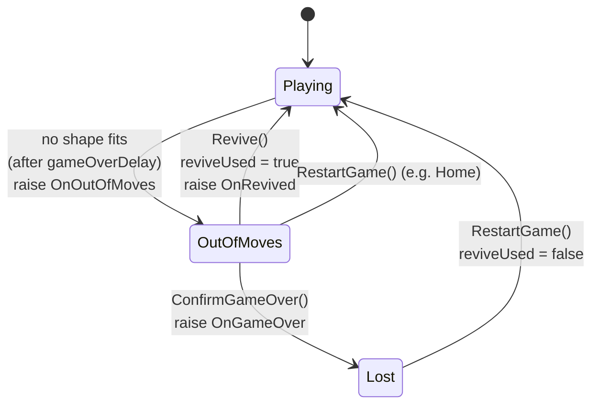
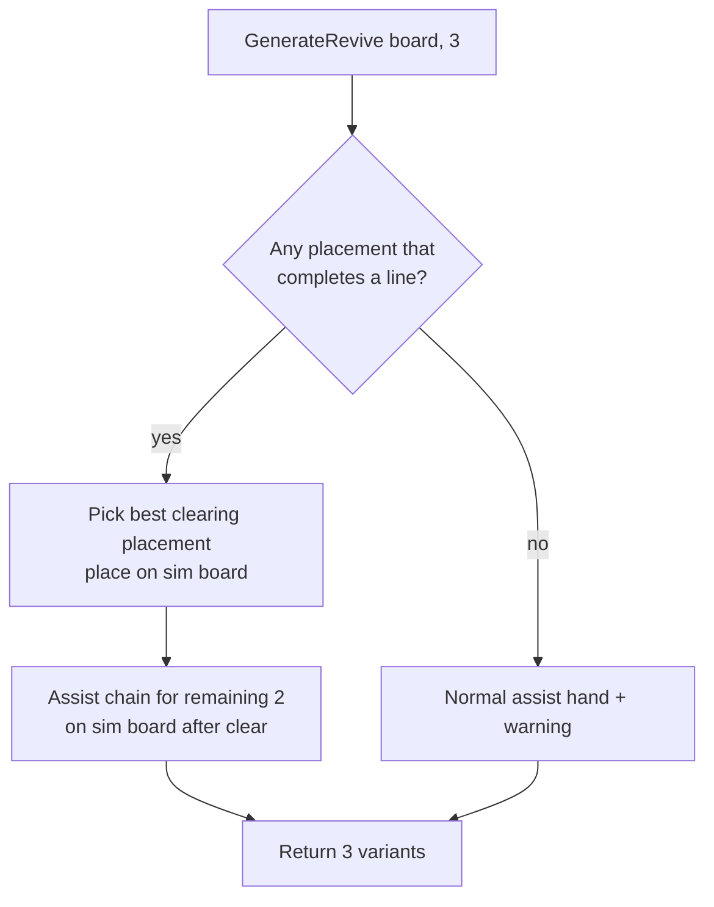
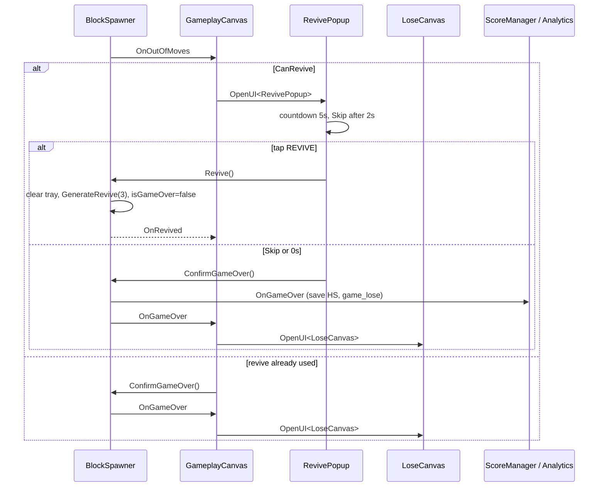
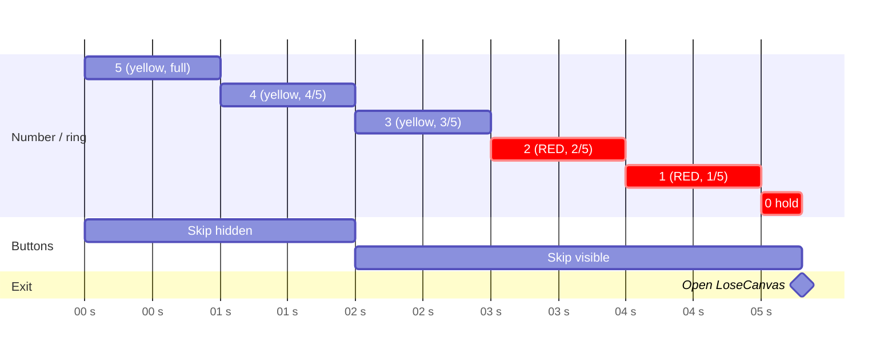

# Revive Popup — Design

- Date: 2026-11-08
- Preview: `Assets/_Game/_BlockDrag/Resource/ComboBlock_UI_assets/UI Preview/Revive@1x.png`
- Assets: `Assets/_Game/_BlockDrag/Resource/ComboBlock_UI_assets/revive/` (`Revive-selection.png`, `badge_ad.png`, `countdown_ring_bg.png`, `countdown_ring_full_red.png`, `countdown_ring_full_yellow.png`, `ic_heart.png`, `ribbon_purple.png`)

## 1. Requirements

| # | Requirement |
|---|-------------|
| R1 | When the board has no valid move, open **RevivePopup** instead of `LoseCanvas`. |
| R2 | No ads yet: tapping **REVIVE** revives right away. Leave one hook where a rewarded ad will go later. |
| R3 | Reviving replaces the tray with **3 new blocks**, and placing them must clear at least one row or column. |
| R4 | The popup counts down from **5s**. At 0 it opens `LoseCanvas` automatically. |
| R5 | The **Skip** button shows up **2s** after the popup opens. Tapping it opens `LoseCanvas`. |
| R6 | The layout must scale correctly on every aspect ratio (phones from 16:9 to 21:9, and tablets). |

| R7 | The ring around the number is a **circular progress** bar that empties as the countdown runs (reference video `Screen Recording 2026-11-08 at 00.58.18.mov`). |
| R8 | When the number reaches **2**, both the number and the ring turn **red**. |

Decisions (confirmed by the user on 2026-11-08):
- **A1. Revive count.** A player can revive **once per run**. If they run out of moves a second time, `LoseCanvas` opens directly.
- **A2. Score.** Score, combo count and high-score baseline are kept. The combo timer stops while the popup is open.
- **A3. Analytics.** `game_lose` and `SaveHighScore` run only on the **final** lose (after Skip or timeout), not when the popup opens.
- **A4. Colour.** The number and ring are yellow/white for 5, 4 and 3, and red for 2, 1 and 0 (R8).
- **A5. Ad banner.** The ad banner strip in the preview is out of scope. The popup only stays inside the safe area.
- **A6. Subtitle text.** The guarantee is "at least one line clears", so the copy becomes **"Clear lines and keep your score"**.

## 2. Current flow and the problem

`BlockSpawner.CheckPlacementsAndGameOver()` sets `isGameOver = true` and raises `OnGameOver` after `gameOverDelay`. Three listeners react to that single event:

- `GameplayCanvas.HandleGameOver` opens `LoseCanvas`.
- `ScoreManager.HandleGameOver` saves the high score and stops the combo timer.
- `BlockDragAnalytics.HandleGameOver` logs `game_lose`.

Revive adds a step between "no moves left" and "run lost", so this one event has to be split into two.

## 3. Design

### 3.1 Session contract (`IBoardSessionService`, Quang.Base via asmref)

```csharp
public interface IBoardSessionService
{
    bool IsGameOver { get; }          // true while the revive offer is open and after the final lose
    bool CanRevive { get; }           // revive not used yet in this run

    event Action OnOutOfMoves;        // NEW: no valid move; UI decides whether to offer a revive
    event Action OnGameOver;          // CHANGED meaning: final lose only
    event Action OnRevived;           // NEW: the revive hand has been spawned
    event Action OnGameRestarted;

    void Revive();                    // NEW: clear tray, spawn revive hand, resume
    void ConfirmGameOver();           // NEW: offer declined or timed out, raise OnGameOver
    void RestartGame();
}
```

Because `OnGameOver` now means the final lose, `ScoreManager` and `BlockDragAnalytics` need **no changes**. A3 holds automatically.

### 3.2 Board session state (`BlockSpawner`)



- `isGameOver` stays `true` in the `OutOfMoves` state, so input and the restart-from-Home logic in `GameSceneFlow` keep working unchanged.
- `Revive()` runs only in the `OutOfMoves` state with `CanRevive` true. It clears the tray, spawns the revive hand (3.3), sets `isGameOver = false` and re-runs `CheckPlacementsAndGameOver()`.
- `RestartGame()` resets `reviveUsed`.

### 3.3 Revive hand: 3 blocks that are guaranteed to clear (`Spawn/`, pure C#)

Add a new method `HandGenerator.GenerateRevive(board, count)`, backed by a "clear-first" mode in `AssistHandBuilder`:

1. **Step 1 (must clear).** Look at every family, variant and position on the board. Keep only placements that complete at least one row or column. Pick the one with the best existing `Score` (clearing more lines and leaving fewer holes ranks higher). Place it on the simulated board.
2. **Steps 2–3.** Use the normal assist chain on the board after the clear, which favours more clears. Every block is guaranteed to fit because the chain is placed on the simulation.
3. **Fallback.** If no shape can complete a line, which is almost impossible because a 1×1 block fills any row that has one empty cell, return a normal assist hand and log a warning.

The result is that after reviving, the player always has a sequence of placements that clears at least one line. This is a pure C# method on `BlockBoard`, so it is covered by EditMode tests.



### 3.4 UI: `RevivePopup` (BlockDrag.UI) rewritten

The current `RevivePopup.cs` and `Resources/UI/RevivePopup.prefab` are template leftovers: Heart/Gold/Video revive using `Locator.Gameplay`, `ITEM.HEART` and a level text. Both are **rewritten** for this design.

Each behaviour and how it works:
- **Open.** Show the score as `N0` (for example `1,240`) from `Locator.Score.CurrentScore`. Start a 5s countdown on **unscaled time** (DOTween `SetUpdate(true)`), hide Skip, play a short pop-in animation.
- **Countdown.** The number and the ring follow the timeline and animation described in 3.6.
- **Skip at 2s.** `DOVirtual.DelayedCall(2, ShowSkip, ignoreTimeScale: true)` fades Skip in.
- **Timeout or Skip.** Run `Decline()`, which closes the popup and calls `session.ConfirmGameOver()`. `GameplayCanvas` then opens `LoseCanvas` from `OnGameOver`.
- **REVIVE.** Run `RequestRevive()`, which stops the countdown and calls the ad hook `TryShowReviveAd(onSuccess)`. For now that hook calls `onSuccess` directly. On success, close the popup and call `session.Revive()`.
- **Guards.** A `resolved` flag makes every path run only once, so a timeout and a tap in the same frame cannot both fire. All tweens are killed in `OnClose` and `OnDestroy`.

The countdown is plain timing logic. It goes into a small pure C# class `ReviveCountdown`, which is ticked from `Update(unscaledDeltaTime)` and raises `OnTick(remaining)`, `OnSkipAvailable` and `OnExpired`. That makes it testable in EditMode without the scene.

`GameplayCanvas` subscribes to:
- `OnOutOfMoves`. If `CanRevive` is true, open `RevivePopup`. Otherwise call `ConfirmGameOver()`.
- `OnGameOver`. Open `LoseCanvas`, unchanged.



### 3.5 Prefab layout and responsiveness

Hierarchy (Canvas Scaler: Scale With Screen Size, using the project's existing reference resolution and match setting):

```
RevivePopup (UISCanvas root, full stretch)
├─ Dim (Image black α≈0.6, full stretch, raycast target — blocks board)
└─ SafeArea (SafeAreaFitter, full stretch)
   └─ Card (anchor center, ReviveCardFitter — see rules below)
      ├─ Panel (white rounded 9-slice, VerticalLayoutGroup + ContentSizeFitter)
      │   ├─ Subtitle  "No more moves left!"
      │   ├─ Ring (fixed square: ring_bg + ring_fill [Filled Radial360] + CountTxt)
      │   ├─ Desc      "Clear lines and keep your score"
      │   ├─ ScoreTxt  "1,240" (gold)
      │   ├─ ReviveBtn (Revive-selection + ic_heart + "REVIVE" + badge_ad top-right)
      │   └─ SkipBtn   (underlined text, CanvasGroup α 0 → 1)
      └─ Ribbon (ribbon_purple + "CONTINUE?") anchored to Panel top, overlapping
```

Responsiveness rules:
- **Width.** The card is anchored at the centre with a fixed reference width of about 82% of the reference width. A `LayoutElement` caps it so it never touches the edges: horizontal anchors 0.09–0.91 inside `SafeArea`, with `preferredWidth` clamped.
- **Height.** The `VerticalLayoutGroup` and `ContentSizeFitter` size the panel to its content. On short screens (wide aspect, tablet), a small `ReviveCardFitter` script scales the card down uniformly when its height is larger than the available safe-area height minus margins. It never scales up above 1.
- **Text.** TMP auto-size uses min and max bounds, so `1,240,000` still fits.
- **Safe area.** `SafeAreaFitter` from `Quang.UI` keeps the card clear of notches. The dim layer covers the whole screen, outside the safe area as well.
- **Check.** In the Game view, check 1080×1920, 1080×2400, 1170×2532 (notch), 1536×2048 (iPad) and 720×1280.

### 3.6 Countdown animation (from the reference video)

Frame analysis of the reference video at 20 fps:

| Time since open | Number | Ring fill | Colour |
|-----------------|--------|-----------|--------|
| 0s – 1s | 5 | 5/5 (full) | number white, ring yellow |
| 1s – 2s | 4 | 4/5 | white / yellow |
| 2s – 3s | 3 | 3/5 | white / yellow |
| 3s – 4s | 2 | 2/5 | **red / red** |
| 4s – 5s | 1 | 1/5 | red / red |
| 5s | 0 | 0 (only the grey track) | red, held briefly, then `LoseCanvas` opens |

- **Ring as a circular progress bar.** The structure is three layers:
  - Track: `countdown_ring_bg`, the grey ring with the white disc.
  - Fill: `Image` with Type **Filled**, Method **Radial 360**, Origin **Top**, **Clockwise**. Its sprite is `countdown_ring_full_yellow`, swapped to `countdown_ring_full_red` at 2.
  - Number: `TMP_Text` on top.

  The filled arc starts at 12 o'clock and goes clockwise. The empty gap grows counter-clockwise from 12 o'clock, which matches the video.
- **Stepping.** The video changes the ring once per second with no visible in-between frames. To make it read as a progress bar but stay close to the video, each step tweens `fillAmount` to `n/5` over **0.2s** (`Ease.OutQuad`, unscaled). Setting the tween to 0 reproduces the video exactly. Both values are serialized fields on `RevivePopup`.
- **Number.** The text changes on each whole second, with no pop or scale in the video. Its colour switches to red (`#F0444F`, picked from the preview) when it shows 2. White/red colours and the switch threshold (`redFromSecond = 2`) are serialized.
- **Zero.** "0" stays on screen for `zeroHoldDuration = 0.3s`, so the player sees the ring empty. Then `Decline()` runs.
- **Timing source.** `ReviveCountdown` (pure C#) owns the timeline. It raises `OnSecondChanged(int shown)` on 5→4→…→0, `OnSkipAvailable` at 2s and `OnExpired` after 0 plus the hold time. `RevivePopup` only reacts to these events (set text, set colour, tween fill), so EditMode tests can check the step and colour thresholds without the scene.



## 4. Module boundaries

| Change | Assembly | Allowed? |
|--------|----------|----------|
| `IBoardSessionService` new members | `Quang.Base` (asmref `_BlockDrag/Base`) | ✅ game contract on `Locator` |
| `BlockSpawner` state, `HandGenerator`/`AssistHandBuilder` revive mode | `BlockDrag` | ✅ |
| `RevivePopup`, `ReviveCountdown`, `ReviveCardFitter`, `GameplayCanvas` | `BlockDrag.UI` | ✅ UI → contracts only |

No package changes. The dependency direction is unchanged, so `architecture.md` only needs one new line describing the revive flow.

## 5. Risks and edge cases

- **Home or Settings opened while the popup is up.** Input is already locked by `GameSceneFlow`. Opening Home calls `RestartGame()` while `IsGameOver` is true, so the popup must close itself on `OnGameRestarted`.
- **The revive hand is placed and the player gets stuck again.** If revive was used, `CanRevive` is false and `LoseCanvas` opens directly (A1).
- **`timeScale` changes (pause or a future ad).** The countdown uses unscaled time and stops as soon as REVIVE is tapped, so an ad can take as long as it needs.
- **Old `RevivePopup` references.** The only consumer is the prefab itself. `Locator.Gameplay.Revive` is no longer called from this game.

## 6. Tests (EditMode)

- `HandGeneratorReviveTests`: on several nearly full boards, the first block of the generated hand completes at least one line, all 3 blocks fit in sequence, and the result always has 3 blocks when shapes are available.
- `ReviveCountdownTests`: the shown number steps 5→4→3→2→1→0 on whole seconds, the red state starts at 2, `OnSkipAvailable` fires at 2s, `OnExpired` fires once after 0 plus the hold time, and `Stop()` prevents expiry.
- `BlockSpawner` state (manual Play Mode): no moves → popup → Revive → play continues. Out of moves again → `LoseCanvas`. Skip and timeout → `LoseCanvas` with `game_lose` logged once.
