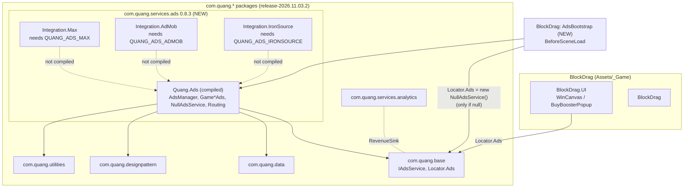

# Import `com.quang.services.ads` — Design

Date: 2026-11-12
Branch: `feature/quang-analytics`

## 1. Goal

Add the shared ads package `com.quang.services.ads` from `Quangbipi/Package_Release` to BlockDrag, at the same release tag as the other `com.quang.*` packages (`release-2026.11.03.2`).

Scope:

1. Import the package so that its neutral API (`Quang.Ads`) compiles in the project.
2. Assign `NullAdsService` to `Locator.Ads` at startup, so game code never calls ads on `null` until a real SDK is added.

Choosing and wiring a mediation SDK (MAX / AdMob / IronSource) is a separate task.

## 2. Current state

- `Packages/manifest.json` has 8 `com.quang.*` packages, all pinned to `#release-2026.11.03.2`. There is no ads package.
- `com.quang.base` already has the ads contracts (`IAdsService`, `IAds`, `IRewardAds`, `Placement`, `ADS_TYPE`, `Locator.Ads`).
- No class implements `IAdsService`. `Locator.Ads` is never assigned, so it stays `null`.
- The game already calls `Locator.Ads` in `WinCanvas` (Reward + Inter) and `BuyBoosterPopup` (Reward). `RevivePopup` has only a TODO.
- No mediation SDK is in the project, and there is no `QUANG_ADS_*` define.

## 3. Package facts (checked on tag `release-2026.11.03.2`)

| Item | Value |
|---|---|
| Version | `0.8.3` |
| Dependencies | `com.quang.designpattern 0.4.5`, `com.quang.utilities 0.2.2`, `com.quang.base 0.26.0`, `com.quang.data 0.12.6` |
| Installed in project | designpattern 0.4.5 ✅, utilities 0.2.2 ✅, base 0.27.0 ✅ (≥ 0.26.0), data 0.12.6 ✅ |
| Neutral assembly | `Quang.Ads` (`autoReferenced: true`, no define constraint). References `Quang.DesignPattern`, `Quang.Utilities`, `Quang.Utilities.STimer`, `Quang.Common`, `Quang.Base`, `Quang.Data`. All of these already exist. |
| Vendor assemblies | `Quang.Ads.Integration.Max` (`QUANG_ADS_MAX`), `.AdMob` (`QUANG_ADS_ADMOB`), `.IronSource` (`QUANG_ADS_IRONSOURCE`). Each one compiles only when its define is set. |
| Test double | `NullAdsService : IAdsService`. Every call is a no-op and rewarded requests finish with `Unsupported`. |

## 4. Design

A single line is added to `Packages/manifest.json`:

```json
"com.quang.services.ads": "https://github.com/Quangbipi/Package_Release.git?path=Packages/com.quang.services.ads#release-2026.11.03.2"
```

No `QUANG_ADS_*` define is added, so:

- Only `Quang.Ads` compiles. The three vendor assemblies are skipped because their define constraints are not set, so no SDK is needed.
- `packages-lock.json` is regenerated by Unity.

### 4.1 Null ads fallback

A new class `Gameplay.BlockDrag.Ads.AdsBootstrap` is added in `Assets/_Game/_BlockDrag/Ads/`, next to the existing `Analytics/` folder.

```csharp
public static class AdsBootstrap
{
    [RuntimeInitializeOnLoadMethod(RuntimeInitializeLoadType.BeforeSceneLoad)]
    static void Init() => Install();

    // Assigns NullAdsService only when no real service is registered yet.
    public static void Install()
    {
        if (Locator.Ads == null) Locator.Ads = new NullAdsService();
    }
}
```

- It runs at `BeforeSceneLoad`, the same point as `AnalyticsBootstrap`, so `Locator.Ads` is set before any `Awake`.
- It never overwrites a registered service. A real `AdsManager` added later assigns `Locator.Ads` in its own `Awake`, which runs after this and replaces the null service. No change is needed here when the SDK arrives.
- `BlockDrag.asmdef` gets a reference to `Quang.Ads` (GUID `9742c66c119bec84bbdcab3c9bcf9bd6`).
- No scene or prefab change.

Behavior with `NullAdsService`:

| Call | Result |
|---|---|
| `Reward.Show(reward, hidden, placement)` | Calls `hidden` only, right away. **No reward is given.** |
| `Inter.Show(callback, placement)` | Calls `callback` right away, so the flow continues (`WinCanvas` → `NextLevel`). |
| `Banner` / `AppOpen` | Do nothing. |
| `ShowRewarded` / `ShowInterstitial` | Finish with `Unsupported`, diagnostic `null-service`. |



## 5. Architecture check

- The dependency direction is unchanged: `Quang.Ads` → `Quang.*` only. It does not reference `BlockDrag` or `BlockDrag.UI`.
- `BlockDrag` → `Quang.Ads` is allowed: gameplay may depend on feature services, and this follows the layers in `.agents/rules/architecture.md`. `BlockDrag.UI` keeps using only the contracts in `com.quang.base`.
- `.agents/rules/architecture.md` is updated: the `Quang.Ads` row is marked as installed, and it notes that `AdsBootstrap` registers `NullAdsService` until a real SDK is added.

## 6. Risks

| Risk | Mitigation |
|---|---|
| Unity version resolution conflict between the package's dependency versions and the installed ones | The installed versions are equal or newer, so no downgrade happens. Check the Package Manager and the console after resolve. |
| `Quang.Ads.Tests` assembly appears in Test Runner | It is expected and comes from the package. Run it once to confirm it compiles. |
| Reward video buttons can lock up. `WinCanvas` (x2 gold) and `BuyBoosterPopup` (booster by video) call `Reward.Show(...)` and then disable all buttons. `NullAdsService` calls `hidden` **inside** `Show`, so `UpdateUI()` re-enables the buttons first and the loop after `Show` disables them again. The screen is then stuck with no reward. | Today neither screen is opened from any code (only their prefabs exist in `Resources/UI`), so players cannot hit this. It is recorded as a follow-up: hide the video buttons when `Locator.Ads.Reward` cannot show, or disable the buttons before calling `Show`. |

## 7. Out of scope / follow-ups

1. Choose a mediation SDK (MAX / AdMob / IronSource), import the SDK and set the `QUANG_ADS_*` define. Place `AdsManager` in `LoadStart`; it replaces `NullAdsService` automatically.
2. Fix the button order in `WinCanvas` / `BuyBoosterPopup` (see risks) before those screens are used.
3. Wire `RevivePopup` to `Locator.Ads.Reward`.

## 8. Decisions

- 2026-11-12: the user chose to assign `NullAdsService` to `Locator.Ads` in this task.
