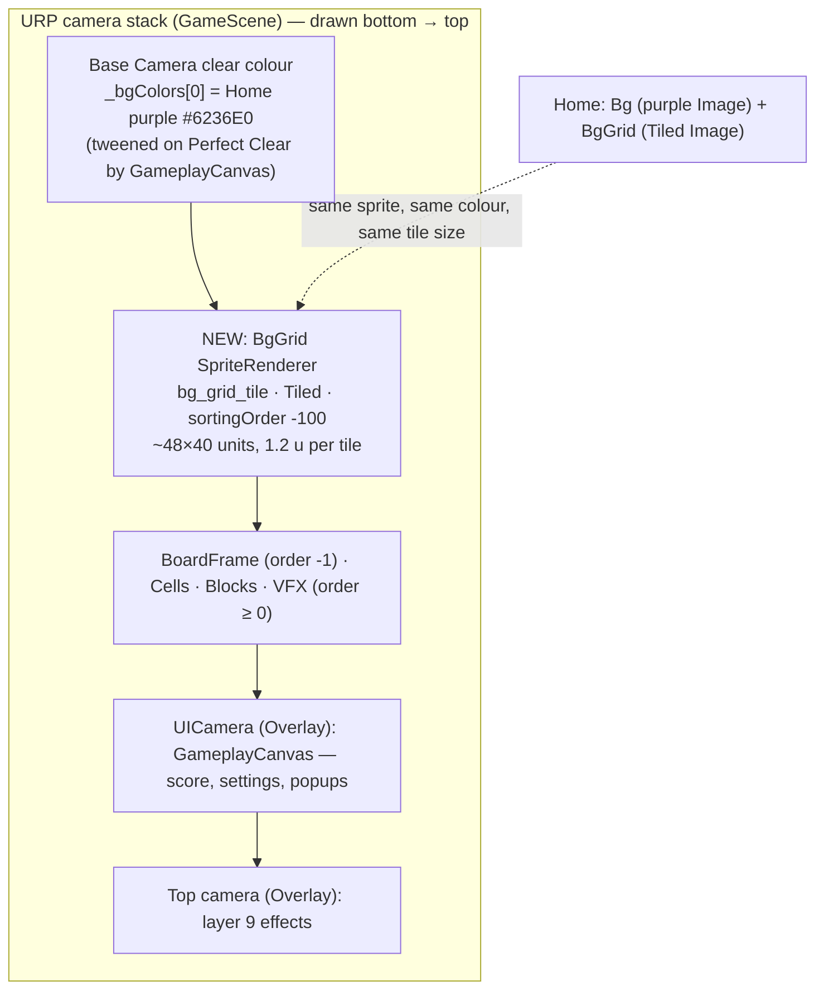

# Gameplay Grid Background — Design

- Date: 2026-11-27
- References: `Screenshots/02_home.png` (target look), `Screenshots/03_gameplay.png` (current look)
- Tile sprite: `Assets/_Game/_BlockDrag/Resource/ComboBlock_UI_assets/bg_grid_tile.png` (72×72 px, PPU 100, Full Rect mesh)

## 1. Requirements

| # | Requirement |
|---|-------------|
| R1 | The gameplay screen shows the same small grid tiles as Home behind the board and the block tray. |
| R2 | The grid sits **under** the board, blocks, VFX and the gameplay UI. It must never cover them. |
| R3 | The grid covers the whole screen on every aspect ratio (16:9 to 21:9 phones, tablets), including while the screen shakes. |
| R4 | The perfect-clear background colour cycle (`GameplayCanvas._bgColors`) keeps working, and the grid stays visible on every colour. |

## 2. How each screen draws its background today

**Home** (`Resources/UI/HomeCanvas.prefab`) uses two full-screen UI Images:
- `Bg`: solid purple `#6236E0` (`r 0.384, g 0.212, b 0.878`).
- `BgGrid`: `bg_grid_tile` sprite, **Image Type = Tiled**, white tint. The tile is thin, semi-transparent lines, so it shows up on top of any base colour. In the 1080×1920 screenshot one tile is about **72 px**.

**Gameplay** (`GameScene.unity` + `Resources/UI/GameplayCanvas.prefab`):
- The `BG` Image in `GameplayCanvas` is **disabled**. `UICamera` is an **Overlay** camera in the URP stack, so any UI Image draws on top of the board, which sits in world space on the Base camera.
- The visible colour is the Base `Camera` clear colour. `GameplayCanvas.ResetBgColor()` sets it to `_bgColors[0]` (brown `#93763C`) and `HandlePerfectClear()` tweens it to the next colour.
- The Base camera is orthographic with size 16 (32 world units tall, which is 60 px per unit at 1920 px). `BoardFrame` uses sorting order −1, and cells and blocks use 0 or higher.

## 3. Design

A UI Image can't be used for the grid (see the Overlay camera note in §2). The grid is therefore drawn in **world space on the Base camera**, between the camera clear colour and the board:

- Add a new GameObject **`BgGrid`** to `GameScene.unity`, under `Environment`, with a **SpriteRenderer**:
  - Sprite `bg_grid_tile`, **Draw Mode = Tiled**, colour white (same as Home).
  - **Sorting order −100**, so it draws below `BoardFrame` (−1) and everything else.
  - Position `(0, 0, 0)`. Its scale makes one tile **1.2 world units** wide, which is 72 px at 1080×1920 and matches Home.
  - Its size is fixed and larger than the widest view: about **48 × 40 world units**. The widest case is a 4:3 tablet, at roughly 43 × 32. The extra margin covers screen shake. Because the size is fixed, no script is needed.
- **Base colour**: change `_bgColors[0]` in `GameplayCanvas.prefab` from brown to Home's purple `#6236E0`, so a new run looks like Home. The other colours in the perfect-clear cycle stay as they are, and the grid shows on all of them (R4).
- **No C# changes.** No assembly or dependency boundaries change.

## 4. Trade-offs and notes

- **Tile size on unusual aspect ratios.** Home is a UI canvas that scales with the screen, while gameplay uses a camera with a fixed height. Tiles match exactly at 1080×1920. On very tall phones (about 9:20) a gameplay tile is around 10–15% larger than on Home. If that's not acceptable, a small `BackgroundGridFitter` component (in `BlockDrag`) could resize the tile from `cam.aspect`. It's left out for now to keep the change simple.
- **Screen shake.** The grid is in world space, so it shakes along with the board. Home has no shake, so there's nothing to compare against there. This should look natural.
- **Rejected option:** turning on `GameplayCanvas/BG` with the tile sprite. It would cover the board because of the Overlay `UICamera`.

## 5. Decisions (confirmed by the user on 2026-11-27)

1. **Base colour:** every run starts on Home's purple `#6236E0` (`_bgColors[0]`).
2. **Perfect-clear colour cycle:** the other colours stay as they are now.
