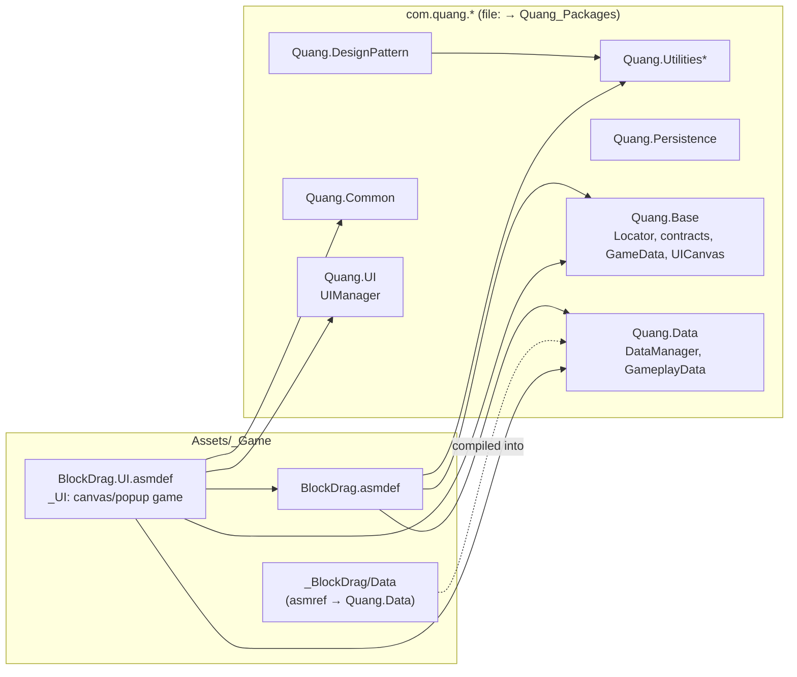

# Bàn Giao: Chuyển BlockDrag sang các package `com.quang.*`

> **Ngày:** 2026-10-11  
> **Branch:** `migrate-quang-packages` (tách từ `main` tại `f0003f2`)  
> **Trạng thái:** ĐANG LÀM. Đã chuyển cấu trúc xong, **chưa biên dịch sạch**, chưa commit.

---

## 1. Bối cảnh

Trước đây BlockDrag **copy thẳng** một bản cũ của framework Hung vào `Assets/_Game/` (`_Base`, `_Data`, `_UI`, `_Common`, `_Utilities`, `_DesignPattern`), với namespace cũ là `Base`, `Base.UI`, `UI`, `Utilities`.

Với sự cho phép của tác giả gốc, framework đã được fork thành bộ package riêng `com.quang.*`:

| Repo | Đường dẫn | Vai trò |
| :--- | :--- | :--- |
| Nguồn | `~/Documents/PackUnity/Quang_Packages` | Nơi sửa code framework. 17 package nằm trong `Packages/`. Có `tools/publish.sh` và `tools/import_upstream.py`. |
| Phát hành | `~/Documents/PackUnity/Quang_Package_Release` | Bản release được sinh tự động bởi `publish.sh`, gắn tag `release-2026.10.11.1`. Remote là `Quangbipi/Package_Release` nhưng **chưa push**. |
| Gốc (chỉ đọc) | `~/Documents/PackUnity/Package_Release` | Bản release `com.hung.*` của tác giả gốc (`HeldenChill/Package_Release`). |

Cách đổi tên (case-preserving): `Hung` → `Quang`, `hung` → `quang`, `HUNG` → `QUANG`. Áp dụng cho id package, namespace, asmdef, define (`QUANG_ADS_MAX`…) và menu (`Quang/...`). **GUID trong `.meta` giữ nguyên** như bản gốc.

---

## 2. Những gì đã thay đổi

### 2.1 `Packages/manifest.json`
Thêm 6 package qua `file:` (sửa trong repo nguồn là game thấy ngay): `com.quang.designpattern`, `utilities`, `persistence`, `base`, `data`, `ui`.

Hệ quả: `com.quang.base` yêu cầu `com.unity.inputsystem` **1.18.0**, nên Unity tự nâng từ 1.14.2. Chưa thêm `services.ads/iap/analytics` vì các package này cần SDK vendor.

### 2.2 Xoá code framework cũ (khoảng 370 file, gồm cả `.meta`)
- 109 script/asmdef trong `_Base`, `_Data`, `_UI`, `_Common`, `_Utilities`, `_DesignPattern` mà package mới đã có. Tiêu chí: trùng GUID, hoặc trùng tên file `.cs`/`.asmdef`/`.asmref`.
- Các file interface cũ bị nhét vào `Hung.Base` qua asmref ở `_Ads/Base`, `_Audio/Base`, `_IAP/Base`, `_Items/Base`, `_Tutorial/Base`, `_SubSystem/*/Base`. Các interface này giờ nằm trong `Quang.Base` (`Locator.Audio`, `Locator.Heart`, `Locator.PiggyBank`…). Những thư mục này đã bị xoá hoàn toàn.
- Hai asmref không còn tác dụng: `Resources/UI/Hung.UI.asmref` và `_UI/Base/Hung.Base.asmref`.
- `_Base/ENUM.BASE.cs` và `_Base/ENUM.GAMEPLAY.cs`: chỉ `GameData`/`GameplayData` cũ dùng.
- `_UI/Base/Extension/Recyclable Scroll Rect/Demo/` (thư mục demo của thư viện).
- Các thư mục rỗng và `.meta` mồ côi.

**Giữ nguyên:** toàn bộ asset của game nằm trong các thư mục cũ (ảnh UI, font, Spine, VFX, prefab, `_Data/DataSO/*.asset`, `_Base/*.prefab`, `_Utilities/Input/PlayerInputActions.inputactions`).

### 2.3 Di chuyển file của game (giữ `.meta`, nên GUID không đổi)

| Từ | Sang | Ghi chú |
| :--- | :--- | :--- |
| `_Utilities/Timer/CountdownManager.cs` | `_BlockDrag/Timer/` | `ScoreManager` dùng |
| `_Data/LevelDataSO.cs` | `_BlockDrag/Data/` | Biên dịch vào `Quang.Data` qua asmref |
| `_Common/GameEventManager.cs` | `_UI/Scripts/Common/` | Chỉ UI dùng. Prefab `GameEventManager.prefab` trong `com.quang.data` tham chiếu script này theo GUID. |
| `_Items/Base/ENUM.ITEM.cs` | `_BlockDrag/Items/` | Namespace đổi `Base` → `Gameplay.BlockDrag` |

### 2.4 Assembly
- `_UI/Hung.UI.asmdef` → **`_UI/BlockDrag.UI.asmdef`** (GUID giữ nguyên). Các reference `Hung.*` đổi thành `Quang.*`.
- `_BlockDrag/Data/Hung.Data.asmref` → `Quang.Data.asmref`. File trỏ theo GUID, mà GUID của `Quang.Data` trùng với `Hung.Data` cũ. Package có hỗ trợ cách mở rộng này: `partial class GameplayData` có thể được viết từ thư mục asmref.
- `BlockDrag.asmdef` **không sửa**: nó tham chiếu theo GUID, và các GUID đó trùng với `Quang.Base`, `Quang.Data`, `Quang.Utilities`, `Quang.Utilities.STimer`.

### 2.5 Namespace trong code game
Script migration đã viết lại `using` trong 34 file (`_UI/Scripts/**`, `_BlockDrag/**`):

| Cũ | Mới |
| :--- | :--- |
| `using Base;` | `using Quang.Base;` |
| `using Base.Init;` | `using Quang.Base.Init;` |
| `using Base.UI;` / `using UI;` / `using Hung.Utilitys;` | `using Quang.UI;` |
| `using Utilities;` / `.Timer` / `.Input` | `using Quang.Utilities;` / `.Timer` / `.Input` |
| `using DesignPattern;` | `using Quang.DesignPattern;` |
| `using Common;` | `using Quang.Common;` |
| `using _Game.Managers;` | `using Quang.Data;` |

Namespace **của chính** các file game (`namespace UI`, `Gameplay.BlockDrag`) giữ nguyên.

### 2.6 Nối lại GUID cho các script đổi GUID
`GameConfig.cs` và `UIParticleSystem.cs` có GUID khác trong package. Các tham chiếu đã được thay trong `_Data/DataSO/GameConfig.asset`, `_UI/VFX/Fx_Star.prefab` và `_UI/VFX/Fx_Glow.prefab`. 24 script framework khác đang gắn trên prefab/scene có GUID trùng, nên tự nối lại.

---

## 3. Trạng thái hiện tại và việc còn lại

### 3.1 Lỗi biên dịch đã biết
Unity dừng ở assembly lỗi đầu tiên, nên **sau khi sửa lỗi này sẽ còn lỗi ở `BlockDrag` và `BlockDrag.UI`**.

- `Assets/_Game/_BlockDrag/Data/LevelDataSO.cs(72)`: `CS0246 'LevelData' not found`. Class `LevelData` (top-level) nằm trong `_Base/GameData.cs` cũ, đã bị xoá. Package mới chỉ có `GameData.LevelData` (class lồng, khác ý nghĩa). **Cách sửa:** khôi phục định nghĩa `LevelData` từ `git show f0003f2:Assets/_Game/_Base/GameData.cs` (khoảng dòng 39) vào một file của game, ví dụ `_BlockDrag/Data/LevelData.cs`.

### 3.2 Rủi ro / regression cần xử lý
1. **`highScore` bị mất.** Tính năng ngày 2026-10-10 (`Docs/plans/2026-10-10-highscore-datamanager-persistence-implementation-plan.md`) đã thêm `public int highScore;` vào `GameData.UserData` cũ, nhưng `GameData` trong `com.quang.base` không có trường này. `GameDataHighScoreStore` sẽ lỗi biên dịch. Hai hướng sửa:
   - (a) Thêm `highScore` vào `GameData.UserData` trong **repo nguồn** `Quang_Packages` (`Packages/com.quang.base/Runtime/GameData.cs`), bump version và ghi CHANGELOG.
   - (b) Lưu high score ở chỗ khác phía game.
2. **Save cũ trên máy hoặc thiết bị** có thể không đọc được, vì `GameData`/persistence của package khác bản cũ. Cần kiểm tra trước khi phát hành bản cập nhật.
3. **API UI có thể khác.** Các canvas game override `Open`/`Close`/`UpdateUI`/`OnDestroy`/`SetupBaseData`. `UICanvas` mới có `Open(object)`, `Setup`, `CloseDirectly`, `OnOpen`, `OnClose`. Các member `SetupBaseData` và `UICanvasComponent` cần kiểm tra lại khi biên dịch.
4. `Locator.Reward` (`ClaimItem`, `GetItem`, `SaveItemData`, `ShowReward`, `SpendItem`) **không còn** trong `Locator` mới. Khả năng tương đương là `Locator.Items` (`IItemService`). Cần map lại.
5. `_UI/Editor/ComboEffectPrefabCreator.cs` dùng `UnityEditor` nhưng nằm trong asmdef runtime `BlockDrag.UI`. Vấn đề này có từ trước và sẽ làm hỏng build player. Nên chuyển sang một asmdef Editor.
6. Prefab/asset của game trước đây được serialize theo schema cũ (`GameplayData.asset`, `PoolData.asset`, `DataManager.prefab`, `Init.prefab`…). Cần mở từng cái để kiểm tra field bị mất và script bị "Missing".

### 3.3 Cập nhật tài liệu repo
`AGENTS.md` và `.agents/rules/architecture.md` vẫn mô tả `_Base`/`_Common`/`_DesignPattern` và `Hung.Base`. Cần cập nhật: framework giờ là package `com.quang.*` (sửa ở `Quang_Packages`, không sửa trong `Library/PackageCache`), và assembly UI của game là `BlockDrag.UI`.

### 3.4 Các bước tiếp theo đề xuất
1. Sửa `LevelData` (mục 3.1), để Unity biên dịch lại và đọc lỗi tiếp theo từ Console hoặc `~/Library/Logs/Unity/Editor.log` (`grep 'error CS'`).
2. Quyết định hướng sửa `highScore` (mục 3.2.1).
3. Sửa lần lượt lỗi trong `BlockDrag` rồi `BlockDrag.UI` (mục 3.2.3, 3.2.4).
4. Chạy test EditMode. `EditModeTests.asmdef` tham chiếu `Hung.Base` theo GUID, GUID này vẫn khớp với `Quang.Base`.
5. Mở các scene và prefab chính để kiểm tra script "Missing", rồi chạy thử gameplay.
6. Commit trên `migrate-quang-packages`, sau đó merge vào `main`.
7. Khi ổn định: chuyển manifest từ `file:` sang Git URL theo tag release, ví dụ `https://github.com/Quangbipi/Package_Release.git?path=Packages/com.quang.base#release-YYYY.MM.DD.N`.

---

## 4. Quy tắc khi làm tiếp
- **Sửa framework ở `~/Documents/PackUnity/Quang_Packages`**, không sửa trong `Library/PackageCache` hay copy lại vào `Assets`. Sau khi sửa: bump `version` và `CHANGELOG.md`, commit, rồi chạy `tools/publish.sh`.
- Code riêng của game giữ trong `Assets/_Game` (L5). Chỉ đưa vào package những gì dùng lại được cho game khác.
- Mở rộng `GameplayData` bằng `partial class` trong `_BlockDrag/Data` (asmref → `Quang.Data`).
- Khi di chuyển file, luôn đi kèm `.meta`.
- Muốn quay lại trạng thái trước migration: `git checkout main` (commit `f0003f2`).

---

## 5. Cập nhật 2026-10-11 (tối): đã biên dịch sạch

Mọi assembly (`Quang.Data` + asmref, `BlockDrag`, `BlockDrag.UI`, `EditModeTests`) đã biên dịch không lỗi. **Không sửa package**, mọi thay đổi nằm phía game.

| Vấn đề | Cách sửa |
| :--- | :--- |
| `LevelData` bị mất (3.1) | Khôi phục `LevelData`, `*UnitData`, `DIRECTION`, `PLACE_TYPE`, `LEVEL_DIFFICULTY`, `LEVEL_PERFORMANCE_TYPE` vào `_BlockDrag/Data/LevelData.cs` (namespace `Gameplay.BlockDrag`). `using UnityEditor` trong `LevelDataSO` được bọc `#if UNITY_EDITOR`. |
| `highScore` (3.2.1) | Chọn hướng (b): `_BlockDrag/Base/Quang.Base.asmref` + `GameData.BlockDrag.cs` (`partial class GameData { int highScore; }`). Field nằm ở `GameData.highScore`, không còn ở `user.highScore`. |
| `CountdownManager` | Namespace `Utilities.Timer` → `Gameplay.BlockDrag`. |
| `BlockDrag.UI` thiếu `Quang.UI` | Thêm reference `Quang.UI` vào asmdef. |
| Enum `ITEM` | Chuyển sang `_BlockDrag/Data/ENUM.ITEM.cs` (assembly `Quang.Data`), bỏ `ITEM_RARITY` trùng (dùng của `Quang.Base`). Thêm `ITEM.ToItemId()` (map sang `BaseItemIds`), `ItemId.TryToItem()`, `ItemData.GetItemType()`. |
| Field `GameplayData` cũ | `_BlockDrag/Data/GameplayData.BlockDrag.cs`: `items`, `frames`, `winLevelGold`, `levelPerChapter` (cùng tên nên asset giữ giá trị). Odin `BindTypeNameToType` cho `Base.ITEM/ITEM_RARITY/ItemData, Hung.Base`. `Items` tự điền `ItemData.Id` từ key. Đã kiểm tra: asset đọc đủ 9 item, 2 frame, winLevelGold=20, levelPerChapter=8. |
| `Locator.Reward` (3.2.4) | → `Locator.Items` với `ITEM.X.ToItemId()`. |
| `CONSTANTS` | `_BlockDrag/CONSTANTS.cs` (`MAX_LEVEL`, `DEFAULT_PROJECTION_SIZE`). |
| `GameEventManager` | Namespace `Common` → `UI`; `DesignPattern.EventID` → `Quang.DesignPattern.EventID`. |
| API khác | `GetFormattedTimeRemaining` → `GetHeartFormattedTimeRemaining`; `Inter.Show(cb)` → `Show(cb, Placement.NONE)`; `Locator.Ads.Analytic.LevelTrackEvent` → `Locator.Analytics?.LevelTrackEvent(...)` (WIN dùng `level.MarkPassed`); bỏ `UpdateBannerSpace` (bản cũ là no-op); `RemoveBackUI` → `BackStack.Remove`. |

### Còn tồn tại (không do code migration)
- Exception `InputSystem` (`InputManager.set_settings` null) sau khi nâng 1.14.2 → 1.18.0: trạng thái domain cũ, **khởi động lại Unity** để hết.
- `WinCanvas.prefab`, `Breaking.prefab` thiếu nested prefab `Star_Disappear` (guid `d98650eb…`): chưa từng có trong repo từ commit đầu.
- EditMode: 36/42 pass. 6 test `GameOverCheckTests` lỗi SetUp do `cellPrefab`/`singleBlockPrefab` null — code/test không đổi so với HEAD, lỗi có từ trước.
- Các mục 3.2.2 (save cũ: `GameData.SaveKey` mới là `GameData.item-id-v1`), 3.2.5 (`ComboEffectPrefabCreator`), 3.2.6 (kiểm tra prefab/scene), 3.3 (tài liệu) vẫn còn mở.
