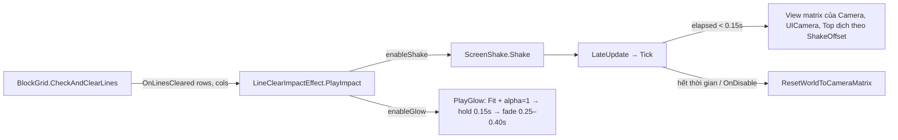

# Implementation Plan: Line Clear Impact Feedback (Rung Toàn Màn Hình & Viền Sáng Quanh Grid)

> **Ngày tạo:** 2026-10-15
> **Design đã duyệt:** `Docs/designs/2026-10-15-line-clear-impact-feedback-design.md`
> **Sửa lần 1 (2026-10-15, đã duyệt):** `ScreenShake` dịch **view matrix** thay vì projection — dịch projection làm canvas của `UICamera` biến mất trong Play mode.
> **Assembly:** `BlockDrag` (namespace `Gameplay.BlockDrag`) — không sửa package, không sửa `BlockDrag.UI`, không đổi ranh giới module.

---

## 0. Hiện trạng đã kiểm tra (làm cơ sở cho plan)

| Hạng mục | Kết quả |
|---|---|
| Camera trong `GameScene` | `Camera` = **Base** (URP 14.0.12), stack gồm `UICamera` và `Top` (cả hai **Overlay**). Cả 3 đều orthographic |
| Canvas UI | `UIManager.prefab` root canvas là **Screen Space – Camera**, scene override `m_Camera` trỏ tới `UICamera`. Các canvas trong `Resources/UI` là canvas con ⇒ đều render qua `UICamera` |
| Kết luận | Dịch view matrix của `Camera` + `UICamera` + `Top` ⇒ **bàn chơi + khối + particle + toàn bộ HUD** cùng rung. Không có canvas Overlay ở gameplay cần xử lý thêm |
| Sorting | `BoardFramePrefab` = -1, `GridCellPrefab` = 0, `BlockPrefab` = 0, viền preview (`LineClearPreviewEffect`) = 6 |
| Sprite viền | `Effects/Textures/LineClearGlow.png` 64×64, PPU 64, border 24, **rỗng giữa**: quầng mờ 0→16px, vạch sáng ở ~16–18px, bên trong trong suốt ⇒ dùng lại được cho khung board, đặt vạch sáng trùng mép khung |
| Code dùng lại | `LineClearPreviewEffect.BakeGradientPixels(...)` (public static), shader `BlockDrag/LineClearRainbowGlow` + `LineClearRainbowGlow.mat`, `BlockGrid.ComputeFrameSize(...)` (public static), `BlockGrid.BoardCenterPosition`, `CellSize`, `GridWidth/GridHeight` |
| Code khác đụng camera | Chỉ **đọc** `cam.transform.position.z`, không ghi ⇒ không xung đột |

---

## 1. Các bước triển khai

### Bước 1 — `ShakeOffset` (thuần C#)
**File mới:** `Assets/_Game/_BlockDrag/Effects/ShakeOffset.cs`

```csharp
public static class ShakeOffset
{
    // elapsed, duration (s); amplitude (tỉ lệ chiều rộng màn hình); frequency (lần đổi hướng / s); seed
    // Trả về offset theo tỉ lệ màn hình (x theo chiều rộng, y cùng đơn vị pixel với x)
    public static Vector2 Evaluate(float elapsed, float duration, float amplitude, float frequency, int seed);
}
```
- `elapsed < 0` hoặc `elapsed >= duration` hoặc `duration <= 0` ⇒ `Vector2.zero`.
- Bước `step = floor(elapsed * frequency)`; hướng = góc ngẫu nhiên từ hash(`seed`, `step`) (dùng hàm hash số nguyên tự viết, **không** dùng `UnityEngine.Random` để không đụng state random của gameplay/spawn).
- Độ lớn = `amplitude * (1 - elapsed / duration)` (giảm tuyến tính).
- Không cấp phát bộ nhớ.

### Bước 2 — `ScreenShake` (MonoBehaviour)
**File mới:** `Assets/_Game/_BlockDrag/Effects/ScreenShake.cs`

Serialized fields:
| Field | Mặc định | Ghi chú |
|---|---|---|
| `Camera[] cameras` | trống | Trống ⇒ fallback `Camera.main` (log warning một lần) |
| `float amplitude` | 0.009 | Tỉ lệ chiều rộng màn hình |
| `float duration` | 0.15 | Giây |
| `float frequency` | 24 | Lần đổi hướng / giây |
| `bool useUnscaledTime` | true | Rung vẫn kết thúc kể cả khi `timeScale = 0` |

API:
- `public void Shake()` — restart: `elapsed = 0`, `seed++`, `isShaking = true`.
- `public void StopAndReset()` — `isShaking = false`, gọi `ResetWorldToCameraMatrix()` cho mọi camera.
- `public bool IsShaking`.
- `public void Tick(float deltaTime)` — logic một frame (public để EditMode test gọi trực tiếp, `LateUpdate` chỉ gọi `Tick(dt)`).

Logic `Tick`:
1. Không rung ⇒ return.
2. `elapsed += dt`; nếu `elapsed >= duration` ⇒ `StopAndReset()` và return.
3. `offset = ShakeOffset.Evaluate(...)` ⇒ đổi sang world: `world = offset * viewWidth`, `viewWidth = 2 * orthographicSize * aspect` (x, y cùng đơn vị nên biên độ dọc = ngang theo pixel).
4. Với mỗi camera khác null: `cam.ResetWorldToCameraMatrix(); cam.worldToCameraMatrix = Matrix4x4.Translate(new Vector3(world.x, world.y, 0f)) * cam.worldToCameraMatrix;`
- `OnDisable` và `OnDestroy` ⇒ `StopAndReset()`.

### Bước 3 — `LineClearImpactEffect` (MonoBehaviour)
**File mới:** `Assets/_Game/_BlockDrag/Effects/LineClearImpactEffect.cs`

Serialized fields:
| Nhóm | Field | Mặc định |
|---|---|---|
| References | `BlockGrid blockGrid` (trống ⇒ `FindObjectOfType`) | |
| | `ScreenShake screenShake` (trống ⇒ `FindObjectOfType`) | |
| | `SpriteRenderer glowRenderer` (con trong prefab, sprite `LineClearGlow`, Sliced, sortingOrder 6) | |
| | `Material rainbowGlowMaterial` (`LineClearRainbowGlow.mat`) | |
| Toggle | `bool enableShake`, `bool enableGlow` | true, true |
| Glow | `float glowPadding` (× cellSize, độ tràn quầng ra ngoài khung) | 0.3 |
| | `float glowLineEdgePixels` | 16 |
| | `float framePaddingRatio` | 0.12 (khớp `BlockGrid`) |
| | `float peakAlpha` | 1 |
| | `float holdDuration` | 0.15 |
| | `Vector2 fadeDurationRange` (1 đường → ≥ `maxLinesForFade`) | (0.25, 0.40) |
| | `int maxLinesForFade` | 3 |
| | `Gradient glowGradient` | cyan → xanh dương → tím → hồng |
| | `Vector2 gradientDirection` | (0.36, 0.6) — cyan dưới/trái, hồng trên/phải; giữ |x|+|y| ≤ 1 vì shader dùng `frac` |

Hành vi:
- `Awake`: tìm tham chiếu; tạo `Material` instance + `Texture2D` 256×1 từ gradient (dùng `LineClearPreviewEffect.BakeGradientPixels`); gán vào `glowRenderer`; `glowRenderer.enabled = false`.
- `OnEnable`/`OnDisable`: subscribe/unsubscribe `blockGrid.OnLinesCleared` (theo mẫu `SubscribeEvents`/`UnsubscribeEvents` của `LineClearPreviewEffect`). `OnDisable` kill tween, ẩn viền.
- `OnDestroy`: destroy material instance + texture.
- `HandleLinesCleared(rows, cols, cells)` ⇒ `PlayImpact(rows + cols)`.
- `public void PlayImpact(int lineCount)`:
  - `lineCount <= 0` ⇒ return.
  - `enableShake && screenShake != null` ⇒ `screenShake.Shake()`.
  - `enableGlow` ⇒ `PlayGlow(lineCount)`.
- `PlayGlow`:
  1. `FitGlowToBoard()`: root bám theo `blockGrid.transform` (giống `LayoutGlows`, **không** làm con của Grid vì `ClearGrid()` destroy child); `frameSize = BlockGrid.ComputeFrameSize(GridWidth, GridHeight, CellSize, framePaddingRatio)`; rect = frame + `2 * glowPadding * cellSize`; scale theo `glowLineEdgePixels` như `LayoutGlows`; cập nhật `_BoundsMin/_BoundsSize` theo world rect.
  2. Kill tween cũ; `enabled = true`; alpha = `peakAlpha` (bật tức thì).
  3. `Sequence`: `AppendInterval(holdDuration)` → `Append(DOFade(0, GetFadeDuration(lineCount)))` → `OnComplete(enabled = false)`.
- `public static float GetFadeDuration(int lineCount, Vector2 range, int maxLines)` — nội suy tuyến tính, kẹp trong `range` (để test).

### Bước 4 — Prefab & Scene
1. Tạo `Assets/_Game/_BlockDrag/Prefabs/LineClearImpactEffect.prefab`:
   - Root `LineClearImpactEffect` (component) → con `BoardGlow` (`SpriteRenderer`: sprite `LineClearGlow`, Draw Mode Sliced, sortingOrder 6, màu trắng).
   - Gán `rainbowGlowMaterial` = `Effects/Materials/LineClearRainbowGlow.mat`.
2. `GameScene.unity`:
   - Thêm component `ScreenShake` vào GameObject `Camera` (main), gán `cameras = [Camera, UICamera, Top]`.
   - Kéo một instance `LineClearImpactEffect.prefab` vào scene (cạnh `LineClearPreviewEffect`), gán `blockGrid` và `screenShake`.
3. Tạo bằng Unity Editor (qua Unity MCP), lưu scene/prefab. Giữ đầy đủ file `.meta`.

### Bước 5 — EditMode tests
**File mới:** `Assets/Tests/EditMode/ShakeOffsetTests.cs`
- `Evaluate_AtOrAfterDuration_ReturnsZero`
- `Evaluate_WithinDuration_MagnitudeNeverExceedsAmplitude`
- `Evaluate_MagnitudeDecreasesOverTime` (so sánh biên độ đỉnh nửa đầu và nửa cuối)
- `Evaluate_SameSeedAndTime_IsDeterministic`
- `Evaluate_NewStep_ChangesDirection` (2 step liên tiếp khác hướng)

**File mới:** `Assets/Tests/EditMode/LineClearImpactEffectTests.cs`
- `ScreenShake_AfterDuration_RestoresDefaultView` — tạo Camera tạm, `Shake()`, `Tick` vượt `duration`, so `worldToCameraMatrix` với ma trận ban đầu.
- `ScreenShake_StopAndReset_MidShake_RestoresDefaultView`
- `ScreenShake_WhileShaking_OffsetsViewOnly` — giữa chừng view khác gốc, projection và transform camera không đổi.
- `ScreenShake_OffsetStaysWithinAmplitudeOfViewWidth` — độ lệch world không vượt `amplitude × viewWidth`, không lệch trục z.
- `ScreenShake_ShakeTwice_DoesNotDrift` — 2 lần liên tiếp, kết thúc vẫn về ma trận gốc.
- `GetFadeDuration_ScalesWithLinesAndClamps` — 1 đường = min, ≥3 = max, 0/âm = min.

`EditModeTests.asmdef` đã tham chiếu `BlockDrag` (các test hiện có như `LineClearPreviewEffectTests` dùng chung) ⇒ không cần sửa asmdef. Nếu biên dịch báo thiếu tham chiếu thì mới bổ sung.

### Bước 6 — Biên dịch & chạy test
- `read_console` kiểm tra không lỗi biên dịch.
- Chạy toàn bộ EditMode tests (Unity MCP `run_tests` hoặc lệnh batchmode trong `AGENTS.md`), mọi test cũ và mới đều pass.

---

## 2. Danh sách file bị ảnh hưởng

| File | Loại |
|---|---|
| `Assets/_Game/_BlockDrag/Effects/ShakeOffset.cs` (+ `.meta`) | Mới |
| `Assets/_Game/_BlockDrag/Effects/ScreenShake.cs` (+ `.meta`) | Mới |
| `Assets/_Game/_BlockDrag/Effects/LineClearImpactEffect.cs` (+ `.meta`) | Mới |
| `Assets/_Game/_BlockDrag/Prefabs/LineClearImpactEffect.prefab` (+ `.meta`) | Mới |
| `Assets/_Game/_Scenes/Game/GameScene.unity` | Sửa — thêm `ScreenShake` trên `Camera`, thêm instance prefab |
| `Assets/Tests/EditMode/ShakeOffsetTests.cs` (+ `.meta`) | Mới |
| `Assets/Tests/EditMode/LineClearImpactEffectTests.cs` (+ `.meta`) | Mới |

**Không sửa:** `BlockGrid.cs`, `LineClearPreviewEffect.cs`, shader/material hiện có, package `com.quang.*`, `BlockDrag.UI`, `architecture.md`.

---

## 3. Luồng sau khi triển khai



---

## 4. Kiểm tra thủ công trong Editor (GameScene, Play mode)

| # | Thao tác | Kỳ vọng |
|---|---|---|
| 1 | Phá 1 hàng | HUD điểm **và** bàn chơi cùng rung ~0.15s, về đúng vị trí; viền gradient cyan→hồng bật tức thì ôm khung board, mờ hết sau ~0.4s |
| 2 | Phá 3+ đường cùng lúc | Rung giống bước 1; viền giữ lâu hơn (~0.55s) |
| 3 | Phá liên tiếp nhanh 2 lần | Hiệu ứng khởi động lại, không trôi màn hình, không nháy sai |
| 4 | Ngay sau khi phá, kéo khối mới | Khối bám ngón tay/chuột bình thường, đặt đúng ô |
| 5 | Nhấn nút UI (setting) ngay sau khi phá | Bấm trúng nút |
| 6 | Đổi Game view sang tỉ lệ tablet (≥ ngưỡng tablet margin) | Viền vẫn ôm khít khung board |
| 7 | Perfect clear | Đổi màu nền hiện có vẫn chạy, rung + viền vẫn đúng |
| 8 | Tắt `enableShake` / `enableGlow` trong Inspector | Hiệu ứng tương ứng không chạy |
| 9 | Xem Frame Debugger / Profiler khi phá | Không cấp phát GC mỗi frame trong lúc rung |

Ghi chú: bản đầu dùng projection khiến HUD biến mất; đã chuyển sang view matrix theo sửa lần 1.

---

## 5. Commit dự kiến
`Gameplay: add screen shake and board glow on line clear` — gồm script, prefab, scene, test và toàn bộ `.meta` liên quan. Chỉ commit khi bạn yêu cầu.
