# Kế Hoạch Triển Khai: Chữ Điểm Bay Lên Score & Đếm Điểm Tăng Dần

> **Ngày tạo:** 2026-10-16
> **Thiết kế đã duyệt:** `Docs/designs/2026-10-16-score-fly-text-count-up-design.md`
> **Quyết định đã chốt:** `countUpDuration` là `[SerializeField]` mặc định **1s**; điểm đặt khối **không bay** (phương án A).

---

## 0. Tổng Quan Thứ Tự

```mermaid
flowchart LR
    S1["B1. Contract<br/>ScoreGain + IScoreService"] --> S2["B2. ScoreManager<br/>phát OnScoreGained"]
    S2 --> S3["B3. ScoreCountUp<br/>(pure C#)"]
    S3 --> S4["B4. TextScoreFly"]
    S4 --> S5["B5. ScoreFlyManager"]
    S5 --> S6["B6. GameplayCanvas"]
    S6 --> S7["B7. Prefab TextScoreFly<br/>+ wiring GameplayCanvas.prefab"]
    S7 --> S8["B8. Tests + compile"]
    S8 --> S9["B9. Kiểm tra thủ công<br/>GameScene"]
    S9 --> S10["B10. Cập nhật architecture.md"]
```



Mỗi bước code xong đều chạy `read_console` (UnityMCP) để chắc chắn không lỗi compile trước khi sang bước sau.

---

## B1. Contract trong `Quang.Base` (asmref `_BlockDrag/Base`)

**Tạo** `Assets/_Game/_BlockDrag/Base/ScoreGain.cs` (+ `.meta` do Unity sinh):
```csharp
namespace Quang.Base
{
    public enum ScoreSource { Placement, LineClear, PerfectClear }

    public readonly struct ScoreGain
    {
        public readonly int Amount;
        public readonly ScoreSource Source;
        public readonly Vector3 WorldPos;
        public readonly bool HasWorldPos;

        public ScoreGain(int amount, ScoreSource source) { ... HasWorldPos = false; }
        public ScoreGain(int amount, ScoreSource source, Vector3 worldPos) { ... HasWorldPos = true; }
    }
}
```

**Sửa** `Assets/_Game/_BlockDrag/Base/IScoreService.cs`: thêm
```csharp
event Action<ScoreGain> OnScoreGained; // (amount, nguồn, toạ độ) — phát TRƯỚC OnScoreChanged
```

**Sửa** `Assets/Tests/EditMode/BlockDragLocatorTests.cs`: `FakeScoreService` thêm `public event Action<ScoreGain> OnScoreGained { add { } remove { } }` (nếu không sẽ lỗi compile).

## B2. `ScoreManager` (`Assets/_Game/_BlockDrag/ScoreManager.cs`)

1. Thêm `public event Action<ScoreGain> OnScoreGained;`.
2. `AddScore(int amount)` → gọi `AddScore(new ScoreGain(amount, ScoreSource.Placement))` (giữ API cũ cho test).
3. Thêm `public void AddScore(ScoreGain gain)`: kiểm `gain.Amount <= 0` → return; cộng `currentScore`; **phát `OnScoreGained(gain)` trước** `OnScoreChanged`; xử lý HighScore như cũ.
4. `HandleShapePlacedWithCount` → `AddScore(new ScoreGain(points, ScoreSource.Placement))`.
5. `HandleLinesCleared(rows, cols, cells)` giữ chữ ký public; tách phần thân thành `private void ApplyLinesCleared(int rows, int cols, Vector3? placedPos)`:
   - `HandleLinesCleared(...)` → `ApplyLinesCleared(rows, cols, null)` → `ScoreGain(total, LineClear)` không toạ độ.
   - `HandleLinesClearedWithPos(..., placedPos)` → `ApplyLinesCleared(rows, cols, placedPos)` → `ScoreGain(total, LineClear, placedPos)`.
   - Vẫn **một** lần `AddScore` cho base + combo bonus.
6. `HandlePerfectClear(boardCenter)` → `AddScore(new ScoreGain(bonus, ScoreSource.PerfectClear, boardCenter))`.

Không đổi thứ tự sự kiện khác (`OnComboChanged`, `OnComboTriggered`, `OnPerfectClear`).

## B3. `ScoreCountUp` — `Assets/_Game/_UI/Scripts/ScoreFly/ScoreCountUp.cs` (mới, namespace `UI`)

Class C# thuần (không MonoBehaviour):
```csharp
public sealed class ScoreCountUp
{
    public int Displayed { get; private set; }
    public int Target { get; private set; }
    public float Duration { get; set; }          // <= 0 → nhảy ngay
    public bool IsRunning => Displayed != Target;

    public void Snap(int value);                  // Displayed = Target = value
    public void SetTarget(int target);            // target < Displayed → Snap; > → chạy lại từ Displayed, elapsed = 0
    public bool Tick(float deltaTime);            // true nếu Displayed đổi
}
```
- Nội suy `from + (Target − from) * EaseOutQuad(elapsed / Duration)`, `RoundToInt`, kẹp không vượt `Target`, kết thúc gán đúng `Target`.

## B4. `TextScoreFly` — `Assets/_Game/_UI/Scripts/ScoreFly/TextScoreFly.cs` (mới)

- `[RequireComponent(typeof(RectTransform), typeof(CanvasGroup))]`.
- `[SerializeField]`: `TMP_Text amountText`, `CanvasGroup canvasGroup`, `popInDuration = 0.15f`, `popInStartScale = 0.5f`, `holdDuration = 0.2f`, `holdRise = 20f`, `flyDuration = 0.25f`, `flyEase = Ease.InQuad`, `absorbDuration = 0.1f`, `absorbScale = 0.3f`.
- `public int Amount { get; }`
- `public void Play(int amount, Vector2 startAnchoredPos, RectTransform target, float startDelay, Action<TextScoreFly> onArrive)`:
  1. Đặt text `"+" + amount`, `anchoredPosition = start`, scale = `popInStartScale`, alpha = 0, `SetAsLastSibling()`.
  2. `Sequence`: `AppendInterval(startDelay)` → pop-in (`DOScale(1.1)` rồi `DOScale(1)`, `DOFade(1)`) → hold (`DOAnchorPosY(+holdRise)`) → `AppendCallback` tính toạ độ đích (target world pos → local của parent) → `DOAnchorPos(dest, flyDuration).SetEase(flyEase)` → absorb (`DOScale(absorbScale)` + `DOFade(0)`) → `OnComplete` gọi `onArrive(this)`.
  3. `SetLink(gameObject)`; dùng `SetUpdate(true)` để không phụ thuộc timeScale (đồng bộ với `unscaledDeltaTime` của count-up).
- `public void ForceComplete()`: `sequence.Kill()` không gọi callback.
- `OnDisable`: kill sequence.

## B5. `ScoreFlyManager` — `Assets/_Game/_UI/Scripts/ScoreFly/ScoreFlyManager.cs` (mới)

- `[SerializeField]`: `TextScoreFly flyPrefab` (fallback `Resources.Load<TextScoreFly>("Prefabs/TextScoreFly")`), `RectTransform flyTarget` (ScoreTxt), `RectTransform poolContainer` (để trống → tự tạo con `ScoreFlyPool` stretch full, last sibling), `int initialPoolSize = 4`, `ScoreSource[] flySources = { LineClear, PerfectClear }`, `Vector2 spawnOffset = (0, 90)`, `float lineClearDelay = 0.3f`, `float perfectClearExtraDelay = 0.25f`, `float screenEdgePadding = 80f`.
- State: `MiniPool<TextScoreFly> pool`, `List<TextScoreFly> flying`, `int PendingAmount`, `IScoreService boundScore`.
- `public event Action<int> OnFlyArrived;`
- Vòng đời: `Awake` init pool; `OnEnable` bind `Locator.ScoreChanged` + `BindScore(Locator.Score)`; `OnDisable` unbind + `CancelAll()`.
- `public bool TrySpawn(ScoreGain gain)` (public để test): trả `false` nếu nguồn không bay / `!HasWorldPos` / thiếu prefab hoặc target. Ngược lại `PendingAmount += amount`, quy đổi toạ độ (Camera.main → screen → `ScreenPointToLocalPointInRectangle` với UI camera của canvas gốc, cùng cách `ComboTextEffect`), cộng `spawnOffset`, kẹp biên, chọn delay theo nguồn, `pool.Spawn()` + `Play(...)`.
- `HandleArrive(fly)`: `PendingAmount -= fly.Amount` (kẹp ≥ 0), remove khỏi `flying`, `pool.Despawn(fly)`, phát `OnFlyArrived(fly.Amount)`.
- `public void CancelAll()`: `ForceComplete` mọi chữ trong `flying`, `pool.Collect()`, `flying.Clear()`, `PendingAmount = 0`.

## B6. `GameplayCanvas` (`Assets/_Game/_UI/Scripts/GameplayCanvas.cs`)

1. Thêm field:
   ```csharp
   [Header("Score Count-Up")]
   [Tooltip("Thời gian (giây) Score chạy từ số đang hiển thị lên số cuối")]
   [SerializeField] private float countUpDuration = 1f;
   [SerializeField] private ScoreFlyManager scoreFlyManager;
   ```
   và `private readonly ScoreCountUp scoreCounter = new ScoreCountUp();`.
2. `Awake`: nếu `scoreFlyManager == null` → `GetComponent<ScoreFlyManager>()`; subscribe `scoreFlyManager.OnFlyArrived += HandleFlyArrived`. `OnDestroy` unsubscribe.
3. `BindScore`: sau khi bind → `ResetScoreDisplay()` (= `scoreFlyManager?.CancelAll()` + `scoreCounter.Snap(CurrentScore)` + gán text).
4. `UpdateScoreText(int score)` → đổi thành `HandleScoreChanged(int score)`:
   - `score < scoreCounter.Displayed` (ván mới / reset) → `ResetScoreDisplay()`.
   - ngược lại → `RefreshScoreTarget()`: `scoreCounter.Duration = countUpDuration; scoreCounter.SetTarget(score − PendingAmount)`.
5. `HandleFlyArrived(int amount)` → `RefreshScoreTarget()` + punch scale ScoreTxt (đoạn `DOPunchScale` hiện có chuyển sang đây).
6. `Update()`: `if (scoreCounter.Tick(Time.unscaledDeltaTime)) ScoreTxt.text = scoreCounter.Displayed.ToString();`
7. `OnGameRestarted` (đã bind `ResetBgColor`) → thêm `ResetScoreDisplay()`.

> Ghi chú: điểm đặt khối không bay → `OnScoreChanged` đến khi `PendingAmount` không chứa nó → Score chạy số ngay trong `countUpDuration`.

## B7. Prefab & Wiring (qua UnityMCP / Editor)

1. **Tạo** `Assets/_Game/Resources/Prefabs/TextScoreFly.prefab`:
   - Gốc `TextScoreFly` (RectTransform 300×100, pivot giữa, `CanvasGroup` với `blocksRaycasts = false`, `interactable = false`, component `TextScoreFly`).
   - Con `Amount` (`TextMeshProUGUI`, `raycastTarget = false`): font giống `ScoreTxt`, cỡ ~64, màu kem-vàng `#FFF1C4`, outline nâu đỏ mỏng, căn giữa, text mẫu `+106`.
   - Gán `amountText`, `canvasGroup`.
2. **Sửa** `Assets/_Game/Resources/UI/GameplayCanvas.prefab`:
   - Thêm component `ScoreFlyManager` vào gốc; gán `flyPrefab = TextScoreFly`, `flyTarget = ScoreTxt`.
   - Gán `GameplayCanvas.scoreFlyManager`; kiểm `countUpDuration = 1`.
3. Kiểm tra instance trong `Assets/_Game/_Scenes/Game/GameScene.unity` nhận component mới (không có override chặn); không sửa trực tiếp scene trừ khi cần.
4. Không đụng `ComboTextEffect.prefab`, `ComboEffectManager.cs`, `ComboTextEffect.cs` (đang có thay đổi chưa commit của task khác).

## B8. Tests (`Assets/Tests/EditMode`)

**Tạo** `ScoreCountUpTests.cs`:
- `Tick_AfterDuration_DisplaysExactTarget`
- `Tick_NeverExceedsTarget`
- `Tick_MidWay_DisplaysValueBetweenStartAndTarget`
- `SetTarget_WhileRunning_ContinuesFromDisplayedValue`
- `SetTarget_WithZeroDuration_JumpsImmediately`
- `SetTarget_LowerThanDisplayed_Snaps`
- `Snap_SetsDisplayedAndTarget`

**Tạo** `ScoreFlyTests.cs`:
- `ShapePlaced_RaisesScoreGained_WithPlacementSourceAndNoWorldPos`
- `LinesClearedWithPos_RaisesSingleLineClearGain_WithBasePlusComboAndPlacedPos`
- `PerfectClear_RaisesPerfectClearGain_WithBoardCenter`
- `ScoreGained_IsRaisedBeforeScoreChanged`
- `ScoreGainedAmounts_SumToCurrentScore`
- `ScoreFlyManager_TrySpawn_PlacementSource_ReturnsFalseAndNoPending`
- `ScoreFlyManager_TrySpawn_LineClear_AddsPendingAmount`
- `ScoreFlyManager_CancelAll_ClearsPendingAndDeactivatesTexts`

(Kiểm tra `EditModeTests.asmdef` đã tham chiếu `BlockDrag.UI` — `ComboEffectTests` đang dùng `UI` nên có sẵn; thêm GUID `DOTween` nếu thiếu.)

Chạy toàn bộ EditMode qua `mcp__UnityMCP__run_tests` → mọi test cũ (đặc biệt `ScoreSystemTests`, `BlockDragLocatorTests`, `ComboEffectTests`) và test mới phải pass.

## B9. Kiểm Tra Thủ Công (GameScene, Play Mode)

| # | Kịch bản | Kỳ vọng |
|---|---|---|
| 1 | Đặt khối không phá hàng | Không có chữ bay; Score chạy số tới điểm mới trong ~1s |
| 2 | Phá 1 hàng | "+N" hiện tại khối vừa đặt sau ~0.3s, bay lên Score; Score chỉ chạy số khi chữ tới, punch 1 lần |
| 3 | Combo ≥2 | "+N" hiện **phía trên** chữ Combo, không chồng lên |
| 4 | Phá hàng liên tiếp nhanh | Nhiều chữ cùng bay; Score chạy tiếp từ số đang hiện, không giật lùi; kết thúc đúng `CurrentScore` |
| 5 | Perfect Clear | 2 chữ (phá hàng + perfect), chữ perfect bay sau |
| 6 | Restart khi chữ đang bay | Chữ biến mất ngay, Score = 0 |
| 7 | Đổi `countUpDuration` trong Inspector (0, 0.5, 2) | Tốc độ chạy số đổi theo; 0 = nhảy số |
| 8 | Profiler khi chơi | Không phát sinh Instantiate sau preload (trừ khi pool nở) |

## B10. Tài Liệu

- Cập nhật `.agents/rules/architecture.md`: `IScoreService` có thêm `OnScoreGained(ScoreGain)`; `BlockDrag.UI` thêm nhóm `ScoreFly` (`ScoreFlyManager`, `TextScoreFly`, `ScoreCountUp`).

---

## Danh Sách File Ảnh Hưởng

| File | Loại | Assembly |
|---|---|---|
| `Assets/_Game/_BlockDrag/Base/ScoreGain.cs` | Mới | Quang.Base (asmref) |
| `Assets/_Game/_BlockDrag/Base/IScoreService.cs` | Sửa | Quang.Base (asmref) |
| `Assets/_Game/_BlockDrag/ScoreManager.cs` | Sửa | BlockDrag |
| `Assets/_Game/_UI/Scripts/ScoreFly/ScoreCountUp.cs` | Mới | BlockDrag.UI |
| `Assets/_Game/_UI/Scripts/ScoreFly/TextScoreFly.cs` | Mới | BlockDrag.UI |
| `Assets/_Game/_UI/Scripts/ScoreFly/ScoreFlyManager.cs` | Mới | BlockDrag.UI |
| `Assets/_Game/_UI/Scripts/GameplayCanvas.cs` | Sửa | BlockDrag.UI |
| `Assets/_Game/Resources/Prefabs/TextScoreFly.prefab` | Mới | — |
| `Assets/_Game/Resources/UI/GameplayCanvas.prefab` | Sửa | — |
| `Assets/Tests/EditMode/ScoreCountUpTests.cs` | Mới | EditModeTests |
| `Assets/Tests/EditMode/ScoreFlyTests.cs` | Mới | EditModeTests |
| `Assets/Tests/EditMode/BlockDragLocatorTests.cs` | Sửa (fake service) | EditModeTests |
| `.agents/rules/architecture.md` | Sửa | — |

Mọi file mới đi kèm `.meta`. Không thay đổi package, không migration dữ liệu lưu.

## Rủi Ro

- **Thêm event vào interface** làm vỡ mọi class implement `IScoreService` → đã rà: chỉ `ScoreManager` và `FakeScoreService` trong test.
- **Toạ độ đích sai khi Canvas là Screen Space – Camera**: tính đích từ `flyTarget.position` quy đổi qua `parent.InverseTransformPoint` lúc bắt đầu bay (cùng không gian canvas), không dùng toạ độ màn hình.
- **Thứ tự vẽ**: `ScoreFlyPool` là con cuối của GameplayCanvas; nếu chữ Combo nằm trên canvas khác có sorting cao hơn, chữ bay vẫn có thể bị che lúc đầu — kiểm ở B9 #3.
